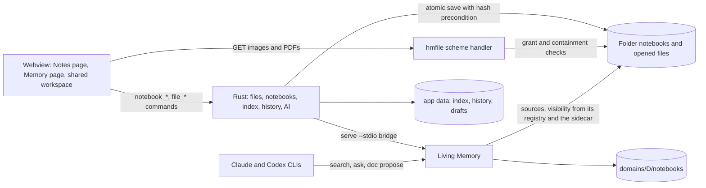

# Notes Studio: shared decisions and contracts

Notes Studio (roadmap item NOTES-1) adds notebooks to Hivemind: a Notes page with folder notebooks and Living Memory notebooks, rich Markdown and `.hmdoc` pages, Notepad++-style editing of any file, search with semantic matching, history, notebook features (daily notes, tasks, queries, canvases), AI actions and agent sessions, and import and export. It is built in 23 phases, NS-0 to NS-9B, across this repository and `agentic-living-memory`.

**How to use these documents.** Read this file first, then your phase's document. This file holds what every phase shares: decisions, architecture, contracts, conventions and how to verify. Where a phase document and this file disagree about a shared name or shape, this file wins; report the conflict. Documents cite files by path plus an anchor string, not line numbers. If an anchor is gone, find its successor before changing anything, and say so in your report. The general conventions in [../plans/README.md](../plans/README.md) sections 4 to 6 still apply, except where section 4 below changes them.

## 1. Decisions (the user, 2026-11-20; do not reopen)

| Topic | Decision |
| --- | --- |
| Notebook kinds | **Folder notebook**: any folder the user picks, including an Obsidian vault; plain files are the only source of truth. **Living Memory notebook**: inside any Living Memory domain, or in a notebook-only domain with no folder binding |
| Workspace | One shared tab and pane workspace (up to 3 panes) on the Notes page. The memory tree and the notebook tree are two navigators over the same open documents. This supersedes decision 2 of `../plans/README.md` ("only notes are tabs") |
| Any file | Open any file: open dialog, drag and drop, recent files, Windows file association and "Open with Hivemind", which opens the file in the running instance |
| Folder metadata | Sidecar `.hivemind/notebook.json` inside the notebook, written only when the user changes order, icons, pins or settings |
| History | A snapshot of every save in Hivemind's app data (100 versions or 90 days per page, pinned versions kept), plus the git timeline and a Commit button for notebooks in a git repository. Living Memory pages use Living Memory's journal |
| Living Memory storage | A separate record kind, not notes: `domains/D/notebooks/<nb>/...`, pages stored byte for byte, its own `doc` commands, journal, undo, backup, Obsidian sync and an attachment store. Review, staleness, maintenance, SessionStart and the wiki never see pages |
| Agent reach | Per notebook, for both kinds: **hidden**, **searchable** (the default: agents' `alm search` and `alm ask` return its paragraphs) or **injectable** (Living Memory adds labelled excerpts to prompts, after notes) |
| Agent writes | Agents outside Notes Studio may only stage page edits: `alm doc propose` for a Living Memory notebook, `alm doc propose --file PATH` for a page of a folder notebook (every agent session is refused a direct Edit or Write on one, with a pointer to `doc propose --file`; shell writes are not covered). The user accepts, merges or rejects each in the Inbox's Pages group (`alm proposals`). Accepting a folder page writes the file through Living Memory, which keeps its line endings and never overwrites a save made meanwhile; Hivemind keeps the page before and after in its file history, so a change can be restored. A notebook with edits waiting says "N agent edits" in the tree |
| Privacy | AI is on by default. **Private** blocks every Hivemind AI feature for the notebook and every Living Memory search and injection path. It is not file protection: an agent whose working folder contains the notebook can read it with its own tools |
| Rich Markdown | Both a much richer CodeMirror live preview (images, tables, callouts, Mermaid, math, embeds, code, footnotes, links, toolbar, slash menu) and a WYSIWYG mode on Tiptap whose serializer keeps untouched blocks byte-identical |
| `.hmdoc` | A rich JSON page format for folder notebooks only: power tables, layout and styling, typed live embeds (never iframes), Excalidraw, freehand ink, free-positioned blocks |
| Power editing | Encodings and line endings kept and convertible; multi-cursor, rectangular selection, line tools, recordable macros; large files (view, search, tail, hex; never editable above about 64 MB); compare any two files; find and replace in files |
| Notebook features | Daily notes and templates; a target switch in Quick capture (Memory note, Today's page, notebook Inbox); a Tasks view across notebooks and Living Memory action items; typed properties and saved queries; JSON Canvas boards |
| Search | A derived SQLite FTS5 index in app data (rusqlite, bundled), rebuildable from files, plus semantic search that reads Living Memory's installed model2vec model in Rust. Living Memory pages are searched through Living Memory. Results are grouped by origin; scores from different origins are never compared |
| Links | Obsidian style `[[Page]]`, resolved in the same notebook, then other notebooks, then memory notes. An ambiguous link gets a picker that writes `[[Notebook/Page]]` or `[[mem:Title]]` |
| AI | Selection and page actions with a diff to accept, edit or reject; Ask a notebook with citations; a background suggestions rail; Save to memory through Executive Capture with links both ways |
| Agent sessions | On folder notebooks only: the agent works in a staged copy tracked by a hidden git repository; the Review page shows its diff; "Apply to notebook" writes the files the user accepts, merging and snapshotting first |
| AI engine and budget | Claude (`oneshot.rs`) or Codex (`codex exec --output-schema`), chosen per action kind, default Claude. `notes_daily_usd` defaults to 2 USD with per-action caps; background suggestions stop at 25% of the day's cap |
| Interop | Obsidian vaults as notebooks; import Evernote ENEX, Notion export zips and OneNote desktop exports (`.mht`, `.docx`); export PDF, DOCX and HTML; paste conversion from browsers and Word. No web clipper |
| Order | Foundation and Living Memory notebooks, then rich editing, search and links, history, power editing, notebook features, AI, interop |
| Delivery | This folder first. Then each phase straight to main: commit, a read-only Codex review of the new commits, fixes in their own commit with regression tests, push |
| Platforms | Windows 11 only; keep code portable and report macOS and Linux as untested |

## 2. Not in scope for any phase

- A Hivemind database of record. The SQLite index is derived and can be deleted at any time.
- Sync, accounts, sharing, multi-user editing, a plugin API, Office or OneNote fidelity, a browser extension or web clipper.
- Writing Living Memory store files directly. Every Living Memory change goes through Living Memory commands.
- Editing files over about 64 MB, or binary files.
- Microsoft Graph or any other cloud import.

## 3. Architecture

The diagram shows who owns what and the only paths that write.



Principles:
- Living Memory is the only writer of its store. Hivemind never writes under the store root.
- The webview never touches the disk. Every file access is a Rust command that checks a registered notebook or a grant, or the `hmfile` scheme handler.
- Files are the source of truth. Anything Hivemind derives (index, snapshots, drafts) can be rebuilt or dropped without losing a page.
- AI and agent output is a proposal. A whole-page result applies only if the page still has the hash or revision captured with it. A selection result applies if its anchor text is still in the page; it is then saved through the normal session save against the latest base, so an outside change is merged, never overwritten.

## 4. Conventions that differ from `../plans/README.md`

- **Trust model.** Hivemind protects against its own mistakes, against links and junctions planted inside a notebook, and against agents that Living Memory governs through its hooks. It does not try to stop another process of the same Windows user that can already write the files. Living Memory's `--actor` flag is self-declared, so it is never a security boundary: agents are told apart only by Living Memory's PreToolUse hook and by `HIVEMIND_SESSION` inside Hivemind terminals. Private notebooks follow from this: Living Memory never offers their content to agents, but an agent can still read files it can reach (decision table, Privacy). In the same way, "agents may only propose" covers Living Memory commands and agents' structured file tools (edit, write); a shell command an agent runs can write any file the user can, including a notebook folder or a vault, and no hook sees it. Saves replace a file by renaming a new one into place, so a hard link inside a notebook never lets a save change another file's bytes.
- **Git:** work on `main`. Per phase: commit (each commit builds and passes tests), run a read-only Codex review of the new commits, fix what holds in its own commit with regression tests, then push. Record the shipped commits in the phase document's "Shipped" section.
- **Gates:** every phase that depends on a Living Memory feature checks it through `src/lib/connection.ts` (a `version` capability or a command name), so an older Living Memory still runs the app.
- **Memory must not change.** `src/workspace/store.test.ts` passes without edits in every phase, and each phase ends with a `scripts/drive_ui.py` pass over the Memory library: open a note, edit, save, force a merge, split, open the rail.
- **Lazy chunks:** every large editor dependency (Tiptap, KaTeX, pdf.js, Excalidraw, mammoth, docx) is loaded with a dynamic `import()`, as `src/ui/Mermaid.tsx` loads mermaid.
- **Colours:** a new colour token needs a value in all three theme blocks of `src/App.css`, and `src/lib/theme.test.ts` must pass.
- **Dependencies:** only MIT, Apache, BSD, ISC or MPL compatible licences. No Tiptap Pro package, and never `@tiptap/extension-unique-id` (it rewrites every node, which breaks the untouched-block check). `jszip` is avoided for its GPL option; `fflate` replaces it if needed. Living Memory stays standard-library only. Each phase adds only the dependencies in its row:

| Phase | New dependencies | Measured or estimated cost |
| --- | --- | --- |
| 1B | `encoding_rs`, `chardetng`; `windows-sys` (direct, features `Win32_Storage_FileSystem` for `ReplaceFileW`) | Licences checked in S7; about 0.3 to 0.5 MB exe (estimate) |
| 3A | `katex` | Lazy; about 0.6 MB with fonts (estimate) |
| 3B | `@tiptap/core`, `pm`, `react`, `starter-kit`, `extension-table`, `extension-list`, `extension-image`, `extension-highlight`, `extension-text-style`, `extension-placeholder`, `extension-drag-handle`; `unified`, `remark-parse`, `remark-gfm`, `remark-frontmatter`, `remark-math`, `mdast-util-to-markdown` | Lazy; 193 KB gzipped measured in S3 |
| 3D | `pdfjs-dist`, `@excalidraw/excalidraw`, `perfect-freehand` | Lazy; several MB (estimate) |
| 4A | `rusqlite` with `bundled` | About 1.7 MB exe and a 22 s clean build, measured in S4 |
| 4B | `unicode-normalization`, `unicode-general-category` | Measured in S5 |
| 5, 6B | `flate2` (already transitive), `ignore`; `regex` (direct, NS-6B search and replace) | About 0.2 MB (estimate) |
| 7B | `yaml` | About 100 KB (estimate) |
| 9A | `dompurify`, `turndown`, `turndown-plugin-gfm`, `docx`, `webview2-com` pinned to the version Tauri resolves | Lazy |
| 9B | `mammoth`, `zip`, `quick-xml` (transitive) | Lazy; about 0.3 MB exe (estimate) |

## 5. Contracts between phases

A phase may add fields and commands. It may not rename or reshape what is listed here.

### 5.1 Documents and tabs (NS-1A)

```ts
// src/workspace/store.ts
export type TabKind = "note" | "new-note" | "file" | "new-file" | "doc";
export interface FileRef { notebook: string; path: string }   // a page in a folder notebook; path relative, forward slashes
export interface GrantRef { grant: string }                    // a loose file opened from disk (NS-1B)
export interface DocRef { domain: string; notebook: string; path: string }  // a Living Memory page (NS-2C)
// Tab gains: file?: FileRef | GrantRef; doc?: DocRef
```

- `docKey(tab)` (pure, `src/documents/keys.ts`): `note:<ref>`, `file:<notebook>:<path>`, `doc:<domain>:<notebook>:<lowercased path>`. A file key keeps the path's letter case, as on disk: in a case-sensitive folder `A.md` and `a.md` are two files (changed in the NS-1B code review, W1; `drafts::file_key` matches). A loose file's notebook is `@<grant id>` (NS-1B). Living Memory page names are unique ignoring case, so `doc:` keys stay lowercased. `sameTab` compares kind family and `docKey`; note behaviour is unchanged.
- A file the user opens from disk that lies inside a registered notebook becomes a `FileRef`, never a `GrantRef`, so one file has one key.
- `showTab(tab)` replaces `showNotes()`: if the current route already shows the workspace (Notes, or Memory with view `notes`), stay; otherwise note kinds go to Memory exactly as today and file and doc kinds go to Notes.
- Persistence: `hivemind.workspace` version 3. Version 1 migrates through `notesOnly` as today; version 2 is kept; tabs of unknown kinds are dropped on load; `new-note` and `new-file` tabs are not persisted. A build that only knows version 2 runs `notesOnly` on version 3 data and keeps the notes.

### 5.2 Document session controller (NS-1A)

`src/documents/session.ts` is a pure state machine per `docKey`: `loading`, `clean`, `dirty`, `saving`, `stale` (text merge), `conflict` (keep mine, keep theirs, save both), `readOnly(reason)`, `error`. `src/documents/useDocument.ts` binds it to React; two tabs on one document share one session and one dirty flag. Adapters:

| Adapter | Read | Save precondition | On a stale save |
| --- | --- | --- | --- |
| `file` (folder pages, loose files) | `file_read` | `{ sha256, size, mtimeMs }` of the bytes loaded | Text: `mergeBody` from `src/features/editor/merge.ts`. `.hmdoc`, `.canvas`: keep mine, keep theirs, save both |
| `lmdoc` (Living Memory pages, NS-2C) | `doc read` | `{ revision }` (sha256 of the page bytes) | Same text merge, then `doc write --expected-revision <theirs>` |

Memory notes keep their own path (`NoteEditor.tsx`, `save.ts`, `MergeDialog.tsx`) and do not use the controller.

Drafts: keys `file-<sha256(docKey)>` and `doc-<sha256(docKey)>` (hashed, so paths never collide or overflow the 200-character key limit of `drafts.rs`). A file draft stores `{ key, kind, target, precondition, base?, mine, format, savedAt }`; `base` is left out above 2 MB. A note draft keeps today's shape (no `kind`). `drafts.rs` gains a 32 MB cap. Autosave of drafts waits 1 s under 256 KB and 5 s above, and stops above 16 MB with a banner. A draft is taken only for the page its `target` names. A draft lookup that fails keeps the page from opening (it would otherwise write over the draft it could not see), and a damaged draft file is moved aside (`.json.damaged-<ms>`), never reported as missing. A page that is gone or read-only shows its draft beside it, to save as a copy or discard; a read-only page takes the draft back once the file can be edited. A rename copies the drafts to their new keys before the files move and removes the old ones after, so a move whose drafts cannot follow does not happen. At start, drafts filed under the lowercased keys used before NS-1B's review move to their page's key (`drafts::migrate`).

### 5.3 File service (NS-1A, encodings in NS-1B)

- One containment helper, `resolve_inside(root, rel, for_write)` in `src-tauri/src/files/contain.rs`: a forward-slash relative path whose every part is a plain name (no empty part, `.` or `..`, no `:` for alternate data streams, no `\`, no Windows device name such as `CON`, `con.txt` or `COM1`, no trailing dot or space, at most 240 characters); the canonical form of the deepest existing part must start with the canonical root. For a write, no part below the root may be a symbolic link or junction (a name-surrogate reparse point; other reparse points such as OneDrive placeholders are ordinary files, so notebooks in OneDrive stay writable). It replaces the ad hoc pattern of `archsuite.rs` (`fn inside`) and `review.rs` (`fn canonical`) for new code; those files are not changed.
- Checks happen at use: every command validates the notebook id, resolves the path and checks it inside the same blocking call that then acts, never earlier.
- **Protected targets** (`files::guard`, NS-1A, used by every operation that writes, in every later phase, including loose files, attachments, history restore, git, import, export, folder replace and session apply): after resolution, refuse the Living Memory store root and everything under it, every Obsidian vault Living Memory manages (from each domain's `sync-state.json`, or a `.living-memory/vault.json` or `copies.json` marker in the folder or an ancestor), and the reserved names `.git`, `.obsidian` and `.hivemind` (the file service itself writes only the sidecar and the trash there). Reads have three narrow exceptions, each enforced where it is used: a Living Memory notebook's `assets` folder through its read-only grant (NS-2C), the vault settings reader for `.obsidian/*.json` (NS-9A), and a loose file inside a protected place, which opens read-only (NS-1B).
- Reads: refuse above 64 MB (larger files go to the large-file viewer in NS-6B); NUL in the first 8000 bytes means binary. Return `{ text, sha256, size, mtimeMs, format: { encoding, bom, eol }, readOnly?: reason }`.
- Saves (`files::atomic::Held`): lock per path inside Hivemind; open the target with read and delete access, sharing only reading, so no other program can write, rename or delete it while Hivemind holds it; hash through that handle and refuse with `Stale { sha256 }` if it differs from the precondition; write a hidden temp file beside the target (`.<name>.hm-<uuid>.tmp`) and `sync_all` it; rename the held target aside through its own handle (`.<name>.hm-old-<uuid>.tmp`); move the temp file to the target name without replacing anything that may have appeared there; delete the old file. If the open finds another program writing the file (a sharing violation, retried briefly for scanners), the save fails with "<name> is in use by another program; try again" and the editor stays dirty. Guarantee: Hivemind only ever replaces the exact bytes its precondition names. Loose files outside notebooks use `ReplaceFileW` so the file keeps its ACLs and attributes. A read-only file is refused and "Save as" is offered. Encoding, BOM and line endings come back in `format` and are applied on save (NS-1B). The temp-file pattern is ignored by the watcher and the indexer.
- Echo suppression: the watcher drops an event whose file now hashes to the last hash Hivemind wrote there.
- Delete moves to `.hivemind/trash/<timestamp>/<path>` inside the notebook; loose files go to the Windows Recycle Bin.

### 5.4 Notebooks (NS-1A)

- Registry: `app_data/notebooks.json`, `{ "version": 1, "notebooks": [{ "id": "nb-<8 hex>", "path": "<plain absolute>", "title": "...", "added": "<iso>" }] }`. Only the native folder dialog adds an entry (the pattern of `folder_pick` in `src-tauri/src/lib.rs`). Folder identity is the canonical path converted with `folders::plain` and compared in lowercase. It is not part of `settings.json`, so `save_settings` cannot change it. Living Memory notebooks are not registered here; Hivemind lists them from Living Memory (NS-2C).
- Refusals at registration: the Living Memory store root, anything inside it, or any folder that holds it; a folder that is, holds or lies inside an Obsidian vault that Living Memory manages (`files::guard`); a folder inside or containing an already registered notebook. Every command checks the notebook again against the current store root, so switching Hivemind to another store blocks a notebook that now overlaps it.
- On registration (and from NS-2B on every change of reach), Hivemind records the notebook's reach in Living Memory's folder policy registry (`doc folder set`, NS-2C), so Private and Hidden take effect even when the sidecar cannot be written.
- Sidecar `.hivemind/notebook.json` (version 1). Unknown keys are kept on write. Read-only folders keep the same JSON in `app_data/notebook-meta/<id>.json`.

```json
{
  "version": 1,
  "order": { "": ["Inbox.md", "Projects"], "Projects": ["Roadmap.md"] },
  "icons": { "Projects": "folder-kanban" },
  "pinned": ["Inbox.md"],
  "visibility": "searchable",
  "private": false,
  "attachments": "assets",
  "templates": "Templates",
  "daily": { "folder": "Daily", "format": "YYYY-MM-DD", "template": null },
  "inbox": "Inbox.md",
  "ai": { "engine": {} }
}
```

- Tree rules: subfolders are sections; a page `X.md` with a sibling folder `X/` holds subpages; `.hivemind`, `.git`, `.obsidian`, `node_modules` and dot-folders are hidden; the attachments folder shows under its own heading. Order not listed in `order` is alphabetical, folders first.
- Hivemind never writes inside `.obsidian`.

### 5.5 The `hmfile` scheme (NS-1B)

`src-tauri/src/assets.rs` registers an asynchronous URI scheme `hmfile`, served on Windows as `http://hmfile.localhost/<grant>/<percent-encoded relative path>`. A grant is an opaque id Rust creates for a folder notebook root, a Living Memory notebook's `assets` folder, or the folder of an opened loose file. The handler is the only gate (capabilities do not cover scheme handlers): webview label `main`; an `Origin` (when sent) equal to one of the app's exact origins (`http://tauri.localhost` in production, the dev server origin in `tauri dev`); GET or HEAD; a known, unrevoked grant; the path percent-decoded once and then checked with `resolve_inside` and `files::guard`; extension in png, jpg, jpeg, gif, webp, avif, bmp, ico, svg, pdf; size cap 50 MB. Grants are revoked when their notebook is removed or their recent-file entry is forgotten or evicted. It answers Range requests (pdf.js) and CORS for the app's exact origins (`Access-Control-Allow-Origin` with that origin, `Access-Control-Expose-Headers: Content-Range, Accept-Ranges, Content-Length`), sets `Content-Type` from the extension, `X-Content-Type-Options: nosniff` and an ETag; SVG also gets `Content-Security-Policy: default-src 'none'` and is only shown through ``. The CSP in `tauri.conf.json` gains `http://hmfile.localhost` in `img-src` and `connect-src`, and `worker-src 'self'`.

### 5.6 Opening files from outside (NS-1B)

`instance.rs` protocol version 2: the knock is the token, a newline, then JSON `{ "v": 1, "id": "<uuid>", "open": ["<absolute path>"], "cwd": "<dir>" }`, at most 64 KiB, ended by closing the write side as today. A token-only knock still only raises the window, so old and new builds interoperate. The running instance answers only after the paths are in the `OpenQueue` (deduplicated by `id`, so a resent knock never opens twice); the starting process waits up to 5 s, as the current waiter does at startup, then falls back to raising the window. The frontend subscribes to `open-requested` before it drains with `open_pending()`, so nothing arrives between the two. Every opened or dropped path becomes a grant in `src-tauri/src/opens.rs` (`app_data/open-files.json`, the 200 most recent). A grant id is the first 16 hex characters of the sha256 of the normalised path, so reopening a file gives the same key. `tauri.conf.json` associates `.md`, `.markdown`, `.hmdoc` and `.canvas`; an NSIS installer hook registers "Open with" for any file with `MultiSelectModel=Player`.

### 5.7 Tauri commands and events

Names are fixed here; signatures are set by the phase that adds them.

| Phase | Commands | Events |
| --- | --- | --- |
| NS-1A | `notebooks_list`, `notebook_add`, `notebook_remove`, `notebook_rename`, `notebook_tree`, `notebook_meta_get`, `notebook_meta_set`, `file_read`, `file_save`, `file_create`, `file_mkdir`, `file_rename`, `file_delete`, `file_reveal` | `files-changed { notebook, paths }` |
| NS-1B | `open_dialog`, `open_pending`, `open_recent`, `open_forget` | `open-requested` |
| NS-2C | (Living Memory `doc` commands go through `lm`) | `docs-changed { domain, notebook }` |
| NS-4A | `index_search`, `index_links`, `index_status`, `index_rebuild`, and added by the phase `index_incoming`, `index_pages`, `index_tags` | `index-progress` |
| NS-5 | `history_list`, `history_read`, `history_pin`, `git_file_log`, `git_file_commit` | |
| NS-6A | `file_reopen` | |
| NS-6B | `bigfile_open`, `bigfile_lines`, `bigfile_search`, `bigfile_bytes`, `bigfile_find_bytes`, `bigfile_close`, `replace_preview`, `replace_apply`, `replace_undo` | `bigfile-progress`, `bigfile-grew` |
| NS-7A | `notebook_append`, `obsidian_setting` | |
| NS-8A | `notes_ai_run`, `notes_ai_cancel`, `notes_ai_status` | `notes-ai-changed` |

### 5.8 Living Memory pages (NS-2A, NS-2B)

The full contract is in `agentic-living-memory/docs/notebooks-design.md`. What Hivemind relies on:
- `doc` commands with JSON output; a page's revision is the sha256 of its bytes; `doc write --expected-revision R` fails with code `stale` (exit 6) like `update`.
- Bodies never make a bridge frame too large (`serve` refuses frames over 2 MiB and stdin payloads over 1 MiB): the bridge measures the encoded frame and the JSON-escaped stdin, and any body whose escaped form exceeds 512 KiB is written to `app_data/lm-staging/<uuid>.md`, passed as `--body-file`, and deleted after the reply.
- Private notebooks need `--include-private` on every read, search and history command; Hivemind's bridge passes it, Living Memory's hook refuses it to agents.
- `version` reports `capabilities.docs = { version, max_page_bytes, max_asset_bytes }` from NS-2A and `docs.search: true`, `docs.folder_policy: true` from NS-2B; Hivemind gates on them (`useDocsEnabled`, `useDocsSearch`).
- `domains` reports `kind: "notebook"` for notebook-only domains; Memory's domain pickers skip them.
- `search` and `ask` return notebook paragraphs of both kinds in a separate `pages` array with `origin: "lm" | "folder"`; `results`, `notes` and `sources` keep their meaning, and folder notebook excerpts no longer appear in `sources`.

### 5.9 AI settings and ledger (NS-8A)

`settings.rs` gains `notes_daily_usd` (default 2.0), `notes_call_usd` (per action, clamped by `per_call`) and `notes_engine` (per action, `claude` or `codex`, default `claude`). Notes AI uses its own ledger `app_data/notes-spend.json` (the `learning.rs Ledger` with a label). Background suggestions reserve only while the day's spend is under 25% of the cap.

### 5.10 Shortcuts

Taken today: Ctrl+P, Ctrl+O (Shift ignored), Ctrl+N, Ctrl+G, Ctrl+Shift+A, Ctrl+W, Ctrl+K and Ctrl+Shift+F (Topbar search), Ctrl+Tab, Ctrl+\, Ctrl+E, Ctrl+S, Ctrl+Shift+C on the Executive page. Notes Studio adds no new global chord in NS-1A to NS-1B: Ctrl+N makes a new page when the Notes page is showing and a new note elsewhere; Ctrl+O lists pages and recent files beside notes and offers "Open file from disk"; Ctrl+K and Ctrl+Shift+F search pages on the Notes page. Editor-local keys (multi-cursor, macros, toolbar) are bound inside CodeMirror or Tiptap and listed in each phase document.

## 6. Phases

| Phase | Repo | Document | Depends on |
| --- | --- | --- | --- |
| NS-0 Design docs and spikes | both | [phase-0-spikes.md](phase-0-spikes.md), `agentic-living-memory/docs/notebooks-design.md` | |
| NS-1A Shared workspace, Notes page, folder notebooks | Hivemind | [phase-1a-workspace.md](phase-1a-workspace.md) | NS-0 |
| NS-1B Open any file | Hivemind | [phase-1b-open-any-file.md](phase-1b-open-any-file.md) | NS-1A |
| NS-2A Living Memory doc records | Living Memory | `agentic-living-memory/docs/notebooks-design.md` | NS-0 |
| NS-2B Page search, agent reach, sync | Living Memory | `agentic-living-memory/docs/notebooks-design.md` | NS-2A |
| NS-2C Living Memory notebooks in Hivemind | Hivemind | [phase-2c-lm-notebooks.md](phase-2c-lm-notebooks.md) | NS-1B (asset grants), NS-2A; NS-2B for the reach settings |
| NS-3A Rich live preview | Hivemind | [phase-3a-live-preview.md](phase-3a-live-preview.md) | NS-1B, NS-2C (Living Memory page embeds and attachments) |
| NS-3B WYSIWYG mode | Hivemind | [phase-3b-wysiwyg.md](phase-3b-wysiwyg.md) | NS-3A |
| NS-3C `.hmdoc` core | Hivemind | [phase-3c-hmdoc.md](phase-3c-hmdoc.md) | NS-3B |
| NS-3D `.hmdoc` embeds and drawing | Hivemind | [phase-3d-embeds-drawing.md](phase-3d-embeds-drawing.md) | NS-3C |
| NS-4A Index, links, search | Hivemind | [phase-4a-index-search.md](phase-4a-index-search.md) | NS-3C; NS-2B for Living Memory pages (gated on the `docs.search` capability) |
| NS-4B Semantic search | Hivemind | [phase-4b-semantic.md](phase-4b-semantic.md) | NS-4A |
| NS-5 History | Hivemind | [phase-5-history.md](phase-5-history.md) | NS-1B (loose files), NS-2C (Living Memory pages) |
| NS-6A Power editing | Hivemind | [phase-6a-power-editing.md](phase-6a-power-editing.md) | NS-1B |
| NS-6B Large files, replace in files | Hivemind | [phase-6b-large-files-replace.md](phase-6b-large-files-replace.md) | NS-5 |
| NS-7A Daily notes, templates, capture | Hivemind | [phase-7a-daily-capture.md](phase-7a-daily-capture.md) | NS-2C |
| NS-7B Tasks, properties, queries | Hivemind | [phase-7b-tasks-queries.md](phase-7b-tasks-queries.md) | NS-4A |
| NS-7C Canvas boards | Hivemind | [phase-7c-canvas.md](phase-7c-canvas.md) | NS-4A |
| NS-8A AI engine and actions | Hivemind | [phase-8a-ai-actions.md](phase-8a-ai-actions.md) | NS-5, NS-2C (Private for both notebook kinds) |
| NS-8B Ask, suggestions, save to memory | Hivemind | [phase-8b-ask-suggest-memory.md](phase-8b-ask-suggest-memory.md) | NS-4B, NS-8A |
| NS-8C Agent sessions on notebooks | Hivemind | [phase-8c-agent-sessions.md](phase-8c-agent-sessions.md) | NS-5, NS-2C |
| NS-9A Obsidian vaults, paste, export | Hivemind | [phase-9a-obsidian-export.md](phase-9a-obsidian-export.md) | NS-3D |
| NS-9B Importers | Hivemind | [phase-9b-importers.md](phase-9b-importers.md) | NS-9A, NS-7B (saved queries for Notion databases) |

A phase may start when its dependencies have shipped; a feature that needs a phase not listed is gated off and its exit criterion moves to that phase. Three items run earlier than the user's order because later work needs them: a minimal link resolver (NS-1A), encoding preservation (NS-1B, needed to save opened files safely), and the `.obsidian` and Living Memory vault protections (NS-1A).

## 7. Running and verifying

Use `../plans/README.md` section 6 (demo store, environment variables, `scripts/drive_ui.py`). In addition:
- Close any running Hivemind before `npm run tauri dev`: every build shares the identifier `dev.hivemind.app` and the single-instance lock makes a second copy exit.
- Use a scratch folder notebook for UI checks, never one of the user's folders. A dev run still writes drafts, snapshots and the index under the real `%APPDATA%\dev.hivemind.app`; remove what the test created.
- File association checks need an installed build (`npm run tauri build`, then the NSIS installer); `tauri dev` cannot test them.
- Live tests that start a model (`HIVEMIND_TEST_CLAUDE`, Codex) cost money and need the user's approval first.

## 8. What every phase reports

- What was built, what was verified in the running app, and what was not.
- Anything in its document that turned out wrong, and what was done instead (and update the document).
- Side effects outside the repository (files left in app data, a Living Memory install).
- What was recorded in Living Memory, and the roadmap item ticked (`NS-<phase>`).
