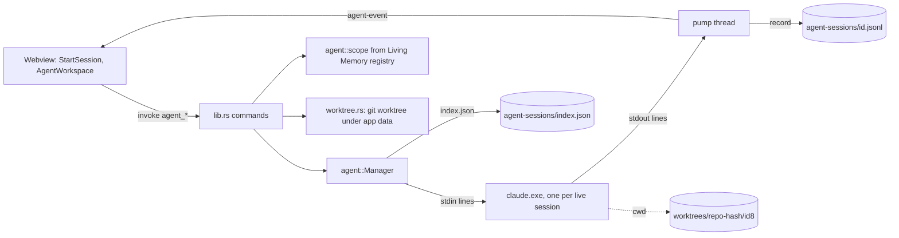
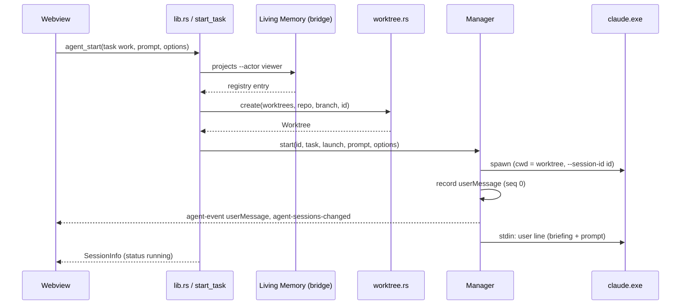
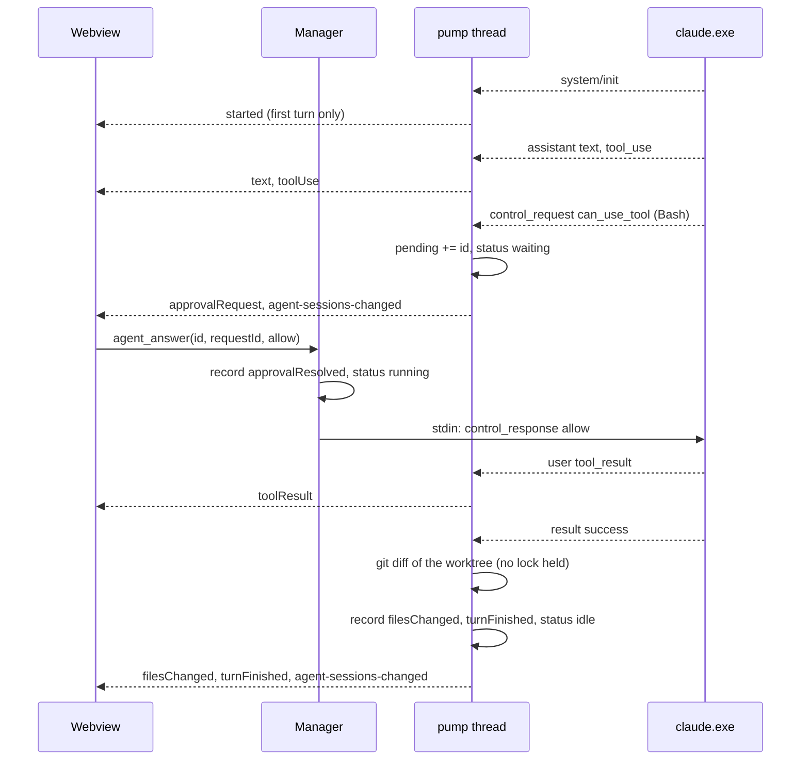
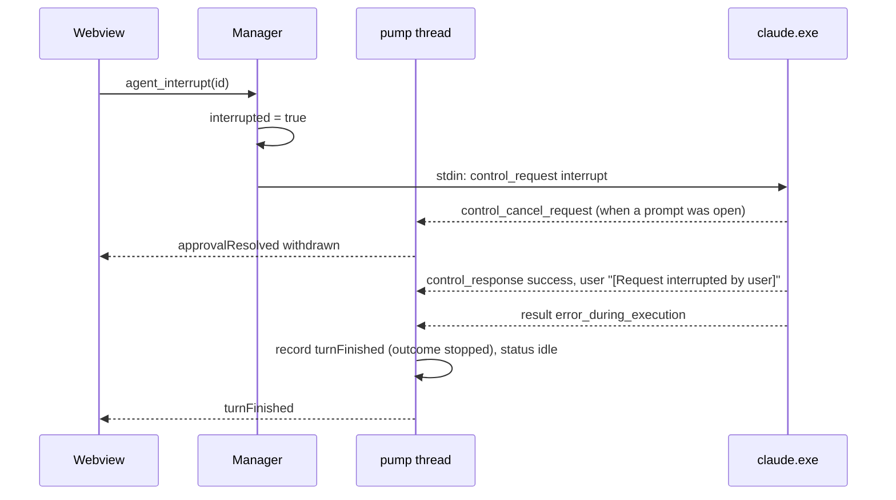
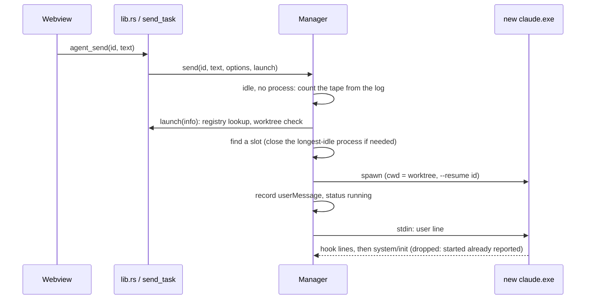
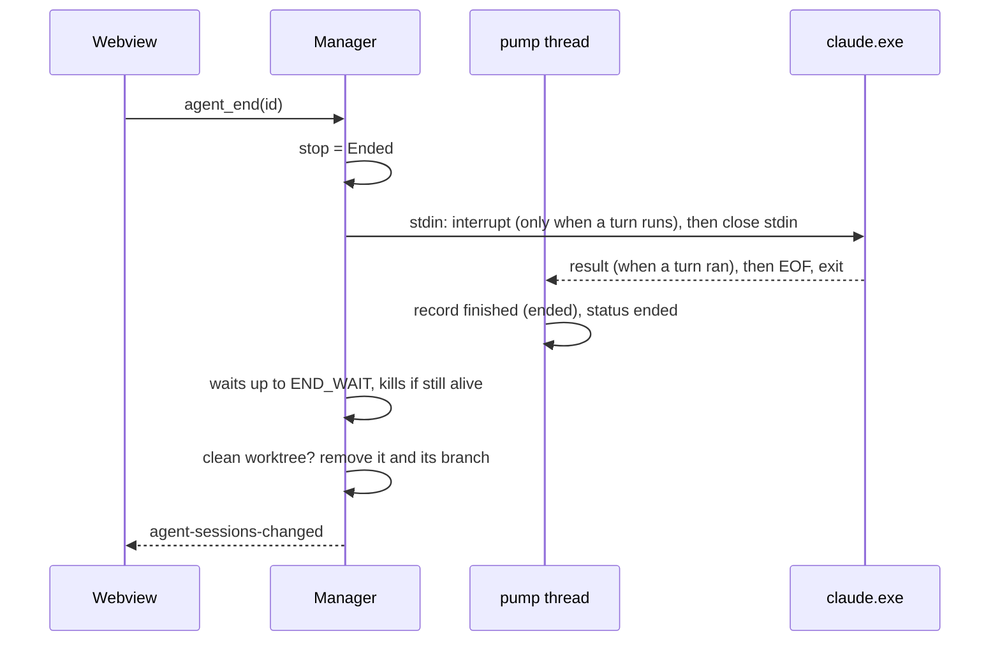

# Phase 2: Interactive agent sessions

Read [README.md](README.md) first. Its section 1 (decisions) and section 7 (contracts) are binding; this document goes deeper and never renames what the README lists. The verified CLI behaviour is in [spikes/claude-headless.md](spikes/claude-headless.md); the lines this phase depends on are copied into section 5 below.

Branch: create `feat/interactive-sessions` from `feat/mock-ux`. One session implements the whole phase.

---

## 1. Goal, mock screens, non-goals

### 1.1 What the user gets

Today Hivemind can start one unattended, one-prompt Claude Code run for one task kind (generate a system passport). After Phase 2 the user can:

1. Open **Start a session** (mock 02), write a task, pick a repository and a start branch, pick how permissions work, check the briefing, and start.
2. **Chat** with the agent (mock 03): send messages, watch tool calls, answer permission prompts in the app, see which files the agent changed after each turn, read the diff, stop a turn, end the session.
3. Come back later, even after restarting Hivemind, and continue the same conversation.
4. Reach the Start screen from Overview, a note, the Memory library and Architecture, with the right context already attached.

Every interactive session works in its own git worktree on its own branch, so the user's checkout is never touched.

### 1.2 Mock screens

The mocks are PNG files in the `hivemind-mocks` folder beside the repository (README section 6). Ignore the wordmark in them; the product is "Hivemind".

| Mock | What Phase 2 takes from it |
| --- | --- |
| `02_Start_Agent_Session.png` | The whole screen, minus the Engine and Interface controls (Phase 5). |
| `03_Agent_Workspace_Chat.png` | The whole screen, minus the Chat / Terminal switch (Phase 5) and the paperclip (no attachments). |
| `01_Project_Overview.png` | The green "Start a session" button; "Resume session" on the "Continue your work" card. |
| `09_Decision_Note.png` | The green "Use in agent session" button. |
| `08_Memory_Library.png` | "Add to agent context" in the preview. |
| `07_Architecture_Diagram_Viewer.png` | "Discuss with agent" in the header; "Attach to agent context" in the inspector. |

### 1.3 Non-goals

- Codex, and the Engine control (Phase 5). The adapter stays Claude Code only.
- The Terminal interface and the Chat / Terminal switch (Phase 5).
- Changes and change numbers (Phase 3). `task.change` and the draft's `change` exist in the types and are always empty.
- The Review page, Approve, Request changes, Discard (Phase 4). Phase 2 shows a read-only diff.
- Token-by-token streaming. Assistant text arrives one content block at a time (`--include-partial-messages` is not passed).
- File or image attachments in the composer (the mock's paperclip).
- Pushing, merging, or switching branches. The worktree branch is only created and, when unused, deleted.
- Deleting sessions from the history by hand.
- Any change to the unattended "Generate with agent" flow. It must behave exactly as today.

### 1.4 What this phase assumes

Phase 1 is the code on `feat/mock-ux`. Nothing from Phases 3 to 5 exists. Run this preflight before changing anything; every line must print a match.

```sh
git grep -n "pub const MAX_RUNNING: usize = 1" -- src-tauri/src/agent/mod.rs
git grep -n "drop(stdin);" -- src-tauri/src/agent/mod.rs
git grep -n "pub trait Adapter" -- src-tauri/src/agent/mod.rs
git grep -n "fn failure(subtype" -- src-tauri/src/agent/claude.rs
git grep -n "pub enum AgentTask" -- src-tauri/src/agent/scope.rs
git grep -n "pub fn load_index" -- src-tauri/src/agent/store.rs
git grep -n "pub fn run_with_timeout" -- src-tauri/src/git.rs
git grep -n "tauri::generate_handler!\[" -- src-tauri/src/lib.rs
git grep -n "export type Route =" -- src/store.ts
git grep -n "export function apply(" -- src/features/agents/events.ts
git grep -n "export function Transcript" -- src/features/agents/AgentWorkspace.tsx
git grep -n "function AgentActions(" -- src/features/systems/ArchitecturePage.tsx
git grep -n "export function DiffView" -- src/features/plans/PlanDialog.tsx
git grep -n "export function buildBriefing" -- src/features/projects/briefing.ts
git grep -n "export function NotePicker" -- src/features/plans/NotePicker.tsx
git grep -n "Still true" -- src/features/editor/NoteTab.tsx
git grep -n "Open to the side" -- src/features/library/MemoryPage.tsx
git grep -n "export function systemsForProject" -- src/features/projects/scope.ts
```

Also check the tools: `claude --version` prints 2.1.322 or newer; `git --version` prints 2.17 or newer (the commands in section 5.2 were run on 2.56.0.windows.4); `npm test`, `npx tsc --noEmit`, and `cargo test` plus `cargo clippy` in `src-tauri` are green before you start.

### 1.5 Prerequisite: the runner has never met the real CLI on this branch

The agent runner in `src-tauri/src/agent/` is tested only with a fake adapter. It has not been run against a real Claude Code from inside the app on this branch; the user postponed that. Step 0 of the commit sequence (section 8) is therefore a short real unattended run from the app, and a real two-turn interactive run from a script in a scratch git repository. Do not build UI on top of the runner before step 0 passes. Step 0 also settles the five UNVERIFIED blocks about the CLI in this document (two in section 4.9, three in section 5.1), and it must not touch the user's real Living Memory store: before any real run, `LIVING_MEMORY_ROOT` is set to a demo store and the real store is checked for changes (section 8, step 0).

---

## 2. Decisions already made

Do not reopen these.

| Date | Decision |
| --- | --- |
| 2026-11-10 | Everything in README section 1 (sections are pages, only notes are tabs; dark only; one phase per session). |
| 2026-11-10 | One long-lived `claude -p --input-format stream-json --output-format stream-json` process per interactive session. Stdin stays open between turns. |
| 2026-11-10 | Permission prompts are answered by Hivemind over stdin/stdout: `--permission-prompts host` together with the hidden `--permission-prompt-tool stdio`. |
| 2026-11-10 | Interactive sessions run in a git worktree under the app data folder, on a branch `hivemind/<first 8 of the session id>`. Module `src-tauri/src/worktree.rs`. |
| 2026-11-10 | Names and shapes of `AgentTask`, the new `SessionInfo` fields, `Status`, the new `RunEvent` variants, the commands `agent_send`, `agent_answer`, `agent_interrupt`, `agent_end`, `agent_files`, the route `{ page: "agents"; session?; view?: "new" }` and `useSessionDraft` are fixed by README section 7.1. |
| 2026-11-10 | Engine (Claude Code, Codex) and Interface (Chat, Terminal) controls are not shown in Phase 2. |
| 2026-11-10 | "Review changes" opens a read-only modal with unified diffs (`DiffView`). Phase 4 replaces it with the Review page. |
| 2026-11-10 | The folders a session may touch and what it may do without asking are built in Rust from the registry and the settings. The webview never supplies a path, a command line or a permission rule. |

Choices this document makes where the README left them open (each with its reason):

| Choice | Reason |
| --- | --- |
| Hivemind records the user's message itself as a `userMessage` event. `--replay-user-messages` is not passed. | The echo arrives only when a turn picks the line up, never arrives if the process dies first, and would carry the whole briefing; a record written at send time makes replay exact and shows the message at once. |
| `turnFinished` is written by Hivemind, not derived from the raw `result` line. | Whether a failed turn was "stopped by the user" is something only Hivemind knows, and a stored event replays without that knowledge. |
| Send is disabled while a turn runs; Rust also refuses `agent_send` unless the session is `idle`. | A line sent mid-turn is folded into the running turn, so one `result` would answer two messages and the turn accounting would break. |
| `MAX_RUNNING` becomes 3 and counts processes that are working or can still take input. | Three working agents is as many as one person can supervise; an idle process holds memory, so it counts until it is closed. |
| A session that needs a slot closes the longest-idle process (stdin close, clean exit). | Idle sessions can always be resumed with `--resume`, so nothing is lost. |
| `work` sessions get no `--add-dir`. | An unasked edit must never land in the user's real checkout, and whether `acceptEdits` treats additional directories as editable was not verified. |
| A shell command that names the Living Memory script and a plan, apply, undo or recover command is refused twice over: by deny rules on the command line (`--disallowedTools`, from `governed_rules()`), and by Hivemind answering deny itself if such a request still arrives. | Its hook auto-allows read and capture commands only; the governed commands must stay denied whatever the user clicks, and whatever allow rules the user's own Claude Code settings hold (an allowed call never reaches Hivemind as a request). |
| Every CLI Hivemind starts gets `LIVING_MEMORY_ROOT` set to the store the app is connected to (`Spec.memory_root`). | Living Memory's hooks pick their store from that variable; without it a session started while the app shows a throwaway store would write its hook state into the user's real store. |
| "Always allow" sends only rule suggestions (rewritten to the session) or, when there are none, the `acceptEdits` mode suggestion. `addDirectories` suggestions are never sent. | Widening the folders a session may write to is not something one click on a command prompt should do. |
| The briefing text is built in TypeScript and sent in the start options as `briefing`; the preview shows the exact text. | One implementation, and what the user previews is what the agent receives. It is prompt text, not a path or a rule. |
| A worktree is removed automatically only when its session ends with no changes and no commits. Otherwise the user removes it. | Removing a worktree with uncommitted files destroys work. |
| A session that still has a worktree is never pruned from the history. | Pruning it would orphan the worktree and its uncommitted files. |
| "Still true" stays in the note header as a plain text button. | Confirming a note is done often; a menu would hide it. |
| The start-branch select is labelled "Start branch", not "Worktree" as in mock 02. | The control picks the branch the new worktree starts from; "Worktree" would suggest picking an existing worktree. |

---

## 3. The code as it stands

Cite by path and anchor; line numbers drift.

### 3.1 Rust (`src-tauri/src`)

| Path | Anchor | What it does today | Why it matters here |
| --- | --- | --- | --- |
| `agent/mod.rs` | `pub const MAX_RUNNING: usize = 1;` | Limit on sessions with a live process. | Becomes 3 with a new meaning (section 4.7). |
| `agent/mod.rs` | `pub trait Adapter` | `name`, `command`, `first_message`, `parse_line`, `outcome`. | Gains the control-protocol methods (section 4.4). |
| `agent/mod.rs` | `pub struct SessionInfo` | Twelve fields, camelCase JSON. | Gains the README 7.1 fields plus three of this document's. |
| `agent/mod.rs` | `pub enum Stop` | `Cancelled`, `Failed(String)`. | Gains `Ended`. |
| `agent/mod.rs` | `struct Live` | `child`, `stop`. | Gains `stdin`, `pending`, `interrupted`, `idle_since`. |
| `agent/mod.rs` | `pub fn finished(` | Builds the one `Finished` event of a session. | Unattended sessions keep using it; gains the `Stop::Ended` arm. |
| `agent/mod.rs` | `fn kill(child: &Mutex<Child>)` | `taskkill /PID <pid> /T /F`, then `child.kill()`. | Reused unchanged for cancel, end and exit. |
| `agent/mod.rs` | `pub fn start(&self, task: AgentTask, scope: Scope, program: String, budget_usd: f64, prompt: &str)` | Spawns, registers, starts the pump, writes one line, closes stdin. | Rewritten (section 6). |
| `agent/mod.rs` | `drop(stdin);` with the comment "Closing stdin is what makes this a one-prompt session" | Ends the session after one turn. | Interactive sessions keep the handle. |
| `agent/mod.rs` | `fn pump(` | Reader thread: log each line, emit events, write `Finished` when the process exits. | Gains turn handling and the interactive exit rules. |
| `agent/mod.rs` | `pub fn session(&self, id: &str, from_seq: u64)` | Rebuilds numbered events from the log. | Must use the same derivation as the live path (`events_of`). |
| `agent/mod.rs` | `pub fn start_task(` | Resolves the scope from Living Memory, then `manager.start`. | Gains worktree creation and options; `send_task` is added beside it. |
| `agent/mod.rs` | `mod tests`, `struct Fake`, `struct Rig` | A fake adapter that runs `cmd /C type` or `ping`. | Gains a scripted fake CLI (section 8, commit 4). |
| `agent/claude.rs` | `fn command(&self, spec: &Spec)` | Builds the `dontAsk` / `none` command line. | Gains the host-prompt flags, `--resume`, `--model`, `--disallowedTools`, and the `LIVING_MEMORY_ROOT` environment variable. |
| `agent/claude.rs` | `fn failure(subtype: &str, result: Option<&str>)` | Words for a failed `result`. | Gains the `errors[0]` fallback. |
| `agent/claude.rs` | `fn parse_line(&self, line: &str)` | `init`, `permission_denied`, `assistant`, `user` tool results. | Gains `control_request` and `control_cancel_request`. |
| `agent/claude.rs` | `fn outcome(&self, line: &str)` | Reads a `result` line. | Gains `budget`. |
| `agent/scope.rs` | `pub enum AgentTask` | One variant, `SystemPassport { slug }`. | Gains `Work`. |
| `agent/scope.rs` | `pub enum Policy` | One variant, `PreApproved { allow }`. | Gains `Ask` and `AcceptEdits`. |
| `agent/scope.rs` | `pub struct Spec`, `pub struct Scope` | What an adapter and the manager need. | Gain fields (section 4.2). |
| `agent/scope.rs` | `pub fn rule_path(` | Spells a folder the way permission rules want it. | Unchanged; not needed by `work` in this phase. |
| `agent/scope.rs` | `pub fn for_task(` | Registry lookup for a passport task. | Unchanged; `work` gets its own functions. |
| `agent/events.rs` | `pub enum Status`, `pub enum RunEvent`, `pub struct Outcome` | Four statuses, six events. | Extended per README 7.1. |
| `agent/store.rs` | `pub enum Record` | `Raw { at, raw }` or `Event { at, event }`, untagged. | Every Hivemind-originated event is written as `Record::Event`. |
| `agent/store.rs` | `pub fn load_index` | Returns an empty history if any entry fails to parse. | Every new field needs a serde default and a compatibility test. |
| `agent/store.rs` | `pub fn prune`, `pub fn recover` | Keep 50; close sessions left running as failed. | Both learn about interactive sessions. |
| `git.rs` | `pub fn run_with_timeout(mut command: Command, timeout: Duration) -> Result<String, String>` | Runs a command hidden, with a timeout; stdout on success, first stderr line on failure. | `worktree.rs` builds on it. |
| `git.rs` | `pub fn git_activity(bridge: &Bridge, slug: &str)` | Looks a project up with `projects --actor viewer`. | The lookup is extracted as `project_entry` and reused. |
| `lib.rs` | `struct AppState`, `tauri::generate_handler![`, `sessions_dir` | State, command list, `app_data_dir()/agent-sessions`. | New commands; a `worktrees` folder beside `agent-sessions`. |
| `lib.rs` | `state.agents.stop_all();` | Kills every live session at exit. | `stop_all` becomes two-step (section 6). |
| `settings.rs` | `pub fn agent_budget_usd(&self) -> f64` | The spend cap, default 5.0. | Now a cap per process run (section 5.1, D). |

Signatures quoted for reference:

```rust
pub trait Adapter: Send + Sync {
    fn name(&self) -> &'static str;
    fn command(&self, spec: &Spec) -> Command;
    fn first_message(&self, prompt: &str) -> String;
    fn parse_line(&self, line: &str) -> Vec<RunEvent>;
    fn outcome(&self, line: &str) -> Option<Outcome>;
}
pub type Sink = Arc<dyn Fn(Emit) + Send + Sync>;
pub fn finished(stop: Option<Stop>, last: Option<Outcome>, denied: u64, exit_code: Option<i32>, stderr: &str) -> RunEvent;
pub fn append(dir: &Path, id: &str, record: &Record) -> Result<(), String>;   // store.rs
pub fn read_log(dir: &Path, id: &str) -> Result<Vec<Record>, String>;          // store.rs
```

The rule the UI relies on (README 3.3): replaying a stored log yields the same numbered events as the live stream. Section 4.5 says how every new event keeps that rule.

### 3.2 Frontend (`src`)

| Path | Anchor | Today | Change |
| --- | --- | --- | --- |
| `lib/agent.ts` | `export type AgentTask` | Types and five invokes. | New types and invokes. |
| `store.ts` | `export type Route =` | `{ page: "agents"; session?: string }`. | Adds `view?: "new"` and `startSession()`. |
| `features/agents/events.ts` | `export function apply(` | Reducer over six event types; unknown types are skipped. | New item kinds. |
| `features/agents/AgentWorkspace.tsx` | `function Entry(`, `export function Transcript`, `function Session(`, `export function AgentWorkspace()` | Read-only session list, transcript, rail. | Becomes the chat. Note `info.task.slug` inside a callback at `const system = info.task.kind === "system_passport" ?`: it stops compiling once `AgentTask` is a union. |
| `features/projects/briefing.ts` | `export function buildBriefing` | The project context pack (Markdown, 8,000 characters). | Reused inside the session briefing. |
| `features/projects/OverviewPage.tsx` | `function ProjectOverview(`, `className="primary big" onClick={newNote}` | "New note" is the primary. | "Start a session" becomes the primary. |
| `features/editor/NoteTab.tsx` | `Still true` | The primary button. | "Use in agent session" becomes the primary. |
| `features/library/MemoryPage.tsx` | `function Preview(`, `Open to the side` | Outline button in the preview. | Replaced by "Add to agent context". |
| `features/systems/ArchitecturePage.tsx` | `function AgentActions(`, `function Inspector(`, `export function ArchitecturePage()` | "Generate with agent" is the primary. | Adds "Discuss with agent" and "Attach to agent context". |
| `features/plans/PlanDialog.tsx` | `export function DiffView({ text }: { text: string })` | Colours a unified diff. | Reused in the changes modal. |
| `features/plans/NotePicker.tsx` | `export function NotePicker({ title, domain, exclude, onPick, onClose }` | Picks one active note in a domain. | Reused as the context picker. |
| `shell/Topbar.tsx` | `function useCrumbs()` | Leaf for a session title. | Leaf "New session". |
| `shell/Sidebar.tsx` | `const running = sessions.data?.some((s) => s.status === "running");` | Dot on Agent Workspace. | Also shows `waiting`. |
| `features/palette/Palette.tsx` | `const page = (route: Route)` | Page commands. | One new entry. |
| `features/settings/SettingsForm.tsx` | `Spend cap per session (USD)` | Label and help text. | Text only (section 6). |
| `App.css` | `/* ---- Agent Workspace ---- */` | Chat and rail styles. | New rules (section 7.6). |

---

## 4. Architecture

### 4.1 Overview



One process per live interactive session. Hivemind writes JSON lines to its stdin (user messages, permission answers, interrupt, mode change) and reads JSON lines from its stdout. Every stdout line is appended to the session's log before anything else happens; Hivemind's own events are appended to the same log. The process may exit and be replaced by a new one with `--resume`; the session and its log go on.

### 4.2 Data model: Rust

All new or changed types, in full. Derives follow the existing style.

`agent/events.rs`:

```rust
#[derive(Serialize, Deserialize, Clone, Copy, Debug, PartialEq)]
#[serde(rename_all = "lowercase")]
pub enum Status {
    /// A turn is in progress.
    Running,
    /// A permission prompt awaits the user.
    Waiting,
    /// The last turn finished and the session can take another message, with or without a live process.
    Idle,
    Succeeded,
    Failed,
    Cancelled,
    /// The user ended an interactive session.
    Ended,
}

/// Unattended is the one-prompt run; interactive takes messages until it is ended.
#[derive(Serialize, Deserialize, Clone, Copy, Debug, Default, PartialEq)]
#[serde(rename_all = "lowercase")]
pub enum Mode {
    #[default]
    Unattended,
    Interactive,
}

#[derive(Serialize, Deserialize, Clone, Copy, Debug, PartialEq)]
#[serde(rename_all = "snake_case")]
pub enum Decision {
    Allow,
    AllowAlways,
    Deny,
    /// The CLI took the question back (its turn was interrupted); never sent by the user.
    Withdrawn,
}

/// How a turn ended. A field this document adds to `turnFinished`.
#[derive(Serialize, Deserialize, Clone, Copy, Debug, Default, PartialEq)]
#[serde(rename_all = "lowercase")]
pub enum TurnEnd {
    #[default]
    Completed,
    /// The user pressed Stop.
    Stopped,
    /// The process reached its spending limit.
    Budget,
    Error,
}

#[derive(Serialize, Deserialize, Clone, Debug, PartialEq)]
#[serde(tag = "type", rename_all = "camelCase", rename_all_fields = "camelCase")]
pub enum RunEvent {
    Started { model: Option<String>, cli_version: Option<String>, plugins: Vec<String> },
    Text { text: String },
    ToolUse { id: String, name: String, summary: String },
    ToolResult { id: String, ok: bool, summary: String },
    Denied { tool: String, summary: String },
    /// Written by Hivemind when it sends a message. `text` is what the user typed; `context` the note refs sent with it.
    UserMessage {
        text: String,
        #[serde(default)]
        context: Vec<String>,
    },
    /// The CLI asks whether a tool call may run.
    ApprovalRequest {
        request_id: String,
        tool: String,
        summary: String,
        /// The tool's input, with every string cut to APPROVAL_INPUT characters.
        input: Value,
        can_always: bool,
        /// What "always" would allow, in words ("Bash(mkdir build)", "file edits and simple file commands in the
        /// worktree").
        #[serde(default)]
        always_label: Option<String>,
    },
    ApprovalResolved { request_id: String, decision: Decision },
    /// Written by Hivemind at the end of every turn of an interactive session.
    TurnFinished {
        ok: bool,
        reason: Option<String>,
        cost_usd: Option<f64>,
        duration_ms: Option<u64>,
        result: Option<String>,
        denials: u64,
        #[serde(default)]
        outcome: TurnEnd,
    },
    /// Written by Hivemind: the worktree's diff against its base after a turn.
    FilesChanged { files: Vec<crate::worktree::FileChange> },
    /// Written by Hivemind, once, as the last event of a session; adapters never produce it.
    Finished { status: Status, reason: Option<String>, cost_usd: Option<f64>, duration_ms: Option<u64>, turns: Option<u64>, result: Option<String>, structured: Option<Value>, denials: u64 },
}

pub struct Outcome {
    pub ok: bool,
    pub reason: Option<String>,
    pub cost_usd: Option<f64>,
    pub duration_ms: Option<u64>,
    pub turns: Option<u64>,
    pub result: Option<String>,
    pub structured: Option<Value>,
    pub denials: u64,
    /// The CLI stopped because the process reached `--max-budget-usd`.
    pub budget: bool,
}
```

`agent/scope.rs`:

```rust
#[derive(Serialize, Deserialize, Clone, Debug, PartialEq)]
#[serde(tag = "kind", rename_all = "snake_case")]
pub enum AgentTask {
    /// Describe one registered system with the Architecture Suite.
    SystemPassport { slug: String },
    /// Work on a project's repository, in a worktree, with the user answering prompts.
    Work {
        project: String,
        repo: String,
        #[serde(default, skip_serializing_if = "Option::is_none")]
        branch: Option<String>,
        #[serde(default, skip_serializing_if = "Option::is_none")]
        change: Option<u64>,
    },
}

/// How gated actions are decided, as stored on a session.
#[derive(Serialize, Deserialize, Clone, Copy, Debug, Default, PartialEq)]
#[serde(rename_all = "snake_case")]
pub enum PolicyMode {
    #[default]
    PreApproved,
    Ask,
    AcceptEdits,
}

#[derive(Clone, Debug, PartialEq)]
pub enum Policy {
    /// Nothing is asked: the listed rules are allowed and every other gated tool call is denied.
    PreApproved { allow: Vec<String> },
    /// The user is asked about every gated call the rules do not cover.
    Ask { allow: Vec<String> },
    /// As `Ask`, but file edits inside the working folder are not asked about.
    AcceptEdits { allow: Vec<String> },
}

impl Policy {
    pub fn mode(&self) -> PolicyMode;      // PreApproved | Ask | AcceptEdits
    pub fn allow(&self) -> &[String];
}

pub struct Spec {
    pub session_id: String,
    pub cwd: PathBuf,
    pub add_dirs: Vec<PathBuf>,
    pub policy: Policy,
    pub plugin_dirs: Vec<PathBuf>,
    pub budget_usd: f64,
    pub schema: Option<Value>,
    pub program: String,
    /// Continue the CLI's own conversation `session_id` instead of creating it.
    pub resume: bool,
    /// A model alias for `--model`, or None for the user's Claude Code default.
    pub model: Option<String>,
    /// Rules the CLI must refuse whatever else allows them (`--disallowedTools`). Copied from the scope.
    pub deny: Vec<String>,
    /// The Living Memory store the app is connected to; the CLI's hooks must use the same one. None when the app
    /// uses Living Memory's own default.
    pub memory_root: Option<PathBuf>,
}

pub struct Scope {
    pub title: String,
    pub cwd: PathBuf,
    pub add_dirs: Vec<PathBuf>,
    pub policy: Policy,
    pub schema: Option<Value>,
    pub plugin_dirs: Vec<PathBuf>,
    pub required_plugin: Option<String>,
    pub mode: Mode,
    pub worktree: Option<crate::worktree::Worktree>,
    /// Rules denied in every session: `governed_rules()`. Set for passport and work scopes alike.
    pub deny: Vec<String>,
}
```

`Spec.memory_root` and `Spec.deny` apply to unattended sessions too (README 7.1). `memory_root` travels in `Launch` (below), not in `Scope`: it comes from the app's connection, not from the task.

`worktree.rs` (new):

```rust
#[derive(Serialize, Deserialize, Clone, Debug, PartialEq)]
#[serde(rename_all = "camelCase")]
pub struct Worktree {
    /// The repository the worktree belongs to, as the registry spells it.
    pub repo: String,
    pub path: String,
    /// `hivemind/<first 8 of the session id>`.
    pub branch: String,
    /// The branch it was created from; "HEAD" when the repository was on a detached commit.
    pub base_branch: String,
    pub base_sha: String,
}

#[derive(Serialize, Deserialize, Clone, Debug, PartialEq)]
pub struct FileChange {
    /// Path inside the worktree, forward slashes.
    pub path: String,
    /// "A" added (also untracked), "M" modified, "D" deleted.
    pub status: String,
    pub added: u64,
    pub removed: u64,
    /// Not read: binary, larger than MAX_COUNTED, or an untracked path that leads outside the worktree.
    /// No line counts and no patch.
    #[serde(default)]
    pub binary: bool,
}

#[derive(Serialize, Deserialize, Clone, Copy, Debug, Default, PartialEq)]
pub struct Totals { pub files: u64, pub added: u64, pub removed: u64 }

#[derive(Serialize, Debug, PartialEq)]
pub struct FileDiff {
    #[serde(flatten)]
    pub file: FileChange,
    /// Unified diff of this file against the base; empty for a binary file.
    pub diff: String,
    /// The diff was cut at PATCH_LIMIT characters.
    pub truncated: bool,
}

#[derive(Serialize, Debug, PartialEq)]
pub struct ChangedFiles {
    pub files: Vec<FileDiff>,
    /// More than MAX_FILES files changed; the rest are left out.
    pub truncated: bool,
}

#[derive(Debug, PartialEq)]
pub struct Listed { pub path: String, pub head: String, pub branch: Option<String> }
```

`agent/mod.rs`:

```rust
pub const MAX_RUNNING: usize = 3;
const END_WAIT: Duration = Duration::from_secs(10);     // how long End waits for a clean exit before killing
const DRAIN_WAIT: Duration = Duration::from_secs(10);   // how long a resume waits for the old process to go
const TITLE: usize = 60;

#[derive(Serialize, Deserialize, Clone, Debug, PartialEq)]
#[serde(rename_all = "camelCase")]
pub struct SessionInfo {
    pub id: String,
    pub adapter: String,
    pub cli_version: Option<String>,
    pub task: AgentTask,
    pub title: String,
    pub workspace: Vec<String>,
    pub status: Status,
    pub started_at: u64,
    pub ended_at: Option<u64>,
    pub cost_usd: Option<f64>,
    pub error: Option<String>,
    pub structured: Option<Value>,
    // README 7.1, Phase 2
    #[serde(default)]
    pub mode: Mode,
    #[serde(default)]
    pub policy: PolicyMode,
    #[serde(default)]
    pub project: Option<String>,
    #[serde(default)]
    pub worktree: Option<Worktree>,
    #[serde(default)]
    pub turns: u64,
    #[serde(default)]
    pub files_changed: Option<Totals>,
    // Added by this document
    /// Note refs included in the briefing or added later with a message.
    #[serde(default)]
    pub context: Vec<String>,
    /// The model alias the session was started with.
    #[serde(default)]
    pub model: Option<String>,
    /// The system whose architecture line was in the briefing (a slug, for display only).
    #[serde(default)]
    pub system: Option<String>,
}

/// What `agent_start` may be told besides the task and the prompt.
#[derive(Deserialize, Clone, Debug, Default, PartialEq)]
pub struct StartOptions {
    #[serde(default)]
    pub policy: Option<PolicyMode>,
    #[serde(default)]
    pub context: Vec<String>,
    /// Text put before the prompt in the first message.
    #[serde(default)]
    pub briefing: Option<String>,
    #[serde(default)]
    pub model: Option<String>,
    #[serde(default)]
    pub system: Option<String>,
}

/// What `agent_send` may be told besides the text.
#[derive(Deserialize, Clone, Debug, Default, PartialEq)]
pub struct SendOptions {
    #[serde(default)]
    pub context: Vec<String>,
    #[serde(default)]
    pub briefing: Option<String>,
}

/// Everything needed to start a process for a session.
pub struct Launch {
    pub scope: Scope,
    pub program: String,
    pub budget_usd: f64,
    /// The store root the app's bridge is connected to (`bridge.launch().root`); becomes `Spec.memory_root`.
    pub memory_root: Option<PathBuf>,
}

pub enum Stop { Cancelled, Failed(String), Ended }

struct Live {
    child: Arc<Mutex<Child>>,
    /// The CLI's stdin; `None` inside once it has been closed (one-prompt run, end, budget, giving up a slot).
    stdin: Arc<Mutex<Option<ChildStdin>>>,
    stop: Option<Stop>,
    /// Permission requests not yet answered: request id -> the request line as printed.
    pending: HashMap<String, String>,
    /// The user pressed Stop during the current turn.
    interrupted: bool,
    /// When the last turn ended (or the process started), in ms; the longest-idle process gives up its slot first.
    idle_since: u64,
}

/// Where a session's log stands: the next event number, whether `started` has been reported, and the list of the
/// last `filesChanged` event (empty when there was none).
#[derive(Clone, Default)]
struct Tape { seq: u64, started: bool, files: Vec<FileChange> }

struct Session {
    info: SessionInfo,
    live: Option<Live>,
    /// `None` until first needed for a session loaded from disk; then counted from its log.
    tape: Option<Tape>,
}
```

Persisted JSON of a new interactive session in `index.json` (one array element):

```json
{"id":"0f9e8d7c-1111-4222-8333-444455556666","adapter":"claude-code","cliVersion":"2.1.322",
 "task":{"kind":"work","project":"paystream","repo":"C:/demo/repos/paystream","branch":"main"},
 "title":"Add a retry ceiling flag to the replay tool","workspace":["C:\\Users\\me\\AppData\\Roaming\\dev.hivemind.app\\worktrees\\paystream-5d1c0a3e\\0f9e8d7c"],
 "status":"idle","startedAt":1794300000000,"endedAt":null,"costUsd":0.04,"error":null,"structured":null,
 "mode":"interactive","policy":"ask","project":"paystream",
 "worktree":{"repo":"C:/demo/repos/paystream","path":"C:\\Users\\me\\AppData\\Roaming\\dev.hivemind.app\\worktrees\\paystream-5d1c0a3e\\0f9e8d7c","branch":"hivemind/0f9e8d7c","baseBranch":"main","baseSha":"a053c800edb319fae41bc4873e4412b763b9d93b"},
 "turns":2,"filesChanged":{"files":3,"added":42,"removed":8},
 "context":["paystream:6f0c1d2e-3b4a-4c5d-8e9f-0a1b2c3d4e5f"],"model":null,"system":"paystream"}
```

An entry written by today's code has none of the last nine keys; it must load with `mode: unattended`, `policy: pre_approved`, `turns: 0`, `context: []` and `None` for the rest.

### 4.3 Data model: TypeScript (`src/lib/agent.ts`)

```ts
export type AgentTask =
  | { kind: "system_passport"; slug: string }
  | { kind: "work"; project: string; repo: string; branch?: string; change?: number };
export type SessionStatus = "running" | "waiting" | "idle" | "succeeded" | "failed" | "cancelled" | "ended";
export type SessionMode = "unattended" | "interactive";
export type Policy = "pre_approved" | "ask" | "accept_edits";
export type Decision = "allow" | "allow_always" | "deny" | "withdrawn";
export type TurnOutcome = "completed" | "stopped" | "budget" | "error";

export interface Worktree { repo: string; path: string; branch: string; baseBranch: string; baseSha: string }
export interface FileChange { path: string; status: "A" | "M" | "D"; added: number; removed: number; binary?: boolean }
export interface FileTotals { files: number; added: number; removed: number }
export interface FileDiff extends FileChange { diff: string; truncated: boolean }
export interface ChangedFiles { files: FileDiff[]; truncated: boolean }
export interface RepoBranches { current: string | null; branches: string[] }

export interface SessionInfo {
  id: string; adapter: string; cliVersion: string | null; task: AgentTask; title: string;
  /** Folders the agent works in; the first is its working directory. */
  workspace: string[];
  status: SessionStatus; startedAt: number; endedAt: number | null; costUsd: number | null; error: string | null;
  structured: unknown;
  mode: SessionMode; policy: Policy; project: string | null; worktree: Worktree | null;
  turns: number; filesChanged: FileTotals | null;
  context: string[]; model: string | null; system: string | null;
}

export type RunEvent =
  | { type: "started"; model: string | null; cliVersion: string | null; plugins: string[] }
  | { type: "text"; text: string }
  | { type: "toolUse"; id: string; name: string; summary: string }
  | { type: "toolResult"; id: string; ok: boolean; summary: string }
  | { type: "denied"; tool: string; summary: string }
  | { type: "userMessage"; text: string; context: string[] }
  | { type: "approvalRequest"; requestId: string; tool: string; summary: string; input: unknown; canAlways: boolean; alwaysLabel: string | null }
  | { type: "approvalResolved"; requestId: string; decision: Decision }
  | { type: "turnFinished"; ok: boolean; reason: string | null; costUsd: number | null; durationMs: number | null; result: string | null; denials: number; outcome: TurnOutcome }
  | { type: "filesChanged"; files: FileChange[] }
  | {
    type: "finished"; status: Exclude<SessionStatus, "running" | "waiting" | "idle">; reason: string | null; costUsd: number | null;
    durationMs: number | null; turns: number | null; result: string | null; structured: unknown; denials: number;
  };

export interface StartOptions { policy: Policy; context: string[]; briefing?: string; model?: string; system?: string }
export interface SendOptions { context: string[]; briefing?: string }
```

Session draft (`src/features/agents/draft.ts`, README 7.1 plus two fields):

```ts
interface SessionDraft {
  task: string;
  context: string[];            // note refs, no duplicates, in the order added
  change: number | null;        // always null in Phase 2
  system: string | null;        // the system whose architecture line goes in the briefing (added here)
  element: string | null;       // a canvas element's name attached with it (added here)
  setTask: (task: string) => void;
  addContext: (ref: string) => void;
  removeContext: (ref: string) => void;
  setSystem: (system: string | null, element?: string | null) => void;
  reset: () => void;
}
```

The draft lives in memory only (plain `create`, no `persist`). The repository, branch, permissions and model are local state of the Start screen.

### 4.4 Commands and events

Tauri turns `session_id` into `sessionId` and so on. Every command that takes a session id first checks it with `store::log_path` (a plain lowercase UUID), as `cancel` does today.

| Command | Arguments | Returns | Errors (exact strings) |
| --- | --- | --- | --- |
| `agent_start` | `task: AgentTask`, `prompt: String`, `options: Option<StartOptions>` | `SessionInfo` | Passport: unchanged from today. Work: `Write a task for the session first`; `A work session needs the ask or accept_edits policy`; `Unknown model: {model}`; `Unknown project: {slug}`; `That repository is not registered for this project`; `The repository folder does not exist: {path}`; `Not a git repository: {path}`; `Unknown branch: {branch}`; `The repository has no commits yet`; `Could not create the worktree: {git message}`; `Claude Code was not found. Install it, or set the path to its program in Settings.`; `3 agent sessions are already working; wait for one to finish or stop one`; `Could not start {program}: {e}` |
| `agent_send` | `session_id`, `text: String`, `options: Option<SendOptions>` | `()` | `Invalid session id`; `Unknown session`; `Write a message first`; `This session does not take messages`; `This session has ended`; `The agent is still working; wait for this turn to finish or stop it`; `This session's worktree no longer exists; end the session`; `That repository is not registered for this project`; `The previous agent process is still shutting down; try again in a moment`; the limit and start errors above |
| `agent_answer` | `session_id`, `request_id: String`, `decision: Decision` | `()` | `Invalid decision` (for `withdrawn`); `That request is no longer waiting for an answer`; `The agent process has stopped` |
| `agent_interrupt` | `session_id` | `()` | `Unknown session`. A session with no turn in progress is not an error. |
| `agent_end` | `session_id` | `()` | `Unknown session`; `Only an interactive session can be ended; stop a background session instead`. Ending an ended session is not an error. |
| `agent_files` | `session_id` | `ChangedFiles` | `This session has no worktree`; a git error message |
| `agent_cancel` | `session_id` | `()` | Unchanged: kills the process now; a session without a process is not an error. |
| `agent_set_policy` (added here) | `session_id`, `policy: PolicyMode` | `()` | `Only an interactive session has a permission mode`; `Unknown policy` (for `pre_approved`); `This session has ended` |
| `agent_remove_worktree` (added here) | `session_id` | `()` | `This session has no worktree`; `End the session before removing its worktree`; `Could not remove the worktree (is a program still open in it?): {git message}` |
| `repo_branches` (added here) | `project: String`, `repo: String` | `RepoBranches` | `Unknown project: {slug}`; `That repository is not registered for this project`; `Not a git repository: {path}` |

`agent_available`, `agent_sessions` and `agent_session` are unchanged.

Tauri events are unchanged in name: `agent-event` carries one `SeqEvent`; `agent-sessions-changed` carries nothing. The new `RunEvent` variants ride on `agent-event`. Examples:

```json
{"sessionId":"0f9e8d7c-1111-4222-8333-444455556666","seq":0,"at":1794300000000,
 "event":{"type":"userMessage","text":"Add a retry ceiling flag to the replay tool.","context":["paystream:6f0c1d2e-3b4a-4c5d-8e9f-0a1b2c3d4e5f"]}}
{"sessionId":"…","seq":5,"at":1794300004000,
 "event":{"type":"approvalRequest","requestId":"6c738ff4-3b35-4894-acec-1b2806f0b2f4","tool":"Bash","summary":"Create directory build",
          "input":{"command":"mkdir build","description":"Create directory build"},"canAlways":true,"alwaysLabel":"Bash(mkdir build)"}}
{"sessionId":"…","seq":6,"at":1794300009000,"event":{"type":"approvalResolved","requestId":"6c738ff4-3b35-4894-acec-1b2806f0b2f4","decision":"allow"}}
{"sessionId":"…","seq":11,"at":1794300020000,
 "event":{"type":"filesChanged","files":[{"path":"src/replay/tool.py","status":"M","added":24,"removed":6,"binary":false},{"path":"tests/test_ceiling.py","status":"A","added":18,"removed":0,"binary":false}]}}
{"sessionId":"…","seq":12,"at":1794300020001,
 "event":{"type":"turnFinished","ok":true,"reason":null,"costUsd":0.04,"durationMs":19800,"result":"The flag is in place.","denials":0,"outcome":"completed"}}
{"sessionId":"…","seq":30,"at":1794300900000,
 "event":{"type":"finished","status":"ended","reason":null,"costUsd":0.11,"durationMs":null,"turns":3,"result":null,"structured":null,"denials":0}}
```

### 4.5 The log and the replay rule

The log of a session is `agent-sessions/<id>.jsonl`: `Record::Raw` lines (what the CLI printed, in order) and `Record::Event` lines (what Hivemind added). One function turns a record into events, and both the live path and the replay use it:

```rust
/// The events one log record stands for. `started` is the session's memory across records: a session reports
/// `started` once, though the CLI prints its init line at the start of every turn.
pub fn events_of(adapter: &dyn Adapter, record: &Record, started: &mut bool) -> Vec<RunEvent>
```

- `Record::Event` gives its event as is.
- `Record::Raw` gives `adapter.parse_line(raw)`, minus every `Started` after the first.

Numbering is the position in the concatenation of these lists. The replay rule for each event:

| Event | Where it comes from | Why replay reproduces it |
| --- | --- | --- |
| `started` | Raw `system/init` line, first one only | `events_of` drops later ones the same way live and on replay. |
| `text`, `toolUse`, `toolResult`, `denied` | Raw lines | `parse_line` is a pure function of the line. |
| `userMessage` | `Record::Event`, written by `start` and `send` before the line goes to stdin | Stored. |
| `approvalRequest` | Raw `control_request` / `can_use_tool` line | Pure function of the line. |
| `denied` for a governed Living Memory command | The same raw `control_request` line | `parse_line` applies the guard (a pure function of the command text) and gives `denied` instead of `approvalRequest`. |
| `approvalResolved` with `allow`, `allow_always`, `deny` | `Record::Event`, written by `answer` | Stored. |
| `approvalResolved` with `withdrawn` | Raw `control_cancel_request` line | Pure function of the line. |
| `filesChanged` | `Record::Event`, written by `Inner::sync_files` at the end of a turn and at every exit of an interactive session's process, and by `recover` | Stored; git state is not in the log. |
| `turnFinished` | `Record::Event`, written by the pump at a `result` line, by the pump when a process dies mid-turn, and by `recover` | Stored. The raw `result` line itself gives no event, exactly as today. |
| `finished` | `Record::Event`, once | Stored. |

Consequences to keep in mind:

- Every append and its numbering happen in one place, `Inner::record`, under the sessions lock. No other code may call `store::append` for a session that can be live.
- Changing what `parse_line` returns for a kind of line changes how old logs replay. The lines this phase teaches it (`control_request`, `control_cancel_request`) never occur in logs written before it, because those sessions ran with `--permission-prompts none`.
- A resumed process needs the numbering to continue. `Tape { seq, started, files }` is counted from the log (the same fold as `session()`) the first time it is needed after a restart; `files` is the list of the last `filesChanged` event in it.
- A `filesChanged` event is recorded whenever the worktree's complete list of changes (every path with its status and counts) differs from the list of the last one recorded. Comparing totals is not enough: one changed file replaced by another with the same counts must still produce a new card. `info.files_changed` keeps only the totals.
- The worktree is compared not only at a `result` line but at every exit of an interactive session's process (cancel, a failure without a result, a crash, End) and at recovery after a restart, each time before the closing event. Files an agent wrote before it died are therefore always reported.

### 4.6 State machine of an interactive session

Unattended sessions keep today's lifecycle: `running`, then exactly one of `succeeded`, `failed`, `cancelled`.

| State | Event | Next state | Side effect |
| --- | --- | --- | --- |
| (none) | `agent_start` succeeds | `running` | Worktree created; process spawned; `userMessage` recorded; first line written. |
| `running` | `can_use_tool` request, not governed | `waiting` | Request line kept in `pending`; `approvalRequest` emitted. |
| `running` | `can_use_tool` request, governed | `running` | Deny written at once; `denied` emitted. |
| `waiting` | `agent_answer` | `running` when `pending` is empty, else `waiting` | `approvalResolved` recorded; `control_response` written. |
| `waiting` | `control_cancel_request` | `running` when `pending` is empty, else `waiting` | `approvalResolved` (`withdrawn`) emitted. |
| `running`, `waiting` | `agent_interrupt` | unchanged | `interrupted = true`; interrupt line written; the CLI then prints a `result`. |
| `running`, `waiting` | `result` line | `idle` | `filesChanged` when the list of changes differs from the last one recorded; `turnFinished`; `turns += 1`; `pending` cleared; `interrupted` cleared; on a budget stop stdin is closed. |
| `running`, `waiting` | Process exits without a `result`, after `started` | `idle` | `filesChanged` when the list differs; `turnFinished` (`ok: false`, `outcome: error`, reason with exit code and stderr tail). |
| any | Process exits and the session never reported `started`, no stop reason | `failed` | `filesChanged` when the list differs; `finished` (`failed`, reason from stderr), as today. |
| `idle` | `agent_send`, process alive | `running` | `userMessage` recorded; line written. |
| `idle` | `agent_send`, no process | `running` | Slot found (section 4.7); process spawned with `--resume`; `userMessage` recorded; line written. |
| `idle` | Another session needs a slot and this is the longest idle | `idle` | Stdin closed; the process exits by itself. |
| `idle` | Process exits | `idle` | Nothing recorded. |
| `running`, `waiting`, `idle` | `agent_end` | `ended` | Interrupt when a turn runs; stdin closed; wait up to `END_WAIT`; kill what remains; `filesChanged` when the list differs; `finished` (`ended`); a clean worktree is removed. |
| `running`, `waiting`, `idle` with a process | `agent_cancel` | `cancelled` | `taskkill /T /F`; `filesChanged` when the list differs; `finished` (`cancelled`). |
| `running`, `waiting` | Hivemind exits | `idle` at next start | `recover` records `filesChanged` when the worktree's list differs from the last one in the log, then `turnFinished` (`outcome: error`, reason `CLOSED`). |
| `ended`, `cancelled`, `failed` | any | unchanged | `agent_send` answers `This session has ended`. |

`turnFinished.outcome` is chosen in this order: `completed` when the result is ok; `stopped` when `interrupted` is set; `budget` when the result says so; else `error`. `reason` is `None` for `completed` and `stopped`, and the words from `failure()` otherwise.

### 4.7 Concurrency

- `MAX_RUNNING = 3` counts sessions that hold a slot: status `running` or `waiting`, or status `idle` with stdin still open. An unattended session counts while it runs. A process whose stdin Hivemind has closed is on its way out and does not count.
- When a start or a resume needs a slot and three are held, Hivemind closes the stdin of the idle session with the smallest `idle_since` and tries again. If no session is idle, the request fails with `3 agent sessions are already working; wait for one to finish or stop one`.
- Idle processes are not closed on a timer. They live until a slot is needed, the session is ended, or Hivemind exits.
- One session has at most one process. A send to a session whose old process is still exiting waits up to `DRAIN_WAIT` for it. Two processes on one conversation were never tested (spike, section B "NOT verified").
- One worktree belongs to one session (its path contains the session id), so at most one live session works in a worktree.
- At exit, `stop_all` closes every stdin, kills at once every session that is `running` or `waiting`, waits up to two seconds for the idle ones to leave, then kills what is left.

### 4.8 Threads and locks

| Thread | Does |
| --- | --- |
| Tauri command threads (`spawn_blocking`) | `start`, `send`, `answer`, `interrupt`, `end`, `files`, git and registry calls. |
| One pump thread per live process | Reads stdout, calls `record`, handles turn ends and the exit. |
| One drain thread per live process | Collects stderr (`crate::git::drain`, as today). |

| Lock | Guards | Rules |
| --- | --- | --- |
| `Inner.sessions: Mutex<HashMap<String, Session>>` | Every `SessionInfo`, `Live`, `Tape`; `index.json`; log appends and numbering. | Held for short, non-blocking work plus file appends. Never held while writing to a CLI's stdin, running git, calling the bridge, or waiting. The sink is called while it is held; the sink must never call back into the manager (the one in `lib.rs` only emits). |
| `Live.stdin: Arc<Mutex<Option<ChildStdin>>>` | Writes to one CLI. | Clone the `Arc` under the sessions lock, release that lock, then lock stdin and write. Never take the sessions lock while holding it. |
| `Live.child: Arc<Mutex<Child>>` | `kill`, `exit_code` | As today. |

Why stdin has its own lock: a CLI that stops reading would block a write; with the sessions lock held that would freeze the session list for the whole app.

### 4.9 Scope of a `work` session (security)

Built in `agent/scope.rs` from the registry. The webview sends a project slug, a repository string, a branch name, a policy name, a model alias, note refs and prompt text. None of them becomes a path, a flag value or a rule without being checked against something Rust already knows:

| Input | Check | What is used afterwards |
| --- | --- | --- |
| `task.project` | Must be a slug in `projects --actor viewer`. | The registry entry. |
| `task.repo` | Must equal one of the entry's `repos` after `same_path` (backslashes to `/`, trailing `/` removed, lowercase). | The registry's own spelling of the path. |
| `task.branch` | Resolved with `git rev-parse --verify --quiet --end-of-options refs/heads/<branch>^{commit}`. | The commit hash it resolved to. |
| `options.policy` | `ask` or `accept_edits`. | A flag from a fixed table. |
| `options.model` | `sonnet`, `opus` or `haiku`. | `--model <alias>`. |
| `options.context`, `options.system` | None; they are stored and shown. | Display only. |
| `prompt`, `options.briefing` | Non-empty prompt. | Serialised with `serde_json` into the user line. |

What the session may do:

- **Working directory:** the worktree. `add_dirs` is empty in Phase 2.
- **Without asking:** reads inside the working directory (CLI behaviour, spike section B "Pre-allowed tools do not prompt"); Living Memory's read and capture commands, which its own PreToolUse hook allows (`ALLOWED_SUBCOMMANDS` in the installed `core/runtime.py`; it answers "allow" only for commands confined to the session's store and project); and whatever the user's own Claude Code settings already allow, because the session loads them and an allowed call never reaches Hivemind. `allow` is an empty list for `work`: Hivemind itself pre-allows nothing.
- **After asking:** everything else the CLI gates. In `accept_edits`, file edits in the working directory are not asked about, and neither are some shell commands that only touch files there (the spike saw `mkdir` in the working folder run without a prompt under `acceptEdits`).
- **Never:** a `Bash` or `PowerShell` call whose command names the Living Memory script and one of its governed commands. Two checks enforce it. First, `Scope.deny` holds `governed_rules()` and the adapter passes them with `--disallowedTools`; deny rules win over allow rules, so a broad allow rule in the user's settings cannot let such a call through. Second, if such a call still arrives as a permission request, `governed_memory_command` (section 6) recognises it, Hivemind answers deny and the user is not asked. Both apply to unattended passport sessions as well.
- **Living Memory store:** every CLI is started with the environment variable `LIVING_MEMORY_ROOT` set to the store root the app's bridge is connected to (`Spec.memory_root`; unset when the app uses Living Memory's default). Living Memory's hooks, which run inside the CLI, choose their store from that variable (`resolve_root` in its `core/storage.py`). Without it a session started from an app that shows a throwaway store would keep its hook state, and its captures, in the user's real store.
- The session loads the user's Claude Code settings, hooks, plugins and MCP servers, because `--setting-sources` is not passed. That is required: the Living Memory hook and the login live there.

> UNVERIFIED: The rules from `governed_rules()` (a `*` in the middle of a `Bash(...)` or `PowerShell(...)` pattern, passed with `--disallowedTools`) match the governed commands and win over an allow rule that covers the same command. (`--disallowedTools` is in `claude --help` on 2.1.322: "Comma or space-separated list of tool names to deny (e.g. \"Bash(git *) Edit\")". The pattern form with a leading `*` is the one `passport_rules` already uses for `--allowedTools`; neither was exercised by the spike.)
> First step: step 0, check E (section 8): a real session with an allow rule for every Living Memory command and the deny rules, asked to run a governed command. Pass: no `control_request`, the tool result is an error, the call is in `result.permission_denials`, and Living Memory's own answer is nowhere in the output. Fail: the command ran.
> If it fails: pass the same rules as `--settings '{"permissions":{"deny":[...]}}'` (the spike verified `--settings` with an allow rule), build that JSON with `serde_json` in `fn command`, and run check E again. If neither form denies, stop and tell the user; do not ship sessions that rely on the host-side check alone.

> UNVERIFIED: In a session started in a worktree outside the repository's own folder, with host prompts on, Living Memory's hook still pins the project's domain and still auto-allows its read and capture commands. (Living Memory finds a domain by path prefix, see `domain_prefixes` in its `core/common.py`, and a worktree under the app data folder is not under the bound folder.)
> First step: step 0, check D (section 8), run with `LIVING_MEMORY_ROOT` set to the demo store in a worktree of the demo repository (which that store binds to the domain `paystream`); never in a worktree of a repository bound in the user's real store. Pass: the `system/hook_response` line before the first turn contains `Living Memory session=` with the project's domain, and a search command runs with no `control_request`. Fail: no domain in the hook text, or a `control_request` arrives for the search.
> If it fails: nothing changes in the design. The briefing already names the domain and the project in its capture line (section 7.2), and an un-allowed read or capture command arrives as a normal approval card. Tell the user in the final report that sessions in worktrees are not bound to the Living Memory domain.

### 4.10 Sequences

Start:



A turn with a permission prompt:



Interrupt:



Resume after the process is gone (restart, budget stop, slot given up):



End:



### 4.11 Where state lives

| State | Where | Written by |
| --- | --- | --- |
| Session list and details | `%APPDATA%\dev.hivemind.app\agent-sessions\index.json` | `Inner::persist` only. |
| Transcript | `agent-sessions\<id>.jsonl` | `Inner::record` and `store::recover` only. |
| The CLI's own conversation | Claude Code's own project folders | Claude Code. Hivemind never reads it. |
| Worktrees | `%APPDATA%\dev.hivemind.app\worktrees\<repo folder name, lowercase>-<hash>\<id8>` | `worktree::create` and `worktree::remove`; the agent edits files inside. |
| Living Memory hook state of a session | The store the app is connected to (`LIVING_MEMORY_ROOT` on the CLI) | Living Memory's hooks inside the CLI. Never the user's default store unless the app itself uses it. |
| Open permission requests, interrupt flag, stdin | Memory (`Live`) | Manager and pump under the sessions lock. |
| The last recorded list of changed files | Memory (`Tape.files`), rebuilt from the log | `Inner::sync_files`. |
| Session draft | Memory (`useSessionDraft`) | Entry-point buttons and the Start screen. |
| Live transcript in the UI | Component state, rebuilt from `agent_session` plus `agent-event` | `events.ts` reducer. |

---

## 5. Verified external contracts

### 5.1 Claude Code 2.1.322 (from [spikes/claude-headless.md](spikes/claude-headless.md), 2026-11-10, Windows 11)

Conventions: "in" is a line Hivemind writes to stdin, "out" is a line the CLI prints. One JSON object per line, `\n` endings, UTF-8 without BOM.

**Command lines.**

```text
claude.exe -p --input-format stream-json --output-format stream-json --verbose
  --permission-mode manual --permission-prompts host --permission-prompt-tool stdio
  --session-id <uuid> --max-budget-usd <n>
  [--allowedTools <rule>...] [--add-dir <dir>...] [--plugin-dir <dir>]
```

Resume: the same flags with `--resume <session-id>` in place of `--session-id <uuid>`. Unattended (unchanged): `--permission-mode dontAsk --permission-prompts none`, one user line, stdin closed.

Two additions that every Hivemind command line carries, interactive or unattended. Neither was exercised by the spike:

- `--disallowedTools <rule>...` with the rules of `governed_rules()`. The flag is in `claude --help` on 2.1.322: "Comma or space-separated list of tool names to deny (e.g. \"Bash(git *) Edit\")". Deny rules take precedence over allow rules. Why it is needed (spike, B): a call that something already allows never reaches the host as a request. The exact pattern syntax is the UNVERIFIED block in section 4.9.
- The environment variable `LIVING_MEMORY_ROOT=<store root>`. Verified in Living Memory's source (`resolve_root` in `core/storage.py`): its hooks, which the user's Claude Code loads in every session, choose their store from `LIVING_MEMORY_ROOT`, then `LIVING_MEMORY_HOME`, then the default. Hivemind's bridge passes `--root` to its own Living Memory process (anchor `command.arg("--root")` in `src-tauri/src/bridge.rs`), which does nothing for the hooks inside an agent CLI.

`--permission-prompt-tool` is hidden from `--help`. The spike's table, verbatim:

| Launch flags | A call needing approval |
|---|---|
| `--permission-mode manual --permission-prompts host` | Denied at once, NO request sent |
| the same plus `--permission-prompt-tool stdio` | `control_request`/`can_use_tool`; waits for the host |
| `--permission-prompts none --permission-prompt-tool stdio` | Denied, no request |
| `--permission-mode dontAsk --permission-prompt-tool stdio` | Denied, no request |

No handshake is required. Never send `initialize`: its response is one 32 KB line that contains the account e-mail. The same holds for `get_status`.

**A. Turns.**

User line (in):

```json
{"type":"user","message":{"role":"user","content":[{"type":"text","text":"Reply with exactly: one"}]}}
```

- End of turn is the `{"type":"result",...}` line, one per turn. Keys used: `subtype` ("success" | "error_during_execution" | "error_max_budget_usd"), `is_error`, `result` (final text; absent on errors), `total_cost_usd` (cumulative for the session), `num_turns`, `duration_ms`, `permission_denials` (array), `terminal_reason` ("completed" | "aborted_tools" | "aborted_streaming" | "budget_exhausted"), `errors` (array, on errors).
- After `result` the process stays alive and silent while stdin is open.
- `system/init` is printed at the start of EVERY turn. Before the first user line only a `system/hook_started` and `system/hook_response` pair is printed.
- A user line sent mid-turn is QUEUED and FOLDED into the running turn: one `result` answers both.
- A non-JSON stdin line KILLS the process: exit 1, stderr `Error parsing streaming input line (type=unknown, 16 chars): SyntaxError`, no `result`.
- Stdin EOF while idle: clean exit 0 in about a second (exit 1 when the last result was an error). Stdin EOF mid-turn: the turn finishes, `result` is printed, exit 0.
- With `--replay-user-messages` the CLI echoes user lines with `"isReplay":true` and also echoes the host's own `control_response` lines. Hivemind does not pass the flag.

**B. Permission requests (out).** No `session_id` or `uuid` on these lines.

```json
{"type":"control_request","request_id":"a09f3229-53c0-4a3d-9b4b-bfa4cb890730","request":{"subtype":"can_use_tool","tool_name":"Write","display_name":"Write","input":{"file_path":"<SCRATCH>\\spike-claude\\a.txt","content":"x"},"description":"a.txt","permission_suggestions":[{"type":"setMode","mode":"acceptEdits","destination":"session"}],"tool_use_id":"toolu_01JDdQ12vozJ8B3vPpSdHovj"}}
```

```json
{"type":"control_request","request_id":"6c738ff4-3b35-4894-acec-1b2806f0b2f4","request":{"subtype":"can_use_tool","tool_name":"Bash","display_name":"Bash","input":{"command":"mkdir spike_dir_1","description":"Create directory spike_dir_1"},"description":"Create directory spike_dir_1","permission_suggestions":[{"type":"addRules","rules":[{"toolName":"Bash","ruleContent":"mkdir spike_dir_1"}],"behavior":"allow","destination":"localSettings"},{"type":"addDirectories","directories":["<SCRATCH>\\spike-claude"],"destination":"session"},{"type":"setMode","mode":"acceptEdits","destination":"session"}],"blocked_path":"<SCRATCH>\\spike-claude\\spike_dir_1","tool_use_id":"toolu_01BaUp77S1XfWQ94cYZZXe5W"}}
```

- `Edit` has the same shape as `Write` with `old_string`, `new_string`, `replace_all` in `input`.
- `PowerShell` has the same shape as `Bash` (`"tool_name":"PowerShell"`).
- A read outside the working folders: `"tool_name":"Read"`, `"input":{"file_path":"C:\\Windows\\win.ini"}`, `"permission_suggestions":[{"type":"addRules","rules":[{"toolName":"Read","ruleContent":"//c/Windows/**"}],"behavior":"allow","destination":"session"}]`.
- Inferred from the binary's schema, not observed: optional `suppress_always_allow_rule`, `mcp_server`, `agent_id`. Not verified: prompts raised by subagents, `AskUserQuestion`, MCP tools.

**Answers (in).** Envelope:

```text
{"type":"control_response","response":{"subtype":"success","request_id":"<the request's id>","response":<inner>}}
```

```text
allow: {"behavior":"allow", "updatedInput"?: object, "updatedPermissions"?: PermissionUpdate[], ...}
deny:  {"behavior":"deny", "message": string (required), "interrupt"?: boolean, ...}
```

- Allow once: `{"behavior":"allow"}` alone works.
- Deny: `{"behavior":"deny","message":"…"}`. The tool result becomes that message with `is_error:true`; the turn still ends `result`/`success`, and the call is listed in `result.permission_denials`.
- Allow always by mode: `"updatedPermissions":[{"type":"setMode","mode":"acceptEdits","destination":"session"}]`; the CLI confirms with `{"type":"system","subtype":"status","status":null,"permissionMode":"acceptEdits",...}`.
- Allow always by rule: `"updatedPermissions":[{"type":"addRules","rules":[{"toolName":"Bash","ruleContent":"mkdir rule_1"}],"behavior":"allow","destination":"session"}]`.
- GOTCHA: the CLI's own Bash suggestion has `"destination":"localSettings"`. Sent back unchanged it writes `<cwd>\.claude\settings.local.json` into the worktree. Rewrite `destination` to `"session"`.
- A host that never answers: the CLI waits (75 s observed, no timeout seen).
- Unknown `request_id` in an answer: ignored silently.
- Withdrawn prompt (out): `{"type":"control_cancel_request","request_id":"…"}`; a late answer is ignored.
- Stdin EOF with a prompt pending: denied at once, the turn ends `success`, exit 0.
- An automatic denial (not from the host) prints `{"type":"system","subtype":"permission_denied","tool_name":"Write","tool_use_id":"toolu_…","message":"Claude requested permissions to write to …, but you haven't granted it yet.","uuid":"…","session_id":"…"}`.

**C. Control requests from the host.**

```json
{"type":"control_request","request_id":"host-1-interrupt","request":{"subtype":"interrupt"}}
```

answered by

```json
{"type":"control_response","response":{"subtype":"success","request_id":"host-1-interrupt","response":{"still_queued":[]}}}
```

then a `user` text line `[Request interrupted by user for tool use]` (or `[Request interrupted by user]`), then `result` with `"is_error":true,"subtype":"error_during_execution","terminal_reason":"aborted_tools"` (or `"aborted_streaming"`). The process stays alive and the next user line runs normally. `failure()` in `claude.rs` would call this result "Claude Code hit an error while working"; after the app's own interrupt it must be shown as stopped.

Set permission mode: `{"subtype":"set_permission_mode","mode":"acceptEdits"}` answers `{"response":{"mode":"acceptEdits"}}`. Valid modes: acceptEdits, auto, bypassPermissions, default, dontAsk, plan (`manual` is answered as `default`). Errors leave the process running: `{"type":"control_response","response":{"subtype":"error","request_id":"…","error":"Unsupported control request subtype: no_such_subtype"}}`.

**D. Resume and budget.**

- `--resume <id>` keeps the session id. No history is replayed on stdout; before the first stdin line only the SessionStart hook pair is printed.
- `total_cost_usd` continues from the earlier total across processes.
- `--session-id` on an existing id: exit 1 before any stdout, stderr `Error: Session ID <id> is already in use.`
- `--resume` on an unknown id: exit 1, stderr `No conversation found with session ID: <id>`, plus a short `result` with `"subtype":"error_during_execution"`, `"num_turns":0`, `"errors":["No conversation found with session ID: …"]`.
- Resume from another folder works; `init.cwd` is the new process's folder.
- `--max-budget-usd` counts only the CURRENT process's spend. The capped turn prints its assistant text, then `result` with `"is_error":true,"subtype":"error_max_budget_usd","errors":["Reached maximum budget ($0.004)"],"terminal_reason":"budget_exhausted"` and no `result` text. The process does NOT exit: every later user line returns the same error at once. Close stdin (exit 1) and start a new process with `--resume`.

**G. Windows.** Launch `claude.exe` directly with `CREATE_NO_WINDOW` and three pipes. Stderr is empty except for the fatal messages above. During a Bash tool the tree is `bash.exe` x3, a second `conhost.exe` and the command.

| Kill method | Result |
|---|---|
| `taskkill /PID <pid> /T /F` | exit 1, no descendants left |
| TerminateProcess on claude.exe only | exit 1; bash.exe x3, conhost.exe and the running command left running |
| `interrupt` control request | command ended, process kept |
| close stdin | clean exit after the current turn |

A killed process prints no `result`; stdout just ends.

How to re-verify: the scripts named at the end of the spike file, or the step 0 script in section 8.

> UNVERIFIED: Launching with `--permission-mode acceptEdits --permission-prompts host --permission-prompt-tool stdio` applies file edits in the working folder without a request and still sends `can_use_tool` requests for shell commands. (The spike launched with `manual` and switched to `acceptEdits` at run time.)
> First step: step 0, check C. Pass: the prompt list has no `Write` or `Edit` and has `Bash` or `PowerShell`. Fail: no prompt at all, or a prompt for the file.
> If it fails: launch every interactive session with `--permission-mode manual` and write the `set_permission_mode` line (`acceptEdits`) to stdin before the first user line when the policy is `accept_edits`.

> UNVERIFIED: A conversation whose process was killed with `taskkill /T /F` in the middle of a turn can be continued with `--resume`. (The spike resumed after clean exits.)
> First step: step 0, check B. Pass: the resumed turn ends `result`/`success`. Fail: exit 1, or a `result` whose `errors` names the session.
> If it fails: make `cancel` and `stop_all` write the interrupt line and wait up to five seconds for the `result` before they kill, so a turn is never cut mid-write.

> UNVERIFIED: `--model opus` is accepted. (`--model haiku` was used at launch and `sonnet` with `set_model` in the spike.)
> First step: `claude --help` and read the `--model` line. Pass: it names aliases including `opus`. Fail: it does not.
> If it fails: remove the Opus option from the Start screen and from the list in `start_task`.

### 5.2 Git (run on git 2.56.0.windows.4 in a scratch repository, 2026-11-10)

`<repo>` is the repository, `<wt>` the worktree, `<base>` the base commit hash. Every Hivemind git call starts `git --no-optional-locks -c core.longpaths=true -c core.quotepath=false -C <dir>`.

| Purpose | Command | Output seen |
| --- | --- | --- |
| Is it a repository | `rev-parse --is-inside-work-tree` | `true`; in a plain folder: exit 128, `fatal: not a git repository (or any of the parent directories): .git` |
| Current branch | `symbolic-ref --quiet --short HEAD` | `main`; exit 1 and no output on a detached HEAD |
| Branch list | `for-each-ref --format=%(refname:short) refs/heads` | one name per line |
| Resolve a branch | `rev-parse --verify --quiet --end-of-options refs/heads/<branch>^{commit}` | the 40-character hash; exit 1 for an unknown name, including one that looks like an option |
| Resolve a detached HEAD | `rev-parse --verify --quiet HEAD^{commit}` | the hash |
| Create | `worktree add -b hivemind/<id8> <path> <base>` | exit 0, `Preparing worktree (new branch 'hivemind/<id8>')`; a second time: exit 255, `fatal: a branch named 'hivemind/<id8>' already exists` |
| Tracked changes, counts | `diff --numstat -z --no-renames <base>` (in `<wt>`) | `2\t1\ta.txt\0` + `0\t1\tb.txt\0`; a binary file prints `-\t-\t<path>` |
| Tracked changes, status | `diff --name-status -z --no-renames <base>` | `M\0a.txt\0D\0b.txt\0` |
| Untracked files | `ls-files --others --exclude-standard -z` | `blob.bin\0new file.txt\0sub/é.txt\0` |
| One file's patch | `diff --no-color --no-ext-diff --no-renames <base> -- <path>` | a normal unified diff; empty for an untracked file |
| Commits made in the worktree | `rev-list --count <base>..refs/heads/hivemind/<id8>` (in `<repo>`) | `0`, or `1` after one commit |
| List | `worktree list --porcelain` (in `<repo>`) | blocks of `worktree <path with forward slashes>`, `HEAD <hash>`, `branch refs/heads/<name>`, separated by a blank line |
| Remove | `worktree remove --force <path>` (in `<repo>`) | exit 0; without `--force` on a dirty worktree: exit 128, `fatal: '<path>' contains modified or untracked files, use --force to delete it` |
| Forget a folder deleted by hand | `worktree prune` (in `<repo>`) | exit 0; the entry leaves the list, the branch stays |
| Delete the branch | `branch -D hivemind/<id8>` (in `<repo>`) | `Deleted branch hivemind/<id8> (was a053c80).` |

`diff <base>` in the worktree compares the working files with the base commit, so it covers committed, staged and unstaged changes together. Git prints "LF will be replaced by CRLF" warnings on stderr; `run_with_timeout` returns stdout only, so they do not matter.

---

## 6. File-by-file change list

### 6.1 New: `src-tauri/src/worktree.rs`

Purpose: the git worktree an interactive session works in. Register it with `mod worktree;` in `lib.rs`.

```rust
const TIMEOUT: Duration = Duration::from_secs(10);
const CREATE_TIMEOUT: Duration = Duration::from_secs(120);   // a checkout of a large repository
pub const MAX_FILES: usize = 200;
pub const PATCH_LIMIT: usize = 16_000;                        // same cap as Living Memory's plan diffs
const MAX_COUNTED: u64 = 1024 * 1024;                         // untracked files larger than this are not line-counted

pub fn folder_for(worktrees: &Path, repo: &Path) -> PathBuf;
pub fn create(worktrees: &Path, repo: &Path, branch: Option<&str>, session_id: &str) -> Result<Worktree, String>;
pub fn changes(tree: &Worktree) -> Result<Vec<FileChange>, String>;
pub fn totals(files: &[FileChange]) -> Totals;
pub fn patch(tree: &Worktree, file: &FileChange) -> Result<(String, bool), String>;
pub fn changed_files(tree: &Worktree) -> Result<ChangedFiles, String>;
pub fn ahead(tree: &Worktree) -> Result<u64, String>;
pub fn list(repo: &Path) -> Result<Vec<Listed>, String>;
pub fn remove(tree: &Worktree) -> Result<(), String>;
```

Private helper: `fn git(dir: &Path) -> Command` returns `git` with `--no-optional-locks -c core.longpaths=true -c core.quotepath=false -C <dir>`. Run everything with `crate::git::run_with_timeout`.

- **`folder_for`**: `worktrees/<name>-<hash>`. Both parts come from the normalised path: the repository path as a string with backslashes turned to `/`, trailing `/` removed, and lowercased (the same normalisation as `scope::same_path`). `name` is the last `/`-separated component of the normalised path, with every character outside `[a-z0-9._-]` replaced by `-`, cut to 40 characters. `hash` is 8 lowercase hex digits: 32-bit FNV-1a (offset `0x811c9dc5`, prime `0x01000193`) over the bytes of the normalised path. Two spellings of one repository (`C:\Work\Pay Stream`, `c:/work/pay stream/`) therefore give the same folder, `pay-stream-<hash>`. This is README 7.1's `<repo folder name>-<8 hex of a hash of the repo path>` with the folder name in lowercase. Write the five-line FNV loop inline; do not add a crate.
- **`create`**:
  1. `repo` must be a folder, else `The repository folder does not exist: {path}`.
  2. `rev-parse --is-inside-work-tree` must succeed, else `Not a git repository: {path}`.
  3. With `branch` given: resolve it (section 5.2), else `Unknown branch: {branch}`; `base_branch` is the given name.
  4. Without: `symbolic-ref --quiet --short HEAD` gives `base_branch`, resolved the same way. On a detached HEAD, `base_branch` is `"HEAD"` and the hash comes from `HEAD^{commit}`. If nothing resolves: `The repository has no commits yet`.
  5. `id8` is the first 8 characters of `session_id`. `path = folder_for(worktrees, repo).join(id8)`. Create the parent folder. If `path` exists: `Could not create the worktree: {path} already exists`.
  6. `worktree add -b hivemind/<id8> <path> <base sha>` with `CREATE_TIMEOUT`. On failure: `Could not create the worktree: {git message}`.
  7. Return `Worktree { repo: repo.display(), path: path.display(), branch: "hivemind/<id8>", base_branch, base_sha }`.
- **`changes`**: in the worktree, run the numstat, name-status and untracked commands of section 5.2 with `base_sha`. Parse on `\0`. Tracked: status letter from name-status (`A`, `D`; anything else is `M`), counts from numstat, `binary` when numstat printed `-`. Untracked: status `A`, `removed` 0, and the content is looked at only through `untracked(tree, path)` below. Sort by path.
- **`untracked`** (private): `fn untracked(tree: &Worktree, path: &str) -> Option<Untracked>` with `enum Untracked { Link(String), Text(String), Unread }`. It is the only place that touches an untracked file's content, and it never follows a link out of the worktree:
  1. `std::fs::symlink_metadata(worktree.join(path))` first; on an error return `None`.
  2. A symbolic link (`file_type().is_symlink()`; whether the Rust standard library also reports a Windows junction this way was not checked for this document, and the design does not depend on it, because a junction that git walks as a folder is caught by step 4 and one that reaches here as a folder by step 3): return `Link(target)` where `target` is `std::fs::read_link(..)` printed with `display()`. The link is never opened and never dereferenced.
  3. Anything that is not a regular file (`!file_type().is_file()`: a folder, a device, a socket): return `None`.
  4. A regular file: `std::fs::canonicalize` it and the worktree folder; when the file's canonical path does not start with the worktree's canonical path (a parent folder of it is a link or junction that leads elsewhere), or either call fails, return `Unread`.
  5. Larger than `MAX_COUNTED`, or a NUL byte in its first 8,000 bytes: `Unread`. Otherwise `Text(content)`, read as UTF-8 with `from_utf8_lossy`.
- **`changes`, untracked entries**: `None` leaves the path out of the list. `Link(_)` gives `added: 1, binary: false`. `Text(content)` gives `added` = the number of `\n`, plus one when the content is non-empty and does not end in `\n`. `Unread` gives `added: 0, binary: true`.
- **`totals`**: number of files, and the sums of `added` and `removed`.
- **`patch`**: `("", false)` for a binary file. Otherwise run the one-file diff (git itself shows a tracked link as its target text and never follows it). If git prints nothing, the file is untracked: call `untracked` and build the patch from the lines `diff --git a/<path> b/<path>`, `new file`, `--- /dev/null`, `+++ b/<path>`, `@@ -0,0 +1,<n> @@`, then for `Text` every line with a `+` in front, and for `Link(target)` the single line `+<target>` (with `new file mode 120000` in place of `new file`). `Unread` and `None` give `("", false)`. Cut at `PATCH_LIMIT` characters and report whether it was cut.
- **`changed_files`**: `changes`, then `patch` for the first `MAX_FILES`; `truncated` when there were more.
- **`ahead`**: the `rev-list --count` command, run in `tree.repo`.
- **`list`**: parse `worktree list --porcelain`; `branch` is the name after `refs/heads/`, `None` for a detached worktree.
- **`remove`**: run `worktree remove --force <path>` in `tree.repo`. If it fails and the folder still exists, return `Could not remove the worktree (is a program still open in it?): {git message}`. Then `worktree prune`. Then, when `ahead(tree)` is `Ok(0)`, `branch -D <branch>` (ignore its error). Then `std::fs::remove_dir` on the parent folder (ignore the error; it fails when other sessions still have worktrees there).

Windows details:

- Paths under the app data folder add about 85 characters; `core.longpaths=true` is passed on every call for that reason. The agent's own git calls do not have it; see section 9.
- `worktree remove` fails while any process has the folder open or as its working directory. Hivemind only calls `remove` for a session with no process.
- Ignored files (`node_modules`, `.env`) and submodule contents are not in a new worktree. The Start screen says so.
- An agent can create a symbolic link or a junction inside its worktree that points anywhere on the disk. `git ls-files --others` then lists the link, or (for a junction, which git may walk as a folder) the files behind it. `untracked` is what keeps Hivemind from reading such a target: a link is reported by its target text only, and a file whose canonical path leaves the worktree is listed but never read.

### 6.2 Changed: `src-tauri/src/git.rs`

- At the anchor `pub fn git_activity(bridge: &Bridge, slug: &str)`: move the lookup (the `bridge.call`, the exit-code check and the `find` by slug) into a new `pub fn project_entry(bridge: &Bridge, slug: &str) -> Result<Value, String>`, and call it from `git_activity`. Same error strings.
- Add:

```rust
#[derive(Serialize, Debug, PartialEq)]
pub struct Branches { pub current: Option<String>, pub branches: Vec<String> }

/// The local branches of a repository and the one checked out (None on a detached HEAD).
pub fn branches(repo: &Path) -> Result<Branches, String>;
```

It runs the "is it a repository", "current branch" and "branch list" commands of section 5.2 and returns `Not a git repository: {path}` when the first fails.

### 6.3 Changed: `src-tauri/src/agent/events.rs`

Replace `Status`, `RunEvent` and `Outcome` with the versions in section 4.2 and add `Mode`, `Decision`, `TurnEnd`. Extend the test `events_serialise_in_the_contract_shape` (section 8, commit 2).

### 6.4 Changed: `src-tauri/src/agent/scope.rs`

- Replace `AgentTask`, `Policy`, `Spec`, `Scope` with the versions in section 4.2; add `PolicyMode` and `impl Policy`. `Policy` now has three variants, so the two irrefutable patterns `let Policy::PreApproved { allow } = …` (one in `fn command` in `claude.rs`, one in the test `passport_scope_comes_from_the_registry_entry`) stop compiling: use `policy.allow()` there.
- In `fn system_passport(`: add `mode: Mode::Unattended, worktree: None, deny: governed_rules()` to the returned `Scope`. Nothing else changes for passports.
- `pub fn for_task(`: add the arm `AgentTask::Work { .. } => Err("A work session is started with start_task".into())`. Work scopes need a worktree and are built by the functions below.
- Add:

```rust
/// Compare two folder spellings the way README 7.1 says: slashes and case do not matter.
pub fn same_path(a: &str, b: &str) -> bool;

/// The registry's own spelling of `repo` when it is one of the project's repositories.
pub fn project_repo(entry: &Value, repo: &str) -> Result<PathBuf, String>;

/// What a work session may touch: its worktree, and nothing without asking beyond reading it.
pub fn work(tree: Worktree, policy: PolicyMode, prompt: &str) -> Result<Scope, String>;

/// The scope of a stored work session, checked against the registry again before a process is started for it.
pub fn for_session(bridge: &Bridge, info: &SessionInfo) -> Result<Scope, String>;

/// The Living Memory commands only the user may run, through Hivemind's reviewed dialogs.
const GOVERNED_COMMANDS: [&str; 11] = ["apply", "undo", "recover", "plan", "merge-plan", "retag-plan", "taxonomy-plan",
    "project-plan", "system-plan", "promote-plan", "change-plan"];

/// A shell command that would change the Living Memory store through a plan. Its hook lets read and capture
/// commands through before Hivemind is asked; these must never run from a session, whatever the user clicks.
pub fn governed_memory_command(command: &str) -> bool;

/// Deny rules for the same commands, for the CLI's own rule engine: they hold even where the user's settings
/// allow the call, so it never becomes a question Hivemind could refuse.
pub fn governed_rules() -> Vec<String>;
```

- **`project_repo`**: find the entry's `repos` string for which `same_path` holds; else `That repository is not registered for this project`.
- **`work`**: `policy` `Ask` gives `Policy::Ask { allow: vec![] }`, `AcceptEdits` gives `Policy::AcceptEdits { allow: vec![] }`, `PreApproved` gives the error `A work session needs the ask or accept_edits policy`. `title` is `clip(first non-empty line of prompt, TITLE)`. `cwd` is the worktree path; `add_dirs`, `plugin_dirs` empty; `schema`, `required_plugin` `None`; `mode: Mode::Interactive`; `worktree: Some(tree)`; `deny: governed_rules()`.
- **`for_session`**: for `AgentTask::Work`: `project_entry`, `project_repo` (so a repository removed from the project stops the session), then `info.worktree` must be `Some` and its `path` a folder, else `This session's worktree no longer exists; end the session`. Build the scope with `work(tree, info.policy, &info.title)`. For a passport task: `Err("This session does not take messages")`.
- **`governed_memory_command`**: lowercase the text; it must contain `living_memory`; split on every character that is not an ASCII letter, digit, `-` or `_`; return true when a word is in `GOVERNED_COMMANDS`, or ends with `-plan` and is not `inspect-plan` (so a plan command added to Living Memory later is refused before this list learns its name).
- **`governed_rules`**: for each tool in `["Bash", "PowerShell"]` and each command in `GOVERNED_COMMANDS`, two rules: `{tool}(*living_memory.py* {command} *)` (the command followed by arguments) and `{tool}(*living_memory.py* {command})` (the command as the last word). 44 strings, in that nested order. Examples: `Bash(*living_memory.py* apply *)`, `PowerShell(*living_memory.py* project-plan)`. The first `*` covers the interpreter and the path in front of the script name; the second covers the closing quote of a quoted path and any options (`--domain x`, `--root y`) before the command. `inspect-plan` and every read or capture command match none of them. The pattern syntax is the UNVERIFIED block in section 4.9.

### 6.5 Changed: `src-tauri/src/agent/claude.rs`

Trait methods the adapter implements (the trait itself is in section 6.6):

- **`command`**: after the fixed six arguments:
  - `Policy::PreApproved`: `--permission-mode dontAsk --permission-prompts none` (unchanged).
  - `Policy::Ask`: `--permission-mode manual --permission-prompts host --permission-prompt-tool stdio`.
  - `Policy::AcceptEdits`: `--permission-mode acceptEdits --permission-prompts host --permission-prompt-tool stdio`.
  - Then `--resume <id>` when `spec.resume`, else `--session-id <id>`; then `--max-budget-usd <n>`; then `--model <alias>` when set; then `--json-schema` and `--allowedTools` (from `policy.allow()`) as today; then, when `spec.deny` is not empty, `--disallowedTools` followed by every rule as its own argument (`command.arg("--disallowedTools").args(&spec.deny)`, the same form as `--allowedTools`); then `--add-dir`, `--plugin-dir` as today.
  - When `spec.memory_root` is `Some(root)`: `command.env("LIVING_MEMORY_ROOT", root)`. When it is `None` the variable is left as the app inherited it.
  - Both hold for every policy, so unattended passport sessions get the deny rules and the variable too.
- **`user_line`** (the renamed `first_message`): same body. Renamed because every message now uses it.
- **`parse_line`**: two new arms, matched on `type`:
  - `control_request` whose `request.subtype` is `can_use_tool`: read `request_id`, `request.tool_name`, `request.input`, `request.description`. When the tool is `Bash` or `PowerShell` and `governed_memory_command(input.command)`: give `Denied { tool, summary: GOVERNED.into() }`. Otherwise give `ApprovalRequest { request_id, tool, summary: clip(description or input_summary(input), TOOL_SUMMARY), input: clip_strings(input, APPROVAL_INPUT), can_always, always_label }` from `always(request)`.
  - `control_cancel_request`: `ApprovalResolved { request_id, decision: Decision::Withdrawn }`.
  - `control_response` and every other new kind: nothing.
- **`outcome`**: add `budget: subtype == "error_max_budget_usd"`. When `result` is absent, pass the first string of `errors` to `failure` instead.
- New constants and helpers:

```rust
const APPROVAL_INPUT: usize = 4000;
const GOVERNED: &str = "Hivemind does not let agent sessions run Living Memory plan, apply or undo commands. Describe the change and let the user apply it.";
const DECLINED: &str = "The user declined this action in Hivemind.";

/// Every string inside a JSON value cut to `max` characters.
fn clip_strings(value: &Value, max: usize) -> Value;

/// The permission updates "always allow" sends for this request, and what they allow in words.
fn always(request: &Value) -> (Vec<Value>, Option<String>);
```

- **`always`**: empty when `request.suppress_always_allow_rule` is `true`. Take `permission_suggestions`. Keep the entries with `"type":"addRules"` and `"behavior":"allow"`; if there are any, they are the updates and the label is their rules written `Tool(ruleContent)` (just `Tool` without content), joined by `, `. If there are none and an entry has `"type":"setMode"` and `"mode":"acceptEdits"`, that entry is the update and the label is `file edits and simple file commands in the worktree` (the card's button adds "for the rest of this session"; that is what `acceptEdits` does; the spike saw it run `mkdir` in the working folder without a prompt). In every kept entry set `"destination":"session"`. `addDirectories` entries are never kept.
- **`answer_line(request, decision)`**: parse the stored request line; `None` when it is not a `can_use_tool` request or the decision is `Withdrawn`. Inner object: `Allow` gives `{"behavior":"allow"}`; `AllowAlways` gives `{"behavior":"allow","updatedPermissions":[…always(request)…]}` (plain allow when the list is empty); `Deny` gives `{"behavior":"deny","message":DECLINED}`. Wrap in the envelope of section 5.1 with the request's `request_id`. Build with `json!` and `to_string`, never by formatting text.
- **`refusal(line)`**: `Some(envelope with {"behavior":"deny","message":GOVERNED})` exactly when `parse_line` would give the governed `Denied` for this line; else `None`. This is the second check: with the deny rules of `governed_rules()` on the command line the CLI refuses such a call itself and prints a `system/permission_denied` line (an ordinary `Denied` event), so a request should reach this function only when a rule failed to match.
- **`interrupt_line()`**: `{"type":"control_request","request_id":"hivemind-<uuid v4>","request":{"subtype":"interrupt"}}`.
- **`mode_line(mode)`**: the same envelope with `{"subtype":"set_permission_mode","mode":"default"}` for `Ask` and `"acceptEdits"` for `AcceptEdits`.
- **`mode_of(line)`**: for a line with `"type":"system"`, `"subtype":"status"` and a string `permissionMode`: `Some(AcceptEdits)` for `acceptEdits`, `Some(Ask)` for `default`, else `None`.

No function in this file may produce an `initialize` or `get_status` request.

### 6.6 Changed: `src-tauri/src/agent/mod.rs`

**The trait.**

```rust
pub trait Adapter: Send + Sync {
    fn name(&self) -> &'static str;
    /// Program, arguments and working directory; the manager sets up the pipes.
    fn command(&self, spec: &Spec) -> Command;
    /// The stdin line that carries one user message (without the newline).
    fn user_line(&self, text: &str) -> String;
    /// The events in one stdout line. Unknown and malformed lines give none; never `Finished` or `TurnFinished`.
    fn parse_line(&self, line: &str) -> Vec<RunEvent>;
    /// The CLI's closing report of a turn, when the line is one.
    fn outcome(&self, line: &str) -> Option<Outcome>;
    /// The stdin line that answers the permission request in `request` (a stdout line as printed).
    fn answer_line(&self, request: &str, decision: Decision) -> Option<String>;
    /// The answer to write at once, without asking the user, when `line` asks for something Hivemind always refuses.
    fn refusal(&self, line: &str) -> Option<String>;
    /// The stdin line that stops the running turn.
    fn interrupt_line(&self) -> String;
    /// The stdin line that changes the permission mode of a running CLI.
    fn mode_line(&self, mode: PolicyMode) -> String;
    /// The permission mode the CLI says it is in now, when the line reports one.
    fn mode_of(&self, line: &str) -> Option<PolicyMode>;
}
```

**`finished`**: add the arm `Some(Stop::Ended) => (Status::Ended, None)`.

**Free functions.**

```rust
pub fn events_of(adapter: &dyn Adapter, record: &Record, started: &mut bool) -> Vec<RunEvent>;   // section 4.5

/// Write one line to a CLI. Fails when stdin has been closed or the process is gone.
fn write(stdin: &Mutex<Option<ChildStdin>>, line: &str) -> Result<(), String>;                    // "The agent process has stopped"

pub fn start_task(manager: &Manager, bridge: &Bridge, saved: &Settings, worktrees: &Path, task: AgentTask, prompt: &str, options: StartOptions) -> Result<SessionInfo, String>;
pub fn send_task(manager: &Manager, bridge: &Bridge, saved: &Settings, id: &str, text: &str, options: SendOptions) -> Result<(), String>;
```

- **`start_task`**:
  1. `program = claude::available(saved)?`, `id = Uuid::new_v4().to_string()`.
  2. Passport task: `scope::for_task(...)` as today; `options` are ignored.
  3. Work task: prompt must be non-blank (`Write a task for the session first`); `options.model` must be `None` or one of `sonnet`, `opus`, `haiku` (`Unknown model: {model}`); policy is `options.policy.unwrap_or(PolicyMode::Ask)`; `entry = git::project_entry(bridge, project)?`; `repo = scope::project_repo(&entry, repo)?`; `tree = worktree::create(worktrees, &repo, branch.as_deref(), &id)?`; `scope = scope::work(tree.clone(), policy, prompt)`.
  4. `manager.start(id, task, Launch { scope, program, budget_usd: saved.agent_budget_usd(), memory_root: bridge.launch().root }, prompt, &options)`. When a work start fails after the worktree was created, call `worktree::remove(&tree)` and return the original error.
- **`send_task`**: `manager.send(id, text, options, |info| Ok(Launch { scope: scope::for_session(bridge, info)?, program: claude::available(saved)?, budget_usd: saved.agent_budget_usd(), memory_root: bridge.launch().root }))`.
- **`memory_root`** is the same in both, and for passport and work tasks alike: `bridge.launch()` (anchor `pub fn launch(&self) -> Launch` in `bridge.rs`) returns the `settings::Launch` the bridge was started with, and its `root` is the store the bridge passes to Living Memory with `--root` (`HIVEMIND_LM_ROOT`, else the saved setting, else `None`). Note the two types named `Launch`: `settings::Launch` (how to start Living Memory) and `agent::Launch` (how to start an agent); refer to the first by its path in `agent/mod.rs`.

**`Manager` methods.**

```rust
pub fn new(dir: PathBuf, adapter: Arc<dyn Adapter>, sink: Sink) -> Manager;                        // unchanged signature
pub fn start(&self, id: String, task: AgentTask, launch: Launch, prompt: &str, options: &StartOptions) -> Result<SessionInfo, String>;
pub fn send(&self, id: &str, text: &str, options: SendOptions, launch: impl FnOnce(&SessionInfo) -> Result<Launch, String>) -> Result<(), String>;
pub fn answer(&self, id: &str, request_id: &str, decision: Decision) -> Result<(), String>;
pub fn interrupt(&self, id: &str) -> Result<(), String>;
pub fn end(&self, id: &str) -> Result<(), String>;
pub fn set_policy(&self, id: &str, mode: PolicyMode) -> Result<(), String>;
pub fn files(&self, id: &str) -> Result<ChangedFiles, String>;
pub fn remove_worktree(&self, id: &str) -> Result<(), String>;
pub fn cancel(&self, id: &str) -> Result<(), String>;                                               // unchanged
pub fn stop_all(&self);
pub fn sessions(&self) -> Vec<SessionInfo>;                                                          // unchanged
pub fn session(&self, id: &str, from_seq: u64) -> Result<SessionLog, String>;
```

- **`new`**: sessions loaded from `store::recover` get `live: None, tape: None`.
- **`start`**:
  1. Build `SessionInfo`: `mode` and `worktree` from the scope; `policy` from `scope.policy.mode()`; `project` from a work task; `context`, `model`, `system` from `options` for an interactive session; `status: Running`; `turns: 0`.
  2. Create the sessions folder. Lock. `free_slot`. `spawn(id, &launch, false, model)`. Insert the session with `tape: Some(Tape::default())`. For an interactive session `record` a `UserMessage { text: prompt, context }`. Persist. Unlock. Emit `SessionsChanged`.
  3. Start the pump thread.
  4. Write the first line: the text is `"{briefing}\n\n---\n\n{prompt}"` when `options.briefing` is set for an interactive session, else `prompt`. Ignore a write error (a CLI that has already died shows up as a failed session, as today).
  5. For an unattended session set the stdin slot to `None` right away. That is today's `drop(stdin)`.
- **`send`**:
  1. `text` must be non-blank. Lock. The session must exist, be interactive (`This session does not take messages`), not be in an end state (`This session has ended`) and be `Idle` (`The agent is still working; wait for this turn to finish or stop it`).
  2. Process alive with stdin open: `record` a `UserMessage { text, context }`, extend `info.context` with the new refs (no duplicates), set `status: Running`, persist, take the stdin `Arc`, unlock, emit `SessionsChanged`, write the line. On a write error return it; the pump's exit handling closes the turn.
  3. Otherwise: unlock. If a process is still there (stdin closed), poll every 50 ms until `live` is `None`, at most `DRAIN_WAIT`; then `The previous agent process is still shutting down; try again in a moment`. Call `launch(&info)`. Lock. Check again that the session is `Idle` with no process. Fill `tape` from the log when it is `None`. `free_slot`. `spawn(id, &launch, resume = tape.started, info.model.clone())`. Then as in step 2, and start the pump.
  4. The line sent is `"{briefing}\n\n---\n\n{text}"` when `options.briefing` is set, else `text`.
- **`answer`**: `Withdrawn` is `Invalid decision`. Lock. Take the request line out of `pending` (`That request is no longer waiting for an answer`). `answer_line`. `record` an `ApprovalResolved`. When `pending` is now empty set `status: Running`. Persist, unlock, emit `SessionsChanged`, write the line.
- **`interrupt`**: lock; when the session has a process and is `Running` or `Waiting`: set `interrupted`, take stdin, unlock, write `interrupt_line()`. Otherwise `Ok(())`.
- **`end`**: unattended: `Only an interactive session can be ended; stop a background session instead`. Already in an end state: `Ok(())`.
  - With a process: lock; `stop.get_or_insert(Stop::Ended)`; note whether a turn runs; take stdin; unlock. Write the interrupt line when a turn runs (set `interrupted` first). Set the stdin slot to `None`. Poll every 50 ms until `live` is `None`, at most `END_WAIT`; then `kill` and wait for the pump the same way.
  - Without a process: `sync_files(id)` first (the user or a tool may have changed the worktree since the last turn); then lock; `record` the `Finished` event built with `finished(Some(Stop::Ended), None, 0, None, "")` but with `cost_usd: info.cost_usd` and `turns: Some(info.turns)`; set `status: Ended`, `ended_at`; persist; unlock.
  - Last, for both: when the session has a worktree and `worktree::changes` is empty and `worktree::ahead` is 0, `worktree::remove` it and set `info.worktree = None`, `info.files_changed = None`. Persist and emit `SessionsChanged`.
- **`set_policy`**: interactive only (`Only an interactive session has a permission mode`); `PreApproved` is `Unknown policy`; an ended session is `This session has ended`. Lock; set `info.policy`; persist; take stdin when there is a process; unlock; emit `SessionsChanged`; write `mode_line(mode)` (ignore a write error).
- **`files`**: the session's worktree (`This session has no worktree`); `worktree::changed_files`; then store the totals in `info.files_changed` and emit `SessionsChanged` when they differ. The totals are `totals` of the full `worktree::changes` list, not of the returned list, which is cut at `MAX_FILES`: otherwise a large change set would be undercounted here and counted in full at the end of a turn. `files` records no event and leaves `Tape.files` alone; the next `sync_files` still sees the difference and records it.
- **`remove_worktree`**: needs a worktree; the session must be in an end state (`End the session before removing its worktree`); `worktree::remove`; set `info.worktree = None`, `info.files_changed = None`; persist; emit.
- **`stop_all`**: section 4.7.
- **`session`**: fold the records with `events_of` and one `started` flag, then number, filter and wrap as today.

**`Inner` methods.**

```rust
/// Append one record to the session's log and report its events, numbered. Every writer goes through here, with the
/// sessions lock held, so the log order and the numbering always agree.
fn record(&self, sessions: &mut HashMap<String, Session>, id: &str, at: u64, record: Record) -> Vec<RunEvent>;

/// Make room for one more process: close the longest-idle one until a slot is free.
fn free_slot(&self, sessions: &mut HashMap<String, Session>) -> Result<(), String>;

/// Start the CLI for a session. Returns the live handle and the pipes the pump reads.
fn spawn(&self, id: &str, launch: &Launch, resume: bool, model: Option<String>) -> Result<(Live, Option<ChildStdout>, JoinHandle<String>), String>;

/// Compare the session's worktree with the list of the last `filesChanged` event and record a new one when they
/// differ. Runs git with no lock held. Does nothing for a session without a worktree.
fn sync_files(&self, id: &str);

fn persist(&self, sessions: &mut HashMap<String, Session>) -> Result<(), String>;                   // unchanged
fn update(&self, id: &str, change: impl FnOnce(&mut SessionInfo));                                  // unchanged
fn pump(&self, id: &str, stdout: Option<ChildStdout>, stderr: JoinHandle<String>, child: &Mutex<Child>, required_plugin: Option<&str>);
```

- **`record`**: `store::append`; `events_of` with the session's `tape.started`; for each event call the sink with `SeqEvent { seq: tape.seq, .. }` and add one to `tape.seq`. Return the events.
- **`spawn`**: builds the `Spec` from the launch: `cwd`, `add_dirs`, `policy`, `plugin_dirs`, `schema` and `deny` from `launch.scope`; `program`, `budget_usd` and `memory_root` from `launch`; `session_id: id`, `resume`, `model`. Then `adapter.command(&spec)`, the three pipes and `CREATE_NO_WINDOW` as `start` does today.
- **`sync_files`**:
  1. Lock; clone `info.worktree`; unlock. Return when it is `None`.
  2. `worktree::changes(&tree)` with no lock held. On an error return (the worktree may be gone).
  3. Lock. Fill `tape` from the log when it is `None` (the fold of section 4.5; `files` is the list of the last `FilesChanged` event). When the new list is not equal to `tape.files` (`Vec<FileChange>` equality: same paths, statuses, counts and flags in the same order; both are sorted by path): `record` a `FilesChanged { files }`, set `tape.files`, and set `info.files_changed` to `Some(totals(&files))` when the list is not empty, else `None`. Persist. Unlock. The caller emits `SessionsChanged`.
  - It is called at the end of every turn, at every exit of an interactive session's process, and by `end` for a session without a process. Totals are never what decides: replacing one changed file by another with the same counts changes the list and gives a new event.
- **`pump`**, per stdout line:
  1. Lock; `record(Raw)`; for each event: `Started` updates `cli_version` and runs the plugin check (as today); `Denied` counts for the unattended total; `ApprovalRequest` puts the line in `pending` and sets `status: Waiting`; `ApprovalResolved` removes the id from `pending` and sets `status: Running` when it is empty and the status was `Waiting`. `mode_of(line)` sets `info.policy` on an interactive session. Persist when the status or policy changed. Unlock; emit `SessionsChanged` when something changed.
  2. `refusal(line)`: write it to stdin.
  3. `outcome(line)`: keep it as `last` and update `cost_usd` (as today). For an interactive session this is the end of a turn: `sync_files(id)`; then lock; `record` a `TurnFinished` (section 4.6 for `outcome` and `reason`; `cost_usd`, `duration_ms`, `result`, `denials` from the `Outcome`); `turns += 1`; `status: Idle`; clear `pending` and `interrupted`; set `idle_since`; when the outcome is `Budget` set the stdin slot to `None`; persist; unlock; emit `SessionsChanged`.
- **`pump`**, when stdout ends: wait for the exit code and stderr as today. For an interactive session call `sync_files(id)` now, before any closing event: the process is gone, so the worktree is final for this run, and whatever the agent wrote before a cancel, a crash or a failure without a result is reported. Then lock and take `live`.
  - Unattended: today's code, unchanged.
  - Interactive with a stop reason: `record` the `Finished` from `finished(stop, None, 0, code, &stderr)` with `cost_usd: info.cost_usd` and `turns: Some(info.turns)`; set the status, `ended_at` and `error` from it.
  - Interactive, no stop reason, `tape.started` false: `record` the `Finished` from `finished(None, None, 0, code, &stderr)` (status `failed`, the "stopped without reporting a result" text).
  - Interactive, no stop reason, started, status `Running` or `Waiting`: `record` a `TurnFinished { ok: false, outcome: Error, reason: Some(the same "stopped without reporting a result" text), cost_usd: info.cost_usd, .. }`; `status: Idle`.
  - Interactive, no stop reason, status `Idle`: nothing.
  - Persist, unlock, emit `SessionsChanged`.

To get the "stopped without reporting a result" text without a `Finished`, move its construction out of `finished` into a small `fn no_result(exit_code: Option<i32>, stderr: &str) -> String` and call it from both places.

### 6.7 Changed: `src-tauri/src/agent/store.rs`

- **`prune`**: keep a session when `seen <= KEEP`, or its status is `Running` or `Waiting`, or `session.worktree.is_some()`.
- **`recover`**: for a session whose status is `Running` or `Waiting`:
  - `mode == Unattended`: as today (failed, `CLOSED`, a `Finished` record).
  - `mode == Interactive`: first report what the dead process left behind. When the session has a worktree and `worktree::changes(&tree)` succeeds, compare the list with the `files` of the last `Record::Event` holding a `FilesChanged` in the session's log (`read_log`; an empty list when there is none). When they differ, append a `Record::Event` with `FilesChanged { files }` and set `files_changed` to `Some(totals)` for a non-empty list, else `None`. Then set `status: Idle` and append `Record::Event` with `TurnFinished { ok: false, reason: Some(CLOSED.into()), cost_usd: session.cost_usd, duration_ms: None, result: None, denials: 0, outcome: TurnEnd::Error }`. Do not set `ended_at` or `error`. This runs git once per session that was mid-turn when Hivemind stopped, at startup; a git failure is ignored and only the `TurnFinished` is written.

### 6.8 Changed: `src-tauri/src/lib.rs`

- Add `mod worktree;`.
- `AppState` gains `worktrees_dir: PathBuf`, set in `setup` to `app.path().app_data_dir()?.join("worktrees")`.
- `agent_start` becomes `agent_start(state, task, prompt, options: Option<agent::StartOptions>)` and calls `agent::start_task(&agents, &bridge, &settings::load(&path), &worktrees, task, &prompt, options.unwrap_or_default())`.
- New commands, each a thin `blocking(...)` wrapper in the style of `agent_cancel`: `agent_send`, `agent_answer`, `agent_interrupt`, `agent_end`, `agent_files`, `agent_set_policy`, `agent_remove_worktree`, `repo_branches`. `repo_branches` does `project_entry`, `scope::project_repo`, `git::branches`.
- Add all eight to `tauri::generate_handler![`.
- The exit handler keeps calling `state.agents.stop_all()`.

### 6.9 Frontend files

**Changed `src/lib/agent.ts`.** The types of section 4.3, and:

```ts
export const agentStart = (task: AgentTask, prompt: string, options?: StartOptions) => invoke<SessionInfo>("agent_start", { task, prompt, options: options ?? null });
export const agentSend = (sessionId: string, text: string, options?: SendOptions) => invoke<void>("agent_send", { sessionId, text, options: options ?? null });
export const agentAnswer = (sessionId: string, requestId: string, decision: Exclude<Decision, "withdrawn">) => invoke<void>("agent_answer", { sessionId, requestId, decision });
export const agentInterrupt = (sessionId: string) => invoke<void>("agent_interrupt", { sessionId });
export const agentEnd = (sessionId: string) => invoke<void>("agent_end", { sessionId });
export const agentFiles = (sessionId: string) => invoke<ChangedFiles>("agent_files", { sessionId });
export const agentSetPolicy = (sessionId: string, policy: Policy) => invoke<void>("agent_set_policy", { sessionId, policy });
export const agentRemoveWorktree = (sessionId: string) => invoke<void>("agent_remove_worktree", { sessionId });
export const repoBranches = (project: string, repo: string) => invoke<RepoBranches>("repo_branches", { project, repo });
```

The existing call `agentStart({ kind: "system_passport", slug }, brief())` keeps compiling and behaving as before.

**Changed `src/store.ts`.** `| { page: "agents"; session?: string; view?: "new" }` in `Route`; add `export const startSession = () => app().go({ page: "agents", view: "new" });`.

**New `src/features/agents/draft.ts`.** `export const useSessionDraft = create<SessionDraft>()(...)` with the shape of section 4.3. `addContext` ignores a ref already present. `setSystem(system, element = null)` sets both. `reset` returns to `{ task: "", context: [], change: null, system: null, element: null }`.

**Changed `src/features/agents/events.ts`.** New item kinds and reducer cases:

```ts
export type Item =
  | { kind: "started"; model: string | null; cliVersion: string | null; plugins: string[] }
  | { kind: "user"; text: string; context: string[] }
  | { kind: "text"; text: string }
  | { kind: "tool"; id: string; name: string; summary: string; result?: { ok: boolean; summary: string } }
  | { kind: "denied"; tool: string; summary: string }
  | { kind: "approval"; requestId: string; tool: string; summary: string; input: unknown; canAlways: boolean; alwaysLabel: string | null; decision?: Decision }
  | { kind: "files"; files: FileChange[] }
  | { kind: "turn"; ok: boolean; outcome: TurnOutcome; reason: string | null; costUsd: number | null; durationMs: number | null; denials: number };

export const pendingApprovals = (t: Transcript) => t.items.filter((i) => i.kind === "approval" && !i.decision);
export const latestFiles = (t: Transcript): FileChange[] | undefined;      // the files of the last "files" item
export const lastTurn = (t: Transcript): Extract<Item, { kind: "turn" }> | undefined;
```

- `userMessage`: push a `user` item.
- `approvalRequest`: push an `approval` item without a decision.
- `approvalResolved`: set `decision` on the item with that `requestId` when it has none (the first answer stands).
- `filesChanged`: push a `files` item.
- `turnFinished`: give every `approval` item without a decision the decision `withdrawn`, then push a `turn` item.
- `finished`: the same closing of open approvals, then set `finished` as today.

**New `src/features/agents/session.ts`** (pure, tested):

```ts
export const ENDED: SessionStatus[] = ["succeeded", "failed", "cancelled", "ended"];
export const isEnded = (s: Pick<SessionInfo, "status">) => ENDED.includes(s.status);
export const repoName = (path: string) => path.split(/[\\/]/).filter(Boolean).pop() ?? path;
export const POLICIES: { id: Exclude<Policy, "pre_approved">; label: string; help: string }[];
export function permissionLines(policy: Policy): string[];
export function draftCounts(notes: number, diagrams: number): string;
export function sessionForNote(sessions: SessionInfo[], project: string, ref: string): SessionInfo | undefined;
export function waitingForReview(s: SessionInfo): boolean;
export function noteBlock(notes: { ref: string; title: string; type: string; body: string }[], heading: string): string;
export function sessionBriefing(input: BriefingInput): string;
```

- `POLICIES`: `{ id: "ask", label: "Review edits", help: "Inspect proposed edits and approve commands when requested." }` (mock 02, verbatim) and `{ id: "accept_edits", label: "Accept edits", help: "File edits apply in the worktree without asking, and so can simple file commands there, such as creating a folder. Other commands ask, unless something already allows them." }`. The first sentence stays as the mock has it; it is true as written ("when requested": a command your Claude Code settings already allow is never requested).
- `permissionLines`: `ask` gives `["File edits require review", "Commands ask unless already allowed"]`; `accept_edits` gives `["File edits apply without asking", "Simple file commands in the worktree may run without asking", "Other commands ask unless already allowed"]`; `pre_approved` gives `["Unattended: pre-approved actions only"]`.
- `ALLOWED_NOTE`: the constant string `“Already allowed” means a rule in your own Claude Code settings, or one you added with “Always allow”. Reading files in the worktree never asks.` It is shown under the permission lines wherever they appear (the Start screen's Permissions section and the chat rail).
- Why these words: the spike showed that a pre-allowed call never prompts (section 5.1, B) and that `acceptEdits` ran `mkdir` in the working folder without a prompt. The UI must not promise a question the CLI will not ask.
- `draftCounts(3, 1)` gives `"3 memory notes · 1 diagram · 1 repository"`; singular forms `1 memory note`; `0 diagrams`.
- `sessionForNote`: the newest session with `mode === "interactive"`, `project === project`, not ended, and `context.includes(ref)`.
- `waitingForReview`: `(s.filesChanged?.files ?? 0) > 0 && s.status !== "running" && s.status !== "waiting"` (README 7.3; `review` does not exist yet).
- `noteBlock`: for each note, `### {title} ({type}, {ref})` followed by the note's summary and key details from `sections(body)`, cut to 1,200 characters per note; under a `## {heading}` line. Empty string for no notes.
- `sessionBriefing`: section 7.2 gives the text.

**New `src/features/agents/StartSession.tsx`** and **new `src/features/agents/Chat.tsx`**, and changed `AgentWorkspace.tsx`: section 7.

**Other changed files** (section 7.5 for the exact controls): `src/shell/Topbar.tsx`, `src/shell/Sidebar.tsx`, `src/features/palette/Palette.tsx`, `src/features/projects/OverviewPage.tsx`, `src/features/editor/NoteTab.tsx`, `src/features/library/MemoryPage.tsx`, `src/features/systems/ArchitecturePage.tsx`, `src/features/settings/SettingsForm.tsx`, `src/App.css`.

`SettingsForm.tsx`, text only: the label `Spend cap per session (USD)` becomes `Spend cap per agent run (USD)`, and the paragraph under it becomes: "Hivemind starts Claude Code for you. A background task, such as generating a system's architecture, may only read the system's repositories, run Architecture Suite and write to the system's architecture folder. An interactive session works in its own git worktree. It asks before it edits files or runs commands, except where you chose “Accept edits” or your own Claude Code settings already allow the action. The cap applies to each run of the agent; continuing a session after the cap starts a new run."

No file is deleted.

---

## 7. Screen specification

Sizes are in `rem`, consistent with `src/App.css`. Icons are from `lucide-react`, sized in `em`. Building blocks named here exist in `src/ui/Page.tsx` unless marked new.

### 7.1 Start a session (mock 02)

Route `{ page: "agents", view: "new" }`. `AgentWorkspace` returns `<StartSession />` for it. Breadcrumb: `<project> / Agent Workspace / New session`.

**Layout.** `<div className="page fill-page">` with three children: `PageHeader`, `.start-body` (scrolls), `.start-footer` (pinned).

```text
PageHeader  title "Start a session"   subtitle "Scope the workspace and inspect the context."
.start-body
  Split
    main: form.start-form
      section  Task          textarea.start-task, linked chip (Phase 3)
      section  Workspace     Repo select | Start branch select, helper line
      section  Permissions   select, helper line
      details  Tools, MCP & hooks
      details  Environment & session options
    rail: Briefing preview   Scope, Included memory, Architecture, Task boundaries, View full briefing
.start-footer   counts | Cancel | Start session
```

The mock's subtitle is "Choose an engine, scope the workspace, and inspect the context." Phase 2 drops the first clause because there is no engine choice; Phase 5 restores the mock's sentence.

**Where Phase 5 adds its controls.** In `form.start-form`, between the Task section and the Workspace section: first a section titled "Engine" (a two-button segmented control, "Claude Code" and "Codex", with the line "Use existing local sign-in." and the link "Manage connection"), then a section titled "Interface" ("Chat" and "Terminal"). Leave the comment `{/* Phase 5: Engine and Interface sections go here */}` at that spot.

**Controls.**

| Control | Markup | Text | Behaviour |
| --- | --- | --- | --- |
| Task | `<h2>Task</h2>`, `<textarea className="start-task" aria-label="Task" autoFocus>` | placeholder `What should the agent do?` | Bound to `draft.task`. Ctrl+Enter starts the session. |
| Linked chip | `<button className="linked-chip">` with `Link` icon | `CHG-014 · <change title>` | Shown only when `draft.change !== null`. That is never true in Phase 2. Phase 3 fills it and makes it open the change. |
| Repo | `<label className="field"><span>Repo</span><select aria-label="Repo">` | options: `repoName(path)`, `title` the full path | The picked project's `repos`. Default: the first. |
| Start branch | `<label className="field"><span>Start branch</span><select aria-label="Start branch">` | options: branch names | From `repoBranches(project.slug, repo)`. Default: `current`, else the first. |
| Workspace helper | `<p className="muted small">` | `The session works in a new git worktree on its own branch. Uncommitted changes, ignored files and submodules of your checkout are not in it.` | |
| Permissions | `<select aria-label="Permissions">` | `Review edits`, `Accept edits` | Default `ask`. |
| Permissions helper | `<p className="muted small">`, twice | the `help` of the picked policy; then `ALLOWED_NOTE` | |
| Tools, MCP & hooks | `<details className="start-more"><summary>` | see below | Read-only. |
| Environment & session options | `<details className="start-more"><summary>` | see below | |
| Start session | `<button className="primary big">` with `Play` icon | `Start session`, `Starting…` while the call runs | Calls `agentStart`. |
| Cancel | `<button className="outline">` | `Cancel` | `goBack()`; when there is nothing to go back to, `go({ page: "agents" })`. The draft is kept: its notes were added on purpose from other pages. |

Contents of "Tools, MCP & hooks" (a `<ul>`; static text that describes what Rust enforces, section 4.9):

- `Without asking: reading files in the worktree; Living Memory's search, read and capture commands (allowed by its own hook); and anything your own Claude Code settings already allow.`
- `With “Accept edits”, also without asking: file edits in the worktree and simple file commands there, such as creating a folder.`
- `Asks you first: everything else, such as other shell commands, reading or writing outside the worktree, and file edits under “Review edits”.`
- `Never: Living Memory plan, apply and undo commands, even if a setting allows them.`
- `Loaded from your Claude Code setup: settings, hooks, plugins and MCP servers. The first line of the session lists the plugins that loaded.`

Contents of "Environment & session options":

- `<label className="field"><span>Model</span><select aria-label="Model">` with `Default (your Claude Code setting)` (value `""`), `Opus` (`opus`), `Sonnet` (`sonnet`), `Haiku` (`haiku`).
- `<p className="muted small">Spending limit: $5.00 per run. Change it in Settings.</p>` with the amount from `getSettings().agent_budget_usd ?? 5`.
- `<p className="muted small">Claude Code: <code>{path}</code></p>` from `agentAvailable()`.

**Briefing preview (rail).** A `Section title="Briefing preview"` and three more `Section`s; the rail's dividers come from `.split-rail > * + *`.

| Part | Content |
| --- | --- |
| Scope | `<p className="muted">Scope: {project.name} / {repoName(repo)}</p>` |
| Included memory | `Section title="Included memory"`. A `ul.briefing-notes`; one `<label>` per note with a checkbox and the note title. The list holds every ref that was in `draft.context` when the screen opened or was added since; a box is checked while the ref is in `draft.context`; toggling calls `removeContext` or `addContext`. Under the list: `<button className="text"><Plus/>Add note</button>` opens `NotePicker` (title `Add a note to the briefing`, `domain` from `domainOf(project.charter)` or the app's current domain). Empty: `<p className="muted small">No notes included. The project's decisions are listed in the briefing anyway; add a note to include its summary and details.</p>` |
| Architecture | `Section title="Architecture"`. The system is `draft.system`, else the first of `systemsForProject(project, live systems)`. With architecture output: a `Row` with a `FileText` icon and `{Containers or Model} · baseline {dayMonth(generatedAt)}` (`Containers` when the model has a view of type `container`), plus `ArrowLink` `Open diagram` (`openSystem(slug)`). When `draft.element` is set, a second line `Attached: {element}`. Staleness, when the git activity is loaded and commits are newer than `generatedAt`: `<p className="warn-text small">Diagram is {n} commits behind source.</p>` (`1 commit`). No output: `<p className="muted small">{system.name} has no architecture output yet.</p>`. No system: `<p className="muted small">No system is registered for this project's repositories.</p>` |
| Task boundaries | `Section title="Task boundaries"`, a `<ul>`: `Limit edits to {repoName(repo)}`; `Work on a new branch from {branch}; nothing is pushed or merged`; and the first of `permissionLines(policy)`. The mock's second line ("Verify replay and restart behavior") comes from a change brief and arrives with Phase 3. |
| Full briefing | `<p className="muted">Preview the exact context before starting.</p>` and `ArrowLink` `View full briefing`. Opens `<Modal title="Briefing" wide>` with `<textarea className="briefing-text" readOnly>` holding the briefing, a `---` line and the task: exactly the first message. |

**Footer.** `<footer className="start-footer">`: a `Layers` icon, `<span>{draftCounts(...)}</span>`, `<span className="fill" />`, Cancel, Start session. The note count is `draft.context.length`; the diagram count is 1 when the system has a model, else 0.

**Starting.**

```ts
const info = await agentStart(
  { kind: "work", project: project.slug, repo, branch },
  draft.task.trim(),
  { policy, context: draft.context, briefing, model: model || undefined, system: system?.slug },
);
useSessionDraft.getState().reset();
client.invalidateQueries({ queryKey: ["agent", "sessions"] });
openSession(info.id);
```

On error: `toast(String(e), "error")` and stay on the screen.

**States.**

| State | What shows |
| --- | --- |
| Living Memory without `projects` | Instead of the form: `<p className="muted">Sessions need a newer Living Memory (one with the <code>projects</code> command).</p>` |
| No project picked | `<div className="empty-state">`: `Pick a project in the sidebar to start a session. A session works in one of the project's repositories.` |
| Project without repositories | `This project has no repositories. Add one to the project first.` and `ArrowLink` `Open the project` (Overview). |
| Branches loading | The Start branch select is disabled with one option `Loading…`. |
| Not a git repository, or git missing | `<p className="error small">` with the error under the Workspace row; Start disabled. |
| Claude Code not found | `<div className="banner warn">` with the `agentAvailable` error above the form; Start disabled. |
| Empty task | Start disabled, `title="Write a task first"`. |
| Notes of the briefing still loading | Start disabled, footer count unchanged. |

**Keyboard.** Tab order follows the DOM order above. Ctrl+Enter in the task starts. Escape closes an open modal (existing `Modal`).

### 7.2 The briefing text

`sessionBriefing` in `session.ts` builds the Markdown that goes before the task in the first message.

```ts
interface BriefingInput {
  project: Project; domain: string | null; repo: string; branch: string; policy: Policy;
  notes: { ref: string; title: string; type: string; body: string }[];
  architecture: { system: string; generated: string | null; behind: number | null; element: string | null; containers: string[] } | null;
  pack: string;        // buildBriefing(...) for the project, maxChars 5000
  now?: Date;
}
```

Output, block by block (a block with nothing to say is left out):

```markdown
# Session briefing: {project.name}

> Built by Hivemind from Living Memory on {YYYY-MM-DD}. Reference only: check the code before acting on it.

## Workspace
- Repository: {repo}
- You are in a git worktree of it, on a new branch created from `{branch}`. Stay inside this folder.
- Do not push, merge, switch branches or delete the worktree.
- {"File edits wait for the user's approval, and so do commands that nothing has allowed yet. A wait can be long; do not work around it." | "File edits apply at once, and so can simple file commands in this folder. Other commands wait for the user's approval unless something already allows them."}

## Included memory
### {title} ({type}, {ref})
{summary and key details, at most 1,200 characters}

## Architecture
- System: {system}. Model generated {date}{, {n} commits behind the repository}.
- Containers: {a, b, c}
- The user attached: {element}

## Living Memory
- Record decisions and gotchas with `--project {slug}`{ ` --domain {domain}`}.
- Do not run its plan, apply or undo commands; describe the change and the user will apply it.

---

{pack}
```

`domain` is `domainOf(project.charter)` when the project has a charter. `pack` is the existing project context pack, so decisions, risks, plans and open work are listed without the user picking them.

The Start screen loads what it needs with existing hooks: `useProject(slug)` for rows, open items and charter, `useGitActivity(slug)` for commits, `useSystem(systemSlug)` for the architecture, and `useQueries` over `noteQuery(ref)` for the included notes.

### 7.3 Agent Workspace: the chat (mock 03)

Route `{ page: "agents", session?: string }`.

**Layout.**

```text
PageHeader  title "Agent Workspace"
.agent-toolbar                      (only for an interactive session)
  .engine-chip "Claude Code" | .toolbar-sep | permissions select | .toolbar-sep | .branch-label
.agents  (grid: 15rem | 1fr | 15rem..21rem)
  nav.session-list     "Sessions" + "New session" button, day groups, session items
  .chat-thread
    header.chat-head   title, status chip, linked chip (Phase 3)
    .chat-scroll       transcript
    .composer          (interactive, not ended)
  aside.agents-rail    Session context, Permissions, Changes, actions
```

The page keeps `className="page fill-page"`. The existing subtitle is removed to make room for the toolbar, as in the mock.

Deviations from the mock: the composer sits under the thread column only (the mock stretches it under the session list); there is no paperclip; the branch is a label, not a dropdown, because a session's branch cannot change.

**Toolbar** (new component `Toolbar({ info })` in `AgentWorkspace.tsx`, shown when the current session is interactive):

| Element | Markup | Text | Behaviour |
| --- | --- | --- | --- |
| Engine | `<span className="engine-chip">` with `Sparkle` icon | `Claude Code` | Static. Phase 5 turns it into the engine dropdown of the mock and puts the Chat / Terminal pill switch (`Tabs` with `pill`) directly after it, before the first separator. |
| Permissions | `<select aria-label="Permissions">` | `Review edits`, `Accept edits` | `value={info.policy}`; `onChange` calls `agentSetPolicy`. Disabled when the session has ended. |
| Branch | `<span className="branch-label" title={"from " + baseBranch}>` with `GitBranch` icon | `hivemind/0f9e8d7c`; `worktree removed` when there is none | Static. |

**Session list.** Header row `div.session-list-head`: `<h2>Sessions</h2>` and `<button className="text"><Plus/>New session</button>` (`startSession()`). Items as today, plus: a session with status `waiting` shows `<span className="nav-dot waiting" aria-label="Waiting for you" />`; `running` shows the existing teal dot.

**Thread header.** `<h2>{info.title}</h2>`, the status chip `<span className={"status-chip cap " + chip}>` where `chip` is the status, except `idle` shown as `ready` with class `active`, and `ended` with no extra class. When `info.task.kind === "work" && info.task.change` (Phase 3 on): the linked chip `CHG-014` under the title. Never shown in Phase 2.

**Transcript items** (`Entry` in `AgentWorkspace.tsx`; the new cards live in `Chat.tsx`):

| Item | Rendering |
| --- | --- |
| `started` | Unchanged muted line. |
| `user` | `div.chat-user`: `<span className="avatar" aria-hidden>` with the first letter of the OS user name (from the `connect` query, as the sidebar does), then `div.chat-bubble` with the text. When `context.length`: under the text, `<span className="muted small">{n} note{s} attached</span>`. |
| `text` | Unchanged (`chat-message`, logo, Markdown). |
| `tool` | Unchanged collapsible row. |
| `denied` | Unchanged warning banner. |
| `approval` | `ApprovalCard`, below. |
| `files` | `FilesCard`, below. |
| `turn` | `completed`: `<p className="turn-line">Turn finished · {duration} · {cost} total</p>`. `stopped`: `<p className="turn-line">Stopped</p>`. `error`: `<div className="banner warn"><strong>The turn failed</strong><span className="small">{reason}</span></div>`. `budget`: `<div className="banner warn"><strong>Spending limit reached</strong><span className="small">This session has spent {cost}. Your next message starts a new run with a fresh limit. The limit is set in Settings.</span></div>`. Add ` · {n} action(s) not allowed` to the first form when `denials > 0`. |
| `finished` (interactive) | `<p className="turn-line">Session ended</p>` for `ended`; the existing `Outcome` banner for `failed` and `cancelled`. |

After the items: `<p className="muted small">Working…</p>` while the status is `running`.

**ApprovalCard** (`Chat.tsx`): `ApprovalCard({ item, sessionId })`.

Waiting form, `<div className="approval" role="group" aria-label={"Permission request: " + item.tool}>`:

1. `div.approval-head`: `ShieldQuestion` icon, `Permission needed`, `<span className="tool-name">{item.tool}</span>`, `<span className="fill" />`, `<span className="status-chip waiting">Waiting for you</span>`.
2. `<p>{item.summary}</p>` when it differs from the detail below.
3. The detail, by tool:
   - `Bash`, `PowerShell`: `<pre>{input.command}</pre>`.
   - `Edit`: `<code>{input.file_path}</code>` and `<DiffView text={…} />` built from `old_string` lines prefixed with `-` and `new_string` lines prefixed with `+`.
   - `Write`: `<code>{input.file_path}</code>` and `<pre>{input.content}</pre>`.
   - `Read`: `<code>{input.file_path}</code>`.
   - anything else: `<pre>{JSON.stringify(input, null, 2)}</pre>`.
4. `div.approval-actions`: `<button className="primary">Allow once</button>`; when `item.canAlways`, `<button title={"Allow " + item.alwaysLabel + " for the rest of this session"}>Always allow for this session</button>`; `<button className="danger-text">Deny</button>`. Each calls `agentAnswer` and disables all three until the answer is recorded. On error: toast.

Answered form, one line, `<div className="approval done">`: `CircleCheck` icon and `Allowed` or `Always allowed`, `CircleX` and `Denied`, or `CircleSlash` and `No longer needed` for `withdrawn`; then the tool name and `<code>` with the command or file path.

The card never takes focus by itself; the user may be typing. Its buttons are normal tab stops.

**FilesCard** (`Chat.tsx`): `FilesCard({ files, latest, onReview })`, `<div className="files-card">`.

- Head, `<button className="files-head" aria-expanded={open}>`: `ChevronDown` (or `ChevronRight` when closed), `File` icon, `{n} file{s} proposed · ` then `<span className="num-add">+{added}</span> <span className="num-del">−{removed}</span>`, and on the latest card `<span className="status-chip waiting">Waiting for review</span>`. The latest card starts open, older ones closed.
- List, `<ul className="files-list">`: per file a `File` icon, `<span className="grow" title={path}>{base name}</span>`, and the two counts; `binary` for a binary file; a struck-through name for status `D`.
- On the latest card only: `<button className="outline">Review changes<ArrowRight/></button>` calling `onReview`.
- A `files` item with an empty list (everything was reverted) renders `<p className="turn-line">No file changes remain</p>`.

**Changes modal** (`ChangesModal({ info, onClose })` in `Chat.tsx`): `<Modal title={"Changes on " + info.worktree.branch} wide>`. It calls `agentFiles(info.id)` on open.

- Loading: `<p className="muted">Reading the worktree…</p>`. Error: `<p className="error">`.
- `<p className="muted">Read-only: the worktree compared with {baseBranch} at {baseSha.slice(0, 7)}.</p>`
- `<div className="effects">` with one `<details>` per file (open when there is one file): summary `<span className="badge">{A|M|D}</span> {path} +{added} −{removed}`; body `<DiffView text={diff} />`; `<p className="muted small">Binary or too large to show.</p>` for a binary file; `<p className="muted small">The diff is cut off at 16,000 characters.</p>` when `truncated`.
- `<p className="muted small">More than 200 files changed; the rest are not listed.</p>` when the result is truncated. Empty: `<p className="muted">No changes.</p>`.
- `<div className="actions"><button onClick={onClose}>Close</button></div>`.

Phase 4 replaces the `onReview` handler with a jump to the Review page and deletes this modal.

**Composer** (`Composer({ info, transcript })` in `Chat.tsx`), `<form className="composer">`:

1. `div.composer-chips` (only when notes are attached): per ref `<span className="chip on">{title}<button className="tag-x" aria-label={"Remove " + title}>×</button></span>`.
2. `div.composer-row`: `div.composer-box` holding `<textarea rows={1} aria-label="Message" placeholder="Ask, plan, or reference a diagram…">` and `<button type="button" className="context-chip"><AtSign/>Context</button>`; then the action button.

| Session status | Textarea | Action button | Hint under the row |
| --- | --- | --- | --- |
| `idle` | enabled | `<button type="submit" className="primary send-button" aria-label="Send"><Send/></button>`, disabled while the text is blank | none |
| `running` | enabled (type ahead) | `<button type="button" className="send-button" aria-label="Stop" title="Stop this turn"><Square/></button>` calling `agentInterrupt`; shows a spinner after the click until the status changes | `Working…` is in the transcript |
| `waiting` | enabled | the same Stop button | `<p className="muted small">Waiting for your answer above.</p>` |
| ended | no composer | | `<p className="muted">This session has ended.</p>` and `ArrowLink` `Start a new session` |

- Enter sends; Shift+Enter makes a new line; Enter does nothing while the session is not `idle`, while the text is blank, or during IME composition (`e.nativeEvent.isComposing`).
- The textarea grows with its content up to the CSS maximum (set `style.height` from `scrollHeight` on input).
- "@ Context" opens `NotePicker` (title `Add a note to the context`, domain as on the Start screen, `exclude=""`). A picked note is added to the chips unless `info.context` or the chips already have it.
- Sending: `agentSend(info.id, text, { context: refs, briefing: noteBlock(notes, "Notes the user added to the context") })` when there are chips, else `agentSend(info.id, text)`. Clear the text and the chips when the call resolves; on error keep them and toast.
- After a budget stop (`lastTurn(transcript)?.outcome === "budget"`) the first send asks first: `<Confirm title="Continue past the spending limit?" action="Continue" message={"This session has spent " + cost + ". Continuing starts a new run that can spend up to the limit in Settings again."}>`.
- An unanswered permission request waits without a time limit. Nothing times out in the UI; the card and the `waiting` dots stay.

**Rail** (`aside.split-rail.agents-rail`). For an unattended session the rail is exactly today's. For an interactive session:

| Section | Rows |
| --- | --- |
| `Session context` | `Row` icon `Layers`, label `Project`, meta the project name, `onClick` `openProject(slug)`. `Row` icon `CodeXml`, label `Repo`, meta `repoName(task.repo)` with the full path as `title`. `Row` icon `Link`, label `{n} linked note{s}`, `onClick` toggles a `ul.card-list.compact` of the notes under it (each a `NoteLink`-style button that opens the note); the row is left out when `context` is empty. `Row` icon `Network`, label `1 architecture view`, `onClick` `openSystem(info.system)`; left out without `info.system`. `Row` label `Started`, meta the date. `Row` label `Duration`, meta `{elapsed} · {cost}`. |
| `Permissions` | One `Row` with a `ShieldCheck` icon per line of `permissionLines(info.policy)`, then `Row` `Living Memory plans are never applied`, then `<p className="muted small">{ALLOWED_NOTE}</p>`. |
| `Changes` | With `info.filesChanged?.files`: `Row` icon `FileText`, label `{n} file{s} awaiting review`, `onClick` opens the changes modal. Otherwise `<p className="muted small">No file changes yet.</p>`. |
| actions (`div.rail-actions`) | Not ended: `<button className="danger-text">End session</button>`. It asks first only while a turn runs: `<Confirm title="End this session?" danger action="End session" message="The agent is still working. Ending stops it; the files it has changed stay in the worktree.">`. Ended with a worktree: `<button className="outline">Remove worktree</button>` behind `<Confirm title="Remove the worktree?" danger action="Remove" message={…}>` with the message `The folder is deleted{, with {n} uncommitted file change(s)}. Commits on {branch} are kept.` Ended: `Copy resume command` (existing button). |

The mock's rail says "3 linked decisions", "File edits require review" and "Network requests ask first". Phase 2 says "linked notes" (any note type can be attached) and "Commands ask unless already allowed" (the spike verified that a shell command prompts when nothing allows it, that a pre-allowed call never prompts, and that `acceptEdits` runs some file commands in the working folder without a prompt; the rail says no more than that).

`Session` keeps loading the log with `agentSession(id, 0)` and listening to `agent-event`; that logic does not change. Replace the non-compiling `info.task.slug` access by narrowing once: `const passport = info.task.kind === "system_passport" ? info.task : null;`.

**States of the page.**

| State | What shows |
| --- | --- |
| Living Memory with neither `projects` nor `systems` | `<p className="muted">Agent sessions need a newer Living Memory (one with the <code>projects</code> command).</p>` |
| No sessions | `div.empty-state`: `No agent sessions yet.`, `<button className="primary"><Plus/>Start a session</button>`, and the existing `ArrowLink` `Open Architecture`. |
| Session list loading or failing | As today. |
| Session log loading or failing | As today (`Loading…`; the error text). |
| Session removed from the history | As today: `This session is no longer in the history.` |

### 7.4 Accessibility

Follow what the code already does: `aria-label` on icon-only buttons (`Send`, `Stop`, `Remove …`), `aria-expanded` on the files head and tool rows, `aria-current` on the selected session, `role="group"` with a label on the approval card, `aria-hidden` on decorative icons, real `<label>` elements around selects and checkboxes. The toast region is already `role="status"`. Colour is never the only signal: the status chip carries text and the counts carry `+` and `−`.

### 7.5 Entry points

| Where | Anchor | Change |
| --- | --- | --- |
| Overview header | `className="primary big" onClick={newNote}` in `OverviewPage.tsx` | The primary becomes `<button className="primary big" onClick={startSession} title="Start an agent session in this project"><Plus size="1.2em" aria-hidden />Start a session</button>`. "New note" moves into the "Project actions" menu as its first item: `<li role="none"><button role="menuitem" onClick={() => { close(); newNote(); }}>New note</button></li>`. Ctrl+N still works. "Copy briefing" stays. |
| Overview "Continue your work" | `<div className="focus-actions">` | With `const session = plan && sessionForNote(sessions, project.slug, plan.ref)`: put `<button className="outline" onClick={() => openSession(session.id)}>Resume session<ArrowRight size="1.1em" aria-hidden /></button>` first in `focus-actions`. When `waitingForReview(session)`: add `<span className="status-chip waiting">Waiting for review</span>` to `p.focus-status` and the line `Claude Code proposed {n} file change{s}. Review before continuing.` above `focus-meta`. In Phase 2 a plan "has a session" when the plan note is in the session's context; Phase 3 widens that to `task.change`. Load sessions with `useQuery(sessionsQuery())`. |
| Note header | `Still true` in `NoteTab.tsx` | The primary becomes `<button className="primary" onClick={…}><Play size="1.15em" aria-hidden />Use in agent session</button>`, shown when the note is active and not being edited. It calls `useSessionDraft.getState().addContext(refId)` and `startSession()`. "Still true" keeps its handler and its place before it, as `<button className="text" …><Check size="1.15em" aria-hidden />Still true</button>`. |
| Memory preview | `Open to the side` in `MemoryPage.tsx` | Replace that button with `<button className="outline" onClick={toggle}><Plus size="1.15em" aria-hidden />Add to agent context</button>`. When the ref is already in the draft the label is `Remove from agent context` (icon `Minus`). Adding toasts `Added to the next session's context`. "Open to the side" stays reachable by Ctrl+click on a row, as the row's tooltip says. |
| Architecture header | `actions={enabled && <>` in `ArchitecturePage()` | After "New system", when a system is shown: `<button className="primary big" onClick={discuss}><MessageCircle size="1.2em" aria-hidden />Discuss with agent</button>`, where `discuss` calls `useSessionDraft.getState().setSystem(system.slug)` and `startSession()`. |
| Architecture `AgentActions` | `<button className="primary" disabled={!!blocked || starting}` | Change the class `primary` to `outline`, so the page has one green button. Nothing else in `AgentActions` changes. |
| Architecture inspector | `function Inspector(` | At the end of the section: `<ArrowLink onClick={() => { useSessionDraft.getState().setSystem(slug, node.name); toast("Attached " + node.name + " to the next session's context"); }}>Attach to agent context</ArrowLink>`. Pass the system slug to `Inspector` as a new prop `slug`. |
| Top bar | `const leaf =` in `useCrumbs` | For `route.page === "agents"`: `route.view === "new" ? "New session" : <the session title>`. |
| Sidebar | `const running =` | Compute `waiting` first: the mark for `agents` is `An agent session is waiting for you` when any session is `waiting` (dot class `nav-dot waiting`), else `An agent session is running`. |
| Palette | after the `sessions` entry | `{ key: "new-session", label: "Start an agent session", run: page({ page: "agents", view: "new" }) }`, inside the `projectsOn` block. |

### 7.6 CSS

Add inside `/* ---- Agent Workspace ---- */`. Change the two existing rules marked "changed".

```css
/* changed: the thread is a column so the composer stays at the bottom */
.chat-thread { display: flex; flex-direction: column; min-width: 0; min-height: 0; padding: 1.1rem 0 0 1.4rem; }
.chat-head { padding-right: 1.4rem; }
.chat-scroll { flex: 1; min-height: 0; overflow: auto; padding: 0 1.4rem 1.5rem 0; }
/* changed: the heading and the New session button share a row */
.session-list h2 { margin: 0; font-size: 1.15rem; }
.session-list-head { display: flex; align-items: center; justify-content: space-between; gap: .5rem; margin: 0 0 .6rem .6rem; }

.agent-toolbar { display: flex; align-items: center; flex-wrap: wrap; gap: .8rem; }
.agent-toolbar select { height: 2.4rem; padding: 0 .8rem; }
.engine-chip, .branch-label { display: inline-flex; align-items: center; gap: .6rem; height: 2.4rem; padding: 0 1rem; border: 1px solid var(--border-strong); border-radius: .45rem; min-width: 0; }
.engine-chip { font-weight: 600; }
.branch-label { font-family: var(--font-mono); font-size: .9rem; }
.toolbar-sep { width: 1px; height: 1.6rem; background: var(--border-strong); }
.nav-dot.waiting { background: var(--warn); }
.linked-chip { display: inline-flex; align-items: center; gap: .6rem; border: none; padding: 0; color: var(--accent); align-self: flex-start; }
.linked-chip:hover { background: none; text-decoration: underline; }

.chat-user { display: flex; gap: .9rem; align-items: flex-start; }
.chat-user .avatar { width: 2rem; height: 2rem; font-size: .9rem; }
.chat-bubble { min-width: 0; display: flex; flex-direction: column; gap: .2rem; padding: .6rem 1rem; border: 1px solid var(--border-strong); border-radius: .6rem; background: var(--bg-hover); white-space: pre-wrap; overflow-wrap: anywhere; }
.turn-line { display: flex; align-items: center; gap: .7rem; margin: 0; color: var(--muted); font-size: .86rem; }
.turn-line::after { content: ""; flex: 1; border-top: 1px solid var(--border); }

.approval { margin-left: 2.9rem; display: flex; flex-direction: column; gap: .55rem; padding: .7rem .9rem; border: 1px solid #b99a2a; border-radius: .5rem; background: var(--bg-alt); }
.approval p { margin: 0; }
.approval.done { flex-direction: row; align-items: center; gap: .7rem; padding: .45rem .8rem; border-color: var(--border-strong); background: none; }
.approval.done code { flex: 1; min-width: 0; overflow: hidden; text-overflow: ellipsis; white-space: nowrap; font-family: var(--font-mono); font-size: .86rem; color: var(--muted); }
.approval-head { display: flex; align-items: center; gap: .6rem; font-weight: 600; }
.approval pre { margin: 0; max-height: 14rem; overflow: auto; padding: .5rem .7rem; background: var(--bg-code); border: 1px solid var(--border); border-radius: .45rem; font-family: var(--font-mono); font-size: .86rem; white-space: pre-wrap; overflow-wrap: anywhere; }
.approval-actions { display: flex; flex-wrap: wrap; gap: .5rem; }

.files-card { border: 1px solid var(--border-strong); border-radius: .5rem; padding: .3rem 1rem .9rem; }
.files-head { display: flex; align-items: center; justify-content: flex-start; gap: .7rem; width: 100%; border: none; padding: .5rem 0; font-weight: 600; text-align: left; }
.files-head:hover { background: none; }
.files-head .status-chip { margin-left: auto; font-weight: 400; }
.files-list { list-style: none; margin: 0 0 .8rem; padding: 0 0 0 1.9rem; }
.files-list li { display: flex; align-items: center; gap: .8rem; padding: .4rem 0; border-top: 1px solid var(--border); }
.files-list .gone { text-decoration: line-through; color: var(--muted); }
.num-add { color: var(--success); font-variant-numeric: tabular-nums; }
.num-del { color: var(--error); font-variant-numeric: tabular-nums; }

.composer { flex: none; display: flex; flex-direction: column; gap: .5rem; margin: 0 1.4rem 0 0; padding: .6rem; border: 1px solid var(--border-strong); border-radius: .6rem; }
.composer p { margin: 0; }
.composer-chips { display: flex; flex-wrap: wrap; gap: .3rem; }
.composer-row { display: flex; align-items: flex-end; gap: .6rem; }
.composer-box { flex: 1; min-width: 0; display: flex; align-items: flex-end; gap: .5rem; padding: .35rem .5rem .35rem .8rem; border: 1px solid var(--border-strong); border-radius: .45rem; background: var(--bg-input); }
.composer-box:focus-within { border-color: var(--accent); }
.composer textarea { flex: 1; min-width: 0; max-height: 12rem; padding: .3rem 0; border: none; background: none; outline: none; resize: none; line-height: 1.5; }
.context-chip { flex: none; padding: .15rem .6rem; border-color: var(--accent); color: var(--accent); font-size: .9rem; }
.send-button { flex: none; width: 2.8rem; height: 2.8rem; padding: 0; }

.start-body { flex: 1; min-height: 0; overflow: auto; }
.start-form { display: flex; flex-direction: column; }
.start-section { display: flex; flex-direction: column; gap: .5rem; padding: 1rem 0; border-top: 1px solid var(--border); }
.start-section:first-child { border-top: none; padding-top: 0; }
.start-section h2 { margin: 0; font-size: 1.2rem; font-weight: 700; }
.start-section p { margin: 0; }
.start-section select { width: 100%; height: 2.2rem; }
.start-task { width: 100%; min-height: 5.2rem; resize: vertical; padding: .6rem 1rem; background: var(--bg-input); border: 1px solid var(--border-strong); border-radius: .45rem; font-size: 1.05rem; }
.start-task:focus { outline: 2px solid var(--accent); outline-offset: -1px; }
.start-row { display: grid; grid-template-columns: 1fr 1fr; gap: 1.6rem; }
.start-more { padding: .6rem 0; border-top: 1px solid var(--border); }
.start-more:last-child { border-bottom: 1px solid var(--border); }
.start-more summary { cursor: pointer; padding: .1rem .6rem; font-size: 1.05rem; }
.start-more[open] summary { margin-bottom: .5rem; }
.start-more ul { margin: 0; padding-left: 2rem; display: flex; flex-direction: column; gap: .3rem; }
.start-more .field, .start-more p { margin: 0 0 .5rem .6rem; }
.briefing-notes { list-style: none; margin: 0; padding: 0; display: flex; flex-direction: column; gap: .55rem; }
.briefing-notes label { display: flex; align-items: flex-start; gap: .8rem; cursor: pointer; }
.briefing-notes input { flex: none; width: 1.2rem; height: 1.2rem; margin-top: .15rem; }
.start-footer { flex: none; display: flex; align-items: center; gap: 1rem; padding-top: 1rem; border-top: 1px solid var(--border); }
```

No new colour token is needed: every colour above is an existing token, or `#b99a2a`, which `.status-chip.waiting` already uses once. If the approval border makes it a second use, that still does not need a token under the README's rule (a token for a colour used in more than one rule): add `--warn-border: #b99a2a;` to `:root` and use it in both rules.

---

## 8. Commit sequence

Each commit builds and passes `npm test`, `npx tsc --noEmit`, `npm run build`, and in `src-tauri` `cargo test` and `cargo clippy`. Do not run `cargo fmt`.

The order is chosen so that no commit refers to something a later commit creates: the worktree module first (it needs nothing from the agent code), then the types that name its structs, then the adapter, then the manager together with its only caller in `lib.rs`. Two rules keep each commit green on its own:

- A function or trait method added in commits 1 to 3 may have no caller until commit 4, and `cargo clippy` then reports `dead_code`. Put `#[allow(dead_code)] // used from commit 4` on exactly those items, and remove every one of them in commit 4. After commit 4, `git grep -n "allow(dead_code)" -- src-tauri/src` must print nothing that this phase added.
- When a commit changes a signature, the same commit changes every caller. The places where this bites are named in the commits below.

### Step 0: prove the runner against the real CLI (one docs commit)

Nothing below may start before this passes. It spends a few cents of the user's Claude plan.

**Before any real run: point the CLI's Living Memory hooks at the demo store.** The user's Claude Code loads Living Memory's hooks in every session, and those hooks choose their store from the environment variable `LIVING_MEMORY_ROOT`. Today's code does not set it for the processes it starts (this phase adds that, section 4.9; it takes effect with commit 4), so in step 0 the variable must come from the shell. Keep setting it in the shell for every later real run as well: it costs nothing and covers a mistake in the new code.

1. Build the demo store (`python scripts/seed_demo_store.py --out <scratch>\demo`, section 11.2).
2. In the shell command that runs the step 0 script, and in the one that starts the dev app: `$env:LIVING_MEMORY_ROOT = "<scratch>\demo\store"` (as well as `HIVEMIND_LM_ROOT`, README section 6). Child processes inherit it. If your shell tool does not keep variables from one command to the next, the assignment must be in the same command as the program it is meant for; the wrapper below and the block in section 11.2 are written that way.
3. Find the real store: `<real store>` is the folder Living Memory uses without that variable (the `root` in `%USERPROFILE%\.config\agentic-living-memory\config.json`; commonly `%USERPROFILE%\LivingMemory`). Do not run Living Memory against it.
4. Take the "untouched" reading around each real run, and take both readings inside ONE shell command. Your own Claude Code session also runs Living Memory hooks between your commands, and they write to the real store, so a before and an after taken in separate commands prove nothing.

```powershell
$env:LIVING_MEMORY_ROOT = "<scratch>\demo\store"
$newest = { param($root) Get-ChildItem $root -Recurse -File -Force | Sort-Object LastWriteTimeUtc -Descending | Select-Object -First 1 FullName, LastWriteTimeUtc }
$realBefore = & $newest "<real store>"; $demoBefore = & $newest "<scratch>\demo\store"
python <scratch>\step0\step0.py <scratch>\step0\repo <scratch>\step0\wt <path>\living_memory.py   # the real run (0b); for 0a put the drive_ui.py call that clicks "Generate with agent", waits and stops here instead
$realAfter = & $newest "<real store>"; $demoAfter = & $newest "<scratch>\demo\store"
"real store untouched: " + ($realBefore.FullName -eq $realAfter.FullName -and $realBefore.LastWriteTimeUtc -eq $realAfter.LastWriteTimeUtc)
"demo store written:   " + ($demoAfter.LastWriteTimeUtc -gt $demoBefore.LastWriteTimeUtc)
```

Pass: `real store untouched: True` and `demo store written: True`. If the real store changed, stop: find out which file changed and why before running anything else, and tell the user. If the demo store did not change, the hooks are not using the variable (or are not installed); say so in the final report and treat the UNVERIFIED block in section 4.9 about the hook in a worktree as failed.

**0a. The unattended run, from the app.** Start the app as in section 11 (the demo store, with `LIVING_MEMORY_ROOT` set). Set the spend cap to `0.5` in Settings. Open Architecture, pick PayStream, click "Generate with agent".

| Check | Pass |
| --- | --- |
| The session appears in Agent Workspace with status `running`. | Yes. |
| The first transcript line names Claude Code's version and the `architecture-suite` plugin. | Yes. If the scope check fails first (no Architecture Suite runtime, no plugin), write down the exact message, tell the user, and go on to 0b; that failure is in today's code, not this phase's. |
| Tool rows stream in while it works. | Yes. |
| "Stop session" after about a minute ends it as `Cancelled`. | Yes, within ten seconds. |
| The one-command wrapper above, around the `drive_ui.py` call that starts and stops this run. | `real store untouched: True`, `demo store written: True`. |
| `Get-Process claude, bash -ErrorAction SilentlyContinue` right after. | No process started by the app is left. |
| Restart the app. | The session is still listed with the same transcript. |

**0b. The interactive run, from a script.** Create `<scratch>\step0\repo` (`git init -b main`, one commit with a README). Save the script below as `<scratch>\step0\step0.py` and run it as shown after the script, inside the one-command wrapper above. The script refuses to start without `LIVING_MEMORY_ROOT`. The script was written for this document and has not been run; fix small mistakes in it rather than skipping the step. It never sends `initialize`, so no line it reads carries account data; still, do not paste its raw output into the repository.

```python
import json, os, queue, re, subprocess, sys, threading, time, uuid

CLAUDE = os.path.expandvars(r"%USERPROFILE%\.local\bin\claude.exe")
FIXED = ["-p", "--input-format", "stream-json", "--output-format", "stream-json", "--verbose",
         "--permission-prompts", "host", "--permission-prompt-tool", "stdio", "--max-budget-usd", "0.50", "--model", "haiku"]

if not os.environ.get("LIVING_MEMORY_ROOT"):
    sys.exit("Set LIVING_MEMORY_ROOT to the demo store first; this script must not touch the real store.")

def start(cwd, session, resume=False, mode="manual", extra=()):
    args = [CLAUDE, *FIXED, "--permission-mode", mode, "--resume" if resume else "--session-id", session, *extra]
    proc = subprocess.Popen(args, cwd=cwd, stdin=subprocess.PIPE, stdout=subprocess.PIPE, creationflags=0x08000000)
    lines = queue.Queue()
    def pump():
        for raw in iter(proc.stdout.readline, b""):
            if raw.strip(): lines.put(json.loads(raw))
        lines.put(None)
    threading.Thread(target=pump, daemon=True).start()
    return proc, lines

def send(proc, value):
    proc.stdin.write((json.dumps(value) + "\n").encode("utf-8")); proc.stdin.flush()

def user(proc, text):
    send(proc, {"type": "user", "message": {"role": "user", "content": [{"type": "text", "text": text}]}})

def allow(proc, line):
    send(proc, {"type": "control_response", "response": {"subtype": "success", "request_id": line["request_id"], "response": {"behavior": "allow"}}})

TOOL_TEXT = ""   # everything tool results said, for check E

def turn(proc, lines):
    """Read to the end of the turn, allowing every prompt. Returns (line kinds, prompted tools, hook text seen, result)."""
    global TOOL_TEXT
    kinds, prompts, hooks = [], [], ""
    while True:
        line = lines.get(timeout=240)
        if line is None: return kinds, prompts, hooks, None
        kinds.append(line.get("type", "?") + ("/" + line["subtype"] if "subtype" in line else ""))
        if kinds[-1] == "system/hook_response": hooks += json.dumps(line)
        if line.get("type") == "user": TOOL_TEXT += json.dumps(line)
        if line.get("type") == "control_request" and line["request"].get("subtype") == "can_use_tool":
            prompts.append(line["request"]["tool_name"]); allow(proc, line)
        if line.get("type") == "result": return kinds, prompts, hooks, line

repo = sys.argv[1]; sid = str(uuid.uuid4())

# A: two turns in one process
proc, lines = start(repo, sid)
user(proc, "Create a file named notes.txt containing the single word alpha. Then reply with exactly: done")
k1, p1, h1, r1 = turn(proc, lines)
user(proc, "Which file did you just create? Reply with its name only.")
k2, p2, _, r2 = turn(proc, lines)
print("A init lines per turn:", k1.count("system/init"), k2.count("system/init"))
print("A prompts:", p1, "| results:", r1["subtype"], r2["subtype"], repr(r2.get("result")))
print("A Living Memory in the hook text:", "Living Memory session=" in h1)
proc.stdin.close(); print("A exit code:", proc.wait(timeout=30))

# B: kill in the middle of a turn, then resume
proc, lines = start(repo, sid, resume=True)
user(proc, "Run the shell command `ping -n 20 127.0.0.1` and tell me its last line.")
while True:
    line = lines.get(timeout=120)
    if line and line.get("type") == "control_request": allow(proc, line); break
time.sleep(3)
subprocess.run(["taskkill", "/PID", str(proc.pid), "/T", "/F"], capture_output=True); proc.wait(timeout=30)
proc, lines = start(repo, sid, resume=True)
user(proc, "Reply with exactly: resumed")
_, _, _, r = turn(proc, lines)
print("B resume after a kill:", r and r["subtype"], r and repr(r.get("result")))
proc.stdin.close(); proc.wait(timeout=30)

# C: launch in acceptEdits
proc, lines = start(repo, str(uuid.uuid4()), mode="acceptEdits")
user(proc, "Create a file named beta.txt containing the word beta. Then run the shell command `python -c \"print(1)\"`. Then reply with exactly: done")
_, p, _, r = turn(proc, lines)
print("C prompts under acceptEdits:", p, "| result:", r["subtype"])
proc.stdin.close(); proc.wait(timeout=30)

# D: Living Memory in a worktree that lies outside the bound repository folder (pass the worktree as argument 2)
if len(sys.argv) > 2:
    proc, lines = start(sys.argv[2], str(uuid.uuid4()))
    user(proc, "Search Living Memory for the word \"retry\" with its script and reply with the number of results.")
    _, p, h, r = turn(proc, lines)
    print("D hook names a session:", "Living Memory session=" in h, "| domain paystream in the hook text:", "paystream" in h, "| prompts:", p)
    proc.stdin.close(); proc.wait(timeout=30)

# E: deny rules beat an allow rule (pass the Living Memory script as argument 3)
if len(sys.argv) > 3:
    script = sys.argv[3]; root = os.environ["LIVING_MEMORY_ROOT"]
    allow_all = json.dumps({"permissions": {"allow": ["Bash(*living_memory.py*)", "PowerShell(*living_memory.py*)"]}})
    deny = [f"{tool}(*living_memory.py* undo{tail})" for tool in ("Bash", "PowerShell") for tail in (" *", "")]
    TOOL_TEXT = ""
    proc, lines = start(repo, str(uuid.uuid4()), extra=["--settings", allow_all, "--disallowedTools", *deny])
    user(proc, f"Run exactly this shell command once and report what happened: python \"{script}\" --root \"{root}\" undo 00000000000000000000000000000000")
    _, p, _, r = turn(proc, lines)
    print("E prompts:", p, "| denials in the result:", len(r.get("permission_denials", [])), "| Living Memory answered:", bool(re.search(r'\\*"ok\\*"\s*:', TOOL_TEXT)))   # its replies are JSON objects with an "ok" key
    proc.stdin.close(); proc.wait(timeout=30)
```

Run it as `python step0.py <scratch>\step0\repo <scratch>\step0\wt <path>\living_memory.py`, inside the one-command wrapper above. Before that, create the worktree for check D from the demo repository, which the demo store binds to the domain `paystream`: `git -C <scratch>\demo\repos\paystream worktree add -b step0/lm <scratch>\step0\wt HEAD`. Afterwards remove it: `git -C <scratch>\demo\repos\paystream worktree remove --force <scratch>\step0\wt` and `git -C <scratch>\demo\repos\paystream branch -D step0/lm`.

The command in check E is harmless even if the deny rule fails: it asks the demo store to undo an operation that does not exist, which Living Memory refuses.

| Check | Pass | If it fails |
| --- | --- | --- |
| A: init lines per turn | `1 1` | Stop and tell the user; the per-turn design rests on it. |
| A: prompts | Contains `Write`. | The hidden flag stopped working: stop and tell the user. |
| A: results | `success success`, and the second result names `notes.txt`. | Stop and tell the user. |
| A: exit code | `0` | Note it; clean exit is not load-bearing. |
| B: resume after a kill | `success 'resumed'` | Apply the fallback of the second UNVERIFIED block in section 5.1. |
| C: prompts under acceptEdits | No `Write` or `Edit`; `Bash` or `PowerShell` present. | Apply the fallback of the first UNVERIFIED block in section 5.1. |
| `claude --help`, the `--model` line | Names `opus` as an alias. | Remove the Opus option (third block in section 5.1). |
| `claude --help`, the `--disallowedTools` line | Present. | Go straight to the fallback of the deny-rule block in section 4.9. |
| D: Living Memory in a worktree (the UNVERIFIED block in section 4.9 about the hook in a worktree) | `True`, `True`, and an empty prompt list: the hook pinned a session for the domain `paystream` of the demo store, and the search ran without a request. | Nothing changes in the design (see that block); report it. |
| E: deny rules (the UNVERIFIED block in section 4.9 about `governed_rules()`) | No prompt, at least one denial in the result, and `Living Memory answered: False`. | Apply that block's fallback (`--settings` with `permissions.deny`), change the script's `extra` the same way, and run E again. |
| The one-command wrapper | `real store untouched: True`, `demo store written: True`. | See the paragraph above the wrapper. |

Check D uses the demo store and the demo repository on purpose. A worktree of a repository bound in the user's real store would make the hooks read and write that store, which this step must never do.

Record what happened in a new section "Step 0 results (Phase 2)" at the end of `docs/plans/spikes/claude-headless.md`: the CLI version, each check with pass or fail, and any fallback taken. Commit: `docs: step 0 results for interactive sessions`.

### Commit 1: `feat(worktree): create, diff, list and remove session worktrees`

Contains: section 6.1 (the whole of `worktree.rs`, including its types `Worktree`, `FileChange`, `Totals`, `FileDiff`, `ChangedFiles`, `Listed`), `mod worktree;` in `lib.rs` (the first bullet of section 6.8; the rest of 6.8 is commit 4), and section 6.2 (`git::project_entry`, `git::branches`). Nothing in `agent/` changes, so nothing here refers to a type that does not exist yet. Nothing calls the new functions yet: use the `dead_code` rule at the top of this section.

Tests in `worktree.rs` use a real git repository in the temp folder and return early when git is missing, like `live_repo_gives_commits` in `git.rs`. Helper: a repository with user name, e-mail and `commit.gpgsign false` set, one commit with `a.txt` ("one\ntwo\n") and `b.txt`, and a branch `feature/x`.

| Test | Asserts |
| --- | --- |
| `folder_names_are_stable_and_safe` | `folder_for(root, "C:\\Work\\Pay Stream")` and `folder_for(root, "c:/work/pay stream/")` are equal, as whole paths; the last component is `pay-stream-` plus 8 lowercase hex digits (the name comes from the normalised, lowercased path, like the hash); `folder_for(root, "C:/Work/Other")` ends in `other-` plus a different hash; a name of 60 characters is cut to 40 before the hyphen. |
| `creates_a_worktree_on_its_own_branch` | `create(.., Some("feature/x"), id)` returns `branch == "hivemind/<id8>"`, `base_branch == "feature/x"`, `base_sha` equal to `rev-parse feature/x`; the folder exists and holds `a.txt`; `list(repo)` has an entry whose branch is `hivemind/<id8>`. With `None` the base branch is `main`. |
| `create_errors_say_what_is_wrong` | A missing folder, a plain folder, an unknown branch, a branch named `--upload-pack=x`, and a repository with no commits each give the string of section 6.1; nothing is created under the worktrees root. |
| `changes_cover_edits_deletions_untracked_and_commits` | After changing `a.txt`, deleting `b.txt`, adding `new file.txt` ("n1\nn2"), a binary file and `sub/é.txt`: the list is sorted, with `a.txt` `M` +2 −1, `b.txt` `D` +0 −1, `blob.bin` `A` binary, `new file.txt` `A` +2, `sub/é.txt` `A` +1. `totals` matches. After committing everything in the worktree the same list comes back and `ahead` is 1. |
| `patches_are_unified_diffs_cut_at_the_limit` | `patch` of `a.txt` contains `-two` and `+TWO`; of the untracked file starts with `diff --git a/new file.txt b/new file.txt` and has `+n1`; of the binary file is empty; of a 40,000-character untracked file has `PATCH_LIMIT` characters and `truncated == true`. |
| `remove_deletes_the_folder_and_an_unused_branch` | On a dirty worktree with no commits: the folder is gone, `list` no longer has it, `git branch --list hivemind/*` is empty. On a worktree with one commit: the folder is gone and the branch remains. Removing twice is `Ok`. |
| `git::branches` in `git.rs`: `lists_branches_and_the_current_one` | `current == Some("main")`, both names listed; after `checkout --detach`, `current == None`; a plain folder gives `Not a git repository: …`. |
| `an_untracked_link_is_reported_by_its_target_and_never_followed` | Outside the worktree, make a folder `outside` holding `secret.txt` with the text `TOP-SECRET-LINE` on 50 lines. In the worktree create a symbolic link `leak.txt` to that file (`std::os::windows::fs::symlink_file` or `std::os::unix::fs::symlink`); return early when the link cannot be created (Windows without the privilege). `changes` has `leak.txt` with status `A`, `added == 1`, `binary == false`. `patch` of it contains `new file mode 120000` and one `+` line holding the target path, and does not contain `TOP-SECRET-LINE`. |
| `files_behind_a_junction_are_listed_but_never_read` (Windows only, `#[cfg(windows)]`) | In the worktree create a junction `vendor` to the same `outside` folder with `cmd /C mklink /J` (no privilege needed). For every entry of `changes` whose path starts with `vendor`: `added == 0` and, when it is a file path under the junction, `binary == true`. No `patch` of any entry contains `TOP-SECRET-LINE`. `changed_files` as a whole, serialised to JSON, does not contain it either. |
| `things_that_are_not_regular_files_are_skipped` | `untracked` returns `None` for a folder path and for a path that does not exist; `changes` on a worktree with an empty untracked folder lists nothing for it. |

### Commit 2: `feat(agent): work task, policy modes, the session fields and the command line`

Contains: sections 6.3 and 6.4 in full (the event and scope types, `same_path`, `project_repo`, `work`, `for_session`, `governed_memory_command`, `governed_rules`), section 6.7, the `SessionInfo` fields; the TypeScript types of section 4.3 without the new invokes; the one-line narrowing fix in `AgentWorkspace.tsx`. The types name `crate::worktree::{Worktree, FileChange, Totals}`, which commit 1 created.

Things this commit must also change so that it compiles and passes by itself:

- `Policy` gains two variants, so `fn command` in `claude.rs` gets its final form now (the `command` bullets of section 6.5: the three policy flag sets, `--resume`, `--model`, `--disallowedTools`, `LIVING_MEMORY_ROOT`), together with its test. `Outcome` gains `budget`, so `fn outcome` in `claude.rs` gets its final form now as well (the `outcome` bullet of section 6.5). The rest of section 6.5 (the protocol methods) is commit 3.
- `Manager::start` keeps today's signature in this commit. Where it builds the `Spec`, add `resume: false, model: None, deny: scope.deny.clone(), memory_root: None`; where it builds the `SessionInfo`, add `mode: scope.mode`, `policy: scope.policy.mode()`, `worktree: scope.worktree.clone()` and defaults for the rest. Commit 4 replaces this function and supplies the real `memory_root`.
- Every other constructor of `SessionInfo`, `Scope`, `Spec` and `Outcome` in code and tests gets the new fields (`Rig::start` and the `Spec` in `command_carries_the_spec`, the `session(..)` helper in `store.rs` tests, the `Scope` in `system_passport`).
- Every TypeScript object literal of type `SessionInfo` in a test or fixture gets the new fields (search for `cliVersion:` under `src`).
- `store::recover` now calls `worktree::changes` (section 6.7); that function exists since commit 1.

Tests:

| File | Test | Asserts |
| --- | --- | --- |
| `agent/store.rs` | `index_written_before_interactive_sessions_still_loads` | Write the literal JSON that today's test `index_round_trips_with_the_contract_field_names` expects (twelve keys, status `succeeded`) as `index.json`. `load_index` returns one session with `mode == Unattended`, `policy == PreApproved`, `project == None`, `worktree == None`, `turns == 0`, `files_changed == None`, `context` empty, `model == None`, `system == None`. |
| `agent/store.rs` | `index_round_trips_with_the_contract_field_names` (update) | The stored JSON of a work session has the keys `mode`, `policy`, `project`, `worktree` (with `baseBranch`, `baseSha`), `turns`, `filesChanged`, `context`, `model`, `system` with the values of section 4.2's example. |
| `agent/store.rs` | `recovery_leaves_an_interactive_session_idle` | An interactive session saved as `Waiting` comes back `Idle` with `ended_at == None`, `error == None`, and its log ends with `Record::Event { event: TurnFinished { ok: false, outcome: TurnEnd::Error, reason: Some(CLOSED), .. } }`. An unattended `Running` one still becomes `Failed` as in `recovery_closes_sessions_left_running`. |
| `agent/store.rs` | `prunes_to_the_newest_and_deletes_their_logs` (extend) | An old session with `worktree: Some(..)` is kept, like the running one. |
| `agent/events.rs` | `events_serialise_in_the_contract_shape` (extend) | The five new variants serialise exactly as the examples in section 4.4 and deserialise back; `turnFinished` without `outcome` reads as `Completed`; `userMessage` without `context` reads as an empty list; the statuses serialise as `waiting`, `idle`, `ended`. |
| `agent/scope.rs` | `task_json_is_tagged_by_kind` (extend) | `{"kind":"work","project":"paystream","repo":"C:/r"}` reads as `Work` with `branch` and `change` `None` and writes back without those two keys; with `"branch":"main","change":14` both survive. |
| `agent/scope.rs` | `registered_repos_match_whatever_the_slashes_and_case` | `project_repo` on `{"repos":["C:/Work/Pay"]}` returns `C:/Work/Pay` for `c:\work\pay\` and errors with `That repository is not registered for this project` for `C:/Work/Pay2` and for `C:/Work`. |
| `agent/scope.rs` | `governed_memory_commands_are_recognised` | True for `python "C:\x\living_memory.py" apply abc --expected-plan-sha256 d`, `… living_memory.py --domain a plan archive x`, `… living_memory.py project-plan create`, `… LIVING_MEMORY.PY undo 123`. False for `… living_memory.py search "apply the plan"`? No: that contains the word `apply`, so it is true, and the test says so on purpose (a refused search is the safe side). False for `… living_memory.py search retries`, `… living_memory.py inspect-plan abc`, `… living_memory.py capture --title x`, `git apply patch.diff`. True for a command not in the list that ends in `-plan` (`… living_memory.py future-plan x`). |
| `agent/scope.rs` | `governed_rules_cover_every_command_for_both_shells` | `governed_rules()` has 44 entries, all different; it contains `Bash(*living_memory.py* apply *)`, `Bash(*living_memory.py* apply)`, `PowerShell(*living_memory.py* undo *)`, `PowerShell(*living_memory.py* change-plan)`; every entry starts with `Bash(*living_memory.py* ` or `PowerShell(*living_memory.py* `; none contains `inspect-plan`, `search`, `read` or `capture`. For every command in `GOVERNED_COMMANDS`, `governed_memory_command("python living_memory.py " + command + " x")` is true (the two checks cover the same list). |
| `agent/scope.rs` | `work_scope_is_the_worktree_and_nothing_else` | `work(tree, Ask, "Fix the retry\nmore")` has `cwd` the worktree path, empty `add_dirs` and `plugin_dirs`, `Policy::Ask { allow: [] }`, `mode == Interactive`, title `Fix the retry`, `deny == governed_rules()`; `PreApproved` errors. |
| `agent/scope.rs` | `passport_scope_comes_from_the_registry_entry` (extend) | The passport scope has `deny == governed_rules()`, `mode == Unattended`, `worktree == None`; its allow list is unchanged. |
| `agent/store.rs` | `recovery_reports_files_a_dead_process_left` (needs git) | An interactive session saved as `Running`, with a real worktree in which one file was added and an empty log: after `recover` the log is `[FilesChanged { 1 file }, TurnFinished { outcome: Error, .. }]` in that order and `files_changed == Some(Totals { files: 1, .. })`. Run `recover` on a second copy whose log already ends with a `FilesChanged` holding the same list: no second `FilesChanged` is written. With a worktree path that does not exist: only the `TurnFinished` is written. |
| `agent/claude.rs` | `command_carries_the_spec` (extend) | For `PreApproved` the expected list is today's plus `--disallowedTools` and the spec's deny rules, each its own argument, between the `--allowedTools` rules and `--add-dir`; with `deny` empty the flag is absent. `Ask`: the arguments after `--verbose` start `--permission-mode manual --permission-prompts host --permission-prompt-tool stdio --session-id <id> --max-budget-usd 5`. `AcceptEdits` with `resume: true` and `model: Some("haiku")`: `--permission-mode acceptEdits … --resume <id> --max-budget-usd 5 --model haiku`, and no `--session-id`. |
| `agent/claude.rs` | `command_points_living_memory_at_the_apps_store` | With `memory_root: Some("/stores/demo")`, `command.get_envs()` contains `("LIVING_MEMORY_ROOT", Some("/stores/demo"))`. With `None`, `get_envs()` has no entry for `LIVING_MEMORY_ROOT` (the variable is neither set nor removed). Both hold for a `PreApproved` spec and for an `Ask` spec. |

### Commit 3: `feat(agent): the Claude adapter speaks the host permission protocol`

Contains: the rest of section 6.5 (everything except `fn command`, which commit 2 finished) and the trait of section 6.6. The trait change and its implementers go together: `ClaudeCode` implements the new methods, the `Fake` adapter in the `agent/mod.rs` tests delegates each of them to `ClaudeCode`, and the one call of `first_message` in `Manager::start` becomes `user_line`. The manager does not use the other new methods yet (the `dead_code` rule applies).

Tests in `claude.rs`. Use the verbatim request lines of section 5.1 as constants `WRITE_REQUEST` and `BASH_REQUEST`.

| Test | Asserts |
| --- | --- |
| `permission_requests_become_approval_requests` | `WRITE_REQUEST` gives one `ApprovalRequest` with the request id, tool `Write`, summary `a.txt`, `input.content == "x"`, `can_always == true`, `always_label == Some("file edits and simple file commands in the worktree")`. `BASH_REQUEST` gives tool `Bash`, summary `Create directory spike_dir_1`, `always_label == Some("Bash(mkdir spike_dir_1)")`. A request with no suggestions gives `can_always == false`. A 10,000-character `content` is cut to 4,000. |
| `governed_memory_requests_are_denied_without_asking` | A Bash request whose command is `python living_memory.py apply x --expected-plan-sha256 y` gives `[Denied { tool: "Bash", summary: GOVERNED }]`, and `refusal` gives a line that parses to the envelope with `behavior` `deny`. `refusal(BASH_REQUEST)` is `None`. |
| `answers_are_one_json_line_in_the_envelope` | `answer_line(BASH_REQUEST, Allow)` parses to `{"type":"control_response","response":{"subtype":"success","request_id":"6c738ff4-…","response":{"behavior":"allow"}}}` and has no newline. `Deny` has `behavior` `deny` and a non-empty `message`. `Withdrawn` and a non-request line give `None`. |
| `always_allow_is_rewritten_to_the_session` | `answer_line(BASH_REQUEST, AllowAlways)`: `updatedPermissions` has exactly one entry, of type `addRules`, with `destination == "session"` and the rule `mkdir spike_dir_1`; the text does not contain `localSettings` or `addDirectories`. For `WRITE_REQUEST`: one `setMode` entry with `mode` `acceptEdits`. |
| `withdrawn_requests_resolve` | `{"type":"control_cancel_request","request_id":"r1"}` gives `ApprovalResolved { request_id: "r1", decision: Withdrawn }`. A `control_response` line gives nothing. |
| `control_lines_are_valid_and_never_initialize` | `interrupt_line()` parses and has `request.subtype == "interrupt"`; two calls have different `request_id`s. `mode_line(Ask)` has mode `default`, `mode_line(AcceptEdits)` has `acceptEdits`. None of the produced lines contains `initialize` or `get_status`. |
| `status_lines_report_the_mode` | The spike's `{"type":"system","subtype":"status","status":null,"permissionMode":"acceptEdits"}` gives `Some(AcceptEdits)`; `default` gives `Some(Ask)`; a `status":"requesting"` line without the key gives `None`. |
| `result_lines_give_the_outcome` (extend; this one belongs to commit 2, with `fn outcome`) | The real budget line (`"is_error":true,"subtype":"error_max_budget_usd","errors":["Reached maximum budget ($0.004)"]`) gives `budget == true` and a reason that contains `Reached maximum budget`. The unknown-session result gives a reason that contains `No conversation found`. A success result gives `budget == false`. |

### Commit 4: `feat(agent): long-lived sessions in the manager, and their commands`

Contains: the rest of section 6.6 and the rest of section 6.8 (`AppState.worktrees_dir`, the changed `agent_start`, the eight new commands, the handler list). They are one commit because `start_task` changes its signature here and `agent_start` in `lib.rs` is its only caller; a commit with one and not the other does not compile. The existing TypeScript call `agentStart(task, prompt)` keeps working against the new command: `options` is an `Option` and a missing argument arrives as `None`. Remove every `#[allow(dead_code)]` this phase added.

**The fake CLI.** Interactive tests need a program that answers stdin lines. Add a test function that acts as that program when an environment variable is set, and run the test binary itself as the CLI:

```rust
/// Not a test of its own: with HIVEMIND_FAKE_SCRIPT set, this process is the fake CLI of another test.
#[test]
fn fake_cli() {
    let Ok(script) = std::env::var("HIVEMIND_FAKE_SCRIPT") else { return };
    // Each script line is "<" (wait for one stdin line; stop at end of input) or a line to print.
    // Every stdin line read is appended to the file named by HIVEMIND_FAKE_STDIN.
}
```

`Fake::command` for these tests: program `std::env::current_exe()`, arguments `["--exact", "agent::tests::fake_cli", "--nocapture", "--test-threads=1"]`, the two variables set with `Command::env`, `current_dir(&spec.cwd)`. The fake prints with `println!` and flushes stdout after every line. The test harness's own lines ("running 1 test") are not JSON and give no events. `Fake` also pushes a clone of every `Spec` it is given into an `Arc<Mutex<Vec<Spec>>>`, so tests can see how each process was started (`resume`, `deny`, `memory_root`). `Rig` builds its `Launch` with `memory_root: Some(rig.dir.join("store"))` and its scopes with `deny: scope::governed_rules()`.

> UNVERIFIED: A `cargo test` binary can serve as the scripted CLI this way (libtest passes the output through with `--nocapture` and the function sees the parent's pipes).
> First step: write `fake_cli` and the first test below. Pass: the test sees the scripted events. Fail: no output arrives, or the harness swallows stdin.
> If it fails: write the fake as a 15-line Python script in the rig's folder, run it with `py -3` on Windows and `python3` elsewhere, and make the interactive tests return early when that interpreter is missing.

Script lines used below: `INIT` (a `system/init` line), `TEXT` (an assistant text line), `BASH_REQUEST`, `TOOL_RESULT`, `RESULT` (success), `ABORTED` (`error_during_execution` with `aborted_tools`), `BUDGET` (the real budget line), `CANCEL` (a `control_cancel_request`).

| Test | Script | Asserts |
| --- | --- | --- |
| `interactive_session_runs_two_turns_and_replays_exactly` | `<`, INIT, TEXT, RESULT, `<`, INIT, TEXT, RESULT, `<` | After `start`: events `[UserMessage, Started, Text, TurnFinished]`, status `Idle`, `turns == 1`. After `send("again")`: `[.., UserMessage, Text, TurnFinished]` with one `Started` in total, `seq` running 0..7 without gaps. `session(id, 0).events == live`. The stdin file has two lines, each parsing to a `user` message; the first contains the briefing and the prompt. No `Finished` exists. |
| `send_is_refused_while_a_turn_runs` | `<`, INIT, `<` | `send` returns `The agent is still working; wait for this turn to finish or stop it`; the stdin file still has one line. |
| `approval_waits_for_an_answer` | `<`, INIT, BASH_REQUEST, `<`, TOOL_RESULT, RESULT, `<` | Status becomes `Waiting` and an `ApprovalRequest` is emitted. `answer(id, "nope", Allow)` errors with `That request is no longer waiting for an answer`. `answer(id, <id>, AllowAlways)` records `ApprovalResolved`, the stdin file's second line has `destination` `session`, the turn ends, status `Idle`. Replay equals live. |
| `governed_requests_are_refused_by_hivemind` | `<`, INIT, the governed request, `<`, RESULT, `<` | A `Denied` event, never `Waiting`, and the stdin file's second line is the deny envelope, written without any `answer` call. |
| `a_withdrawn_request_clears_waiting` | `<`, INIT, BASH_REQUEST, `<`, CANCEL, ABORTED, `<` | After `interrupt`: stdin line 2 is the interrupt request; events end `[ApprovalResolved(Withdrawn), TurnFinished { ok: false, outcome: Stopped, reason: None }]`; status `Idle`; a following `send` is accepted. |
| `budget_stop_closes_the_process_and_the_next_message_resumes` | First process: `<`, INIT, BUDGET, `<`. Second: `<`, INIT, RESULT, `<` | The turn ends `Budget` with a reason; the process exits without a `Finished`; status stays `Idle`. `send` starts a second process; the recorded specs have `resume` `[false, true]`; exactly one `Started` event exists in total; replay equals live. |
| `every_process_gets_the_store_and_the_deny_rules` | two-turn script over two processes (budget stop in between), plus one unattended `printing` session | Every recorded `Spec`, for the first process, the resumed one and the unattended one, has `memory_root == Some(<rig>/store)` and `deny == governed_rules()`. With a `Launch` whose `memory_root` is `None`, the spec's is `None`. |
| `process_that_dies_mid_turn_leaves_the_session_idle` | `<`, INIT (then the script ends) | Events end with `TurnFinished { ok: false, outcome: Error, reason: Some(text containing "without reporting a result") }`; status `Idle`; no `Finished`. |
| `process_that_never_starts_fails_the_session` | a program that exits at once | One `Finished` with status `Failed`; `send` then errors with `This session has ended`. |
| `idle_session_gives_up_its_process_when_a_slot_is_needed` | each: `<`, INIT, RESULT, `<` | Start three sessions and let each go `Idle`. A fourth start succeeds; the first session's process exits and its status stays `Idle`. With three `lingering` unattended sessions instead, a fourth start errors with `3 agent sessions are already working; wait for one to finish or stop one`. |
| `session_resumes_after_a_restart_with_the_same_numbering` | as the two-turn script, split over two processes | Run one turn, call `stop_all`, build a new `Manager` on the same folder: the session is `Idle`. `send` works; the new events continue the numbering; `resume` was `true`; replay of the whole log equals everything emitted by both managers. |
| `end_writes_finished_once_and_refuses_more_messages` | `<`, INIT, RESULT, `<` | `end` returns within `END_WAIT`; the last event is `Finished { status: Ended, turns: Some(1) }`; `info.ended_at` is set; `end` again is `Ok`; `send` errors with `This session has ended`. Ending a session whose process is already gone writes the same `Finished`. |
| `files_changed_follows_the_worktree` (needs git) | `<`, INIT, RESULT, `<`, INIT, RESULT, `<` | With a real worktree in the scope: write a file into it, then send; the turn's events are `[.., FilesChanged { 1 file }, TurnFinished]` and `info.files_changed == Some(Totals { files: 1, .. })`. A second turn with no further change emits no `FilesChanged`. `files(id)` returns the file with a patch. After `end`, the worktree is still there (it has changes); `remove_worktree` deletes it and clears `info.worktree`. A session ended with a clean worktree has `worktree == None` afterwards. |
| `a_different_file_with_the_same_counts_is_a_new_event` (needs git) | three turns: `<`, INIT, RESULT, repeated, then `<` | Before turn 1 write `one.txt` ("x\n"). Before turn 2 delete it and write `two.txt` ("y\n"): the totals are the same (1 file, +1 −0). Turn 2 still records a `FilesChanged` whose only path is `two.txt`. Before turn 3 change nothing: no `FilesChanged`. `info.files_changed` is `Some(Totals { files: 1, added: 1, removed: 0 })` throughout. After a restart (`stop_all`, new `Manager`), a turn with no change records no `FilesChanged` (the list was rebuilt from the log); a turn after writing `three.txt` records one. |
| `files_written_before_the_process_dies_are_reported` (needs git) | (a) `<`, INIT, then the script ends; (b) `<`, INIT, `<` and `cancel`; (c) a program that exits at once | With a real worktree and a file written into it before `start` (so the test does not race the process): (a) the events end `[FilesChanged { 1 file }, TurnFinished { outcome: Error, .. }]`; (b) after `cancel` they end `[FilesChanged { 1 file }, Finished { status: Cancelled, .. }]`; (c) they are `[UserMessage, FilesChanged { 1 file }, Finished { status: Failed, .. }]`. In each case `FilesChanged` comes before the closing event, `info.files_changed.files == 1`, and replay equals live. |
| `cancel_stops_a_running_session_and_frees_the_limit` (update) | lingering | Start three; the fourth errors with the new limit message; cancel one; a start succeeds. The rest of the test is unchanged. |
| `session_runs_to_success_and_replays_exactly` and the other existing tests | unchanged scripts | Still pass with the same six events: an unattended session records no `UserMessage` and no `TurnFinished`. |

### Commit 5: `feat(agent): typed invokes for the session commands`

Contains: the invokes of section 6.9 in `src/lib/agent.ts` (the types came with commit 2; the commands they call came with commit 4). No test beyond compilation and the existing suites. Nothing in the UI calls them until commits 7 and 8; an unused export does not fail `tsc`.

### Commit 6: `feat(agents): transcript reducer for interactive events`

Contains: `events.ts`.

Tests in `events.test.ts`:

| Test | Asserts |
| --- | --- |
| `shows the user's message and the turn end` | Building `[userMessage, started, text, turnFinished(completed)]` gives items of kinds `["user", "started", "text", "turn"]`; the turn item carries `outcome`, `costUsd`, `durationMs`. |
| `an approval is open until it is resolved, and the first answer stands` | After `approvalRequest`: `pendingApprovals` has one. After `approvalResolved(allow)`: none, and the item's `decision` is `allow`. A later `approvalResolved(withdrawn)` for the same id changes nothing. |
| `a turn end closes approvals that were never answered` | `approvalRequest` then `turnFinished`: the item's decision is `withdrawn`. The same with `finished`. |
| `the latest files and the last turn are found` | With two `filesChanged` events `latestFiles` is the second list; `lastTurn` is the last turn item; both are `undefined` on `EMPTY`. |
| `a stored log plus live events equals the full stream` (extend) | Holds for a stream that contains every new event type. |

### Commit 7: `feat(agents): session draft, the New session route and the Start screen`

Contains: `draft.ts`, `session.ts`, `StartSession.tsx`, `store.ts`, `Topbar.tsx`, `Palette.tsx`, the Start-screen CSS, and in `AgentWorkspace.tsx` only the branch that renders `<StartSession />`.

| File | Test | Asserts |
| --- | --- | --- |
| `draft.test.ts` | `adds each note once and removes it` | `addContext("a")` twice leaves `["a"]`; `removeContext("a")` leaves `[]`. |
| `draft.test.ts` | `reset clears everything` | After `setTask`, `addContext`, `setSystem("pay", "Ingestion")`, `reset()` gives the initial values, with `change === null`. |
| `session.test.ts` | `counts read like the mock` | `draftCounts(3, 1)` is `3 memory notes · 1 diagram · 1 repository`; `(1, 0)` is `1 memory note · 0 diagrams · 1 repository`. |
| `session.test.ts` | `finds the session that works on a note` | Among an ended session, an unattended one, one of another project and two matching ones, `sessionForNote` returns the newest matching; `undefined` when none has the ref in `context`. |
| `session.test.ts` | `waiting for review needs changes and a quiet session` | True for `idle` with `files: 2`; false for `running` with `files: 2` and for `idle` with `null`. |
| `session.test.ts` | `permission lines follow the policy` | The three lists of section 6.9. |
| `session.test.ts` | `the briefing names the workspace, the notes and the memory rules` | With one note, an architecture entry `behind: 2` and `domain: "paystream"`: the text contains `# Session briefing: PayStream`, the repository path, `` created from `main` ``, `### Use event ID as the idempotency key (decision, paystream:…)`, `2 commits behind`, `` `--project paystream` `` and `` `--domain paystream` ``, and ends with the pack. Without notes and architecture those two headings are absent. A 5,000-character note body is cut to 1,200. |
| `store.test.ts` | `opens the New session screen` | `startSession()` sets the route to `{ page: "agents", view: "new" }`. |

Check in the running app: the screen against mock 02 (section 11, shots `02-start-empty` and `02-start-filled`).

### Commit 8: `feat(agents): chat thread, approvals, composer and context rail`

Contains: `Chat.tsx`, the rest of `AgentWorkspace.tsx`, the chat CSS. No new unit tests (rendering only; the logic is in commits 6 and 7). Check in the running app: section 11, shots `03-*`.

### Commit 9: `feat: start and resume sessions from Overview, notes, Memory and Architecture`

Contains: section 7.5 and the `SettingsForm.tsx` text. Check in the running app: section 11, shots `01-*`, `07-*`, `08-*`, `09-*`. Check that "Generate with agent" still starts a passport session and that the Review page still lists agent proposals.

### Commit 10: `docs: verification results for interactive sessions`

Only if verification changed anything in this document or the spike file. Otherwise nothing.

---

## 9. Edge cases and failure handling

| Situation | What the user sees | What the code does |
| --- | --- | --- |
| The webview sends a repository path that is not the project's | Toast `That repository is not registered for this project` | `scope::project_repo` refuses; no git command runs on the string. |
| The webview sends a branch name that looks like an option | Toast `Unknown branch: …` | Resolved as `refs/heads/<name>` after `--end-of-options`; only the resulting hash reaches `worktree add`. |
| The webview sends `withdrawn` as a decision | Toast `Invalid decision` | `Manager::answer` refuses. |
| The agent asks to run `living_memory.py apply …` | A "Not allowed: Bash" banner in the transcript | The CLI refuses it by the deny rules of `governed_rules()` (`--disallowedTools`) and prints `system/permission_denied`. If a request still arrives, Hivemind writes the deny answer itself. No card either way; the user cannot allow it. |
| The user's own Claude Code settings allow every Living Memory command (a broad `Bash(...)` allow rule) | The same banner | An allowed call never becomes a request, so the host-side check alone would be bypassed; the deny rules win over the allow rule. Step 0, check E proves it on the installed CLI. |
| The app is connected to a throwaway store (`HIVEMIND_LM_ROOT`) and a session starts | Nothing visible | The CLI gets `LIVING_MEMORY_ROOT` for that store, so the session's Living Memory hooks read and write there and the user's real store is not touched. |
| The app uses Living Memory's default store (no root configured) | Nothing visible | `Spec.memory_root` is `None`; the variable is left as inherited and the hooks resolve the default store themselves, as they do in any Claude Code session. |
| The user changes the store in Settings while a session is idle | Nothing visible | `save_settings` reconfigures the bridge; the next process for the session (start or resume) reads `bridge.launch().root` again. A process that is already running keeps the store it was started with. |
| The agent creates a symbolic link in its worktree to a file elsewhere (`C:\Users\…\.ssh\id_rsa`) | The files card lists the link as one added line; the changes modal shows the link's target path, not the file's content | `worktree::untracked` checks `symlink_metadata` first and never opens a link. |
| The agent creates a junction or folder link in its worktree to a folder elsewhere | Files under it, if git lists them, appear as "Binary or too large to show" with no counts | The canonical path of each file is outside the worktree, so `untracked` returns `Unread`; nothing is read. |
| The agent is cancelled, crashes, or fails before any `result` after writing files | A files card appears before the "Cancelled" / "The turn failed" marker; the rail's Changes row counts the files | `sync_files` runs at every exit of an interactive session's process, before the closing event. |
| Hivemind itself dies while a turn is writing files | After the restart, a files card, then the failed turn | `recover` compares the worktree with the last recorded list and appends `filesChanged` before the `turnFinished`. |
| A turn replaces one changed file by another with the same line counts | A new files card with the new path | The whole list is compared, not the totals. |
| The agent asks to read a file outside the worktree | A normal approval card for `Read` | Allow once, or always (a session rule for that folder, shown in the button's tooltip). |
| The user never answers a prompt | The card and the yellow dots stay | Nothing; the CLI waits. Other sessions are unaffected. |
| The user answers a card twice quickly | The buttons are disabled after the first click | The second `agent_answer` gets `That request is no longer waiting for an answer`. |
| Stop is pressed while a prompt is open | The card turns to "No longer needed", then "Stopped" | `control_cancel_request` resolves it as `withdrawn`; the `result` ends the turn as `stopped`. |
| Stop is pressed just as the turn ends by itself | "Turn finished" | The `result` is ok, so the outcome is `completed`; `interrupted` is cleared at the turn end and cannot leak into the next turn. |
| Stop does not stop the turn | The spinner on Stop stays | Nothing more in Phase 2; "End session" still works and kills after `END_WAIT`. |
| The spending limit is reached | The "Spending limit reached" banner; the next send asks to continue | The capped process's stdin is closed; the next message starts a new process with `--resume` and a fresh limit. |
| Hivemind is closed to the tray while a session runs | Nothing changes | The window is hidden; processes keep running. |
| Hivemind exits while a turn runs | After restart the session is "ready" with a failed turn that says `Hivemind closed while this session was running` | `stop_all` kills; `recover` records `filesChanged` when the worktree differs from the last recorded list, then the `turnFinished`, and sets `idle`; the next message resumes. |
| With "Accept edits", the agent creates a folder or moves a file in the worktree by a shell command | No card for it | `acceptEdits` approves some file commands in the working folder by itself (spike: `mkdir`). The helper text and the rail say so. |
| A command the user's Claude Code settings allow (`Bash(npm test)`, say) | No card for it | The CLI does not ask about a pre-allowed call. The rail's note explains "already allowed". |
| Hivemind crashes | The same as above | `recover` does not depend on a clean exit. Orphaned `claude.exe` processes may remain; the report in section 12 says so. |
| The CLI crashes mid-turn | "The turn failed" with the exit code and the stderr tail | `turnFinished` (`error`); the session stays `idle`. |
| The CLI cannot start a resumed conversation (`No conversation found`) | "The turn failed: … No conversation found …" | The short error `result` ends the turn; the process exits; the session stays `idle`. The user ends it. |
| A fourth session is started while three are working | Toast `3 agent sessions are already working; wait for one to finish or stop one` | `free_slot` found no idle process to close. A worktree created for the failed start is removed. |
| A fourth session is started while one of three is idle | It starts | The idle one's stdin is closed; it resumes on its next message. |
| The session's worktree folder was deleted by hand | Toast `This session's worktree no longer exists; end the session` | `scope::for_session` refuses before any process starts. Ending works; `end` skips the worktree step when `changes` fails. |
| The repository was removed from the project | Toast `That repository is not registered for this project` on the next message | `for_session` checks the registry on every resume. |
| "Remove worktree" while an editor or terminal is open in it | Toast `Could not remove the worktree (is a program still open in it?): …` | Nothing is changed; the user closes the program and tries again. |
| The agent commits in its worktree | The files card still lists the files | The diff is against `baseSha`, so commits count. The branch is kept when the worktree is removed. |
| The agent writes `.claude\settings.local.json` through a `localSettings` suggestion | Cannot happen through Hivemind | `always` rewrites every destination to `session`. |
| The project has a very deep folder tree (paths over 260 characters) | The worktree is created; the agent's own git commands may fail on long paths | Hivemind passes `core.longpaths=true`; the agent's commands do not. If the user reports it, the fix is theirs: `git config --global core.longpaths true`. |
| The repository has uncommitted changes | The helper line on the Start screen says they are not included | The worktree starts from the branch's last commit. |
| The repository is on a detached HEAD | The Start branch select lists the branches; none is preselected as current | `current` is `null`; the first branch is the default. |
| A huge untracked folder appears in the worktree (a dependency install) | "More than 200 files changed; the rest are not listed." in the modal; the card lists what the event carries | `changes` returns everything for the totals; `changed_files` builds patches for 200. |
| An older Hivemind build opens an index written by this one | An empty session history in the older build | Its `Status` has no `idle`; `load_index` drops everything, and its next save overwrites the file. Section 11 backs the folder up first. |
| The session log has a torn last line | The transcript ends one event early | `read_log` skips unreadable lines, as today. |
| Two windows or a reload in the middle of a turn | The transcript catches up | `apply` flags the gap and the view reloads the log, as today. |
| A request arrives for a tool with no special rendering (MCP, `AskUserQuestion`, a subagent's call) | A card with the tool name and the input as JSON | Allow or deny works the same. These request kinds were not observed in the spike; say so in the report if one misbehaves. |

---

## 10. Known gotchas

| Trap | Fix built into this design |
| --- | --- |
| `--permission-prompts host` alone denies everything at once. | Always pass `--permission-prompt-tool stdio` with it. It is hidden from `--help`; a CLI update may change it, so step 0 checks it first. |
| `system/init` is printed every turn. | `events_of` reports `started` once per session. |
| The process is silent after `result`; there is no "idle" line. | The `result` line is the end of the turn. |
| A user line sent mid-turn is folded into the running turn. | `agent_send` is refused unless the session is `idle`. |
| A non-JSON stdin line kills the process. | Every stdin line is built with `serde_json` and written with one `write` helper. A user's text never reaches stdin except inside a JSON string. |
| The CLI's Bash "always" suggestion writes a settings file into the working folder. | `always` rewrites `destination` to `session` and drops `addDirectories`. |
| An interrupt ends the turn with an error result. | `interrupted` turns it into `outcome: stopped` with no reason. |
| The budget counts per process and a capped process never recovers. | Close stdin at a budget stop; resume in a new process; the UI asks before continuing. |
| `--session-id` on an existing conversation is refused. | A process for a session that has reported `started` is launched with `--resume`. |
| Resume prints no history. | The stored log is the only transcript. Never rebuild it from the CLI. |
| The `initialize` and `get_status` responses contain the account e-mail. | Neither is ever sent. If a later phase sends one, it must drop the response line before `store::append`. |
| A plain kill leaves `bash.exe` and the running command behind. | `kill` uses `taskkill /T /F`; nothing else kills. |
| `load_index` drops the whole history when one entry fails to parse. | Serde defaults on every new field, and a test with an index written by today's code. |
| `parse_line` is also the replay function. | Never make it depend on state, and remember that changing it rewrites history for old logs. |
| The sink runs with the sessions lock held. | It must only emit. Do not call the manager from it. |
| Vitest has no DOM. | Logic lives in `events.ts`, `session.ts`, `draft.ts`; components stay thin. |
| `tsc` fails on unused imports. | Remove `agentCancel` and others from a file when the code that used them moves. |
| Living Memory binds a domain by folder prefix; a worktree is elsewhere. | The briefing names the project and the domain for captures (section 7.2). See the UNVERIFIED block in section 4.9 about the hook in a worktree. |
| The Living Memory hook allows only read and capture commands confined to the project. | Anything else reaches Hivemind as a request; governed commands are refused, the rest are shown. |
| A call the user's own settings allow never reaches the host as a request, so answering requests cannot be the only guard. | `governed_rules()` go on the command line with `--disallowedTools` for every session, unattended ones included; the host-side refusal stays as the second check. The pattern syntax is UNVERIFIED until step 0, check E. |
| Living Memory's hooks inside the CLI pick their store from `LIVING_MEMORY_ROOT`, not from anything Hivemind's bridge passes. | `Spec.memory_root` sets the variable on every CLI. In step 0 and in every verification run it is also set in the shell, and the real store is checked for changes. |
| Your own Claude Code session writes to the real store between your commands. | Take the "before" and "after" readings of the real store inside one shell command (section 8, step 0). |
| A link or junction in the worktree can point anywhere; `git ls-files --others` lists it like a file. | `worktree::untracked` is the only reader of untracked content: `symlink_metadata` first, links reported by target, canonical path must stay inside the worktree. |
| `acceptEdits` approves more than edits, and pre-allowed calls never prompt. | The helper text, the rail, the "always" label and the briefing say exactly that and no more (sections 6.9, 7.1, 7.2, 7.3). |
| The process can die without a `result`. | `sync_files` runs at every process exit and `recover` does the same at startup, so written files are always reported. |
| Equal totals do not mean equal changes. | `filesChanged` is decided by comparing the whole list with `Tape.files`. |
| Two types are named `Launch`. | `settings::Launch` starts Living Memory; `agent::Launch` starts an agent. Use the path for the first inside `agent/`. |
| Sessions, settings and worktrees live in the app's real data folder even in a dev run. | Back up `agent-sessions` before verifying and restore it after (section 11). |
| The dev port 1420 is fixed. | Only one dev instance at a time. |

---

## 11. Verification script

### 11.1 Automated

```sh
npm test
npx tsc --noEmit
npm run build
cd src-tauri && cargo test && cargo clippy
```

### 11.2 The running app

Protect the user's data first (PowerShell):

```powershell
Copy-Item "$env:APPDATA\dev.hivemind.app\agent-sessions" "<scratch>\agent-sessions.bak" -Recurse -ErrorAction SilentlyContinue
```

Build the demo store and start the app:

```powershell
python scripts/seed_demo_store.py --out <scratch>\demo
$env:HIVEMIND_LM_ROOT = "<scratch>\demo\store"; $env:HIVEMIND_LM_SCRIPT = "<path>\living_memory.py"; $env:HIVEMIND_PYTHON = "<python.exe>"
$env:LIVING_MEMORY_ROOT = "<scratch>\demo\store"     # the agent CLIs' Living Memory hooks must use the demo store too (README section 6)
$env:WEBVIEW2_ADDITIONAL_BROWSER_ARGUMENTS = "--remote-debugging-port=9222"
$env:WEBVIEW2_USER_DATA_FOLDER = "<scratch>\webview-profile"
npm run tauri dev
```

The demo project "PayStream" has one git repository, `<scratch>\demo\repos\paystream`, on branch `main`. Real turns below use the Haiku model and cost a few cents in total.

**The real store stays untouched.** No real CLI run may happen before `LIVING_MEMORY_ROOT` is set as above; check with `$env:LIVING_MEMORY_ROOT` in the window that starts the app. The app also sets it itself for every CLI from commit 4 on (`Spec.memory_root`); the shell variable covers a mistake in that code. Prove it for Block 2 below, which is the first real turn, by running the block inside the one-command wrapper of section 8, step 0, with the `drive_ui.py` call in the middle:

```powershell
$newest = { param($root) Get-ChildItem $root -Recurse -File -Force | Sort-Object LastWriteTimeUtc -Descending | Select-Object -First 1 FullName, LastWriteTimeUtc }
$realBefore = & $newest "<real store>"; $demoBefore = & $newest "<scratch>\demo\store"
python scripts/drive_ui.py --out <scratch>\shots "click:Start session" wait:12 shot:03-approval "click:Allow once" wait:15 shot:03-files "click:Review changes" wait:2 shot:03-diff "sel:.modal-head button"
$realAfter = & $newest "<real store>"; $demoAfter = & $newest "<scratch>\demo\store"
"real store untouched: " + ($realBefore.FullName -eq $realAfter.FullName -and $realBefore.LastWriteTimeUtc -eq $realAfter.LastWriteTimeUtc)
"demo store written:   " + ($demoAfter.LastWriteTimeUtc -gt $demoBefore.LastWriteTimeUtc)
```

Both lines must end in `True`. `<real store>` is the folder Living Memory uses without the variable (section 8, step 0, point 3). Both readings must be taken in this one command: your own Claude Code session's hooks write to the real store between your commands. Then also check the code path without the shell's help: in the session's log `%APPDATA%\dev.hivemind.app\agent-sessions\<id>.jsonl`, the `system/hook_response` line before the first turn, if it names a store path or a domain, names the demo store's (`paystream`), never one of the user's real domains.

Run the steps in order (one `drive_ui.py` call per block; `--out <scratch>\shots` on each).

Block 1, Start screen:

```text
nav:Overview wait:1 shot:01-overview
"click:Start a session" wait:1 shot:02-start-empty
"type:textarea.start-task=Add a file NOTES.md with one line that says hello. Then stop."
"sel:details.start-more:last-of-type summary"
"eval:(()=>{const s=document.querySelector('select[aria-label=\"Model\"]');Object.getOwnPropertyDescriptor(HTMLSelectElement.prototype,'value').set.call(s,'haiku');s.dispatchEvent(new Event('change',{bubbles:true}));return s.value})()"
wait:1 shot:02-start-filled
"click:View full briefing" wait:1 shot:02-briefing "sel:.modal-head button"
```

Block 2, first turn with an approval (run it through the wrapper above; the steps are the same):

```text
"click:Start session" wait:12 shot:03-approval
"click:Allow once" wait:15 shot:03-files
"click:Review changes" wait:2 shot:03-diff "sel:.modal-head button"
```

Block 3, second turn, stop, and restart:

```text
"type:.composer textarea=In one sentence, what did you just do?" "sel:.send-button" wait:12 shot:03-turn2
"type:.composer textarea=Run the shell command: ping -n 30 127.0.0.1" "sel:.send-button" wait:8 "click:Allow once" wait:3
"sel:.send-button" wait:4 shot:03-stopped
```

Now quit the app from the tray menu, start it again with the same variables, and continue:

```text
"nav:Agent Workspace" wait:2 shot:03-after-restart
"type:.composer textarea=Reply with exactly: resumed" "sel:.send-button" wait:15 shot:03-resumed
```

Block 4, entry points and the end:

```text
nav:Memory wait:1 "click:Add to agent context" wait:1 shot:08-added
"dbl:Use event ID as the idempotency key" wait:2 shot:09-note
"click:Use in agent session" wait:1 shot:02-from-note
"click:Cancel" nav:Architecture wait:2 shot:07-architecture
"click:Discuss with agent" wait:1 shot:02-from-architecture
"click:Cancel" "nav:Agent Workspace" wait:1
"click:End session" wait:4 shot:03-ended
"click:Remove worktree" wait:1 "click:Remove" wait:3 shot:03-removed
```

What each screenshot must show:

| Shot | Compare with | Must show |
| --- | --- | --- |
| `01-overview` | mock 01 | Green "Start a session" as the only primary in the header; "New note" inside the "…" menu. |
| `02-start-empty` | mock 02 | Title "Start a session"; sections Task, Workspace (Repo `paystream`, Start branch `main`), Permissions (`Review edits` with the mock's helper sentence), the two collapsible rows; no Engine or Interface section; the rail "Briefing preview" with Scope, Included memory, Architecture, Task boundaries, "View full briefing"; the footer with `0 memory notes · 1 diagram · 1 repository`, Cancel, and a disabled green "Start session". |
| `02-start-filled` | mock 02 | The task text; the second collapsible open with Model `Haiku`; "Start session" enabled. |
| `02-briefing` | none | A modal whose text starts `# Session briefing: PayStream` and ends with the task. |
| `03-approval` | mock 03 | Three columns; the toolbar with "Claude Code", the permissions select and `hivemind/…`; the user bubble; an approval card for `Write` with "Allow once", "Always allow for this session", "Deny"; a yellow dot on the session and on the sidebar item; status chip `waiting`. |
| `03-files` | mock 03 | A files card "1 file proposed · +1 −0" with `NOTES.md`, "Waiting for review" and "Review changes"; a "Turn finished" line; the rail's Changes row "1 file awaiting review"; status `ready`. |
| `03-diff` | none | A modal "Changes on hivemind/…" with one file and a green `+hello` line. |
| `03-turn2` | mock 03 | A second user bubble and an answer; no new files card. |
| `03-stopped` | none | A "Stopped" line; the composer usable again. |
| `03-after-restart` | none | The same transcript as before the restart, ending with the failed or stopped turn; status `ready`. |
| `03-resumed` | none | The answer "resumed"; one "Claude Code 2.1…" line in the whole transcript. |
| `08-added` | mock 08 | The preview's outline button now reads "Remove from agent context"; a toast. |
| `09-note` | mock 09 | Green "Use in agent session"; "Still true" as a text button beside "Edit". |
| `02-from-note` | mock 02 | The Start screen with that note checked under Included memory and `1 memory note` (or 2, with the one from Memory) in the footer. |
| `07-architecture` | mock 07 | Green "Discuss with agent" in the header; "Generate with agent" as an outline button. |
| `02-from-architecture` | mock 02 | The Architecture section of the rail names the PayStream baseline. |
| `03-ended` | none | "Session ended"; no composer; "Remove worktree" in the rail. |
| `03-removed` | none | The branch label reads "worktree removed". |

Also check by hand:

- While the first approval card is open, `Get-Process claude` shows one process; after "End session" none is left from the app.
- `git -C <scratch>\demo\repos\paystream worktree list` shows only the main worktree at the end, and `git -C <scratch>\demo\repos\paystream status --short` is empty: the user's checkout was never touched.
- `git -C <scratch>\demo\repos\paystream branch --list "hivemind/*"` is empty (the session made no commit).
- `<worktree>\.claude\settings.local.json` never existed (look before removing the worktree).
- The wrapper around Block 2 printed `real store untouched: True` and `demo store written: True`.
- Governed commands: in a new session (Haiku), send `Run exactly this shell command once and tell me what happened: python "<path>\living_memory.py" --root "<scratch>\demo\store" undo 00000000000000000000000000000000`. The transcript shows a "Not allowed" banner or a failed tool row saying the call was denied; no approval card appears for it; Living Memory's own JSON answer is not in the tool row. (The command is harmless even if it ran: the operation does not exist, and the store is the demo one.)
- Files before a death: in a session, send `Create a file named late.txt containing the word late, then run the shell command: ping -n 60 127.0.0.1`, allow both, and while the ping runs kill the CLI from outside (`taskkill /IM claude.exe /T /F` when no other Claude Code is running on the machine, else pick the app's process id from `Get-Process claude`). The transcript shows a files card with `late.txt` and then "The turn failed"; the rail's Changes row counts the file.
- A link is not followed: create `<scratch>\outside\secret.txt` with the text `TOP-SECRET-LINE`; in a session's worktree run `cmd /C mklink /J vendor <scratch>\outside` yourself; end a turn; open "Review changes". The text `TOP-SECRET-LINE` is nowhere in the modal.
- Start "Generate with agent" once more and stop it: the unattended flow is unchanged.

Clean up: quit the app; delete `%APPDATA%\dev.hivemind.app\agent-sessions` and put the backup back in its place; confirm `%APPDATA%\dev.hivemind.app\worktrees` holds no folder from this run; delete `<scratch>\demo`, `<scratch>\step0` and the webview profile.

---

## 12. Definition of done, and the final report

### 12.1 Checklist

- [ ] Step 0 ran; its results are in `docs/plans/spikes/claude-headless.md`; every UNVERIFIED block in this document is settled, with the fallback applied where a check failed.
- [ ] `npm test`, `npx tsc --noEmit`, `npm run build`, `cargo test`, `cargo clippy` are green on the last commit, and each commit built on its own.
- [ ] An index written by the code before this phase loads (test `index_written_before_interactive_sessions_still_loads`).
- [ ] A replayed log equals the live events for a two-turn session, a session with an approval, and a session resumed in a second process (tests in commit 4).
- [ ] The Start screen matches mock 02 except for the documented deviations (no Engine, no Interface, "Start branch", the subtitle).
- [ ] The chat matches mock 03 except for the documented deviations (no Chat / Terminal switch, no paperclip, a branch label, the composer under the thread only, the rail wording).
- [ ] Send, approve once, approve always, deny, stop, end, resume after a restart, and continue after a budget stop all work in the running app.
- [ ] A governed Living Memory command is refused without a card, by the CLI's deny rules (`--disallowedTools` from `governed_rules()`, proven by step 0, check E, with an allow rule present) and by the host-side refusal behind them.
- [ ] Every CLI Hivemind starts carries `LIVING_MEMORY_ROOT` for the app's store (tests `command_points_living_memory_at_the_apps_store`, `every_process_gets_the_store_and_the_deny_rules`), and a real run left the user's real store unchanged while the demo store was written.
- [ ] An untracked link or junction in a worktree is never read through (tests in commit 1).
- [ ] Files written before a cancel, a crash or a restart show up in the transcript before the closing event, and a file swap with equal counts gives a new files card (tests in commits 2 and 4).
- [ ] No permission text promises a question the CLI does not ask: the helper, the rail, the "always" label, the Settings paragraph and the briefing all allow for "Accept edits" file commands and for pre-allowed calls.
- [ ] Every commit compiled and passed its tests alone, in the order of section 8, and no `allow(dead_code)` added by this phase remains.
- [ ] "Always allow" never writes a file into the worktree.
- [ ] The user's checkout is unchanged after a session; worktrees are created under the app data folder and removed when unused.
- [ ] The four entry points work: Overview, note, Memory preview, Architecture (header and inspector).
- [ ] "Generate with agent" behaves as before.
- [ ] No test session, worktree, branch or stray `claude.exe` is left behind.
- [ ] The word for the brand everywhere is "Hivemind".

### 12.2 What to tell the user (README section 8)

- What was built, commit by commit; what was verified in the running app (name the screenshots) and what was not.
- The step 0 results, including the checks that failed and the fallbacks taken.
- Anything in this document that turned out wrong, and what you did instead. In particular: whether the scripted fake CLI worked as a test binary; whether sessions in a worktree are bound to the Living Memory domain; whether the `--disallowedTools` patterns denied a governed command with an allow rule present, or the `--settings` fallback was needed.
- The Living Memory isolation result: the two lines the wrapper printed (`real store untouched`, `demo store written`) for step 0 and for the verification run. If either was not `True`, say exactly what changed in the real store.
- Every side effect outside the repository: the `step0` scratch folder and branch (removed), worktrees and `hivemind/*` branches created in the demo repository (removed), the backup and restore of `agent-sessions`, money spent on real turns, any `claude.exe` you had to kill by hand.
- The known limits of this phase: no timer closes idle processes; a hung Stop needs End session; an older build cannot read the new index; paths over 260 characters depend on the user's git setting.
- Where the next phases plug in: the linked chip and `task.change` (Phase 3); `onReview` and the changes modal (Phase 4); the Engine and Interface sections, the engine dropdown and the Chat / Terminal switch (Phase 5).

### 12.3 What to record in Living Memory

If the implementing session has Living Memory, record these as notes for the project (one per topic; update an existing note rather than adding a duplicate):

- **Decision:** interactive sessions use one long-lived Claude Code process with host-answered prompts over stdio; the user message and the turn end are Hivemind-written log events; why (replay exactness).
- **Gotcha:** `--permission-prompt-tool stdio` is hidden and required; without it `host` prompts are denied at once. Include the CLI version it was checked on.
- **Gotcha:** the session index is not readable by builds from before this phase (new status values); back up `agent-sessions` before switching builds.
- **Knowledge:** where things live: worktrees under the app data folder, the scripted fake CLI in `agent/mod.rs` tests (or the Python fallback), the step 0 script and its results in the spike file.
- **Finding from step 0:** whether a worktree session is bound to the Living Memory domain, whether resume after a kill works, whether `acceptEdits` at launch routes shell prompts to the host, and which form of deny rule the installed CLI honours for the governed commands.
- **Gotcha:** agent CLIs take their Living Memory store from `LIVING_MEMORY_ROOT`; Hivemind sets it on every CLI it starts (`Spec.memory_root`), and every real test run must also set it in the shell and check the real store, taking both readings in one command.
- **Decision:** governed Living Memory commands are denied by rule (`--disallowedTools` from `governed_rules()`) and, behind that, by Hivemind answering deny; answering requests alone is bypassed by a user allow rule.

Record these from a shell whose `LIVING_MEMORY_ROOT` is not the demo store (a new window, or clear the variable first): the notes belong in the user's real store, the test runs do not.
- Update the repository's codebase map note with the new files: `src-tauri/src/worktree.rs`, `src/features/agents/{draft,session}.ts`, `StartSession.tsx`, `Chat.tsx`.
