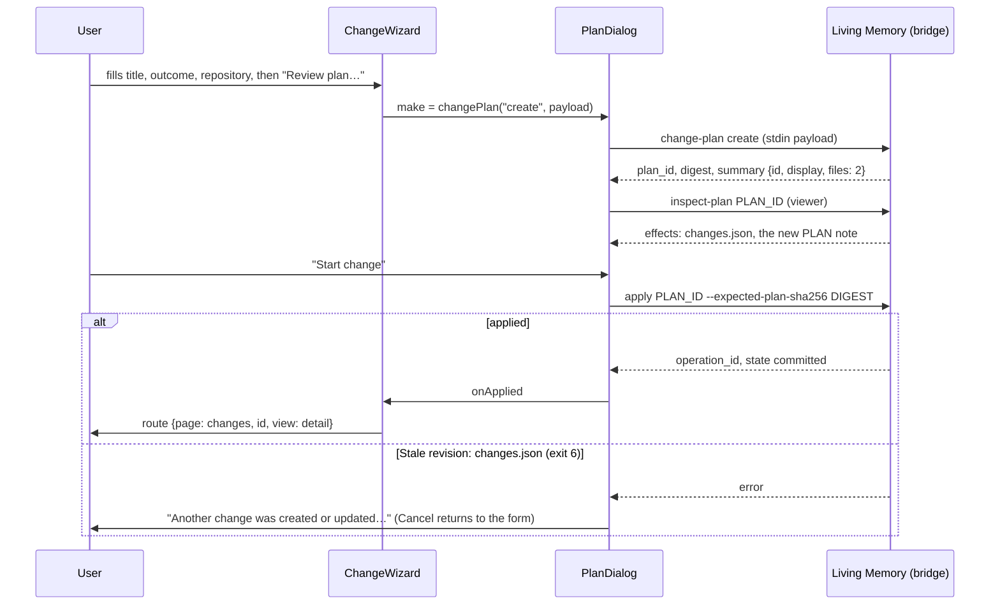
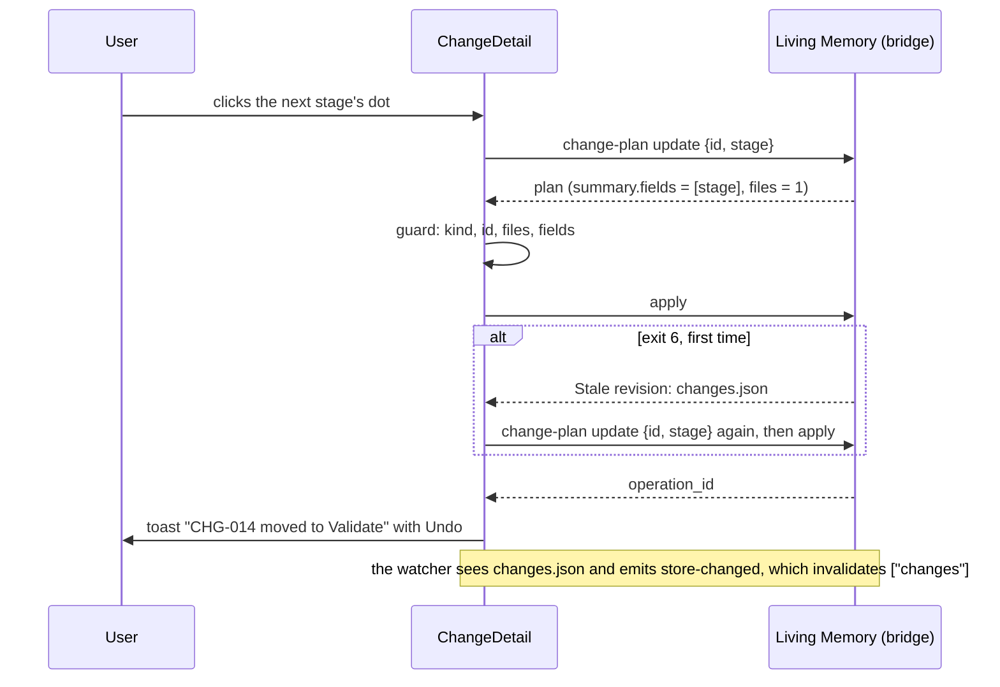
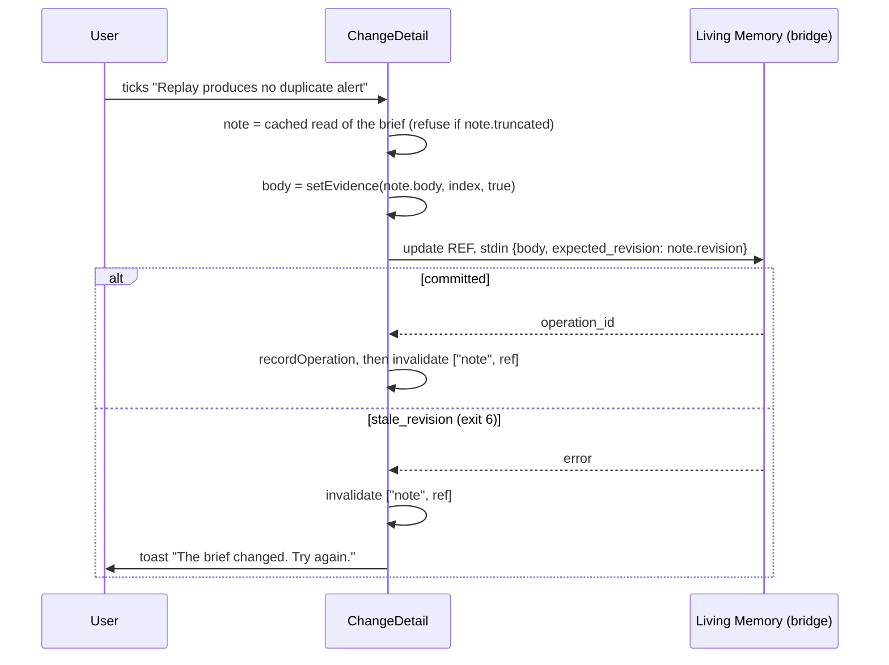
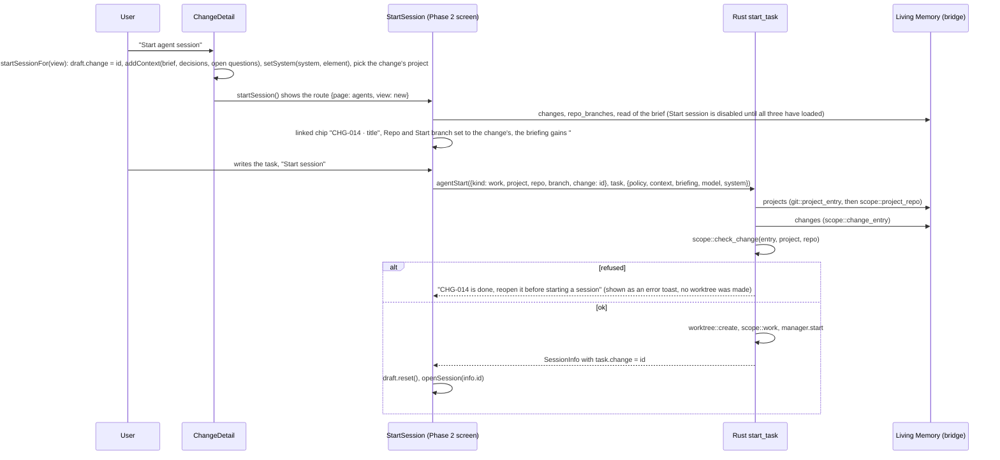
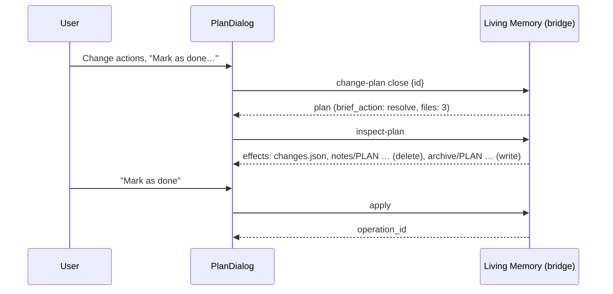

# Phase 3: Changes

Read [README.md](README.md) first. This document goes deeper on Phase 3 and does not repeat the README. Where the two disagree on a shared name or shape, the README wins; say so in your final report.

Written on 2026-11-10 against:

- the app repository at branch `feat/mock-ux`, commit `0a322e5` (Phase 1 built, **Phase 2 not yet in the tree**), and [phase-2-interactive-sessions.md](phase-2-interactive-sessions.md), which defines every Phase 2 name used below;
- the Living Memory source checkout at branch `main`, commit `9ac6ea2` (`SERVE_API=2`, `CORE_RELEASE "1.0.0"`);
- the spike [spikes/lm-registry-reference.md](spikes/lm-registry-reference.md), cited below as "the reference".

Names used for folders: `<repo>` is the app repository, `<lm>` is the Living Memory source checkout (a folder named `agentic-living-memory` beside `<repo>`), `<scratch>` is any throwaway folder outside both.

Phase 3 has two parts that ship separately:

- **Part A** changes Living Memory (a different repository, its own branch and pull request): a new registry `changes.json` with the commands `changes` and `change-plan`.
- **Part B** changes the app: the Changes list (mock 05), the Change detail (mock 06), the "Start a change" wizard, and the places elsewhere that show a change.

Do Part A first. Part B is developed against the Part A source checkout and a throwaway store; nothing needs to be installed until the end, and installing is the user's step.

---

## 1. Goal, mock screens, non-goals

### 1.1 What the user gets

A **change** is a numbered unit of work, shown as `CHG-014`. It belongs to one project, has a brief (a `plan` note: outcome, steps, acceptance evidence), a stage (Explore, Design, Implement, Validate), a status (active, done, cancelled), and optionally a repository, a branch, a system and one architecture element. Agent sessions started for a change carry its number.

The user can:

1. See a project's changes with their state at a glance, find one, and read its outcome, linked session and connected notes (mock 05).
2. Open one change: move it through its stages with one click, tick steps, tick and add acceptance evidence, record a checkpoint note, resume or start its agent session, and see its architecture element, decisions and open questions (mock 06).
3. Start a change from a form that ends in a reviewed plan, or adopt an existing plan note as a change.
4. See the change wherever it matters: the Overview's "Continue your work" card, the CHG chip under a session title, and under Connections on notes linked to the brief.

### 1.2 Mock screens

The mocks are PNG files in a folder named `hivemind-mocks` beside `<repo>`. The images carry a different product wordmark; ignore it. The product is "Hivemind".

| Mock | What this phase takes from it |
| --- | --- |
| `05_Changes_List.png` | The whole screen. |
| `06_Change_Detail.png` | The whole screen. |
| `01_Project_Overview.png` | The "Continue your work" card (`CHG-014 · feature/idempotency · 3 decisions`, "Resume session", "Open change") and the "New change" link in the header. |
| `03_Agent_Workspace_Chat.png` | The `CHG-014` chip under the session title. |
| `02_Start_Agent_Session.png` | The parts of Phase 2's Start screen that Phase 2 leaves to this phase: the chip `CHG-014 · Prevent duplicate payment alerts` under the Task box, and the brief's line under "Task boundaries". |
| `09_Decision_Note.png` | The row `CHG-014 · Prevent duplicate payment alerts` with the branch icon under Connections. |
| `08_Memory_Library.png` | The link `CHG-014 · Prevent duplicate payment alerts` under Connections in the library preview. |

Section 7 describes every screen in words, so the work does not depend on the images.

### 1.3 Non-goals

- No `change/<id>` tag facet (decision C10 in section 2).
- No review of file diffs. "Review proposed changes" opens the session in Agent Workspace; Phase 4 retargets it.
- No moving a change to another project, and no re-pointing a change at a different brief.
- No labelling of Activity rows with the change number. The plan summaries carry `id`, `display` and `title` so a later phase can; this phase adds only the three verbs.
- No per-evidence-item agent claims (the mock's "Agent reports passing tests — review needed" chip). Nothing records such a claim, so it is not shown.
- No change to `SERVE_API`, no new note type, no change to Living Memory's instruction block (so no harness rewiring).
- Deploying Living Memory to the installed copy is not something the implementer does. The user applies the install plan (section 8, step A5).

### 1.4 What Phase 3 assumes from earlier phases

Phase 1 (in the tree): everything in README section 3.

Phase 2 (README section 7.1 and [phase-2-interactive-sessions.md](phase-2-interactive-sessions.md) sections 4, 6 and 7). Its code was **not in the tree when this was written**, so every Phase 2 name below comes from that document, not from code:

| Needed | Where Phase 2 puts it |
| --- | --- |
| `AgentTask` kind `"work"` with `project`, `repo`, `branch?`, `change?` (Rust: `AgentTask::Work { project, repo, branch, change: Option<u64> }`) | `src/lib/agent.ts`, `src-tauri/src/agent/scope.rs` |
| `SessionInfo` fields `mode`, `policy`, `project`, `worktree`, `turns`, `filesChanged: FileTotals \| null`, `context`, `model`, `system` | `src/lib/agent.ts`, `src-tauri/src/agent/mod.rs` |
| `SessionStatus`: `running`, `waiting`, `idle`, `succeeded`, `failed`, `cancelled`, `ended` | `src/lib/agent.ts`, `src-tauri/src/agent/events.rs` |
| `agentStart(task, prompt, options?: StartOptions)` with `StartOptions { policy, context, briefing?, model?, system? }` | `src/lib/agent.ts` |
| Route `{ page: "agents"; session?: string; view?: "new" }` and `export const startSession = () => app().go({ page: "agents", view: "new" })` | `src/store.ts` |
| `useSessionDraft`: `task: string` (the task **text**), `context: string[]`, `change: number \| null` (always null in Phase 2), `system`, `element`, `setTask`, `addContext`, `removeContext`, `setSystem(system, element?)`, `reset`. In memory only. The repository, branch, permissions and model are local state of the Start screen, not of the draft. | `src/features/agents/draft.ts` |
| `isEnded(s)`, `repoName(path)`, `sessionForNote(sessions, project, ref)`, `waitingForReview(s)`, `sessionBriefing(input: BriefingInput)` | `src/features/agents/session.ts` |
| The Start screen, with a `linked-chip` button reserved for the change, and the task built as `{ kind: "work", project: project.slug, repo, branch }` | `src/features/agents/StartSession.tsx` |
| The chat: thread header `header.chat-head` with a place reserved for the change chip under the title | `src/features/agents/AgentWorkspace.tsx`, `Chat.tsx` |
| CSS class `.linked-chip` | `src/App.css`, block `/* ---- Agent Workspace ---- */` |
| Rust `start_task(manager, bridge, saved, worktrees, task, prompt, options)`, which for a work task calls `git::project_entry`, `scope::project_repo`, `worktree::create`, `scope::work`, in that order | `src-tauri/src/agent/mod.rs` |
| Rust `scope::same_path(a, b)` and `scope::project_repo(entry, repo) -> Result<PathBuf, String>` | `src-tauri/src/agent/scope.rs` |
| Rust `git::project_entry(bridge, slug)` | `src-tauri/src/git.rs` |

Also in the tree since Phase 1: `src/ui/Markdown.tsx` exports `Markdown({ children }: { children: string })` (react-markdown with GFM; links open in the system browser instead of navigating the app window). Use it wherever this document renders Markdown text; do not import `react-markdown` directly.

Two facts about Phase 2 that this document builds on as they are:

- **A session's `adapter` is `"claude-code"`** (README 7.1; it is what `fn name(&self)` in `src-tauri/src/agent/claude.rs` returns, and what the stored example in Phase 2 section 4.2 shows). Phase 5 adds `"codex"`. Map the engine's display name from that exact string.
- **Phase 2's `waitingForReview(s)` is `filesChanged.files > 0` and the status is neither `running` nor `waiting`.** Phase 3 calls that function and does not define its own. Phase 4 adds the `review` part of README 7.3 to the same function.

> **UNVERIFIED:** Phase 2 was implemented with exactly the names, signatures and file paths its document gives.
> **First step:** run the preflight below. Pass: every line prints a match. Fail: a line prints nothing.
> **If it fails:** find the successor in the Phase 2 code (search for the behaviour, not the name), use it wherever this document uses the old name, and list the difference in your final report.

### 1.5 Preflight checklist

Run these before writing any code. Every line must find something; if one does not, stop and read the Phase 2 document and code to find the successor name, and note it in your report.

In `<repo>` (bash or PowerShell; `git grep` works in both). The base is Phase 2's branch `feat/interactive-sessions`, or wherever it was merged:

```sh
git status --short                                                        # clean (ask the user about anything that is not yours)
git log --oneline -3                                                      # the Phase 2 commits are the base
git grep -n 'kind: "work"; project: string; repo: string' -- src/lib/agent.ts
git grep -n 'change?: number' -- src/lib/agent.ts
git grep -n 'filesChanged: FileTotals' -- src/lib/agent.ts
git grep -n '"ended"' -- src/lib/agent.ts
git grep -n 'export const agentStart' -- src/lib/agent.ts
git grep -n 'export const useSessionDraft' -- src/features/agents/draft.ts
git grep -n 'change: number | null' -- src/features/agents/draft.ts
git grep -n 'setSystem' -- src/features/agents/draft.ts
git grep -n 'export function waitingForReview' -- src/features/agents/session.ts
git grep -n 'export const isEnded' -- src/features/agents/session.ts
git grep -n 'export function sessionBriefing' -- src/features/agents/session.ts
git grep -n 'linked-chip' -- src/features/agents/StartSession.tsx src/App.css
git grep -n 'kind: "work", project: project.slug, repo, branch' -- src/features/agents/StartSession.tsx
git grep -n 'className="chat-head"' -- src/features/agents
git grep -n 'export const startSession' -- src/store.ts
git grep -n 'view?: "new"' -- src/store.ts
git grep -n 'export function Markdown' -- src/ui/Markdown.tsx
git grep -n 'change: Option<u64>' -- src-tauri/src/agent/scope.rs
git grep -n 'pub fn same_path' -- src-tauri/src/agent/scope.rs
git grep -n 'pub fn project_repo' -- src-tauri/src/agent/scope.rs
git grep -n 'pub fn start_task' -- src-tauri/src/agent/mod.rs
git grep -n 'pub fn project_entry' -- src-tauri/src/git.rs
npm test && npx tsc --noEmit
```

In `<lm>`:

```sh
git status --short                                   # clean
git log --oneline -1                                 # 9ac6ea2 or later on main
git grep -n "systems.json" -- core                   # backup.py, cli.py, runtime.py, systems.py
git grep -n "'changes'" -- core                      # nothing: the name is free
py -3.15 -m unittest discover -s tests -p test_systems.py -v     # passes before you touch anything
```

`py -3.15` is the Python launcher for the interpreter that runs Living Memory on this machine. Use whichever interpreter `doctor` reports if yours differs.

---

## 2. Decisions already made (do not reopen)

Made by the user on 2026-11-10:

1. A change is a `plan` note (the brief) plus an entry in a new Living Memory registry `changes.json`. The shape and the command names are fixed in README section 7.2.
2. CHG numbers are integers unique across the whole store, shown as `CHG-014` (three digits, growing as needed).
3. The four stages are the mock's: Explore, Design, Implement, Validate.

Made by the architect on 2026-11-10 from the reference's section "Conflicts and recommendations" (C1 to C14):

| # | Decision |
| --- | --- |
| C1 | `id` is an integer. The module has its own `load()` validation and sorts by `id`. `display` is derived. `update` and `close` accept `14` or `"CHG-014"`. |
| C2 | The id is allocated inside `change_plan` as max + 1, under the store lock. It is **provisional until apply**. |
| C3 | Undoing a create frees the number. This is accepted and documented. `cancelled` is the normal way to abandon a change. |
| C4 | Corrections are a new `update`, never `undo`. |
| C5 | One registry file. A second outstanding plan fails at apply with exit 6; the app plans again. |
| C6 | `change-plan create` takes `brief: {domain?, title?, body}` and builds the plan note in the same plan. The note title is the display id plus the title: `CHG-014 Prevent duplicate payment alerts`. Tags: `subject/project`, `concern/workflow`, `project/<slug>`, and `system/<slug>` when given. The domain is chosen with `projects._charter_domain`. `brief` may instead be a ref string: an existing plan note is adopted. |
| C7 | `project` and `system` are validated against their registries. `repo` is normalised. `branch` and `element` have length limits. `STAGES` is a tuple. Free text is scanned for credentials. |
| C8 | Statuses are `active`, `done`, `cancelled`. `close` takes `{id, status?}` with `status` defaulting to `done`. `update` may set any status, including back to `active`. |
| C9 | `close` resolves the brief in the same plan (and skips the note when it is already resolved). Reopening through `update` reopens the brief in the same plan. |
| C10 | No `change/<id>` tag facet. |
| C11 | The listing resolves the brief with `notes.resolve_ref`, so a note that moved to another domain is still found. Do not "fix" this back to `find_note`. |
| C12 | Names stay `changes`, `change-plan`, `changes.json`, `core/changes.py`. Inside the module the file-effects dict is called `files`, not `changes`. |
| C13 | Listing rows add `display`, `brief_status`, `actions: {open, done}`. Filters `--status` and `--project`. Warnings for an unknown project, an unknown system and a brief that does not resolve. |
| C14 | Every plan summary carries `id`, `display` and `fields`. `changes` joins the read-only and auto-approved command lists. `changes.json` joins backups and the protected-file rule. `SERVE_API` is **not** bumped: the app gates on `commands.includes("changes")`. |

Choices this document makes where the README and the brief left room (each with its reason):

| Choice | Reason |
| --- | --- |
| Adopting a note adds the missing `project/<slug>` and `system/<slug>` tags to it in the same plan. It does not rename the note. | Membership in Living Memory is the tag, and the app joins briefs to the project's note list by that tag; renaming would break existing `[[Title]]` links. |
| A note is "connected" to a change when the brief links to it **or** it links to the brief. | Agents and "Record checkpoint" attach notes by linking to the brief (C10), without editing the brief. |
| A change title may not contain `[`, `]`, `\|` or `#`. | The title becomes the brief's title, and those characters end a wikilink target. |
| Plan summaries also carry `title`; a create adds `brief` and `adopted`; update and close add `brief_action`. | The Activity feed and the app can label and check a plan without reading its diff. |
| The route keeps an optional `ref` beside `id` and `view`. | The Phase 1 fallback page selects plan notes by ref; README 7.2 allows added fields. |
| Rust refuses a work task whose `change` is unknown, closed, in another project or tied to another repository. | A session's link to a change is recorded for good in the session index; it must be true. |
| The detail page has inline "Add step" and "Add evidence" inputs and a small "Change actions" menu (edit, mark as done, cancel, reopen). | Without them a change made in the wizard could not get steps or evidence, or ever be closed, from the app. |
| Moving to the next stage is one click (plan and apply at once). | Named exception to the reviewed-plan rule; section 4.6 says exactly why and how it is guarded. |

---

## 3. The code as it stands

Anchors are strings to search for. Line numbers drift; do not rely on them.

### 3.1 Living Memory (`<lm>`)

| File | Anchor | What it does today, and why it matters here |
| --- | --- | --- |
| `core/systems.py` | `def system_plan(root,action,payload)` | The model for the new module: constants, `load`, `_clean`, `_registry`, the plan builder, `listing`. 120 lines, dense one-line style. Copy the style. |
| `core/projects.py` | `def _charter_domain(root,named,repos,field='charter.domain')` | Shared helpers the new module imports as they are: `_text(value,field,low,high)`, `_repos(repos)`, `_charter_domain(...)`, and `tag(slug)`, `load(root)`. |
| `core/governance.py` | `def plan(root, changes, kind, domains=(), summary=None, guards=None)` | Writes the plan file. `changes` maps a store-relative POSIX path to the full new text, or `None` to delete. It computes the expected hashes itself. `domains` are reconciled after apply. |
| `core/governance.py` | `def apply(root,plan_id,expected_digest,sync_overlay=True)` | Stale detection is per whole file: `Stale revision: <path>` (exit 6). |
| `core/notes.py` | `def build_note(title,body,tags,domain,root,note_type='knowledge'` | Returns `(path, note, file text)` for a new note and writes nothing. Validates like a capture, but skips the duplicate-title check. |
| `core/notes.py` | `def _change_set(note_id,domain,action,root,expected_revision=None,successor=None,pending=None,**values)` | Returns `(changes, expected, target)` for one note action. Used here for `'resolve'`, `'reopen'` and `'retag'` (which it turns into an update of `tags`). Raises `Only active plan, bug and risk notes may be resolved` and `Only resolved plan, bug and risk notes may be reopened`. |
| `core/notes.py` | `def resolve_ref(value,domain=None,root=None,search_domains=())` | `(domain, full id)` for `domain:id` or `domain:prefix`; finds a note whose domain changed, because ids are store-wide. With `domain=None` an unmatched value raises. |
| `core/notes.py` | `def check_action(note_id,domain,root=None,item=None,index=None,done=True)` | `check`: the index counts Action Items only. |
| `core/note_format.py` | `def split(body)`, `def format_body(body)`, `def _action_lines(body)` | A `##` heading the layout does not define is kept in place with key `None`. `_action_lines` counts checkboxes only under the Action Items heading. See section 5.4. |
| `core/cli.py` | `p=sub('system-plan')`, `READ_ONLY={`, `elif cmd=='system-plan':`, `from .systems import listing as systems_listing` | The four places a registry is wired into the CLI. **The file starts with a UTF-8 BOM.** |
| `core/backup.py` | `TOP_LEVEL=(` | The store-root files a snapshot includes. |
| `core/runtime.py` | `ALLOWED_SUBCOMMANDS={`, `def protected_rule(path,cwd,root)` | Auto-approved shell subcommands; the files agents may not write. **The file starts with a UTF-8 BOM.** |
| `tests/test_systems.py` | `class Fixture(StoreFixture)` | The model for the new tests. In-process CLI calls with `--root`. |
| `tests/test_core.py` | `class StoreFixture(unittest.TestCase)` | A temp store `<tmp>/store` with one bound domain `demo` whose prefix is `<tmp>/project`. |

Signatures you will call, verbatim:

```python
# core/projects.py
def tag(slug):return f'project/{slug}'
def load(root)                                   # {'version':1,'projects':[...]}
def _text(value,field,low,high)                  # raises f'{field} must be {low}..{high} characters'; returns the stripped string
def _repos(repos)                                # list in, list out: forward slashes, no trailing slash
def _charter_domain(root,named,repos,field='charter.domain')
# core/systems.py
def tag(slug):return f'system/{slug}'
def load(root)                                   # {'version':1,'systems':[...]}
# core/repository.py
def read_json(path, default=None)                # raises ValueError('Invalid or unreadable configuration preserved: <path>') on bad JSON
def canonical_json(value)                        # sort_keys, no whitespace
def find_secrets(text)                           # [(kind, start, end)]
def store_lock(root, allow_retired=False, timeout=None)   # re-entrant per thread
def now()                                        # UTC ISO 8601 with microseconds
```

### 3.2 The app (`<repo>`)

| File | Anchor | What it does today, and why it matters here |
| --- | --- | --- |
| `src/lib/lm.ts` | `export async function run<T>` | Every Living Memory call. `view(argv)` appends `--actor viewer`. Model the new wrappers on `systemsArgs`, `systems`, `systemPlan` at the end of the file. |
| `src/lib/lm.ts` | `export const check = (ref: string, index: number, done: boolean)` | Ticks an Action Item. Reused as is. |
| `src/lib/lm.ts` | `export const update = (ref: string, payload: UpdatePayload` | Sends `{body, expected_revision}` on stdin. Used for acceptance evidence. |
| `src/lib/lm.ts` | `export const read = (ref: string` | Asks for at most 64,000 characters and returns `truncated`. A truncated body must never be written back (section 10). |
| `src/lib/connection.ts` | `export const useSystemsEnabled` | The pattern for the new gate. |
| `src/lib/note.ts` | `export function actionItems(body: string): ActionItem[]` | Mirrors Living Memory's numbering. The evidence functions go beside it and reuse `H2`, `FENCE`, `CALLOUT_LINE`, `ACTION`, `letters`. |
| `src/lib/refresh.ts` | `const KEEP = [` | `refreshStore` invalidates every query whose first key is not in `KEEP`. A key `["changes"]` is therefore refreshed on note changes without any edit here. |
| `src/App.tsx` | `function useLiveRefresh(` | The `store-changed` listener invalidates `projects`, `systems`, `taxonomy`. Add `changes`. |
| `src-tauri/src/watcher.rs` | `pub fn store_file(` | Its `matches!(name, …)` lists the config files watched directly under the store root (`"projects.json"`, `"systems.json"`, `"tag_taxonomy.json"`, and whatever was added since). Add `"changes.json"`. |
| `src/store.ts` | `export type Route =` | `{ page: "changes"; ref?: string }` today. Helpers `openProject`, `openSystem`, `openSession` at the end. |
| `src/shell/Shell.tsx` | `const PAGES: Record<Page, () => ReactNode>` | `changes: () => <ChangesPage />`. Stays; the component becomes a switch. |
| `src/shell/Topbar.tsx` | `function useCrumbs()` | Computes the leaf crumb per page. Add the `CHG-014` leaf. |
| `src/features/changes/ChangesPage.tsx` | `export function ChangesPage()` | The Phase 1 page over plan notes. It becomes the fallback (renamed `PlansFallback`). It reads `s.route.ref` and navigates with `go({ page: "changes", ref })`. |
| `src/features/projects/OverviewPage.tsx` | `<Section title="Continue your work"` | The focus card over the newest plan note. Phase 2 adds to it a "Resume session" button for the session found by `sessionForNote(sessions, project.slug, plan.ref)`, a "Waiting for review" chip and the "proposed N file changes" line. Phase 3 puts the change variant in front of it. Header actions are in `actions={<>` just above; after Phase 2 the primary there is "Start a session" (`startSession`) and "New note" is in the "Project actions" menu. |
| `src/features/projects/useProject.ts` | `export function useProject(slug: string \| undefined)` | `rows` (member notes with `summary` and `actions`), `open`, `due`, `charter`. `useAllLinks()` returns the all-domains link graph under the key `["links", "*"]`. |
| `src/features/projects/ProjectWizard.tsx`, `wizard.ts` | `function CreateProject(`, `export function validateCreate` | The pattern for a form that ends in a `PlanDialog`: `review` state, `applied` ref, problems shown after the first submit, pure validation in `wizard.ts`. |
| `src/features/plans/PlanDialog.tsx` | `export function PlanDialog` | `make()` builds the plan; the dialog inspects, shows the diff, applies, calls `recordOperation`, `refreshStore`, `onApplied(operationId)`, then `onClose()`. |
| `src/features/plans/NoteMenu.tsx` | `const items: { label: string; show: boolean; act: () => void; danger?: boolean }[]` | The note's "⋯" menu. Gains "Adopt as change…". |
| `src/features/systems/MiniDiagram.tsx`, `diagram.ts` | `export function MiniDiagram`, `export function chain(` | A row of at most three container boxes; `selected` highlights one **by name** (`.mini-node.on`). `chain` may leave the selected element out; section 6 fixes that. |
| `src/features/history/activity.ts` | `const PLAN_KINDS = new Set(`, `const VERBS: Record<string, string>` | Journal kinds and verbs. |
| `src/features/links/useLinks.ts` | `export function noteLinks(` | Pure: `out` (casefolded link target to node), `incoming`, `outgoing` for one note in a graph. |
| `src/features/links/LinksPanel.tsx` | `export function LinksPanel` | The note rail's Connections. Gains the change rows. |
| `src/features/library/MemoryPage.tsx` | `function Preview(` | The library preview's Connections. Gains the change links. |
| `src/features/agents/AgentWorkspace.tsx` | `<header className="chat-head">` | The thread header: `<h2>{info.title}</h2>` and the status chip. Phase 2 section 7.3 reserves the place under the title for "the linked chip `CHG-014`" and never renders it. Phase 3 renders it. |
| `src/features/agents/draft.ts` (Phase 2) | `export const useSessionDraft` | The session draft (section 1.4). `change` exists and is always null. There is no setter for it; Phase 3 sets it with the store's own `setState`. `reset()` clears it. |
| `src/features/agents/StartSession.tsx` (Phase 2) | `className="linked-chip"`, `{ kind: "work", project: project.slug, repo, branch }`, `aria-label="Repo"`, `aria-label="Start branch"`, `title="Task boundaries"` | The Start screen (mock 02). The chip is rendered only when `draft.change !== null` and has no text source or click handler yet. The task it sends has no `change`. The repository defaults to the project's first, the branch to the repository's current one. It works on the project picked in the sidebar (`useCurrentProject`). Phase 3 edits all four places (section 6.2). |
| `src/features/agents/session.ts` (Phase 2) | `export function sessionBriefing(`, `interface BriefingInput` | Builds the Markdown put before the task in the first message. An included note contributes only its summary and key details (`noteBlock`), so a brief's steps and acceptance evidence are not in it. Phase 3 adds a `## Change` block. |
| `src/ui/Markdown.tsx` | `export function Markdown` | `Markdown({ children })`: the only way this phase renders Markdown text. |
| `src/ui/toast.tsx` | `export const toast =` | A toast is one button that dismisses itself. Gains an optional action. |
| `src/ui/Page.tsx` | `export function PageHeader` | `PageHeader`, `Split`, `Section`, `Tabs`, `ArrowLink`, `Row`, `dayMonth`, `longDate`. All reused. |
| `src-tauri/src/agent/mod.rs` (Phase 2) | `pub fn start_task(` | Step 3 of its work branch: `entry = git::project_entry(bridge, project)?`, `repo = scope::project_repo(&entry, repo)?`, `tree = worktree::create(worktrees, &repo, branch.as_deref(), &id)?`, `scope = scope::work(...)`. It ignores `change`. Phase 3 checks the change between `project_repo` and `worktree::create`, so a refused start leaves no worktree behind. |
| `scripts/seed_demo_store.py` | `# ---- Lifecycle:` | Builds the PayStream store. Gains seeded changes when the Living Memory it runs has the `changes` command. |

Signatures you will call, verbatim:

```ts
// src/lib/lm.ts
export interface Plan { ok: true; plan_id: string; digest: string; kind: string; summary: Record<string, unknown> }
export const applyPlan = (p: Pick<Plan, "plan_id" | "digest">) => run<{ ok: true; operation_id: string; state: string; idempotent: boolean; warnings?: string[] }>(...)
export class LmError extends Error { code: string; exitCode: number; get stale(): boolean }   // stale is exitCode === 6
export const capture = (domain: string, payload: CapturePayload, opts?: { redact?: boolean }) => run<WriteResult>(...)
// src/features/viewer/NoteView.tsx
export const noteQuery = (ref: string) => ({ queryKey: ["note", ref], queryFn: () => read(ref) });
// src/features/systems/useSystem.ts
export const systemsQuery = () => ({ queryKey: ["systems"], queryFn: () => systems() });
export function useSystem(slug: string | undefined)   // { system, architecture, ... }
// src/features/projects/scope.ts
export function systemsForProject(project, systems)   // systems that share a repository with the project
// src/lib/agent.ts
export const sessionsQuery = () => ({ queryKey: ["agent", "sessions"], queryFn: agentSessions });
// src/features/agents/session.ts (Phase 2)
export const isEnded = (s: Pick<SessionInfo, "status">) => ENDED.includes(s.status);   // succeeded, failed, cancelled, ended
export function waitingForReview(s: SessionInfo): boolean;                             // files changed, and neither running nor waiting
export function sessionBriefing(input: BriefingInput): string;
// src/features/agents/draft.ts (Phase 2)
export const useSessionDraft = create<SessionDraft>()(...)   // task, context, change, system, element, setTask, addContext, removeContext, setSystem, reset
// src/store.ts
export const openSession = (session: string) => app().go({ page: "agents", session });
export const startSession = () => app().go({ page: "agents", view: "new" });           // Phase 2
// src/ui/Markdown.tsx
export function Markdown({ children }: { children: string })
```

```rust
// src-tauri/src/agent/scope.rs (Phase 2)
pub fn same_path(a: &str, b: &str) -> bool;                                    // slashes and case do not matter
pub fn project_repo(entry: &Value, repo: &str) -> Result<PathBuf, String>;     // the registry's own spelling
// src-tauri/src/agent/mod.rs (Phase 2)
pub fn start_task(manager: &Manager, bridge: &Bridge, saved: &Settings, worktrees: &Path, task: AgentTask, prompt: &str, options: StartOptions) -> Result<SessionInfo, String>;
```

---

## 4. Architecture

### 4.1 Where each piece of state lives, and who may write it

| State | Lives in | Written by | Read by |
| --- | --- | --- | --- |
| The change registry | `<store>/changes.json` | Living Memory only, through an applied `change-plan` (or an applied `undo` plan) | `changes` (any actor) |
| The brief | a `plan` note under `<store>/domains/<domain>/notes/` (or `archive/` once resolved) | Living Memory: `change-plan` (create, close, reopen, adopt's retag), `check`, `update` | `read`, `list`, `links`, `open`, `review` |
| Which sessions belong to a change | `task.change` in each session's entry in the app's session index | Rust (`start_task`, behind `agent_start`), after `check_change` | `agent_sessions` |
| The change a new session is being prepared for | `useSessionDraft().change` (Phase 2's draft, in memory only) | the webview: `startSessionFor` sets it, the Start screen's unlink button and `reset()` clear it | the Start screen |
| Which notes are connected to a change | `[[...]]` links in note bodies | whoever writes the notes | `links` |
| The selected change, the open view | the route in `useApp`, persisted as `hivemind.nav` | the webview | the webview |
| The list's tab and search text, the wizard's fields | component state | the webview | the webview |
| Which form is open | `useChangeIntent` (zustand, not persisted) | the webview | `ChangeWizardHost` |

The app never writes a file under the store. Every write is a Living Memory command.

### 4.2 Data model

#### The registry file

`<store>/changes.json`, canonical JSON (sorted keys, one line, no trailing newline), absent until the first change exists. Pretty-printed here:

```json
{
  "changes": [
    {
      "branch": "feature/idempotency",
      "brief": "paystream:6f0c1d2e-3b4a-4c5d-8e9f-0a1b2c3d4e5f",
      "created": "2026-11-10T10:48:16.123456+00:00",
      "element": "Ingestion",
      "id": 14,
      "project": "paystream",
      "repo": "C:/work/paystream",
      "stage": "implement",
      "status": "active",
      "system": "paystream",
      "title": "Prevent duplicate payment alerts",
      "updated": "2026-11-10T11:02:40.000001+00:00"
    }
  ],
  "version": 1
}
```

| Field | Type | Default at create | Rules |
| --- | --- | --- | --- |
| `id` | integer >= 1 | max of existing ids + 1 | identity; never in a create payload; never changes |
| `title` | string | required | trimmed, 1..120 characters, none of `[ ] \| #` |
| `project` | string | required | slug of a registered project (any status); never changes |
| `brief` | string | set by create | `domain:full-id` of a `plan` note; never in an update payload |
| `stage` | string | `explore` | one of `STAGES` |
| `status` | string | `active` | one of `STATUSES`; not accepted in a create payload |
| `repo` | string or null | `null` | absolute folder path, forward slashes, no trailing slash |
| `branch` | string or null | `null` | trimmed, 1..200 characters |
| `system` | string or null | `null` | slug of a registered system (any status) |
| `element` | string or null | `null` | trimmed, 1..120 characters; requires `system`. It is the element's **name** as the architecture model spells it, because `MiniDiagram` highlights by name. |
| `created`, `updated` | string | `now()` | `updated` is rewritten by every update and close |

#### TypeScript types (new, in `src/lib/lm.ts`)

```ts
// ---- Changes (an LM that has the `changes` command). ----

export const STAGES = ["explore", "design", "implement", "validate"] as const;
export type ChangeStage = (typeof STAGES)[number];
export type ChangeStatus = "active" | "done" | "cancelled";

/** One row of `changes`: the registry entry plus `display`, `brief_status` and `actions`. */
export interface Change {
  id: number; display: string; title: string; project: string;
  /** `domain:id` of the brief where it lives now. */
  brief: string;
  stage: ChangeStage; status: ChangeStatus;
  repo: string | null; branch: string | null; system: string | null; element: string | null;
  created: string; updated: string;
  /** The brief note's status, whatever it is: an archived or superseded note still resolves and reports that status.
   *  Null only when no note with the brief's id exists any more (deleted, or the stored ref is broken). */
  brief_status: Status | null;
  actions: { open: number; done: number };
}
export interface ChangesResult { ok: boolean; changes: Change[]; warnings: string[] }

export interface ChangeCreate {
  project: string; title: string;
  /** A new brief to write, or the ref of an existing active plan note to adopt. */
  brief: { domain?: string; title?: string; body: string } | string;
  stage?: ChangeStage; repo?: string | null; branch?: string | null; system?: string | null; element?: string | null;
}
export interface ChangeUpdate {
  id: number | string; title?: string; stage?: ChangeStage; status?: ChangeStatus;
  repo?: string | null; branch?: string | null; system?: string | null; element?: string | null;
}
export interface ChangeClose { id: number | string; status?: "done" | "cancelled" }
export interface ChangePlanSummary {
  id: number; display: string; title: string; fields: string[]; files: number;
  brief?: string; adopted?: boolean; brief_action?: "resolve" | "reopen" | null;
}
export type ChangePlan = Plan & { summary: ChangePlanSummary };
```

#### TypeScript types (new, in `src/features/changes/changes.ts`)

```ts
export type StepState = "done" | "current" | "later";
export interface Chip { label: string; tone: "" | "active" | "waiting" | "busy" }
/** What the app may do with a change's brief: "ok" (active or resolved), "retired" (archived or superseded: it still
 *  reads, but is shown read-only), "missing" (`brief_status` is null: nothing to read). */
export type BriefState = "ok" | "retired" | "missing";
/** Whether the Start screen may start a session for the change in the draft (section 6.2, `StartSession.tsx`). */
export type LinkState =
  | { kind: "none" }                        // no change in the draft: Phase 2's screen, unchanged
  | { kind: "loading"; what: string }       // Start is disabled; `what` is shown beside it
  | { kind: "failed"; message: string }     // Start is disabled; the message is shown with "Unlink the change"
  | { kind: "ready" };

/** Everything the screens show about one change, joined from the registry, sessions, links and notes. */
export interface ChangeView {
  change: Change;
  /** Sessions whose task carries this change, newest first. */
  sessions: SessionInfo[];
  latest: SessionInfo | undefined;
  chip: Chip;
  /** The later of the entry's `updated` and the brief's. */
  updated: string;
  decisions: LinkNode[];      // connected notes of type decision
  questions: LinkNode[];      // connected active notes of type risk
  checkpoints: LinkNode[];    // connected notes of type status, newest title first
  hasDiagram: boolean;        // the change has a system whose registry entry has an architecture folder
}
export interface ViewContext {
  sessions: SessionInfo[]; graph: LinkGraph | undefined;
  due: Set<string>;                 // refs of notes due for review
  rows: Map<string, NoteRow>;       // note rows by ref (for the brief's `updated`)
  systems: System[];
}
```

#### TypeScript types (new, in `src/features/changes/intent.ts` and `wizard.ts`)

```ts
export type ChangeForm =
  | { mode: "create" }
  | { mode: "adopt"; ref: string; title: string }
  | { mode: "edit"; change: Change };

export interface ChangeFields {
  project: string; title: string; outcome: string; repo: string; branch: string;
  system: string; element: string; stage: ChangeStage;
}
```

#### Changed TypeScript types

```ts
// src/store.ts
| { page: "changes"; id?: number; view?: "detail"; ref?: string }   // ref: the plan-note fallback page only

// src/ui/toast.tsx
export interface Toast { id: number; text: string; kind: "info" | "warn" | "error"; action?: { label: string; run: () => void } }

// src/features/agents/session.ts (Phase 2's BriefingInput gains one optional field)
interface BriefingInput {
  // ...Phase 2's fields, unchanged...
  /** The change the session works on: a "## Change" block is written for it. */
  change?: { display: string; title: string; stage: string; briefTitle: string; steps: string[]; evidence: string[] } | null;
}
```

Phase 2's `SessionDraft`, `AgentTask`, `SessionInfo` and `StartOptions` are **not** changed. The draft's existing `change` field is filled; the existing optional `change` of the `work` task is sent.

#### Rust

No new struct or enum. Two new functions in `src-tauri/src/agent/scope.rs`, one call added in `start_task` in `src-tauri/src/agent/mod.rs` (section 6.3), and one widened `matches!` in `watcher.rs`. No field is added to `SessionInfo` or to any stored record, so no serde default and no old-index test is needed in this phase.

### 4.3 Tauri commands and events

**No new command and no new event.**

Changed behaviour of existing ones:

| Name | Change |
| --- | --- |
| event `store-changed` | Its payload `files` may now contain `"changes.json"`. Example: `{"files":["changes.json"]}`. |
| command `agent_start` | For a `work` task with `change`, it now fails with one of the exact messages below before the worktree is created and before anything is spawned. Phase 2's own errors (section 4.4 of its document) are unchanged. |

`agent_send` is not changed: a session that already carries a change keeps taking messages after the change is closed, so work in flight can be finished.

`agent_start` errors added (strings, exact; `CHG-014` stands for the display id built as `CHG-{:03}`):

```text
Living Memory could not list changes (is it up to date?): <error from the bridge>
Unknown change: CHG-014
CHG-014 belongs to project <slug>, not <task project>
CHG-014 is <status>; reopen it before starting a session
CHG-014 is tied to another repository: <repo from the registry>
```

### 4.4 Living Memory commands (new)

```text
changes      [--status active|done|cancelled|any] [--project SLUG]     default status any
change-plan  create|update|close [--payload-file FILE]                 payload on stdin otherwise
```

Both also take the common options `--root`, `--domain`, `--cwd`, `--json`, `--actor`. Section 5.2 gives payloads and results.

Journal kinds: `change_create`, `change_update`, `change_close`.

### 4.5 State machines

**Status** (registry field `status`; the brief follows in the same plan):

| State | Event | Next | Side effect in the same plan |
| --- | --- | --- | --- |
| (none) | `create` | `active` | the brief is written (new) or retagged (adopted) |
| `active` | `close {id}` or `close {id,status:"done"}` or `update {status:"done"}` | `done` | the brief is resolved, if it is an active plan note |
| `active` | `close {id,status:"cancelled"}` or `update {status:"cancelled"}` | `cancelled` | the brief is resolved, if it is an active plan note |
| `done`, `cancelled` | `update {status:"active"}` | `active` | the brief is reopened, if it is a resolved plan note |
| `done` | `update {status:"cancelled"}` (and the reverse) | the other closed status | none |
| `done`, `cancelled` | `close` | refused: `CHG-014 is already done` | none |
| any | applied `undo` of the create | (none) | the brief is deleted (new) or its tags restored (adopted); the number is free again |

**Stage** (registry field `stage`): any stage may be set to any other with `update {stage}`. Living Memory enforces no order. The app's stepper offers only the next stage as a one-click move; any other move goes through "Edit change…".

**Status chip** (derived in the app, first match wins; `changeChip` in `changes.ts`):

| # | Condition | Label | Class |
| --- | --- | --- | --- |
| 1 | `status === "done"` | Done | `status-chip active` |
| 2 | `status === "cancelled"` | Cancelled | `status-chip` |
| 3 | a session of the change is waiting for review (below) | Waiting for review | `status-chip waiting` |
| 4 | the brief is in Living Memory's `review` list (due) | Needs review | `status-chip` |
| 5 | a session of the change has not ended (`!isEnded(s)`: `running`, `waiting` or `idle`); or `actions.done > 0`; or `stage !== "explore"` | In progress | `status-chip busy` |
| 6 | otherwise | Not started | `status-chip` |

"Waiting for review" is README 7.3 as far as Phase 2 can tell it: Phase 2's `waitingForReview(s)` in `src/features/agents/session.ts` is true when `filesChanged.files > 0` and the session is neither `running` nor `waiting` (a session waiting on a permission prompt is mid-turn). Phase 3 calls that function and adds no predicate of its own, so when Phase 4 adds "and `review` is null or `pending`" to it, every screen here follows.

**One-click stage move** (`moveStage` in `useChanges.ts`):

| State | Event | Next | Side effect |
| --- | --- | --- | --- |
| idle | click on the next stage | planning | `change-plan update {id, stage}` |
| planning | plan returned and it is exactly `kind change_update`, `summary.id === id`, `summary.files === 1`, `summary.fields` is `["stage"]` | applying | `apply` |
| planning | plan returned and it is anything else | failed | nothing is applied; error toast |
| applying | apply succeeded | idle | `recordOperation`; queries invalidated; toast with Undo |
| applying | exit 6 (stale), first time | planning | plan again |
| applying | exit 6 a second time, or any other error | failed | error toast; the stepper shows the stored stage |
| idle | "Undo" in the toast | planning | the same machine with the previous stage |

### 4.6 Why the one-click stage move is acceptable

README section 5 says no plan is applied unseen except where a phase document names a one-click action. This is the one in Phase 3.

- **There is nothing to review.** The plan rewrites one field of one entry in one file. The dialog would show a one-line JSON diff of the whole registry.
- **It is guarded.** The app applies the plan only if Living Memory's own summary says it is a `change_update` of this id touching one file and only the field `stage`. A status change always touches the brief too (`files` is 2 or 3), so it can never pass this guard.
- **It is reversible in one click.** The toast offers Undo, which is another stage-only update back to the previous stage (C4: a new update, not `undo`).
- **It is still journaled and validated** by Living Memory under the store lock, and appears in Activity as "updated change".
- **It is frequent.** C5 says plans against one file should be short-lived.

Failure is shown as an error toast `CHG-014 was not moved: <message>`. The stepper never shows a stage the registry does not hold: it draws from the query data, shows a spinner on the target dot while the move runs, and disables its button.

### 4.7 Sequences

Start a change:



Move to the next stage:



Tick an acceptance evidence item:



Start an agent session for a change:



(The real refusal text has a semicolon where the diagram shows a comma: `CHG-014 is done; reopen it before starting a session`.)

Close a change:



### 4.8 Threading and locking

- **Living Memory:** `change_plan` reads the registry, allocates the id and writes the plan file inside one `store_lock(root)` (re-entrant, so the nested lock in `governance.plan` is the same lock). `apply` re-checks every touched file's hash under the lock. No new lock.
- **Rust:** `change_entry` makes one `Bridge::call`, which serialises on the bridge's own mutex like every other call. It runs inside Phase 2's `start_task`, which `agent_start` already calls in its `blocking(...)` wrapper, before `manager.start` and so before the sessions lock is taken. The watcher's callback runs on the debouncer thread and only emits an event. No new lock, thread or shared state.
- **Webview:** single-threaded. Mutations are TanStack mutations; a control is disabled while its own mutation is pending.

---

## 5. Verified external contracts

Tool: Living Memory at commit `9ac6ea2`. **The JSON in 5.1 was derived by the spike from reading the code, not captured from a run** (the reference says so in "How this was produced"); ids, hashes and timestamps are illustrative. To re-verify any of it, run the command against a throwaway store built as in section 11.

### 5.1 Existing behaviour this phase depends on

Plan result (`system-plan`; `change-plan` returns the same envelope):

```json
{"ok":true,"plan_id":"<32 hex>","digest":"<64 hex>","kind":"system_create",
 "summary":{"slug":"billing","tag":"system/billing","added_tag":true,"passport":"demo:6f0c1d2e-...","files":3},
 "hint":"Review with inspect-plan PLAN_ID, then apply PLAN_ID --expected-plan-sha256 DIGEST."}
```

`inspect-plan`:

```json
{"ok":true,"plan_id":"<32 hex>","digest":"<64 hex>","kind":"system_create","summary":{...},
 "effects":[
   {"path":"domains/demo/notes/CONTEXT - billing-passport-6f0c1d2e.md","expected_revision":null,"action":"write","diff":"--- ...\n+++ ...\n@@ ...","truncated":false},
   {"path":"systems.json","expected_revision":null,"action":"write","diff":"...","truncated":false}
 ]}
```

`apply`:

```json
{"ok":true,"operation_id":"<the plan id>","state":"committed","idempotent":false}
```

The bridge (`serve --stdio`), one JSON object per line each way:

```json
{"id": 7, "argv": ["system-plan", "create", "--actor", "main"], "stdin": "{\"slug\":\"billing\", ...}"}
{"id": 7, "exit_code": 0, "result": {"ok": true, "plan_id": "...", "digest": "...", "kind": "system_create", "summary": {...}, "hint": "..."}, "error": null}
```

On failure `result` is `null` and `error` is `{"code": "invalid"|"conflict"|"stale"|"internal", "message": "..."}`.

Exit codes:

| Exit | Code | Examples |
| --- | --- | --- |
| 0 | | success |
| 2 | `invalid` | validation errors, `Plan digest mismatch`, `Plan unavailable`, actor refusals |
| 5 | `conflict` | `Undo conflicts with later edits` |
| 6 | `stale` | `Stale revision: changes.json`, `stale_revision` |

The code is derived from the message text (`error_code` in `core/cli.py`): the text before the first `: ` or quote decides. A new message gets exit 6 only if it has "stale" there, exit 5 only with "conflict". **None of the new messages in section 6.1 contains either word before its first `: ` or quote.**

Facts from the reference, each used below:

- A command is served over the bridge and listed in `version.commands` as soon as it is registered with `sub(name)`. There is no separate allow-list.
- `--actor viewer` may run only commands in `VIEWER` (`READ_ONLY` plus four). `--actor subagent` only `READ_ONLY`.
- The bridge process is long-lived: **it does not load edited code until it is restarted** (restart the app, or reconnect from Settings).
- Stale detection is per whole file; two outstanding plans against one registry file cannot both apply.
- After any later write to a file, an earlier operation on it can no longer be undone (`Undo conflicts with later edits`, exit 5).
- Every write is an `atomic_write`: a temporary dot-file then a rename. A registry file can be created and deleted, not only modified.
- `check REF --index N`: `N` is 1-based among **the note's Action Items**, ticked or not. Result: `{"ok":true,"operation_id":"<32 hex>","state":"committed","idempotent":false,"id":"<uuid>","status":"update","item":"Tag v2","index":3,"done":true,"open":2}`.
- `resolve` moves the note file from `notes/` to `archive/` under the same filename and keeps its `domain:id` ref. `reopen` moves it back.
- `list --with-summary` adds `actions: {"open": n, "done": m}` for plan, bug and risk notes.
- `links` returns `{nodes:[{ref,id,domain,title,type,status,tags}], edges:[{from,to,kind}], unresolved:[{from,target}]}`. A `[[Title]]` link resolves by title in the linking note's domain, then its parents, then the global domains.
- A `plan` note has no default concern tag, so a new brief must name one. `concern/workflow` is in the default taxonomy.

### 5.2 The new commands (the contract Part A must meet)

Payloads:

```json
{"project":"paystream","title":"Prevent duplicate payment alerts","repo":"C:/work/paystream","branch":"feature/idempotency",
 "system":"paystream","element":"Ingestion",
 "brief":{"body":"## Executive Summary\nProcess repeated payment events once, without losing valid alerts."}}
```

```json
{"project":"paystream","title":"Extract notification delivery","stage":"design","brief":"paystream:1a2b3c4d-5e6f-4a7b-8c9d-0e1f2a3b4c5d"}
```

```json
{"id":"CHG-014","stage":"validate"}
```

```json
{"id":14,"status":"cancelled"}
```

`change-plan create` prints:

```json
{"ok":true,"plan_id":"<32 hex>","digest":"<64 hex>","kind":"change_create",
 "summary":{"id":14,"display":"CHG-014","title":"Prevent duplicate payment alerts",
            "fields":["branch","brief","element","project","repo","system","title"],
            "brief":"paystream:6f0c1d2e-3b4a-4c5d-8e9f-0a1b2c3d4e5f","adopted":false,"files":2},
 "hint":"Review with inspect-plan PLAN_ID, then apply PLAN_ID --expected-plan-sha256 DIGEST."}
```

`change-plan update` and `close` print the same envelope with `kind` `change_update` or `change_close` and:

```json
"summary":{"id":14,"display":"CHG-014","title":"Prevent duplicate payment alerts","fields":["stage"],"brief_action":null,"files":1}
```

`fields` is the sorted list of payload keys other than `id` (`["status"]` for a close). `brief_action` is `"resolve"`, `"reopen"` or `null`. `files` is 1 for a registry-only plan, 3 when the brief moves between `notes/` and `archive/` (more if other notes' relative links to the brief had to be rewritten).

`changes` prints (top-level keys `ok`, `changes`, `warnings`):

```json
{"ok":true,
 "changes":[{"branch":"feature/idempotency","brief":"paystream:6f0c1d2e-3b4a-4c5d-8e9f-0a1b2c3d4e5f",
   "created":"2026-11-10T10:48:16.123456+00:00","element":"Ingestion","id":14,"project":"paystream",
   "repo":"C:/work/paystream","stage":"implement","status":"active","system":"paystream",
   "title":"Prevent duplicate payment alerts","updated":"2026-11-10T11:02:40.000001+00:00",
   "display":"CHG-014","brief_status":"active","actions":{"open":3,"done":2}}],
 "warnings":["CHG-009: unknown system ledger"]}
```

Rows are in id order. `brief` in a row is the ref where the note lives **now**, which may differ from the stored one after a promotion or a remap.

### 5.3 How to re-verify

```powershell
$store = '<scratch>\lm-dev'; $proj = '<scratch>\lm-dev-project'; New-Item -ItemType Directory -Force $proj | Out-Null
cd <lm>
py -3.15 living_memory.py --root $store bind demo $proj
py -3.15 living_memory.py --root $store migration-plan
py -3.15 living_memory.py --root $store apply <PLAN_ID> --expected-plan-sha256 <DIGEST>
py -3.15 living_memory.py --root $store version
```

`--root` wins over every other way of choosing a store, so the configured store is never touched. In PowerShell 5.1, pipe a payload on stdin (`'{"id":1,"stage":"design"}' | py -3.15 living_memory.py --root $store change-plan update`); a file written with `>` or `Out-File` has a BOM and `--payload-file` then fails to parse.

### 5.4 Custom sections and `check`, verified in the code

The brief's acceptance evidence is a custom `## Acceptance evidence` section holding a task list. Read in `core/note_format.py` and `core/notes.py` at `9ac6ea2`:

- `split` keeps a heading the layout does not define as a part with key `None` and the heading text. `format_body` writes it back as `## <heading>` in its written position (only the summary is moved first). So the section survives every write, including `check`, `resolve`, `update --add-action` and a full-body `update`.
- An empty section is dropped (`_is_empty`). A line `- [ ] text` is not empty; a bare `- [ ]` is. So a section whose items all have text is kept, and a section with no items disappears.
- `_action_lines` sets `inside` only for the heading whose letters are "action items". Checkboxes under `## Acceptance evidence` are **not** Action Items: `check --index` does not count them, `open` does not list them, and `actions: {open, done}` does not include them.
- A `##` heading after the Important Note callout starts a new section (the heading test comes before the callout-continuation test in `split`).
- There is no flag for writing a custom section. The only way is to send the whole body: `update REF` with `{"body": ..., "expected_revision": ...}`.

Design consequence: steps are ticked with `check` (index among Action Items, exactly as `actionItems` in `src/lib/note.ts` numbers them); evidence items are ticked and added by rewriting the body and sending it with `update` and the revision that was read. Part A adds a test that pins this behaviour in Living Memory's own suite (`test_brief_keeps_custom_sections`).

---

## 6. File-by-file change list

### 6.1 Part A: Living Memory (`<lm>`)

#### `core/changes.py` (new)

Dense style, like `core/systems.py`. The code below is a reference implementation. It was written from a full read of the functions it calls but **has not been run**; see the UNVERIFIED block after it.

```python
"""Change registry (changes.json): numbered units of work (CHG-014), each in one project, at one stage, with a brief
(a plan note) and optionally a repo folder, a branch, a system and an architecture element.

Changes are created and changed only through change-plan (hash-approved, journaled, undoable)."""
from __future__ import annotations
import re,uuid
from pathlib import Path
from . import projects,systems
from .projects import _charter_domain,_repos,_text
from .repository import read_json,canonical_json,find_secrets,store_lock,now

STAGES=('explore','design','implement','validate')
STATUSES=('active','done','cancelled')
SHARED={'title','stage','repo','branch','system','element'}
FIELDS={'create':SHARED|{'project','brief'},'update':SHARED|{'id','status'},'close':{'id','status'}}
NUMBER=re.compile(r'CHG-0*([1-9]\d*)',re.I)
# The title becomes the brief's title, and other notes link to it as [[CHG-014 Title]]: these characters end a link target.
UNLINKABLE=re.compile(r'[\[\]|#]')

def display(number):return 'CHG-%03d'%number
def _path(root):return Path(root)/'changes.json'

def load(root):
    """The registry as {'version':1,'changes':[...]}; a missing file is an empty registry."""
    data=read_json(_path(root),{'version':1,'changes':[]});rows=data.get('changes') if isinstance(data,dict) else None
    if not isinstance(rows,list) or any(not isinstance(c,dict) or type(c.get('id')) is not int or c['id']<1 for c in rows) or len({c['id'] for c in rows})!=len(rows):
        raise ValueError(f'Invalid or unreadable configuration preserved: {_path(root)}')
    return data

def _number(value):
    """A change number from 14 or 'CHG-014'."""
    if isinstance(value,str):
        found=NUMBER.fullmatch(value.strip());value=int(found[1]) if found else None
    if type(value) is not int or value<1:raise ValueError('id must be a change number such as 14 or CHG-014')
    return value

def _brief(ref,root):
    """(domain, id, note) for a brief ref wherever the note lives now (a promoted or remapped note keeps its ID), else None."""
    from .notes import resolve_ref,find_note
    if not isinstance(ref,str) or ':' not in ref:return None
    try:domain,note_id=resolve_ref(ref,None,root);return domain,note_id,find_note(note_id,domain,root)[1]
    except (ValueError,OSError):return None

def _clean(values,base,root):
    """Validated registry fields from a payload's values, layered over base (an entry)."""
    entry=dict(base)
    if 'title' in values:
        entry['title']=_text(values['title'],'title',1,120)
        if UNLINKABLE.search(entry['title']):raise ValueError('title cannot contain [ ] | or #')
    if 'stage' in values:
        if values['stage'] not in STAGES:raise ValueError('stage must be one of '+', '.join(STAGES))
        entry['stage']=values['stage']
    if 'status' in values:
        if values['status'] not in STATUSES:raise ValueError('status must be one of '+', '.join(STATUSES))
        entry['status']=values['status']
    if 'repo' in values:
        repo=values['repo']
        if repo is not None and (not isinstance(repo,str) or not repo.strip() or not Path(repo).is_absolute()):raise ValueError('repo must be an absolute folder path or null')
        entry['repo']=_repos([repo])[0] if repo else None
    for field,high in (('branch',200),('element',120)):
        if field in values:entry[field]=None if values[field] is None else _text(values[field],field,1,high)
    if 'system' in values:
        slug=values['system']
        if slug is not None and not any(s['slug']==slug for s in systems.load(root)['systems']):raise ValueError(f'system names an unknown system: {slug}; create it with system-plan first')
        entry['system']=slug
    if entry.get('element') and not entry.get('system'):raise ValueError('element needs a system')
    found=find_secrets('\n'.join(str(entry.get(k) or '') for k in ('title','branch','element')))
    if found:raise ValueError(f'Potential credential detected ({found[0][0]}) in the change fields; remove it')
    return entry

def _registry(entries):return canonical_json({'version':1,'changes':sorted(entries,key=lambda c:c['id'])})

def change_plan(root,action,payload):
    """A reviewed plan creating, updating or closing one change (kinds change_create, change_update, change_close)."""
    from .governance import plan
    from .notes import build_note,_change_set
    root=Path(root).resolve()
    if action not in FIELDS:raise ValueError('change-plan action must be create, update or close')
    if not isinstance(payload,dict):raise ValueError('Payload must be a JSON object')
    extra=set(payload)-FIELDS[action]
    if extra:raise ValueError('Unknown payload fields: '+', '.join(sorted(extra)))
    with store_lock(root):
        entries=load(root)['changes'];stamp=now();files={}
        if action=='create':
            for key in ('project','title','brief'):
                if key not in payload:raise ValueError(f'create requires {key}')
            slug=payload['project'];project=next((p for p in projects.load(root)['projects'] if p['slug']==slug),None)
            if not project:raise ValueError(f'project names an unknown project: {slug}; create it with project-plan first')
            # Provisional until apply: a second plan made from the same registry gets the same number and goes stale.
            number=max((c['id'] for c in entries),default=0)+1
            entry=_clean({k:v for k,v in payload.items() if k not in ('project','brief')},{'id':number,'project':slug,'stage':'explore','status':'active','repo':None,'branch':None,'system':None,'element':None,'created':stamp,'updated':stamp},root)
            tags=[projects.tag(slug)]+([systems.tag(entry['system'])] if entry['system'] else []);brief=payload['brief']
            if isinstance(brief,str):
                # Adopt an existing plan note: it keeps its title and gains the tags a new brief would carry.
                found=_brief(brief,root)
                if not found:raise ValueError(f'brief {brief} does not resolve to a note')
                domain,note_id,note=found
                if note.get('type')!='plan' or note.get('status')!='active':raise ValueError('brief must be an active plan note')
                taken=next((c for c in entries if str(c.get('brief')).endswith(':'+note_id)),None)
                if taken:raise ValueError(f"That note is already the brief of {display(taken['id'])}")
                missing=set(tags)-set(note.get('tags') or [])
                if missing:files.update(_change_set(note_id,domain,'retag',root,tags=sorted(set(note.get('tags') or [])|missing))[0])
            else:
                if not isinstance(brief,dict) or not isinstance(brief.get('body'),str) or not brief['body'].strip():raise ValueError('create requires brief.body (with an Executive Summary), or brief as the reference of an existing plan note')
                if set(brief)-{'domain','title','body'}:raise ValueError('brief accepts domain, title and body')
                if not isinstance(brief.get('title') or '',str):raise ValueError('brief.title must be a string')
                domain=_charter_domain(root,brief.get('domain'),[entry['repo']] if entry['repo'] else project.get('repos') or [],'brief.domain')
                note_id=str(uuid.uuid4())
                path,note,text=build_note(f"{display(number)} {brief.get('title') or entry['title']}",brief['body'],['subject/project','concern/workflow']+tags,domain,root,'plan',note_id=note_id)
                files[path.relative_to(root).as_posix()]=text
            entry['brief']=f'{domain}:{note_id}';files['changes.json']=_registry(entries+[entry])
            return plan(root,files,'change_create',[domain],{'id':number,'display':display(number),'title':entry['title'],'fields':sorted(payload),'brief':entry['brief'],'adopted':isinstance(brief,str),'files':len(files)})
        number=_number(payload.get('id'));current=next((c for c in entries if c['id']==number),None)
        if not current:raise ValueError(f'Unknown change {display(number)}')
        if action=='close':
            values={'status':payload.get('status','done')}
            if values['status'] not in ('done','cancelled'):raise ValueError('close status must be done or cancelled')
            if current.get('status')!='active':raise ValueError(f"{display(number)} is already {current.get('status')}")
        else:
            values={k:v for k,v in payload.items() if k!='id'}
            if not values:raise ValueError('update requires at least one field to change')
        entry=_clean(values,current,root);entry['updated']=stamp;domains=[];moved=None
        live=entry['status']=='active'
        # Closing resolves the brief and reopening reopens it, in this same plan; a brief already there is left alone.
        found=_brief(entry.get('brief'),root) if live!=(current.get('status')=='active') else None
        if found and found[2].get('type')=='plan' and found[2].get('status')==('resolved' if live else 'active'):
            moved='reopen' if live else 'resolve';files.update(_change_set(found[1],found[0],moved,root)[0]);domains=[found[0]]
        files['changes.json']=_registry([c for c in entries if c['id']!=number]+[entry])
        return plan(root,files,'change_'+action,domains,{'id':number,'display':display(number),'title':entry['title'],'fields':sorted(values),'brief_action':moved,'files':len(files)})

def listing(root,status='any',project=None):
    """Registry entries (optionally one status and one project) with display, brief_status and actions, and warnings for what no longer resolves."""
    from .note_format import action_items
    root=Path(root);rows=[];warnings=[]
    known={p['slug'] for p in projects.load(root)['projects']};built={s['slug'] for s in systems.load(root)['systems']}
    for c in load(root)['changes']:
        if status!='any' and c.get('status')!=status:continue
        if project and c.get('project')!=project:continue
        who=display(c['id']);row=dict(c,display=who,brief_status=None,actions={'open':0,'done':0});rows.append(row)
        if c.get('project') not in known:warnings.append(f"{who}: unknown project {c.get('project')}")
        if c.get('system') and c['system'] not in built:warnings.append(f"{who}: unknown system {c['system']}")
        found=_brief(c.get('brief'),root)
        if not found:warnings.append(f"{who}: brief {c.get('brief')} does not resolve to a note");continue
        domain,note_id,note=found;items=action_items(note.get('body') or '')
        row.update(brief=f'{domain}:{note_id}',brief_status=note.get('status','active'),actions={'open':sum(1 for d,_ in items if not d),'done':sum(1 for d,_ in items if d)})
    return {'ok':True,'changes':rows,'warnings':warnings}
```

> **UNVERIFIED:** the reference implementation above runs as written. It was derived from reading `core/systems.py`, `core/projects.py`, `core/notes.py`, `core/governance.py` and `core/note_format.py`; it was never executed.
> **First step:** write `tests/test_changes.py` (below) and run `py -3.15 -m unittest discover -s tests -p test_changes.py -v`. A pass is every test green. A fail is any error or failure.
> **If it fails:** fix the module until the tests pass. The contract in section 5.2, the function list and messages below, and the test assertions are what must hold; the exact lines of code are not.

Function by function:

| Function | Behaviour |
| --- | --- |
| `display(number)` | `'CHG-%03d'`: `CHG-001`, `CHG-014`, `CHG-1000`. |
| `_path(root)` | `Path(root)/'changes.json'`. |
| `load(root)` | A missing file is `{'version':1,'changes':[]}`. Raises `Invalid or unreadable configuration preserved: <path>` unless the value is a dict whose `changes` is a list of dicts, each with an integer `id` >= 1 (a bool is not an integer), all ids distinct. |
| `_number(value)` | Accepts an int or a string matching `CHG-<digits>` in any case, with or without leading zeros. Anything else: `id must be a change number such as 14 or CHG-014`. |
| `_brief(ref,root)` | `(domain, full id, note dict)` or `None`. Uses `resolve_ref(ref,None,root)` so a note that changed domain is found (C11), then `find_note` for the note. Never raises. |
| `_clean(values,base,root)` | Layers validated payload values over `base`. Only keys present in `values` are touched. Ends with the `element needs a system` rule and the credential scan over `title`, `branch`, `element`. |
| `_registry(entries)` | The file text: `canonical_json({'version':1,'changes':<sorted by id>})`. |
| `change_plan(root,action,payload)` | Below. |
| `listing(root,status='any',project=None)` | Below. |

`change_plan`, step by step:

1. Resolve the root. Check the action, that the payload is an object, and that it has no key outside `FIELDS[action]`.
2. Take the store lock. Load the registry.
3. **create:** require `project`, `title`, `brief`. Look the project up in `projects.load`. Allocate `number = max(id) + 1`. Build the entry with `_clean` over the defaults (`stage` `explore`, `status` `active`, the four optional fields `None`).
   - **`brief` is a string (adopt):** resolve it; it must be an active `plan` note that is not already another change's brief. If the note lacks `project/<slug>` or `system/<slug>`, add a retag of the note to the plan with `_change_set(note_id,domain,'retag',root,tags=...)`. The note's title, body and `updated` do not change (a tag-only update never bumps `updated`).
   - **`brief` is an object (new):** require a non-empty `body`; allow only `domain`, `title`, `body`. Choose the domain with `_charter_domain(root, brief.domain, [repo] or the project's repos, 'brief.domain')`. Build a `plan` note titled `"<display> <brief.title or the change title>"` with tags `subject/project`, `concern/workflow`, `project/<slug>` and, when a system is given, `system/<slug>`.
   - Store `entry['brief'] = f'{domain}:{note_id}'`, add `changes.json` to `files`, and return `plan(root, files, 'change_create', [domain], summary)`.
4. **update / close:** parse the id with `_number`; find the entry or raise `Unknown change CHG-014`.
   - **close:** `status` defaults to `done` and must be `done` or `cancelled`; an entry that is not `active` is refused.
   - **update:** every payload key except `id` is a value; at least one is required.
   - Clean, stamp `updated`.
   - If the change crosses between active and not active, and the brief resolves to a `plan` note in the matching state (active when closing, resolved when reopening), add `_change_set(note_id, domain, 'resolve' | 'reopen', root)[0]` to `files` and pass `[domain]` as the plan's domains so apply reconciles it. Otherwise `files` holds only `changes.json` and `domains` is `[]`.
   - Return `plan(root, files, 'change_' + action, domains, summary)`.

Only the first element of `_change_set`'s result is used. `governance.plan` records the expected hash of every path in `files` itself, including `None` for a path that must not exist yet.

`listing`: for each entry that passes the filters, build the row (entry plus `display`, `brief_status: None`, `actions: {open: 0, done: 0}`), add the two registry warnings, then resolve the brief. A brief that resolves sets `brief` to its current ref, `brief_status` to the note's status and `actions` to the counts from `note_format.action_items`. One that does not resolve adds a warning and keeps the defaults.

"Resolves" means a note with that id exists, in any lifecycle state. `resolve_ref` and `find_note` (`core/notes.py`) both search `inventory(domain, root, retired=True)`, which includes `archive/`. So there are two different cases, and only the first is a warning:

| Case | `brief_status` | Warning |
| --- | --- | --- |
| The note was deleted, or the stored ref is broken | `None` | `CHG-014: brief <ref> does not resolve to a note` |
| The note was archived or superseded by a plan (it sits in `archive/`) | `"archived"` or `"superseded"` | none; the status says it |
| The note was resolved (by `close`, or by hand) | `"resolved"` | none |

`close` on a change whose brief is archived or superseded leaves the note alone (it is not an active plan note), exactly as for a brief resolved by hand.

Error messages raised by the module (all `ValueError`, all exit 2):

| Message | When |
| --- | --- |
| `Invalid or unreadable configuration preserved: <path>` | `load` |
| `change-plan action must be create, update or close` | bad action |
| `Payload must be a JSON object` | |
| `Unknown payload fields: a, b` | e.g. `status` or `id` in a create, `project` or `brief` in an update |
| `create requires project` / `create requires title` / `create requires brief` | |
| `project names an unknown project: <slug>; create it with project-plan first` | |
| `system names an unknown system: <slug>; create it with system-plan first` | |
| `title must be 1..120 characters` / `branch must be 1..200 characters` / `element must be 1..120 characters` | from `projects._text` |
| `title cannot contain [ ] \| or #` | |
| `stage must be one of explore, design, implement, validate` | |
| `status must be one of active, done, cancelled` | |
| `repo must be an absolute folder path or null` | |
| `element needs a system` | |
| `Potential credential detected (<kind>) in the change fields; remove it` | |
| `brief <ref> does not resolve to a note` | adopt |
| `brief must be an active plan note` | adopt |
| `That note is already the brief of CHG-014` | adopt |
| `create requires brief.body (with an Executive Summary), or brief as the reference of an existing plan note` | |
| `brief accepts domain, title and body` | |
| `brief.title must be a string` | |
| `brief.domain <name> is not a bound domain` | from `_charter_domain` |
| `id must be a change number such as 14 or CHG-014` | update, close |
| `Unknown change CHG-014` | update, close |
| `close status must be done or cancelled` | |
| `CHG-014 is already done` (or `cancelled`) | close |
| `update requires at least one field to change` | |

Errors from `build_note` also surface at create: `Note needs an Executive Summary: start the body with a short summary, or pass --summary`, and `Unknown tags require an approved taxonomy plan: concern/workflow` when the store's taxonomy lacks that tag.

Known limits, to state in the docs: `update` never retags the brief (changing `system` leaves the old `system/` tag on the note); a change whose brief was deleted can still be updated and closed but shows a warning.

#### `core/cli.py` (four edits; keep the BOM)

1. Anchor `p=sub('systems');p.add_argument('--status'`. Add after that line:

   ```python
   p=sub('change-plan');p.add_argument('action',choices=['create','update','close']);p.add_argument('--payload-file',type=Path)
   p=sub('changes');p.add_argument('--status',choices=['active','done','cancelled','any'],default='any');p.add_argument('--project',help='Only the changes of this project slug')
   ```

2. Anchor `READ_ONLY={`. Add `'changes'` to the set (after `'systems'`).

3. Anchor `elif cmd=='systems':` (the dispatch branch, two lines). Add after it:

   ```python
   elif cmd=='change-plan':
       from .changes import change_plan
       result=change_plan(root,args.action,_payload(args))
       result['hint']='Review with inspect-plan PLAN_ID, then apply PLAN_ID --expected-plan-sha256 DIGEST.'
   elif cmd=='changes':
       from .changes import listing
       result=listing(root,args.status,args.project)
   ```

   Match the indentation of the neighbouring `elif` branches.

4. Anchor `except ValueError as exc:warnings.append(f'systems.json: {exc}')` (in `doctor`). Add after it:

   ```python
   from .changes import listing as changes_listing
   try:warnings+=['changes: '+w for w in changes_listing(root)['warnings']]
   except ValueError as exc:warnings.append(f'changes.json: {exc}')
   ```

Do not touch `SERVE_API`, `VIEWER` (it is built from `READ_ONLY`), or `CAPTURE_FACETS`.

#### `core/backup.py`

Anchor `TOP_LEVEL=(`. Add `'changes.json'` after `'systems.json'`.

#### `core/runtime.py` (two edits; keep the BOM)

1. Anchor `ALLOWED_SUBCOMMANDS={`. Add `'changes'` (after `'systems'`). Do **not** add `'change-plan'`, and do not add either to `MUTATING_SUBCOMMANDS`.
2. Anchor `root/'systems.json',` inside `def protected_rule`. Add `root/'changes.json',` to the same set.

#### `tests/test_changes.py` (new)

Modelled on `tests/test_systems.py`: same imports, same `cli` helper, in-process calls.

```python
"""Change registry: change-plan create|update|close, changes, the brief note, numbering, adoption, and wiring."""
import contextlib,io,json,unittest
from unittest.mock import patch
from test_core import StoreFixture
from core.cli import main
from core.note_format import render
from core.init_domain import init_domain
from core import backup,runtime
from core.runtime import protected_rule

CHARTER=render('PayStream turns payment events into alerts.',(),(),(),(),'','')
BRIEF=render('Process repeated payment events once.',(),(),['Define a durable event key','Verify replay and restart'],(),'','')+'\n\n## Acceptance evidence\n- [ ] Replay produces no duplicate alert\n- [x] Suppression survives a restart'
SLASH=lambda p:str(p).replace(chr(92),'/')
```

`class Fixture(StoreFixture)`:

- `setUp`: call `super().setUp()`; write the taxonomy `['subject/project','concern/architecture','concern/decision','concern/knowledge','concern/workflow']` as `tests/test_systems.py` does; make `self.repo = self.base/'project'/'billing'`; create and apply a project `{'slug':'paystream','name':'PayStream','repos':[str(self.repo)],'charter':{'body':CHARTER}}` with `project-plan create`, and a system `{'slug':'billing','name':'Billing','repos':[str(self.repo)],'passport':{'body':CHARTER}}` with `system-plan create`.
- `cli(self,*argv,stdin=None,cwd=None)`: copy from `tests/test_systems.py`.
- `payload(self,**kw)`: `{'project':'paystream','title':'Prevent duplicate payment alerts','repo':str(self.repo),'branch':'feature/idempotency','system':'billing','element':'Ingestion','brief':{'body':BRIEF}}` updated with `kw`.
- `plan(self,action,value,actor='main')`: `self.cli('--actor',actor,'change-plan',action,stdin=json.dumps(value))`.
- `apply(self,plan)`, `create(self,**kw)`, `registry(self)` (reads `changes.json`), `entry(self,number=1)`: as in the systems fixture.
- `note(self,ref)`: `self.cli('--domain','demo','read',ref.split(':')[1])[1]`, then `.get('note', result)` as the systems test does.

`class Changes(Fixture)`, one test per row:

| Test | Assertions |
| --- | --- |
| `test_create_inspect_apply` | The plan's `kind` is `change_create`; `summary` has `id` 1, `display` `CHG-001`, `adopted` False, `files` 2. `inspect-plan` lists exactly two paths: `changes.json` and one starting `domains/demo/notes/PLAN - chg-001-`. `tag_taxonomy.json` is byte-identical before and after apply. The entry has `stage` `explore`, `status` `active`, `repo` equal to `SLASH(self.repo)`, `branch`, `system`, `element` as sent, and `brief` equal to `summary['brief']`. The note has type `plan`, title `CHG-001 Prevent duplicate payment alerts`, tags sorted `['concern/workflow','project/paystream','subject/project','system/billing']`. `changes` returns one row with `display` `CHG-001`, `brief_status` `active`, `actions` `{'open':2,'done':0}`. `changes --status done` and `changes --project other` return no rows; `changes --project paystream` returns one. |
| `test_numbers_follow_and_a_second_plan_goes_stale` | Make two create plans before applying either: both summaries say `id` 1. Apply the first. Applying the second returns exit code 6 and a message containing `Stale revision`. Plan it again: `id` 2. Apply. The registry's ids are `[1,2]`, in that order in the file. |
| `test_undo_then_create_again_reuses_the_number` | Create; `undo` the operation and apply the undo plan. `changes.json` does not exist; no `PLAN*` file is left in `domains/demo/notes`. Create again: the entry's `id` is 1. |
| `test_adopt_an_existing_plan_note` | Capture a plan note with the CLI (`'--domain','demo','capture','--type','plan','--title','Extract delivery','--summary','Move delivery out.','--subject','project','--concern','workflow','--action','Publish the contract'`). Create with `brief` set to its `demo:<id>`, `title` `Extract delivery`, `stage` `design`, no `repo`/`system`/`element`. Summary: `adopted` True, `files` 2. After apply the note's title is unchanged, its tags include `project/paystream`, and the entry's `brief` is `demo:<full id>` and `stage` is `design`. A second create naming the same note by its 8-character short ref fails with `already the brief of CHG-001`. A create naming a `decision` note fails with `active plan note`. A create with `brief` `'demo:00000000-0000-0000-0000-000000000000'` fails with `does not resolve`. |
| `test_update_touches_only_the_registry` | Create. `update {'id':'CHG-001','stage':'design','branch':'feature/x','title':'New title'}`: kind `change_update`; `inspect-plan` lists only `changes.json`; `summary['fields']` is `['branch','stage','title']`, `brief_action` None, `files` 1. After apply the entry has the new values and `updated > created`; the brief note's title is still the old one. `update {'id':1,'element':None}` sets `element` to None. `update {'id':9,'stage':'design'}` fails with `Unknown change CHG-009`. `update {'id':1}` fails with `at least one field`. |
| `test_close_resolves_the_brief_and_reopen_brings_it_back` | Create. `close {'id':1}`: kind `change_close`, `brief_action` `resolve`; the plan's paths are `changes.json`, the note under `notes/` with action `delete`, and the same filename under `archive/`. After apply: entry `status` `done`; the note's `status` is `resolved`; `open --all-domains` lists none of its items; the `changes` row has `brief_status` `resolved` and the same `brief` ref. `close {'id':1}` again fails with `already done`. `update {'id':1,'status':'active'}`: `brief_action` `reopen`; after apply the note is `active` and the entry `active`. `close {'id':1,'status':'cancelled'}` then gives `cancelled`. `close {'id':1,'status':'active'}` on a fresh change fails with `close status must be done or cancelled`. |
| `test_close_leaves_a_brief_that_is_already_resolved` | Create; run `resolve` on the brief directly. `close {'id':1}`: `inspect-plan` lists only `changes.json`, `brief_action` None. Apply succeeds. |
| `test_refusals` | A table of `(payload, expected substring)` for create, each must return a non-zero code and contain the substring: `project='ghost'` → `unknown project`; `system='ghost'` → `unknown system`; no `title` → `requires title`; no `brief` → `requires brief`; `brief={'body':'## Key Details\n* only details'}` → `Executive Summary`; `brief={'body':BRIEF,'extra':1}` → `brief accepts`; `repo='rel/path'` → `absolute`; `stage='ship'` → `stage must be one of`; `status='active'` → `Unknown payload`; `title='Fix [x]'` → `cannot contain`; `title='x'*121` → `1..120`; `system=None, element='Ingestion'` → `element needs a system`; `title='Rotate '+'sk-'+'a'*24` → `credential`. Then for update: `{'id':'CHG-x','stage':'design'}` → `change number`; `{'id':1,'project':'other'}` → `Unknown payload`. None of these creates `changes.json`. |
| `test_viewer` | `changes` exits 0 as `viewer` and as `subagent`. `change-plan create` as `viewer` fails with `Viewers`; as `subagent` it fails. |
| `test_warnings` | Create; rewrite `changes.json` by hand so the entry has `project` `ghost`, `system` `gone` and `brief` `demo:00000000-0000-0000-0000-000000000000`. `changes` warnings contain `unknown project ghost`, `unknown system gone` and `does not resolve`; the row has `brief_status` None and `actions` `{'open':0,'done':0}`. `doctor` has a warning starting `changes: `. Write `{broken` to the file: `changes` exits 2, and `doctor` has a warning starting `changes.json: `. |
| `test_an_archived_brief_still_resolves` | Create. Archive the brief with a note plan (`self.cli('--domain','demo','plan','archive',ref)`, then apply). `changes` returns the row with the same `brief` ref, `brief_status` `archived`, the `actions` counts of the note, and **no** warning containing `does not resolve`. `close {'id':1}`: `inspect-plan` lists only `changes.json`, `brief_action` None; apply succeeds and the note is still `archived`. |
| `test_a_brief_that_changed_domain_is_still_found` | `init_domain('other',[str(self.base/'other')],self.root)`. Create; rewrite the stored `brief` to `other:<same id>`. `changes` returns the row with `brief` `demo:<id>`, `brief_status` `active`, and no warning. |
| `test_brief_keeps_custom_sections` | Create (the brief body has the `## Acceptance evidence` section). `check <ref> --index 2` ticks `Verify replay and restart`. Read the note: the body still contains `## Acceptance evidence`, `- [ ] Replay produces no duplicate alert` and `- [x] Suppression survives a restart`. `check <ref> --index 3` fails with `No Action Item 3; the note has 2`. `update <ref> --add-action 'Ship it'` keeps the section. An `update` with stdin `{"body": <the body with the first evidence line ticked>, "expected_revision": <revision>}` succeeds and the read shows `- [x] Replay produces no duplicate alert`; the `changes` row's `actions` still counts only Action Items. |
| `test_backup_and_protection` | Create. `'changes.json'` is in `backup.canonical_files(self.root)`. `protected_rule(str(self.root/'changes.json'),str(self.base),self.root)` is `'config'`. `'changes'` is in `runtime.ALLOWED_SUBCOMMANDS`; `'change-plan'` is not; neither is in `runtime.MUTATING_SUBCOMMANDS`. |
| `test_version_lists_the_commands` | `version` returns `api` 2 and `commands` containing `changes` and `change-plan`. |

End the file with `if __name__=='__main__':unittest.main()`.

#### Docs

| File | Anchor | Edit |
| --- | --- | --- |
| `SCRIPT_REFERENCE.md` | the table row starting `\| Systems \|` | Add a row after it: `\| Changes \| changes [--status active\|done\|cancelled\|any] [--project SLUG] (read-only): {ok, changes:[{id,title,project,brief,stage,status,repo,branch,system,element,created,updated,display,brief_status,actions}], warnings}; change-plan create\|update\|close [--payload-file FILE] (payload on stdin otherwise; then inspect-plan and apply) \|` (escape the pipes as the neighbouring rows do). |
| `SCRIPT_REFERENCE.md` | the paragraph starting `Systems: a system is` | Add a paragraph after it starting `Changes:`. It must state: a change is an entry in `<store>/changes.json` plus a brief (a `plan` note); the fields and their limits (section 4.2); the id is a store-wide integer shown as `CHG-014`, allocated at plan time and provisional until apply; the three payloads (section 5.2) and kinds; create writes the brief (tags `subject/project`, `concern/workflow`, `project/<slug>`, `system/<slug>`; title prefixed with the display id; domain: `brief.domain`, else the domain bound to `repo`, else to the project's first repo, else global) or adopts an existing active plan note given as a ref (adding the missing project and system tags); `close` resolves the brief and reopening reopens it, in the same plan; there is no `change/` tag facet, so notes are tied to a change by linking to its brief; undoing a create frees the number and `cancelled` is the way to abandon a change; corrections are a new `update`. Word it so "a change" (the entity) is never confused with a plan's file changes. |
| `PROTOCOL.md` | the line starting `Systems: \`systems\` lists` | Add after it: ``Changes: `changes` lists the change registry (read-only, any actor). `change-plan create|update|close` changes changes.json and the change's brief (a `plan` note); like `project-plan` it is a main-agent write that needs the user's approval. Link a note to a change by linking to its brief: `--link '[[CHG-014 Title]]'`.`` |
| `NOTE_TYPES.md` | the line starting `A system's passport is` | Add after it: ``A change's brief is a `plan` note tagged `project/<slug>` (with `subject/project` and `concern/workflow`); `change-plan create` writes it, or adopts an existing plan note, and `changes.json` links to it.`` |

No other file changes. `install.py` ships everything under `core/` automatically; `tests/` is not installed; `core/instructions.py` is not touched, so no harness needs rewiring.

### 6.2 Part B: the app, frontend

#### `src/lib/lm.ts` (changed)

Append the block from section 4.2, then:

```ts
export const changesArgs = (o: { status?: ChangeStatus | "any"; project?: string } = {}) =>
  view(["changes", ...(o.status ? ["--status", o.status] : []), ...(o.project ? ["--project", o.project] : [])]);
export const changes = (o: { status?: ChangeStatus | "any"; project?: string } = {}) => run<ChangesResult>(changesArgs(o));
export const changePlan = (action: "create" | "update" | "close", payload: ChangeCreate | ChangeUpdate | ChangeClose) =>
  run<ChangePlan>(["change-plan", action], JSON.stringify(payload));
/** Append one open Action Item; the rest of the body is kept. */
export const addAction = (ref: string, text: string) =>
  run<WriteResult>(["update", ref, "--domain", domainOf(ref), "--add-action", text]);
```

`addAction` sends no stdin: with a section flag present `update` does not read a payload.

#### `src/lib/connection.ts` (changed)

```ts
/** Numbered changes need an LM that has the `changes` command. */
export const useChangesEnabled = () => useConnection((s) => s.commands.includes("changes"));
```

#### `src/lib/agent.ts` (not changed)

Phase 2 already has everything this phase needs there: the `work` task with `change?: number`, `SessionInfo.filesChanged`, `agentStart`. Do not add a "waiting for review" predicate: Phase 2's `waitingForReview` in `src/features/agents/session.ts` is the one to import.

#### `src/features/agents/session.ts` (Phase 2 file, changed)

Anchors `interface BriefingInput` and `export function sessionBriefing(`.

1. Add the optional field `change` to `BriefingInput` (section 4.2).
2. In `sessionBriefing`, when `input.change` is set, write this block directly after the `## Workspace` block and before `## Included memory`:

   ```markdown
   ## Change
   - This session works on {display} {title} (stage: {stage}).
   - Open steps: {steps joined with "; "}
   - Acceptance evidence still to show: {evidence joined with "; "}
   - Link every note you capture for this change to its brief: `--link '[[{briefTitle}]]'`.
   ```

   The "Open steps" line is left out when `steps` is empty, the "Acceptance evidence" line when `evidence` is empty. Without `input.change` the output is byte-for-byte what Phase 2 produces.

Why: `noteBlock` gives an included note only its summary and key details, so without this block the agent never sees the brief's steps or evidence; and the last line is what makes the notes it captures show up under the change (section 2, "connected").

#### `src/lib/note.ts` (changed)

Add after `actionItems`. They reuse the file's private `H2`, `FENCE`, `CALLOUT_LINE`, `ACTION`, `letters`, `stripChar` and `WIKILINK_FULL`.

```ts
export const EVIDENCE_HEADING = "Acceptance evidence";
export interface EvidenceItem { index: number; line: number; done: boolean; text: string }

/** Task-list lines of the brief's custom "## Acceptance evidence" section, numbered from 1. */
export function evidenceItems(body: string): EvidenceItem[]
/** The body with evidence item `index` (1-based) ticked or unticked; no other line changes. Throws RangeError when there is no such item. */
export function setEvidence(body: string, index: number, done: boolean): string
/** The body with one unchecked evidence item added at the end of the section, which is created when missing. */
export function addEvidence(body: string, text: string): string
/** An Action Item's text as a title and a detail line: split at the first " — " outside a [[link]]; links shown as their text. */
export function stepParts(text: string): { title: string; detail: string }
```

One private helper carries the parsing:

```ts
/** Lines of the body, and the line range [start, end) of the evidence section: its heading line up to the next
 *  `##` heading or Important Note callout outside a code fence, or the end. Null when there is no such section. */
function evidenceRange(body: string): { lines: string[]; start: number; end: number } | null
```

Algorithm of `evidenceRange`:

1. `lines = body.replace(/\r\n/g, "\n").split("\n")`.
2. Walk the lines, tracking a code fence exactly as `split` in the same file does (`FENCE`, same opening character, at least as long, nothing else on the closing line). Lines inside a fence are never headings.
3. Outside a fence: a line matching `H2` whose `letters(heading)` equals `letters(EVIDENCE_HEADING)` (`"acceptance evidence"`; so `## ✅ Acceptance Evidence` matches) sets `start`, if `start` is not set yet. Any later `H2` line, or a line that starts with `>` and matches `CALLOUT_LINE`, sets `end` and stops.
4. Return `null` if `start` was never set; `end` defaults to `lines.length`.

`evidenceItems`: for each line in the range after the heading that matches `ACTION` (`/^(\s*[-*+]\s*)\[([ xX])\](.*)$/`) and is not inside a fence, push `{ index, line, done: m[2] !== " ", text: m[3].trim() }`. No range: `[]`.

`setEvidence`: find the item; rewrite its line as `m[1] + "[" + (done ? "x" : " ") + "]" + m[3]` (the `ACTION` match of that line); return `lines.join("\n")`.

`addEvidence`:

1. `item = "- [ ] " + text.replace(/\s+/g, " ").trim()`.
2. Section exists: insert `item` after the last non-blank line of the range.
3. No section, and the body has an Important Note callout outside a fence: insert `["## " + EVIDENCE_HEADING, item, ""]` before the callout's first line, with one blank line before it. (The callout is the layout's closing element; Living Memory also keeps it last when it adds one.)
4. Otherwise: `body.replace(/\s+$/, "") + "\n\n## " + EVIDENCE_HEADING + "\n" + item`.

`stepParts`: `plain = text.replace(WIKILINK_FULL, (_, target, _heading, alias) => alias || target.trim())`; `i = plain.indexOf(" — ")`; return `i > 0 ? { title: plain.slice(0, i).trim(), detail: plain.slice(i + 3).trim() } : { title: plain.trim(), detail: "" }`. The separator is space, em dash, space: it reads well as plain text in the places that show an item's raw text (Overview, Open work).

#### `src/features/changes/changes.ts` (new)

Pure helpers. No React, no queries.

```ts
import type { SessionInfo } from "../../lib/agent";
import type { Change, ChangeStage, LinkGraph, LinkNode, NoteRow, System } from "../../lib/lm";
import { isEnded, waitingForReview } from "../agents/session";   // Phase 2
import type { NoteLinks } from "../links/useLinks";

export const displayId = (id: number) => `CHG-${String(id).padStart(3, "0")}`;
export const STAGE_LABELS: Record<ChangeStage, string> = { explore: "Explore", design: "Design", implement: "Implement", validate: "Validate" };

/** One state per stage, in STAGES order: every stage is done for a done change. */
export function stageStates(change: Pick<Change, "stage" | "status">): StepState[]
/** "missing" for a null `brief_status`, "retired" for archived or superseded, else "ok". */
export function briefState(change: Pick<Change, "brief_status">): BriefState
/** The stage a click moves to, or null at the last stage, for a change that is not active, and for one whose brief is not "ok". */
export function nextStage(change: Pick<Change, "stage" | "status" | "brief_status">): ChangeStage | null
/** Whether the Start screen may start a session for the linked change, and what to say when it may not. */
export function linkState(p: {
  change: number | null; changesOn: boolean;
  registryLoading: boolean; registryError: string | null; linked: Change | undefined;
  branchesLoading: boolean; branchesError: string | null; applied: boolean;
  briefLoading: boolean; briefError: string | null;
}): LinkState

/** A session's engine as the mocks name it. The Claude Code adapter stores "claude-code"; Phase 5 adds Codex. */
export const engineName = (adapter: string) => ({ "claude-code": "Claude Code", codex: "Codex" } as Record<string, string>)[adapter] ?? adapter;
/** Sessions whose task carries this change, newest first. */
export function sessionsOf(id: number, sessions: SessionInfo[]): SessionInfo[]

export function changeChip(change: Change, sessions: SessionInfo[], due: boolean): Chip      // the table in section 4.5
/** Notes linked to or from this note with a [[link]], each once. */
export function connected(graph: LinkGraph | undefined, ref: string): LinkNode[]
export function viewOf(change: Change, ctx: ViewContext): ChangeView
/** The card's meta lines. `first` is empty without a session. */
export function metaLines(view: ChangeView, updatedLabel: string): { first: string[]; second: string[] }
/** What the linked-session block says under the session title. */
export function sessionLine(s: SessionInfo): string
/** The change the Overview features: an active one waiting for review first, else the most recently updated active one. */
export function topChange(views: ChangeView[]): ChangeView | undefined
/** Changes whose brief is this note, or which this note links to or from. */
export function changesFor(ref: string, links: NoteLinks, changes: Change[]): Change[]
/** Active plan notes that are no change's brief (and not the charter). */
export function unadopted(rows: NoteRow[], changes: Change[], charter: string | null): NoteRow[]
/** Note refs a session for this change starts with: the brief, then its decisions and open questions. */
export function contextRefs(view: ChangeView): string[]
export function checkpointTitle(display: string, now?: Date): string
export function checkpointBody(p: { summary: string; briefTitle: string; stage: ChangeStage; branch: string | null;
  steps: { done: number; total: number }; evidence: { done: number; total: number } }): string
```

Behaviour:

| Function | Rule |
| --- | --- |
| `stageStates` | `status === "done"`: four `"done"`. Otherwise by position against `STAGES.indexOf(change.stage)`: before is `"done"`, equal is `"current"`, after is `"later"`. |
| `briefState` | `brief_status === null`: `"missing"`; `"archived"` or `"superseded"`: `"retired"`; `"active"` or `"resolved"`: `"ok"`. Every screen decides what to show about the brief from this one function. |
| `nextStage` | `null` unless `status === "active"` and `briefState(change) === "ok"`; else `STAGES[i + 1] ?? null`. (The stage of a change whose brief is gone or retired is still changed through "Edit change…", with a reviewed plan.) |
| `linkState` | First match, with `D` the display id of `p.change`: (1) `change === null`: `none`. (2) `!changesOn`: `failed`, `D cannot be loaded: this Living Memory has no changes command.` (3) `registryLoading`: `loading`, `Loading D…`. (4) `registryError`: `failed`, `D could not be loaded: <error>`. (5) no `linked`: `failed`, `D is not in the change registry.` (6) `briefState(linked) === "missing"`: `failed`, `The brief of D is missing, so its briefing cannot be built.` (7) `briefLoading`: `loading`, `Loading the brief of D…`. (8) `briefError`: `failed`, `The brief of D could not be loaded: <error>`. (9) `branchesError`: `failed`, `The branches for D could not be read: <error>`. (10) `branchesLoading` or `!applied`: `loading`, `Loading the repository and branch of D…`. (11) `ready`. A done or cancelled change is **not** a failure here: Rust refuses it at start with its own message (section 4.3). A retired brief is not a failure either: it still reads. |
| `sessionsOf` | `sessions.filter((s) => s.task.kind === "work" && s.task.change === id)` sorted by `startedAt` descending. |
| `connected` | Nodes at the other end of every edge with `kind === "link"` where `from === ref` or `to === ref`, de-duplicated by `ref`, in edge order. |
| `viewOf` | `sessions = sessionsOf(...)`; `latest = sessions[0]`; `chip = changeChip(change, sessions, ctx.due.has(change.brief))`; `updated` is the larger string of `change.updated` and `ctx.rows.get(change.brief)?.updated ?? ""`; `linked = connected(ctx.graph, change.brief)`; `decisions` are `type === "decision"`; `questions` are `type === "risk" && status === "active"`; `checkpoints` are `type === "status"` sorted by title descending; `hasDiagram` is true when `change.system` names a system in `ctx.systems` whose `architecture` is set. |
| `metaLines` | With a `latest` session: `first = [engineName(latest.adapter), files]`, where `files` is `"N file(s) proposed"` when `waitingForReview(latest)`, `"N file(s) changed"` when `filesChanged.files > 0` otherwise, and left out at 0. `second = ["Brief missing" (briefState "missing") or "Brief archived" / "Brief superseded" (briefState "retired"), stage label (only when there is no session), "N decision(s)" (when > 0), "1 diagram" (when hasDiagram), "Updated " + updatedLabel]`. |
| `sessionLine` | `waitingForReview(s)`: `"N file(s) awaiting review"` (the wording of Phase 2's rail row); else by status: `running`: `"Working…"`; `waiting`: `"Waiting for you"`; `idle`: `"Ready · N turn(s)"` (Phase 2 shows `idle` as "ready"); `failed`: `"Failed"`; `cancelled`: `"Cancelled"`; otherwise `"Ended"`. |
| `topChange` | Among views with `change.status === "active"`: the first with chip label `Waiting for review`, else the one with the largest `updated`. |
| `changesFor` | `refs = {ref} ∪ link nodes in links.incoming ∪ link nodes in links.outgoing` (only `kind === "link"`); `changes.filter((c) => refs.has(c.brief))`. |
| `unadopted` | `rows` with `type === "plan"`, `status === "active"`, `ref !== charter`, and `ref` not equal to any `change.brief`; newest `updated` first. |
| `contextRefs` | `[change.brief, ...decisions refs, ...questions refs]`, de-duplicated; without the brief when `briefState(change) === "missing"` (a retired brief still reads, so it stays in). |
| `checkpointTitle` | `"CHG-014 checkpoint 2026-11-10 14:32"` in local time, zero-padded. The minute makes same-day checkpoints distinct. |
| `checkpointBody` | `## 📌 Executive Summary\n<summary>\n\n---\n\n## 📝 Key Details\n* **Stage:** Implement\n* **Steps:** 2 of 5 done\n* **Evidence:** 0 of 2 verified\n* **Branch:** feature/idempotency\n\n## 🗂️ Resource Links\n* [[<briefTitle>]]`. The Steps line is left out when `total` is 0, the Evidence line when its `total` is 0, the Branch line when `branch` is null. Use `HEADINGS` from `src/lib/note.ts`. |

#### `src/features/changes/wizard.ts` (new)

```ts
export const MAX_TITLE = 120;
export const MAX_BRANCH = 200;
export const EMPTY: ChangeFields = { project: "", title: "", outcome: "", repo: "", branch: "", system: "", element: "", stage: "explore" };

/** Problems Living Memory would reject, in plain words (empty when the form is ready for a plan). */
export function validateChange(form: ChangeFields, mode: ChangeForm["mode"]): string[]
/** The brief of a new change: the outcome is its Executive Summary. */
export const briefBody = (outcome: string) => `## ${HEADINGS.summary}\n${outcome.trim()}`;
/** The create payload; `adopt` is the ref of an existing plan note to use as the brief. */
export function createPayload(form: ChangeFields, adopt?: string): ChangeCreate
export const formOf = (change: Change): ChangeFields
/** A ChangeUpdate with only what changed (plus the id), or null when nothing did. */
export function changedChange(before: Change, form: ChangeFields): ChangeUpdate | null
```

`validateChange` messages, in this order:

```text
Pick a project.                                                             (project empty)
Give the change a title.                                                    (title empty)
The title is limited to 120 characters.
The title cannot contain [ ] | or #: other notes link to the brief by its title.
Describe the outcome: it becomes the brief's Executive Summary.             (mode "create" only, outcome empty)
The branch name is limited to 200 characters.
Pick a system before an element.                                            (element set, system empty)
```

`createPayload`: `{ project, title: title.trim(), brief: adopt ?? { body: briefBody(outcome) } }` plus `repo`, `branch`, `system`, `element` only when non-empty (trimmed), plus `stage` only when it is not `"explore"`.

`formOf`: nulls become `""`; `outcome` is `""`.

`changedChange`: compares `title`, `stage`, `repo`, `branch`, `system`, `element` (form value trimmed, `""` meaning `null`) with `before`; a field goes into the update only when it differs. Clearing `system` also sends `element: null`. Returns `null` when only `id` would be sent.

#### `src/features/changes/intent.ts` (new)

```ts
/** Which change form is open. Opened from the Changes page, the Overview, a note's menu and the command palette. */
export const useChangeIntent = create<{ form: ChangeForm | null; open: (form?: ChangeForm) => void; close: () => void }>((set) => ({
  form: null,
  open: (form = { mode: "create" }) => set({ form }),
  close: () => set({ form: null }),
}));
```

#### `src/features/changes/useChanges.ts` (new)

```ts
export const changesQuery = () => ({ queryKey: ["changes"], queryFn: () => changes() });

/** Every change with what the screens show about it. One query per source; all are shared with other pages by key. */
export function useChangeViews(): { enabled: boolean; query: UseQueryResult<ChangesResult>; views: ChangeView[] }
/** Plan and apply a stage change at once (section 4.6). Resolves with the operation id; rejects without applying when the plan is not a stage-only, one-file update. */
export async function moveStage(id: number, stage: ChangeStage): Promise<string>
/** Fill the session draft from a change and show the Start screen. */
export function startSessionFor(view: ChangeView): void
```

`useChangeViews`:

- `enabled = useChangesEnabled()`.
- Queries: `changesQuery()` (enabled by the gate), `sessionsQuery()`, `useAllLinks(enabled)`, `systemsQuery()` (enabled by `useSystemsEnabled()`), `review({ allDomains: true, limit: 100 })` under the existing key `["review", "*"]`, and `list({ allDomains: true, status: "any", types: ["plan"], summary: true })` under the existing key `["list", "*", "any", "plans"]`.
- `views = useMemo(() => changes.map((c) => viewOf(c, ctx)), [...])`.
- The list always loads every change and filters in the component, so tab counts and lookups from other pages use one cache entry.

`moveStage`:

```ts
export async function moveStage(id: number, stage: ChangeStage): Promise<string> {
  for (let attempt = 0; ; attempt++) {
    const plan = await changePlan("update", { id, stage });
    const s = plan.summary;
    if (plan.kind !== "change_update" || s.id !== id || s.files !== 1 || s.fields.join() !== "stage")
      throw new Error("Living Memory returned a plan that is not a stage-only update; nothing was applied.");
    try {
      const done = await applyPlan(plan);
      recordOperation(done.operation_id);
      return done.operation_id;
    } catch (e) {
      if (!(e instanceof LmError && e.stale) || attempt) throw e;   // one fresh plan after a stale apply
    }
  }
}
```

`startSessionFor`:

```ts
export function startSessionFor(view: ChangeView) {
  const { change } = view;
  const draft = useSessionDraft.getState();
  useSessionDraft.setState({ change: change.id });          // the draft has no setter for `change`; reset() clears it
  contextRefs(view).forEach(draft.addContext);              // keeps notes the user already added; ignores duplicates
  if (change.system) draft.setSystem(change.system, change.element);
  const app = useApp.getState();
  if (app.project !== change.project) app.setProject(change.project);   // the Start screen works on the picked project
  startSession();                                           // src/store.ts (Phase 2)
}
```

What the draft does **not** carry, and how the Start screen gets it instead:

- `draft.task` is the task **text** and is left as the user had it.
- The repository and the branch are local state of `StartSession`. It reads them from the change that `draft.change` names (the edit below). `startSessionFor` passes no path.
- The `change` in the task sent to `agent_start` is added by `StartSession` (the edit below), from `draft.change`.

#### `src/features/agents/StartSession.tsx` (Phase 2 file, changed)

Phase 2 leaves the linked chip and one Task boundaries line to this phase, and builds a task without `change`. Six edits follow; all key off `draft.change`, and with `draft.change === null` the screen is exactly Phase 2's.

**The rule that holds the edits together:** a session linked to a change must start from the change's repository and branch and with the `## Change` block in its briefing. None of the three is known until the change, the repository's branches and the brief have loaded. So while a change is linked, **Start session is disabled until all three have loaded and the change's repository and branch have been applied**, and a load that fails is shown with a way to unlink. The decision is the pure function `linkState` in `changes.ts`.

Add near the top of the component:

```ts
const changesOn = useChangesEnabled();
const registry = useQuery({ ...changesQuery(), enabled: changesOn && draft.change !== null });
const linked = draft.change === null ? undefined : registry.data?.changes.find((c) => c.id === draft.change);
// The brief itself, loaded on its own so nothing below depends on it staying ticked under "Included memory".
const brief = useQuery({ ...noteQuery(linked?.brief ?? ""), enabled: !!linked && briefState(linked) !== "missing" });
const briefNote = brief.data;
const openSteps = briefNote ? actionItems(briefNote.body).filter((s) => !s.done).map((s) => stepParts(s.text).title) : [];
// The change whose repository and branch have been put into the two selects (edit 2); null until that is done.
const [appliedFor, setAppliedFor] = useState<number | null>(null);
const link = linkState({
  change: draft.change, changesOn,
  registryLoading: registry.isLoading, registryError: registry.error ? classify(registry.error).message : null, linked,
  branchesLoading: <Phase 2's branches query>.isLoading,
  branchesError: <Phase 2's branches query>.error ? String(<Phase 2's branches query>.error) : null,
  applied: appliedFor === draft.change,
  briefLoading: brief.isLoading, briefError: brief.error ? classify(brief.error).message : null,
});
const blocked = link.kind === "loading" || link.kind === "failed";
```

`<Phase 2's branches query>` is the query Phase 2 makes with `repoBranches(project.slug, repo)`; `branches` below is its `data.branches`.

| # | Anchor | Edit |
| --- | --- | --- |
| 1 | `className="linked-chip"` | Phase 2 renders the button when `draft.change !== null`, with no text source and no handler. Give it the text `{displayId(draft.change)}{linked ? " · " + linked.title : ""}` after its `Link` icon, and `onClick={() => openChange(draft.change!)}`. Directly after it add `<button type="button" className="tag-x" aria-label="Unlink the change" title="Start the session without the change" onClick={() => useSessionDraft.setState({ change: null })}>×</button>`. Wrap the two in a `<span>` so they sit on one line. (`tag-x` is an existing class.) |
| 2 | the state behind `aria-label="Repo"` and the one behind `aria-label="Start branch"` | Phase 2's defaults are the project's first repository and the repository's current branch. When `linked` arrives and the user has not picked by hand: if `linked.repo` is one of `project.repos` (compare with backslashes turned to `/`, a trailing `/` removed, and lower case), select that entry of `project.repos`; then, once the branches of that repository are loaded, if `linked.branch` is in `branches`, select it. A branch that no longer exists is not an error: the default stays and a line `<p className="muted small">The change names the branch {linked.branch}, which this repository does not have.</p>` shows under the Workspace row. Implement this as one `useEffect` on `[linked?.id, repo, branches]`, in this order: (a) no `linked`: return. (b) a `touched` ref is true (the user picked by hand; set it in the two selects' `onChange`): `setAppliedFor(linked.id)`, return. (c) `linked.repo` matches an entry of `project.repos` that is not the selected `repo`: select it and return (the branches query now reloads for that repository and the effect runs again). (d) `branches` not loaded: return. (e) `linked.branch` is in `branches`: select it. (f) `setAppliedFor(linked.id)`. Until step (f) or (b) has run for the linked change, `linkState` reports `loading`, so Start cannot be pressed with Phase 2's defaults still in the selects. |
| 3 | `{ kind: "work", project: project.slug, repo, branch }` | Becomes `{ kind: "work", project: project.slug, repo, branch, ...(draft.change !== null ? { change: draft.change } : {}) }`. This is the only place the change enters a session. |
| 4 | `Section title="Task boundaries"` | After the `Limit edits to …` line add one `<li>` per entry of `openSteps.slice(0, 3)`. This is the mock's "Verify replay and restart behavior" line, which Phase 2 section 7.1 leaves to this phase. |
| 5 | the call of `sessionBriefing(` | Add to its input: `change: linked && briefNote ? { display: linked.display, title: linked.title, stage: STAGE_LABELS[linked.stage], briefTitle: briefNote.title, steps: openSteps, evidence: evidenceItems(briefNote.body).filter((e) => !e.done).map((e) => e.text) } : null`. The same `noteQuery` key is used by Phase 2's own loading of the included notes, so the brief is fetched once. With `link.kind === "ready"` both `linked` and `briefNote` are set, so a linked session never starts without the block. |
| 6 | the Start button (`<button className="primary big">` with the `Play` icon), the handler it calls, and the task box's Ctrl+Enter | Add `blocked` to the button's `disabled` condition, and return early from the start handler when `blocked` (Ctrl+Enter calls the same handler). The button's `title` is `link.what` or `link.message` while blocked. In `footer.start-footer`, directly before Cancel, when `link.kind === "loading"`: `<span className="muted small" role="status">{link.what}</span>`. Above the form, where Phase 2 puts its "Claude Code not found" banner, when `link.kind === "failed"`: `<div className="banner warn" role="alert"><strong>{link.message}</strong><span className="small">Start is disabled so a session is not started without its change. Unlink the change to start a plain session, or go back and try again.</span><div className="actions"><button onClick={() => useSessionDraft.setState({ change: null })}>Unlink the change</button></div></div>`. |

States added to the screen (`D` is the display id; the texts come from `linkState`):

| State | `link` | What shows |
| --- | --- | --- |
| no change in the draft | `none` | Phase 2's screen, unchanged. |
| the registry is loading | `loading` | The chip shows `CHG-014` alone. Start is disabled; beside it: `Loading CHG-014…` |
| the brief is loading | `loading` | The chip has its title. Start is disabled; beside it: `Loading the brief of CHG-014…` |
| the branches are loading, or the change's repository and branch are not in the selects yet | `loading` | Start is disabled; beside it: `Loading the repository and branch of CHG-014…` |
| everything loaded and applied | `ready` | Start follows Phase 2's own conditions (a task is written, Claude Code is found, and so on). |
| the registry cannot be read | `failed` | The banner: `CHG-014 could not be loaded: <error>`, with "Unlink the change". Start is disabled. |
| the number is not in the registry (the create was undone) | `failed` | The banner: `CHG-014 is not in the change registry.` |
| the brief is missing (`brief_status` null) | `failed` | The banner: `The brief of CHG-014 is missing, so its briefing cannot be built.` |
| the brief cannot be read | `failed` | The banner: `The brief of CHG-014 could not be loaded: <error>` |
| the branches cannot be read | `failed` | The banner: `The branches for CHG-014 could not be read: <error>`, with "Unlink the change". (Phase 2 also shows the git error under the Workspace row and disables Start on its own.) |
| the connected Living Memory has no `changes` command | `failed` | The banner: `CHG-014 cannot be loaded: this Living Memory has no changes command.` Cannot normally be reached: every control that sets the draft's change is behind `useChangesEnabled()`. |
| the brief is archived or superseded | `ready` | Nothing special: the note still reads, so the briefing is complete. (The change's own pages do not offer "Start agent session" in this state; section 7.2.) |
| the change belongs to another project than the one picked | `ready` | `startSessionFor` picks the change's project first, so this happens only if the user switches project afterwards. Rust then refuses with `CHG-014 belongs to project <slug>, not <picked>`; the toast shows it and the screen stays. |
| Rust refuses the change (done, cancelled, another repository) | `ready` | Phase 2's handling: `toast(String(e), "error")`, the screen stays, the draft is kept. |

Nothing else on the Start screen changes. After a successful start Phase 2 calls `useSessionDraft.getState().reset()`, which clears `change`.

#### `src/features/agents/AgentWorkspace.tsx` (Phase 2 file, changed)

Section 7.7: the change chip in the thread header.

#### `src/features/changes/ChangesPage.tsx` (replaced) and `PlansFallback.tsx` (renamed)

1. `git mv src/features/changes/ChangesPage.tsx src/features/changes/PlansFallback.tsx`. In it, rename `export function ChangesPage()` to `export function PlansFallback()`, and add the notice of section 7.9 as the first child after `<PageHeader …/>`. Nothing else in that file changes.
2. New `ChangesPage.tsx`:

```tsx
/** Changes: the registry's list and detail, or the plan-note page when this Living Memory has no `changes` command. */
export function ChangesPage() {
  const enabled = useChangesEnabled();
  const route = useApp((s) => s.route);
  if (!enabled) return <PlansFallback />;
  return route.page === "changes" && route.view === "detail" && route.id ? <ChangeDetail key={route.id} id={route.id} /> : <ChangesList />;
}
```

In commit B5 (section 8) `ChangeDetail` does not exist yet: the last line there is `return <ChangesList />;`, and commit B6 puts the detail branch in.

#### `src/features/changes/ChangesList.tsx` (new)

`export function ChangesList()`: mock 05. Section 7.1 has the layout and copy. Structure: the same skeleton as the Phase 1 page (`page`, `PageHeader`, `lib-bar` with `Tabs` and the inline search, `split wide-rail lib-split`, `lib-list` of `lib-row change-row` buttons, the rail). Local state: `shown: "active" | "completed" | "all"`, `query`. The selected id comes from `route.id`; a click does `go({ page: "changes", id }, { replace: true })`.

A private `Rail({ view })` component renders the right rail.

#### `src/features/changes/ChangeDetail.tsx` (new)

`export function ChangeDetail({ id }: { id: number })`: mock 06. Section 7.2. Private components in the same file: `Stepper`, `PlanSteps`, `Evidence`, `Checkpoint` (the link, the last-checkpoint line and the dialog), `LinkedSession` (the rail block; the list's rail has its own smaller one), `ChangeMenu`. Split the file only if it grows past about 350 lines.

Data it loads:

| Data | Source |
| --- | --- |
| the view | `useChangeViews().views.find((v) => v.change.id === id)` |
| the brief | `useQuery({ ...noteQuery(change.brief), enabled: briefState(change) !== "missing" })` (a retired brief is read and shown read-only) |
| the brief's links | `noteLinks(useAllLinks().data, change.brief)` (for the "Decision recorded" chip) |
| the system and its model | `useSystem(change.system ?? undefined)` |

Mutations (each a `useMutation`; `onError: (e) => toast(classify(e).message, "error")` unless said otherwise):

| Action | Call | On success |
| --- | --- | --- |
| tick a step | `check(change.brief, index, !done)` | `recordOperation`; invalidate `["note", ref]` and `["changes"]` |
| add a step | `addAction(change.brief, text)` | same |
| tick evidence | `update(ref, { body: setEvidence(note.body, index, !done), expected_revision: note.revision })` | `recordOperation`; invalidate `["note", ref]`. On a stale error: invalidate `["note", ref]` and toast `The brief changed. Try again.` |
| add evidence | `update(ref, { body: addEvidence(note.body, text), expected_revision: note.revision })` | same |
| move stage | `moveStage(id, next)` | invalidate `["changes"]`; toast with Undo (section 7.2) |
| record checkpoint | `capture(domainOf(change.brief), {...})` | `recordOperation`; `refreshStore(client)`; toast `Checkpoint recorded` |

Both evidence mutations first check `note.truncated` and, when true, toast `This brief is too long to edit here. Open the brief and edit it there.` and do nothing.

#### `src/features/changes/ChangeWizard.tsx` (new)

```tsx
/** The change form for the current intent, mounted once in the shell. */
export function ChangeWizardHost()
function ChangeWizard({ form, onClose }: { form: ChangeForm; onClose: () => void })
```

`ChangeWizardHost` reads `useChangeIntent`; when `form` is set and `useChangesEnabled()` is true it renders `<ChangeWizard key={key} form={form} onClose={close} />`, where `key` is the mode plus the change id (edit) or the note ref (adopt), so opening another form starts from fresh state.

`ChangeWizard` follows `CreateProject` in `ProjectWizard.tsx`: `fields` state (a `ChangeFields`), `review` state, `applied` ref, `shown` flag, `problems = validateChange(fields, form.mode)`. Initial fields: create: `EMPTY` with `project` the current project's slug (or `""`) and `repo` that project's first repo; adopt: the same plus `title: form.title`; edit: `formOf(form.change)`. A `made` ref holds the id from the plan summary so `onApplied` can navigate.

When `review` is true it renders the `PlanDialog`:

| Mode | `title` | `make` | `applyLabel` | `intro` |
| --- | --- | --- | --- | --- |
| create | `Start change: <title>` | `changePlan("create", createPayload(fields)).then(keep)` | `Start change` | `One plan gives the change the next free number, registers it and creates its brief (a plan note). One undo from History reverses both, as long as neither was edited since.` |
| adopt | `Adopt “<note title>” as a change` | `changePlan("create", createPayload(fields, form.ref)).then(keep)` | `Adopt as change` | `One plan gives the change the next free number and registers it with this note as its brief. The note keeps its title and text; it gains the project tag if it lacks it.` |
| edit | `Update <display>` | `changePlan("update", changedChange(form.change, fields)!)` | `Update change` | `This changes the registry entry of the change only.` |

`keep = (p: ChangePlan) => { made.current = p.summary.id; return p; }`. `onApplied`: set `applied.current = true`; for create and adopt, `go({ page: "changes", id: made.current!, view: "detail" })`. `onClose`: `applied.current ? onClose() : setReview(false)` (Cancel returns to the form, as in the project wizard). `PlanDialog` already refreshes every store query, so no manual invalidation is needed.

#### Other changed frontend files

| File | Anchor | Edit |
| --- | --- | --- |
| `src/store.ts` | `\| { page: "changes"; ref?: string }` | Replace with the route in section 4.2. At the end of the file add `export const openChange = (id: number) => app().go({ page: "changes", id, view: "detail" });`. |
| `src/App.tsx` | `client.invalidateQueries({ queryKey: ["taxonomy"] });` | Add `client.invalidateQueries({ queryKey: ["changes"] });` in the same `store-changed` listener. |
| `src/shell/Shell.tsx` | `<Topbar />` | Import `ChangeWizardHost` and render `<ChangeWizardHost />` as the last child of the outer `<div className="shell">`. |
| `src/shell/Topbar.tsx` | `: route.page === "architecture" ? systems.data` | Add a branch before `: undefined`: `: route.page === "changes" && route.view === "detail" && route.id ? displayId(route.id)`. Import `displayId`. The existing `section` crumb already navigates to `{ page: "changes" }`. |
| `src/features/palette/Palette.tsx` | `{ key: "changes", label: "Changes"` | Add after it, when `useChangesEnabled()` is true: `{ key: "new-change", label: "Start a change…", run: () => { close(); useChangeIntent.getState().open(); } }`. Read the gate with a hook at the top of the component, as `projectsOn` and `systemsOn` are. |
| `src/ui/toast.tsx` | `export interface Toast` | Add the optional `action` (section 4.2). `push(text, kind = "info", action?)` stores it; the timeout is 9000 ms when `kind === "error"` or an action is given, else 5000. `toast(text, kind?, action?)` passes it on. In `Toasts`, a toast with an action renders `<div key={t.id} className={"toast with-action " + t.kind}><span>{t.text}</span><button className="link" onClick={() => { dismiss(t.id); t.action!.run(); }}>{t.action.label}</button></div>`; others render as today. |
| `src/features/plans/PlanDialog.tsx` | `if (/^stale plan\|^Stale revision/.test(p.message))` | Add one line before it: `if (/^Stale revision: changes\.json/.test(p.message)) return "Another change was created or updated while this plan was open. Close this and review a fresh plan.";` |
| `src/features/plans/NoteMenu.tsx` | `{ label: "Copy reference"` | Add an item before it: `{ label: "Adopt as change…", show: adoptable, act: () => { setOpen(false); useChangeIntent.getState().open({ mode: "adopt", ref: refId, title: n.title }); } }`, where `adoptable = changesOn && n.type === "plan" && n.status === "active" && !(all.data?.changes ?? []).some((c) => c.brief === refId)`, with `changesOn = useChangesEnabled()` and `all = useQuery({ ...changesQuery(), enabled: changesOn })` at the top of the component (before the `if (!n) return null`). |
| `src/features/history/activity.ts` | `"system_create", "system_update", "system_retire"]);` and `system_create: "created system"` | Add `"change_create", "change_update", "change_close"` to `PLAN_KINDS`, and to `VERBS`: `change_create: "started change", change_update: "updated change", change_close: "closed change",`. |
| `src/features/systems/diagram.ts` | `export function chain(` | Add a third parameter `include?: string` (an element name). After the `while` loop: `const wanted = include ? all.find((e) => e.name === include) : undefined; if (wanted && !nodes.includes(wanted)) nodes[nodes.length - 1] = wanted;`. `linked` is computed after that, as today. Update the doc comment: "`include` names a container that must be among the boxes". |
| `src/features/systems/MiniDiagram.tsx` | `const { nodes, linked } = chain(model);` | `chain(model, 3, selected)`. |
| `src/features/projects/OverviewPage.tsx` | `<Section title="Continue your work"`, and `<button className="text underline" onClick={copy}` | Section 7.6. |
| `src/features/agents/AgentWorkspace.tsx` | `<header className="chat-head">` | Section 7.7. |
| `src/features/agents/StartSession.tsx`, `session.ts` | see their own headings above | The six edits to the Start screen and the `## Change` block of the briefing. |
| `src/features/links/LinksPanel.tsx` | `<div className="links-panel">` | Section 7.8. |
| `src/features/library/MemoryPage.tsx` | `<h3>Connections</h3>` in `function Preview(` | Section 7.8. |
| `src/App.css` | `/* ---- Changes ---- */` and `.toast.error` | Section 7.10. |

### 6.3 Part B: the app, Rust

#### `src-tauri/src/watcher.rs`

Anchor `pub fn store_file(`. In its `matches!(name, …)` add `| "changes.json"` to the names already there. In the test `only_store_config_files_count` add:

```rust
assert_eq!(store_file(&root, &root.join("changes.json")).as_deref(), Some("changes.json"));
assert_eq!(store_file(&root, &root.join(".changes.json.tmp")), None);
```

Update the doc comment of `store_file` if it lists the files.

#### `src-tauri/src/agent/scope.rs`

Add, modelled on `architecture::system_entry` (anchor `pub fn system_entry(bridge: &Bridge, slug: &str)` in `src-tauri/src/architecture.rs`):

```rust
/// A change's registry entry, by number.
pub fn change_entry(bridge: &Bridge, id: u64) -> Result<Value, String> {
    let reply = bridge.call(&["changes".into(), "--actor".into(), "viewer".into()], None)?;
    if reply.exit_code != 0 {
        return Err(format!("Living Memory could not list changes (is it up to date?): {}", reply.error));
    }
    reply
        .result
        .get("changes")
        .and_then(Value::as_array)
        .and_then(|all| all.iter().find(|c| c.get("id").and_then(Value::as_u64) == Some(id)))
        .cloned()
        .ok_or_else(|| format!("Unknown change: CHG-{id:03}"))
}

/// A session may carry a change only if the change is active, in the task's project and not tied to another repository.
pub fn check_change(entry: &Value, project: &str, repo: &str) -> Result<(), String> {
    let text = |key: &str| entry.get(key).and_then(Value::as_str).unwrap_or_default();
    let display = format!("CHG-{:03}", entry.get("id").and_then(Value::as_u64).unwrap_or_default());
    if text("project") != project {
        return Err(format!("{display} belongs to project {}, not {project}", text("project")));
    }
    if text("status") != "active" {
        return Err(format!("{display} is {}; reopen it before starting a session", text("status")));
    }
    if !text("repo").is_empty() && !same_path(text("repo"), repo) {
        return Err(format!("{display} is tied to another repository: {}", text("repo")));
    }
    Ok(())
}
```

`same_path` is Phase 2's helper in the same file (slashes and case do not matter). `reply.error` is formatted exactly as `system_entry` formats it.

Tests in the same file's `mod tests`: section 8, commit B7.

#### `src-tauri/src/agent/mod.rs` (Phase 2 file, changed)

Anchor `pub fn start_task(`. In its work branch (Phase 2 section 6.6, step 3), between the line that resolves the repository and the line that creates the worktree:

```rust
let repo = scope::project_repo(&entry, repo)?;                       // Phase 2
if let Some(id) = change {                                           // added: `change` is the task's Option<u64>
    scope::check_change(&scope::change_entry(bridge, *id)?, project, &repo.to_string_lossy())?;
}
let tree = worktree::create(worktrees, &repo, branch.as_deref(), &id)?;   // Phase 2
```

Bind `change` in the `AgentTask::Work { project, repo, branch, change }` pattern Phase 2 matches there (it may currently write `..` for it); write `*id` or `id` as that binding requires. The check sits before `worktree::create` on purpose: a refused start must not leave a worktree behind.

`send_task` and `scope::for_session` are **not** changed: a stored session keeps taking messages whatever happens to its change later.

No change to `lib.rs` (no new command) or to `agent/store.rs`.

### 6.4 `scripts/seed_demo_store.py`

So the demo store shows mocks 05 and 06. All additions are skipped when the Living Memory it runs has no `changes` command, so the script keeps working with an older install.

1. Anchor `commit("Add restart recovery runbook"`. Add after that statement: `git("branch", "feature/idempotency")`.
2. Anchor `refs["plan_dupes"] = note(`. In its `done=[...]`, change the first item to `"Dedupe by event ID in ingestion — decided in [[Use event ID as the idempotency key]]"`.
3. Add a helper next to `body(...)`:

   ```python
   def add_section(ref, text):
       """Append a custom section to a note's body (there is no flag for one; the whole body is sent)."""
       current = lm("read", ref, "--max-chars", "64000")
       lm("update", ref, "--domain", ref.split(":")[0], payload={"body": current["body"] + "\n\n" + text})
   ```

4. Anchor `# ---- Lifecycle:`. Replace the two lines that tick and resolve `plan_review` with:

   ```python
   for _ in range(2): lm("check", refs["plan_review"], "--index", "1", "--domain", "paystream")
   if "changes" in lm("version")["commands"]:
       adopt = lambda key, title, **kw: apply(lm("change-plan", "create", payload={"project": "paystream", "title": title, "brief": refs[key], **kw}))
       adopt("plan_review", "Review retry policy", stage="validate")                                              # CHG-001
       adopt("plan_extract", "Extract notification delivery", stage="design", repo=repo, system="paystream", element="Delivery")   # CHG-002
       adopt("plan_dupes", "Prevent duplicate payment alerts", stage="implement", repo=repo, branch="feature/idempotency",
             system="paystream", element="Ingestion")                                                             # CHG-003
       add_section(refs["plan_dupes"], "## Acceptance evidence\n- [ ] Replay produces no duplicate alert\n- [ ] Suppression survives a restart")
       made = lm("change-plan", "create", payload={"project": "paystream", "title": "Decide the key retention window", "repo": repo,
                 "brief": {"body": body("Choose between a 30-day key window and rejecting late events.", links=["[[Key retention period]]"])}})
       apply(made)                                                                                                # CHG-004
       lm("update", made["summary"]["brief"], "--domain", "paystream", "--review-by", (date.today() - timedelta(days=2)).isoformat())
       apply(lm("change-plan", "close", payload={"id": 1}))                                                       # resolves the brief too
   else:
       lm("resolve", refs["plan_review"], "--domain", "paystream")
   ```

   (`repo` is the variable already defined under `# ---- Registries:`. Move the `today = date.today()` line above this block if you prefer to reuse it.)
5. In the summary block add one line: `print("changes:", ", ".join(f"{c['display']} [{c['status']}/{c['stage']}]" for c in lm("changes")["changes"]))`, guarded by the same `"changes" in version["commands"]` test.

The demo numbers are CHG-001 to CHG-004, not the mock's CHG-012 to CHG-014: numbers are allocated by Living Memory and cannot be chosen.

---

## 7. Screen specification

Shared rules: one stylesheet (`src/App.css`), sizes in `rem`, icons from `lucide-react` sized in `em`. Every loading state is the text `Loading…` in `.muted`; every error is `classify(error).message` in `.error`. Dates use `dayMonth` ("Nov 9").

Icons used (all exist in `lucide-react` 1.71.0): `Plus`, `Search`, `Play`, `Clock`, `Check`, `CircleCheck`, `CircleEllipsis`, `Circle`, `LoaderCircle`, `Bookmark`, `FileText`, `Layers`, `CircleQuestionMark`, `GitBranch`, `Link`, `Ellipsis`, `ArrowRight`, and `Sparkle` (the icon Phase 2's `.engine-chip` uses for the engine).

Markdown text (the outcome, a summary) is always rendered as `<div className="markdown"><Markdown>{text}</Markdown></div>` with `Markdown` from `src/ui/Markdown.tsx`.

### 7.1 Changes list (mock 05), route `{ page: "changes"; id? }`

Layout, top to bottom:

1. `PageHeader`: title `Changes`; subtitle `Plans, architecture and agent work in one place.`; action: `<button className="primary big"><Plus size="1.2em" aria-hidden />Start a change</button>`, which calls `useChangeIntent.getState().open()`.
2. `div.lib-bar`: `Tabs label="Changes"` with items `Active` (with `count`: the number of active changes in scope), `Completed`, `All changes`; then `label.lib-search.inline` with the `Search` icon and an input, placeholder and `aria-label` `Find a change`.
3. `div.split.wide-rail.lib-split`: the list in `.split-main`, the rail in `aside.split-rail`.

Scope: with a project picked, the changes whose `project` is its slug. With "All memory", every change, and each card's second meta line starts with the project's name.

Tabs: `Active` is `status === "active"`; `Completed` is `status === "done"`; `All changes` is everything, cancelled included. Order: `id` descending. "Find a change" keeps the rows whose `` `${display} ${title}`.toLowerCase() `` contains the trimmed, lowercased query.

A card is `<li><button className={"lib-row change-row" + (selected ? " on" : "")} aria-current={selected}>`:

| Part | Markup | Content |
| --- | --- | --- |
| id | `<span className="eyebrow">` | `CHG-014` (the eyebrow class is already lilac and uppercase) |
| title | `<span className="lib-row-title">` | the change's title |
| meta line 1 | `<span className="lib-row-meta">`, only when the change has a session | `Claude Code`, `3 files proposed` |
| meta line 2 | `<span className="lib-row-meta">` | `3 decisions`, `1 diagram`, `Updated Nov 9` (and the stage label first when there is no session: `Design`, `Updated Nov 6`) |
| chip | `<span className={"status-chip " + chip.tone}>` at the right | the label from section 4.5 |

The selected card gets the teal bar from the existing `.lib-row.on`. The selected card is the one whose id is `route.id`, else the first row.

What each meta item is derived from:

| Item | Source | Shown when |
| --- | --- | --- |
| engine name | the latest session's `adapter` through `engineName`: `claude-code` is `Claude Code`, `codex` (Phase 5) is `Codex` | the change has a session |
| `N files proposed` | the latest session's `filesChanged.files`, when `waitingForReview(latest)` (Phase 2's function) | > 0 |
| `N files changed` | the same count, when it is not waiting for review | > 0 |
| stage label | `change.stage` | the change has no session |
| `N decisions` | connected notes of type `decision` | > 0 |
| `1 diagram` | `change.system` is set and that system's registry entry has an `architecture` folder | true |
| `Updated <date>` | the later of the entry's `updated` and the brief's `updated` | always |

Deviation from the mock: its cards for CHG-013 and CHG-012 say "Design discussion" and "Decision confirmation". Nothing stores such a phrase, so the stage name stands in its place.

Controls and keys: a click selects (`go({ page: "changes", id }, { replace: true })`); a double-click opens the detail (`openChange(id)`). The cards are buttons, so Tab and Enter work; from the keyboard the detail is reached with the rail's "Open change".

Below the cards, on the `Active` tab, when a project is picked and `unadopted(...)` is not empty: `Section title="Plans without a change"`, one `div.arrow-row` per plan note with the `FileText` icon, the note's title as a `button.link` that opens the note, and a `button.outline` `Adopt as change` that calls `useChangeIntent.getState().open({ mode: "adopt", ref, title })`. This is where the Phase 1 plan list lives on, so plans written before the registry are not lost from view.

Below that, when `changes.data.warnings` is not empty: `<div className="banner warn">` with the heading text `Living Memory reports problems with the change registry:` and the warnings as a `<ul>`.

The rail, for the selected change (`aside.split-rail`):

1. `<h2 className="detail-title">` title; then the outcome: the brief's Executive Summary, `<div className="markdown"><Markdown>{summary}</Markdown></div>` (from `sections(note.body).summary` of `noteQuery(change.brief)`; while it loads, the brief row's `summary` if known).
2. `Section title="Linked session"`:
   - With a session: `div.session-card` holding `<strong>` engine name, the session title, a status chip, and `<button className="outline">Resume session<ArrowRight size="1.1em" aria-hidden /></button>` calling `openSession(latest.id)`. Resuming is just that: Phase 2's chat shows the composer for a session that has not ended, and its next message starts a new process if the old one is gone. For an ended session (`isEnded(latest)`) the button reads `Open session`.
   - The status chip: `<span className="status-chip waiting">Waiting for review</span>` when `waitingForReview(latest)`; otherwise the chip Phase 2's thread header shows for the status (its section 7.3): `<span className={"status-chip cap " + cls}>` with the status as text and class, except `idle`, shown as `ready` with class `active`, and `ended`, shown with no extra class.
   - Without: `<p className="muted">No agent session yet.</p>` and, for an active change whose `briefState` is `"ok"`, `<button className="outline">Start agent session</button>` calling `startSessionFor(view)`.
3. `Section title="Connected context"`, rows built with `Row`, at most six, in this order:
   - the system, when `change.system` is set: icon `Layers`, label `change.element ?? system name`, `meta` `Architecture`, click `openSystem(slug)`;
   - each decision: icon `FileText`, label the note title, `meta` `Decision`, click opens the note (Ctrl+click beside);
   - each open question: icon `CircleQuestionMark`, label the note title, `meta` `Open question`, click opens the note.
   - Empty: `Nothing is connected yet. Link a note to this change's brief to see it here.`
4. `<ArrowLink onClick={() => openChange(id)}>Open change</ArrowLink>`.

States:

| State | What shows |
| --- | --- |
| loading | `Loading…` in the list column |
| error | the error in the list column |
| no change at all in scope | `No changes yet. A change is a numbered piece of work with a brief, stages and its agent sessions.` |
| `Active` empty, others exist | `No active changes.` |
| `Completed` empty | `No completed changes yet. Marking a change as done completes it.` |
| search matches nothing | `No change matches.` |
| nothing selected | rail: `Select a change to see its outcome and context.` |
| brief missing (`briefState` is `"missing"`: `brief_status === null`) | the card's second meta line starts with `Brief missing`; the rail shows the title and `The brief note of this change is missing.` in `.muted` instead of the outcome; no "Start agent session"; the registry warning banner under the list names it |
| brief archived or superseded (`briefState` is `"retired"`) | the card is listed under the tab of its own status as usual, with its usual chip; its second meta line starts with `Brief archived` (or `Brief superseded`); the rail shows the outcome as usual (the note still reads) and under it `The brief of this change was archived.` (or `superseded`) in `.muted`; no "Start agent session"; no registry warning |

### 7.2 Change detail (mock 06), route `{ page: "changes"; id; view: "detail" }`

Breadcrumb: `<project name> / Changes / CHG-014` (from `useCrumbs`).

`PageHeader`:

- `eyebrow`: `CHANGE BRIEF · CHG-014` (write `Change brief · {display}`; the class uppercases it).
- `title`: the change's title.
- `meta`: `<span className={"status-chip " + chip.tone}>` with a `Clock` icon (`size="1.1em"`) before the label when the tone is `waiting`; then `<span className="muted">Updated {dayMonth(view.updated)}</span>`.
- `actions`: the `ChangeMenu`, then the primary button:
  - the latest session has not ended (`latest && !isEnded(latest)`): `<button className="primary big"><Play size="1.2em" aria-hidden />Resume agent session</button>` → `openSession(latest.id)`;
  - otherwise, for an active change whose `briefState` is `"ok"`: the same button reading `Start agent session` → `startSessionFor(view)`;
  - for a change that is not active, or whose brief is missing or retired: no primary button (a session that is still running can always be resumed, by the first rule).

`ChangeMenu` is `<Menu label="Change actions" align="right" button={<Ellipsis size="1.3em" aria-hidden />} className="icon-menu">` with:

| Item | Shown | Does |
| --- | --- | --- |
| `Open brief` | `briefState` is not `"missing"` | opens the note in Memory (an archived note opens too; its History tab is where an archive is undone) |
| `Edit change…` | always | `useChangeIntent.getState().open({ mode: "edit", change })` |
| `Mark as done…` | active | `PlanDialog` title `Mark CHG-014 as done`, `make={() => changePlan("close", { id })}`, `applyLabel="Mark as done"`, intro `The change is marked done and its brief is resolved: it leaves open work and moves to the archive. Reopen the change to bring both back.` |
| `Cancel change…` (`danger-text`) | active | `PlanDialog` title `Cancel CHG-014`, `make={() => changePlan("close", { id, status: "cancelled" })}`, `applyLabel="Cancel change"`, `danger`, intro `The change is marked cancelled and its brief is resolved. Its number is not reused.` |
| `Reopen change…` | not active | `PlanDialog` title `Reopen CHG-014`, `make={() => changePlan("update", { id, status: "active" })}`, `applyLabel="Reopen"`, intro `The change becomes active again and its brief is reopened.` |

Body: `Split` (default rail width) with the main column and the rail.

**Main column, in order:**

1. **Stepper**: `<ol className="stepper" aria-label="Stage">`, one `<li className={state}>` per stage (`done`, `current`, `later`), `aria-current="step"` on the current one. Each holds the dot and `<span className="step-name">` with the label.
   - done: the dot is a `span.step-dot` with a `Check` icon (teal ring and tick);
   - current: an empty `span.step-dot` with the lilac ring; the label is lilac;
   - later: an empty grey `span.step-dot`;
   - the stage returned by `nextStage(change)` renders its dot as `<button className="step-dot" aria-label="Move to Validate" title="Move to Validate">`. While the move runs it shows `LoaderCircle` with class `spin` and is disabled.
   - After a move: `toast(display + " moved to " + STAGE_LABELS[stage], "info", { label: "Undo", run: () => move.mutate(previous) })`. On failure: `toast(display + " was not moved: " + classify(e).message, "error")`.
   - For a change that is not active no dot is a button. A done change shows four ticks.
   - For a change whose brief is missing or retired no dot is a button either (`nextStage` returns null); the stepper shows the stored stage. The stage can still be changed with "Edit change…".
2. `Section title="Outcome"`: the brief's Executive Summary, `<div className="markdown"><Markdown>{sections(note.body).summary ?? ""}</Markdown></div>`. Empty text cannot happen (Living Memory requires a summary).
3. `Section title="Implementation plan"`: `<ol className="plan-steps">`, one `<li>` per Action Item with the class `plan-step` plus `done` for a ticked step or `current` for the first one not ticked:
   - a `<button className="step-box" aria-label={done ? "Mark as not done" : "Mark as done"} aria-pressed={done}>` holding `CircleCheck` (done), `CircleEllipsis` (current) or `Circle` (later), `size="1.7em"`; a click ticks or unticks through `check`; disabled while pending and for a change that is not active;
   - `div.plan-step-main`: `<strong>` the title from `stepParts`, then the detail line in `.muted` when there is one. On the current step, when it has no detail of its own and the latest session is waiting for review, the detail line is `Claude Code proposed 3 files.` (engine name and count).
   - a chip `<span className="status-chip">Decision recorded</span>` when the step's text contains a `[[link]]` that resolves, in the brief's links, to a note of type `decision`.
   - Under the list, for an active change: `<button className="link">Add step</button>`; a click swaps it for `form.add-line` with an input (`aria-label` `New step`, placeholder `What needs doing`) and a `button.primary` `Add`; Enter submits, Escape cancels; submitting calls `addAction`.
   - Empty: `No steps yet.` followed by the same `Add step` control.
4. `Section title="Acceptance evidence"`: `<ul className="evidence-list">`, one `<li>` per `evidenceItems(body)` entry: `<label><input type="checkbox" className="action-box" checked={done} …/>{text}</label>` and a chip at the right: `<span className="status-chip">Not verified</span>` or `<span className="status-chip active">Verified</span>`. Changing the box calls the evidence mutation. Under the list, for an active change: `Add evidence`, the same inline pattern (`aria-label` `New evidence item`, placeholder `What must be shown to be true`).
   - Empty: `No acceptance evidence yet. Add what must be true before this change is done.`
5. **Record checkpoint**: `<button className="text underline"><Bookmark size="1.2em" aria-hidden />Record checkpoint</button>` (active changes only). When the change has checkpoints, a line after it: `<span className="muted small">Last checkpoint: </span>` and the newest checkpoint's title as a `button.link` that opens the note.

Deviations from the mock in the main column: the step chip "Acceptance evidence required" and the evidence chip "Agent reports passing tests — review needed" are not shown (nothing they could be derived from); "Add step", "Add evidence" and the last-checkpoint line are added.

**Checkpoint dialog**: `<Modal title="Record checkpoint">`:

- `<p className="muted">Saves a status note linked to CHG-014, so the next session starts from where this stands.</p>`
- `label.field` `Where it stands` with a `<textarea rows={4} autoFocus>`; required.
- `div.actions`: `Cancel`, and `<button className="primary">Record checkpoint</button>`, disabled while the text is empty or the capture runs.
- It captures into `domainOf(change.brief)`:

  ```ts
  capture(domainOf(change.brief), {
    type: "status", title: checkpointTitle(change.display),
    body: checkpointBody({ summary, briefTitle: note.title, stage: change.stage, branch: change.branch, steps, evidence }),
    tags: ["subject/project", "concern/workflow", `project/${change.project}`, ...(change.system ? [`system/${change.system}`] : [])],
    allow_similar: true,
  })
  ```

  `briefTitle` is the brief note's real title (for an adopted brief it has no `CHG-` prefix). `allow_similar` is set because checkpoints of one change are meant to resemble each other.
- An error stays in the dialog as `<p className="error">`. For `classify(e).kind === "unknown-tags"` the text is `This store's taxonomy lacks a tag the checkpoint needs (<tags>). Add it under Memory, Tags, then record the checkpoint again.`

**Rail, in order:**

1. `Section title="Linked session"`: with a session, `div.session-card`: a line with the `Sparkle` icon and `<strong>` engine name; the session title (`<span className="session-title">`); `sessionLine(latest)` in `.muted`; and an `ArrowLink`: `Review proposed changes` when `waitingForReview(latest)`, else `Open session`. Both call `openSession(latest.id)`: in Phase 2 the proposed files are read in the session itself (the files card's "Review changes" button and the rail row "N files awaiting review" open its read-only changes modal). Phase 4 points the first link at the Review page. Without a session: `No agent session yet.`
2. `Section title="Architecture"` (only when `change.system` is set): `<MiniDiagram model={arch.model} selected={change.element ?? undefined} />` and `<ArrowLink onClick={() => openSystem(slug)}>Open diagram</ArrowLink>`. Without a model: `<p className="muted">{system name} has no architecture output yet.</p>` and the link reads `Open {system name}`. Loading: `Loading…`. The system is unknown to the registry: `The system “<slug>” is no longer registered.`
3. `Section title="Decisions"`: one `Row` per decision (icon `FileText`, the title, click opens the note). Then one `<button className="question-row">` per open question: the `CircleQuestionMark` icon and the risk note's title, in the yellow of `--warn-fg`; a click opens the note. Empty (neither): `No decisions are linked to this change yet.`

States:

| State | What shows |
| --- | --- |
| loading the registry | `<p className="muted pad">Loading…</p>` |
| the id is not in the registry | `<div className="page"><p className="muted">CHG-014 is not in the change registry. It may have been undone.</p><ArrowLink …>All changes</ArrowLink></div>` (the link goes to `{ page: "changes" }`) |
| brief missing (`briefState` `"missing"`) | a `banner warn` under the header: `The brief note of this change is missing: it was deleted, or its reference no longer resolves. The change can still be edited or cancelled.`; Outcome, Implementation plan, Acceptance evidence and Record checkpoint are not rendered; the stepper is inert; no "Start agent session" |
| brief archived or superseded (`briefState` `"retired"`) | a `banner warn` under the header: `The brief of this change was archived, so it is shown read-only. Undo the archive from the brief's History to work on it again, or cancel the change.` (`superseded` in place of `archived` for that status), with `<div className="actions"><button>Open brief</button></div>`. Outcome, Implementation plan and Acceptance evidence **are** rendered from the note, read-only: step boxes and evidence boxes are disabled, "Add step", "Add evidence" and "Record checkpoint" are not rendered. The stepper is inert. No "Start agent session". "Edit change…", "Mark as done…" and "Cancel change…" work; closing leaves the retired note alone |
| brief loading or failing | each of the three sections shows its own loading or error through `Section`'s `loading` and `error` props |
| change not active | the stepper, the boxes, the add controls and Record checkpoint are inert or absent, as said above; the chip says `Done` or `Cancelled` |

One rule covers the three rows above: the brief is **writable** only when `change.status === "active" && briefState(change) === "ok"`. Compute it once (`const writable = …`) and pass it to `Stepper`, `PlanSteps`, `Evidence` and `Checkpoint`.
| no `systems` command | the Architecture section is not rendered |

### 7.3 Change wizard: create

`<Modal title="Start a change" wide>` with `<form className="settings">`. Fields, in order (each a `label.field` with a `<span>` caption; inputs carry a `name` for scripted checks):

| Caption | Control | Notes |
| --- | --- | --- |
| `Project` | `<select name="project">` of active projects | preselected: the picked project. With "All memory" it starts at `Choose…`. Changing it resets Repository to that project's first repo and clears System and Element. |
| `Title` | `<input name="title" autoFocus maxLength={120}>` | placeholder `Prevent duplicate payment alerts` |
| `Outcome` | `<textarea name="outcome" rows={3}>` | placeholder `What will be true when this is done? One or two sentences.`; hint `Becomes the Executive Summary of the brief.` |
| `Repository` | `<select name="repo">` of the project's `repos`, each option showing the folder name with the full path as `title` | preselected: the first. A project without repos: no select, the hint `This project has no repositories. A session for this change will ask for one.` |
| `Branch` | `<input name="branch">` | placeholder `feature/idempotency`; hint `The branch agent sessions for this change start from. Leave empty for the repository's current branch.` |
| `System` | `<select name="system">`: `None`, then the systems that share a repository with the project (`systemsForProject`), then the other non-retired systems | only when `useSystemsEnabled()` |
| `Element` | `<select name="element">`: `None`, then the names of `ownContainers(model)` of the chosen system | disabled until a system with an architecture model is chosen; hint then: `Pick a system that has an architecture model to choose an element.` |

Then, after the first submit, `div.banner.error` with the problems as a list; then `div.actions`: `Cancel` and `<button className="primary" type="submit">Review plan…</button>`.

Keys: Enter in a single-line field submits; Escape closes (the `Modal` does that).

### 7.4 Change wizard: adopt and edit

Adopt: `<Modal title="Adopt as change" wide>`. A first line `Brief: <note title>` in `.muted`. Fields: `Project` (preselected: the picked project; else the first registered project named by a `project/` tag on the note; else `Choose…`), `Title` (prefilled with the note's title), `Stage` (`<select name="stage">` of the four labels, `Explore` first), `Repository`, `Branch`, `System`, `Element`. No Outcome field: the note already has a summary. Submit: `Review plan…`.

Edit: `<Modal title="Edit CHG-014" wide>`. Fields: `Project` (read-only, disabled), `Title`, `Stage`, `Repository` (with a `None` option), `Branch`, `System`, `Element`. `Review plan…` is disabled until `changedChange(...)` is non-null and there are no problems. A hint under Stage: `Moving back a stage is done here; the stepper only moves forward.`

### 7.5 Plan dialogs

Every reviewed write uses the existing `PlanDialog` with the titles, intros and labels given in sections 6.2 and 7.2. The diff of `changes.json` is one long line (the file is canonical JSON); the brief's diff is the readable one. Nothing is done about that in this phase.

### 7.6 Overview (mock 01)

File `src/features/projects/OverviewPage.tsx`, inside `function ProjectOverview(`.

After Phase 2 the header's primary button is "Start a session" (`startSession`), "New note" is the first item of the "Project actions" menu, and the "Continue your work" card has Phase 2's session additions (`sessionForNote`, "Resume session", the waiting chip and line). Phase 3 changes two things:

1. Header: in `actions={<>`, directly before the primary button (anchor `className="primary big" onClick={startSession}`), when `useChangesEnabled()`: `<button className="text underline" onClick={() => useChangeIntent.getState().open()}>New change</button>`. That is the mock's order: the link, then the green button. The existing buttons stay.
2. "Continue your work": compute `const top = topChange(views.filter((v) => v.change.project === project.slug))` from `useChangeViews()`. When `top` exists, render this card instead of the existing one. The existing card, with everything Phase 2 added to it, stays as the `else` branch, untouched; it is what a project without an active change shows, and what the fallback shows. This is where Phase 2's "a plan has a session when the plan note is in the session's context" is widened to `task.change`, as its section 7.5 says Phase 3 will:

```tsx
<div className="focus-card">
  <h3>{top.change.title}</h3>
  <p className="focus-status"><CircleCheck size="1.2em" aria-hidden />{top.chip.label}</p>
  <p className="clamp">{waiting ? `${engineName(top.latest!.adapter)} proposed ${n} file change${n === 1 ? "" : "s"}. Review before continuing.` : oneLine(briefRow?.summary)}</p>
  <p className="focus-meta"><LinkIcon size="1.1em" aria-hidden /><span>{top.change.display}</span>{top.change.branch && <span>{top.change.branch}</span>}{!!top.decisions.length && <span>{top.decisions.length} decision{top.decisions.length === 1 ? "" : "s"}</span>}</p>
  <div className="focus-actions">
    {top.latest && !isEnded(top.latest)
      ? <button className="outline" onClick={() => openSession(top.latest!.id)}>Resume session<ArrowRight size="1.1em" aria-hidden /></button>
      : <button className="outline" onClick={() => startSessionFor(top)}>Start session</button>}
    <ArrowLink onClick={() => openChange(top.change.id)}>Open change</ArrowLink>
  </div>
</div>
```

`waiting` is `!!top.latest && waitingForReview(top.latest)`, `n` is `top.latest.filesChanged.files`, `briefRow` is `members.find((r) => r.ref === top.change.brief)`. `isEnded` and `waitingForReview` come from `../agents/session`; `ArrowRight` is already imported there by Phase 2's Resume button. The sentence "… proposed N file changes. Review before continuing." is the one Phase 2 writes in its own card; keep the two identical. The section's `empty` text applies only when there is neither a top change nor a `focus`.

In the existing (else) card, the link `go({ page: "changes", ref: plan.ref })` stays as it is: it is reached only when the project has no active change, and with the registry on it opens the list, where the plan is under "Plans without a change".

### 7.7 Agent Workspace (mock 03)

Phase 2's thread header (`<header className="chat-head">` in `AgentWorkspace.tsx`: `<h2>{info.title}</h2>`, then the status chip) reserves the place under the title for this chip and never renders it. Add it as the header's last child, when `info.task.kind === "work" && info.task.change != null`, with Phase 2's class `linked-chip` (the same class its Start screen uses):

```tsx
<button className="linked-chip" title="Open the change" onClick={() => openChange(info.task.change!)}>
  <LinkIcon size="1.1em" aria-hidden />{displayId(info.task.change)}
</button>
```

`.chat-head` is a wrapping flex row (`flex-wrap: wrap`), so give the chip `style={{ flexBasis: "100%" }}`, or put it in a `<div style={{ flexBasis: "100%" }}>`, to drop it onto its own line under the title as in the mock. Narrow `info.task` once (`const work = info.task.kind === "work" ? info.task : null;`) so the access type-checks, the way Phase 2 narrows the passport task.

The chip shows the number without waiting for the registry. It is shown even when the connected Living Memory has no `changes` command; the click then lands on the fallback page.

Nothing else in the chat changes. Phase 2's rail rows, files card and composer are as it left them.

**Start screen (mock 02).** The six edits to `StartSession.tsx` are specified in section 6.2 with their states. On screen they add, and only when the draft has a change:

| Where | What shows |
| --- | --- |
| under the Task box | `<button className="linked-chip">` with the `Link` icon and `CHG-014 · Prevent duplicate payment alerts` (the mock's text), which opens the change; then a `×` button (`aria-label="Unlink the change"`) |
| Workspace | Repo and Start branch preselected from the change; when the change's branch is gone: `The change names the branch feature/idempotency, which this repository does not have.` |
| Briefing preview, Task boundaries | after `Limit edits to …`: the titles of the brief's open steps, at most three (the mock shows one: `Verify replay and restart behavior`) |
| View full briefing | the `## Change` block of section 6.2 |
| footer, before Cancel | while the change, its brief or the branches load: `Loading CHG-014…`, `Loading the brief of CHG-014…` or `Loading the repository and branch of CHG-014…` in `.muted.small` with `role="status"`; **Start session is disabled** and its `title` is the same text |
| above the form | when one of them cannot be loaded: a `banner warn` with `role="alert"`, the failure (`CHG-014 could not be loaded: …`, `CHG-014 is not in the change registry.`, `The brief of CHG-014 is missing, so its briefing cannot be built.`, `The brief of CHG-014 could not be loaded: …`, `The branches for CHG-014 could not be read: …`), the line `Start is disabled so a session is not started without its change. Unlink the change to start a plain session, or go back and try again.` and the button `Unlink the change`; **Start session is disabled** |

Keyboard: the chip and the `×` are ordinary buttons in the tab order, after the Task box. Ctrl+Enter in the task box does nothing while Start is disabled for the change. "Unlink the change" in the banner is a normal button; after it the screen is Phase 2's plain one and Start follows Phase 2's own rules.

### 7.8 Connections (mocks 09 and 08)

`src/features/links/LinksPanel.tsx`, in `LinksPanel`, as the first children of `<div className="links-panel">`, one per change in `changesFor(tab.ref, links, all.data?.changes ?? [])`:

```tsx
<Row key={c.id} icon={<GitBranch size="1.3em" aria-hidden />} onClick={() => openChange(c.id)}><strong>{c.display}</strong> · {c.title}</Row>
```

`all` is `useQuery({ ...changesQuery(), enabled: useChangesEnabled() })`. The "Linked from" and "Links to" lists below are untouched, so a brief also still appears there as a note; one row opens the change, the other the note.

`src/features/library/MemoryPage.tsx`, in `Preview`: compute the same list; render the `<h3>Connections</h3>` heading when there is a change or a linked note; before the note links, one per change:

```tsx
<button key={c.id} className="conn-link" onClick={() => openChange(c.id)}><LinkIcon size="1.1em" aria-hidden />{c.display} · {c.title}</button>
```

### 7.9 Fallback (no `changes` command)

`PlansFallback` (the Phase 1 page) with one line added under the header:

```tsx
<p className="muted">Numbered changes with stages and linked sessions need a newer Living Memory (one with the <code>changes</code> command). Until it is updated, the project's plan notes are listed here.</p>
```

Nothing else differs from Phase 1: "Start a change" there still opens a new plan note. "Adopt as change…", "New change", the palette entry and the wizard host are all behind the gate and do not appear.

### 7.10 CSS

Append to the `/* ---- Changes ---- */` block of `src/App.css`:

```css
.stepper { list-style: none; margin: 0; padding: .2rem 0 1.3rem; display: flex; border-bottom: 1px solid var(--border); }
.stepper li { flex: 1; min-width: 0; position: relative; display: flex; flex-direction: column; align-items: center; gap: .5rem; }
.stepper li + li::before { content: ""; position: absolute; top: .72rem; left: calc(-50% + 1.4rem); right: calc(50% + 1.4rem); border-top: 2px solid var(--border-strong); }
.step-dot { width: 1.55rem; height: 1.55rem; padding: 0; border-radius: 50%; border: 2px solid var(--border-strong); background: var(--bg); display: grid; place-items: center; }
.stepper .done .step-dot { border-color: var(--teal); color: var(--teal); }
.stepper .current .step-dot { border-color: var(--accent); }
.stepper .current .step-name { color: var(--accent); font-weight: 600; }
.stepper button.step-dot:hover { border-color: var(--accent); background: var(--accent-soft); }
.plan-steps, .evidence-list { list-style: none; margin: 0; padding: 0; }
.plan-step { display: flex; align-items: center; gap: 1rem; padding: .7rem .6rem; border-bottom: 1px solid var(--border); }
.plan-step.current { background: #361a45; border-radius: .5rem; }
.step-box { border: none; padding: 0; flex: none; color: var(--muted); }
.step-box:hover { background: none; color: var(--fg); }
.plan-step.done .step-box { color: var(--teal); }
.plan-step.current .step-box { color: var(--accent); }
.plan-step-main { flex: 1; min-width: 0; display: flex; flex-direction: column; }
.plan-step-main strong { font-size: 1.15rem; }
.evidence-list li { display: flex; align-items: center; gap: 1rem; padding: .75rem .3rem; border-bottom: 1px solid var(--border); }
.evidence-list label { flex: 1; min-width: 0; display: flex; align-items: center; gap: 1rem; font-weight: 600; }
.evidence-list input { width: 1.2rem; height: 1.2rem; flex: none; }
.add-line { display: flex; gap: .5rem; }
.add-line input { flex: 1; min-width: 0; }
.session-card { display: flex; flex-direction: column; align-items: flex-start; gap: .4rem; }
.session-card strong { font-size: 1.2rem; }
.session-title { font-size: 1.15rem; font-weight: 600; }
.question-row { border: none; padding: .5rem 0; gap: .8rem; justify-content: flex-start; text-align: left; color: var(--warn-fg); }
.question-row:hover { background: none; text-decoration: underline; }
```

The change chip in Agent Workspace and on the Start screen uses Phase 2's `.linked-chip`; no rule is added for it.

And beside `.toast.error`:

```css
.toast.with-action { display: flex; align-items: center; gap: 1rem; border-radius: .45rem; }
```

No new colour token: every colour above is an existing token, or a literal already used for the same purpose (`#361a45` is the selected-row background of `.lib-row.on`).

### 7.11 Accessibility

In the style the code already uses: the list is `<ol className="lib-list">` of buttons with `aria-current`; tabs come from `Tabs` (`role="tablist"`, `aria-selected`); the search input has `aria-label="Find a change"`; the stepper is an `<ol aria-label="Stage">` with `aria-current="step"`, and its one button has an `aria-label` naming the target stage; step boxes are buttons with `aria-pressed` and an `aria-label`; evidence items are native checkboxes inside their labels; decorative icons carry `aria-hidden`; dialogs come from `Modal` (`role="dialog"`, `aria-label`, Escape to close); the menu comes from `Menu` (`aria-haspopup`, `role="menu"`, `role="menuitem"` on its buttons).

---

## 8. Commit sequence

Two repositories, two branches. Every commit builds and passes its repository's tests. End each commit message with the attribution lines your session is configured to add.

### Part A, in `<lm>`: branch `feat/changes-registry` from `main`

Message style there: conventional subject, lowercase (`feat: …`), a short paragraph, then a bullet list wrapped at about 72 columns.

**A1. `feat: change registry (changes.json), change-plan and changes`**

- Contains: `core/changes.py`; the four edits in `core/cli.py`; `tests/test_changes.py` without `test_backup_and_protection`.
- Before committing: `py -3.15 -m unittest discover -s tests -p test_changes.py -v` (all green), then the whole suite `py -3.15 -m unittest discover -s tests -v`.
- Check the BOM survived: `py -3.15 -c "print(open('core/cli.py','rb').read(3))"` prints `b'\xef\xbb\xbf'`.
- Check the diff is only what you meant: `git diff --stat` shows `core/cli.py` with a handful of lines, not the whole file.

**A2. `feat: back up and protect changes.json; auto-approve the changes command`**

- Contains: `core/backup.py`, the two edits in `core/runtime.py`, and `test_backup_and_protection`.
- Before committing: the whole suite; the BOM check for `core/runtime.py`.

**A3. `docs: changes registry`**

- Contains: `SCRIPT_REFERENCE.md`, `PROTOCOL.md`, `NOTE_TYPES.md`.
- Before committing: the whole suite once more.

**A4. Stop and ask about the pull request.** Do not push. Tell the user the branch is ready and ask whether to push it and open the pull request. If yes:

```sh
git push -u origin feat/changes-registry
gh pr create --base main --title "feat: change registry (changes.json), change-plan and changes" --body-file <a file with the description>
```

The description says what the registry is, lists the changes as bullets, and states "no SERVE_API bump: the new commands are additive". The repository squash-merges; the squash subject is the PR title.

**A5. Stop and ask about deployment.** Deploying replaces the copy of Living Memory that the user's hooks and their real store use. **Do not run `install.py` yourself in any form** (with no flag it plans and applies in one step). Give the user these steps and wait:

```powershell
cd <lm>
py -3.15 install.py --plan
# review the printed plan, then:
py -3.15 install.py --apply-plan <PLAN_ID> --expected-plan-sha256 <DIGEST>
# no integrations/setup.py rewiring is needed: core/instructions.py did not change
# restart Hivemind (its serve --stdio process loads code once), then check:
py -3.15 "$env:LOCALAPPDATA\agentic-living-memory\app\living_memory.py" version    # commands include "changes" and "change-plan"
```

Part B does not wait for A4 or A5. Until the user has deployed, develop and verify the app against the source checkout: set `HIVEMIND_LM_SCRIPT` to `<lm>\living_memory.py`, and both `HIVEMIND_LM_ROOT` and `LIVING_MEMORY_ROOT` to a throwaway store (section 11.2 says why both). Never point either at the real store.

### Part B, in `<repo>`: branch `feat/changes` from the Phase 2 branch (`feat/interactive-sessions`)

Checks before every commit: `npm test`, `npx tsc --noEmit`, and for commits that touch Rust `cd src-tauri && cargo test && cargo clippy`. Before B5 and later, also `npm run build`.

**B1. `feat: changes in the Living Memory client, the feature gate and live refresh`**

- Contains: `src/lib/lm.ts`, `src/lib/connection.ts`, `src/App.tsx`, `src-tauri/src/watcher.rs`, `src/features/history/activity.ts`.
- Tests:
  - `src/lib/lm.test.ts`, `"changes read as viewer and change plans carry the payload"`: `changesArgs()` equals `["changes", "--actor", "viewer"]`; `changesArgs({ status: "active", project: "paystream" })` equals `["changes", "--status", "active", "--project", "paystream", "--actor", "viewer"]`; with a fake transport, `changePlan("update", { id: 14, stage: "design" })` sends `["lm", { argv: ["change-plan", "update"], stdin: '{"id":14,"stage":"design"}' }]`; `addAction("demo:abc", "Ship it")` sends argv `["update", "demo:abc", "--domain", "demo", "--add-action", "Ship it"]` and `stdin: null`.
  - (`waitingForReview` is Phase 2's and is tested in its `session.test.ts`; nothing to add.)
  - `src/features/history/activity.test.ts`: `verbOf("change_create")` is `"started change"`, `verbOf("change_close")` is `"closed change"`; `actorOf({ operation_id: "x", kind: "change_update" }, new Set())` has kind `"plan"`.
  - `src-tauri/src/watcher.rs`: the two assertions of section 6.3.

**B2. `feat: acceptance evidence and step parsing; keep the selected element in the mini diagram`**

- Contains: `src/lib/note.ts`, `src/features/systems/diagram.ts`, `MiniDiagram.tsx`.
- Tests in `src/lib/note.test.ts`, `describe("acceptance evidence")`. Use one fixture body: summary, `---`, Key Details, Action Items with two items, then `## Acceptance evidence` with `- [ ] Replay produces no duplicate alert` and `- [x] Suppression survives a restart`, then the Important Note callout.
  - `"lists the section's task lines and nothing else"`: two items, indexes 1 and 2, `done` false and true, texts exact; the Action Items are not among them; `actionItems(body)` still returns exactly the two Action Items.
  - `"matches the heading on its letters"`: `## ✅ ACCEPTANCE EVIDENCE` is found; `## Evidence` is not.
  - `"ignores a look-alike heading inside a code fence"`: a fenced block containing `## Acceptance evidence` and a task line yields `[]`.
  - `"ticks one line in place"`: `setEvidence(body, 1, true)` differs from `body` in exactly one line, which reads `- [x] Replay produces no duplicate alert`; `setEvidence(setEvidence(body, 1, true), 1, false)` equals `body` with `\r\n` normalised; `setEvidence(body, 3, true)` throws `RangeError`.
  - `"adds to an existing section"`: `evidenceItems(addEvidence(body, " Third\nitem "))` has three items, the last `{ done: false, text: "Third item" }`, and the callout still follows the section.
  - `"creates the section before the callout, or at the end"`: for a body with a callout and no section, the new heading's line index is lower than the callout's; for a body with neither, the result ends with `## Acceptance evidence\n- [ ] X`.
  - `"splits a step at the first spaced em dash and unwraps links"`: `stepParts("Define a durable event key — Establish the event ID.")` is `{ title: "Define a durable event key", detail: "Establish the event ID." }`; `stepParts("Dedupe — decided in [[Use event ID as the idempotency key]]")` has detail `"decided in Use event ID as the idempotency key"`; `stepParts("Ship [[Plan|the plan]]")` is `{ title: "Ship the plan", detail: "" }`.
- Test in `src/features/systems/diagram.test.ts`, `"keeps the named container among the boxes"`: with a model of four containers where `chain(model)` returns the first three, `chain(model, 3, "<name of the fourth>")` has three nodes whose last is the fourth, and `linked` has length 2; `chain(model, 3, "<name of the first>")` equals `chain(model)`; an unknown name changes nothing.

**B3. `feat: change view model and wizard logic`**

- Contains: `src/features/changes/changes.ts`, `wizard.ts`, and their tests.
- Tests in `src/features/changes/changes.test.ts` (build small `Change`, `SessionInfo`, `LinkGraph` objects with helper factories; a session factory must fill every field of Phase 2's `SessionInfo`, with `adapter: "claude-code"`):
  - `"names the engine"`: `engineName("claude-code")` is `"Claude Code"`, `engineName("codex")` is `"Codex"`, an unknown name comes back unchanged.
  - `"formats display ids"`: `displayId(1)` `"CHG-001"`, `displayId(14)` `"CHG-014"`, `displayId(1000)` `"CHG-1000"`.
  - `"stage states and the next stage"`: implement and active gives `["done","done","current","later"]` and next `"validate"`; validate gives next `null`; a done change gives four `"done"` and next `null`; a cancelled change at design gives `["done","current","later","later"]` and next `null`; an active change whose `brief_status` is `null`, `"archived"` or `"superseded"` gives next `null`, and one whose brief is `"resolved"` (resolved by hand) still gives its next stage.
  - `"brief state"`: `null` is `"missing"`; `"archived"` and `"superseded"` are `"retired"`; `"active"` and `"resolved"` are `"ok"`.
  - `"link state of the Start screen"`, one assertion per rule of `linkState` in order, starting from an input that is `ready` (`change: 14`, `changesOn: true`, nothing loading, no errors, `linked` an active change with `brief_status: "active"`, `applied: true`) and changing one field at a time: `change: null` gives `none`; `changesOn: false` gives `failed` with `CHG-014 cannot be loaded: this Living Memory has no changes command.`; `registryLoading` gives `loading` `Loading CHG-014…`; `registryError: "boom"` gives `failed` `CHG-014 could not be loaded: boom`; `linked: undefined` gives `failed` `CHG-014 is not in the change registry.`; `brief_status: null` gives `failed` `The brief of CHG-014 is missing, so its briefing cannot be built.`; `briefLoading` gives `loading` `Loading the brief of CHG-014…`; `briefError: "gone"` gives `failed` `The brief of CHG-014 could not be loaded: gone`; `branchesError: "not a repo"` gives `failed` `The branches for CHG-014 could not be read: not a repo`; `branchesLoading` gives `loading` `Loading the repository and branch of CHG-014…`; `applied: false` gives the same `loading`; the untouched input gives `ready`; `brief_status: "archived"` still gives `ready`; a `linked` change with `status: "done"` still gives `ready` (Rust refuses it). Also: with both `registryLoading` and `briefLoading` set, the registry message wins (order matters).
  - `"picks a change's sessions, newest first"`: only `work` tasks with the same `change`; a `system_passport` session and a work session without `change` are excluded.
  - `"chip order"`: one assertion per row of the table in section 4.5, including that a waiting-for-review session (status `idle`, `filesChanged.files` 3) beats a due brief, that a due brief beats "In progress", that a session with files changed but status `waiting` (a permission prompt) gives "In progress" and not "Waiting for review", and that an `ended` session with no files leaves an untouched change at "Not started".
  - `"session line"`: `"3 files awaiting review"` for an idle session with three files; `"Ready · 2 turns"` for an idle one with none and `turns: 2`; `"Working…"`, `"Waiting for you"`, `"Failed"`, `"Cancelled"`, `"Ended"` for the other statuses.
  - `"connected notes come from links in either direction"`: an edge brief→decision and an edge status→brief both count; a `supersedes` edge does not; a node linked both ways appears once.
  - `"viewOf joins the sources"`: `decisions`, `questions` (a resolved risk is excluded), `checkpoints` (newest title first), `updated` (the brief row's when later), `hasDiagram` (false when the system has no architecture folder).
  - `"meta lines"`: with a waiting session: `first` is `["Claude Code", "3 files proposed"]` and `second` is `["3 decisions", "1 diagram", "Updated Nov 9"]`; with no session: `first` is `[]` and `second` starts with the stage label; singulars (`"1 file changed"`, `"1 decision"`); a change with `brief_status: "archived"` has `"Brief archived"` as the first item of `second`, `"superseded"` gives `"Brief superseded"`, `null` gives `"Brief missing"`, and `"active"` or `"resolved"` add nothing.
  - `"the top change"`: a waiting one wins over a more recently updated one; done and cancelled changes are never chosen; none gives `undefined`.
  - `"changes of a note"`: the brief itself, a note the brief links to, and a note linking to the brief each return the change; an unrelated note returns `[]`.
  - `"plans without a change"`: excludes briefs, the charter, resolved plans and non-plan notes.
  - `"checkpoint title and body"`: the title for a fixed `Date` is `"CHG-014 checkpoint 2026-11-10 14:32"`; the body starts with `## 📌 Executive Summary`, contains `* **Stage:** Implement`, `* **Steps:** 2 of 5 done`, ends with `* [[CHG-014 Prevent duplicate payment alerts]]`, and has no Evidence line when its total is 0.
  - `"context refs"`: the brief first, then decisions, then questions, without duplicates; no brief when `brief_status` is null; an archived brief stays in.
- Tests in `src/features/changes/wizard.test.ts`:
  - `"validates a new change"`: an empty form returns the three "required" messages in order; a title with `#` returns the wikilink message; 121 characters returns the limit message; adopt mode does not ask for an outcome; an element without a system returns its message.
  - `"builds the create payload"`: empty optional fields are absent; `stage` is absent at `explore` and present otherwise; with `adopt`, `brief` is the ref string; otherwise `brief.body` starts with `## 📌 Executive Summary`.
  - `"sends only what changed"`: no change gives `null`; a new branch gives `{ id, branch }`; clearing the system gives `{ id, system: null, element: null }`.

**B4. `feat: change wizard (start, adopt, edit) behind the changes gate`**

- Contains: `intent.ts`, `useChanges.ts`, `ChangeWizard.tsx`, the host in `Shell.tsx`, the `PlanDialog` wording, the `NoteMenu` item, the palette entry, `openChange` and the route type in `src/store.ts`.
- Tests: none new (components are not tested; the logic is in B3). `npm run build` must pass.
- Manual check (section 11.3, step 1): the palette's "Start a change…" opens the form and a plan applies.

**B5. `feat: Changes list over the registry, with the plan-note page as fallback`**

- Contains: the rename to `PlansFallback.tsx` with its notice, the new `ChangesPage.tsx`, `ChangesList.tsx`, the crumb in `Topbar.tsx`, the list CSS.
- Tests: none new. Manual check: section 11.3, steps 2 and 3, and 11.4.

**B6. `feat: Change detail with stages, steps, acceptance evidence and checkpoints`**

- Contains: `ChangeDetail.tsx`, the toast action in `src/ui/toast.tsx`, the rest of the CSS.
- Tests: none new. Manual check: section 11.3, steps 4 to 8.

**B7. `feat: sessions carry their change; refuse a change that does not fit the task`**

- Contains: `change_entry` and `check_change` in `src-tauri/src/agent/scope.rs`; the call in `start_task` in `src-tauri/src/agent/mod.rs`; the six edits to `src/features/agents/StartSession.tsx` (`linkState` itself and its test are in B3); the `## Change` block in `src/features/agents/session.ts`; the chip in `AgentWorkspace.tsx`. (`startSessionFor` exists since B4 and is already called by the list and the detail; before this commit a session started from a change simply does not carry it.)
- Tests in `src-tauri/src/agent/scope.rs`, `mod tests`:
  - `change_must_fit_the_task`: with `json!({"id": 14, "project": "paystream", "status": "active", "repo": "C:/work/paystream"})`: `check_change(&e, "paystream", r"c:\work\paystream\")` is `Ok`; project `"ledger"` gives exactly `"CHG-014 belongs to project paystream, not ledger"`; a `"done"` entry gives `"CHG-014 is done; reopen it before starting a session"`; repo `"C:/work/other"` gives `"CHG-014 is tied to another repository: C:/work/paystream"`; an entry with `"repo": null` accepts any repo.
- Test in `src-tauri/src/agent/mod.rs`, `mod tests`, only if Phase 2's rig for `start_task` can answer bridge calls (its tests use a scripted fake CLI; read how they stub Living Memory first): `a_work_task_with_a_closed_change_makes_no_worktree`: `start_task` with `change: Some(2)` against a registry whose change 2 is `done` returns the "is done" error and the worktrees folder is still empty. If the rig cannot stub the bridge, leave this to the manual check and say so in the report.
- Tests in `src/features/agents/session.test.ts` (Phase 2's file), `"the briefing describes the change"`: with `change: { display: "CHG-014", title: "Prevent duplicate payment alerts", stage: "Implement", briefTitle: "CHG-014 Prevent duplicate payment alerts", steps: ["Verify replay"], evidence: ["Replay produces no duplicate alert"] }` the text contains `## Change`, `CHG-014 Prevent duplicate payment alerts (stage: Implement)`, `Open steps: Verify replay`, `Acceptance evidence still to show: Replay produces no duplicate alert` and `` `--link '[[CHG-014 Prevent duplicate payment alerts]]'` ``, and `## Change` comes after `## Workspace` and before `## Included memory`; with empty `steps` and `evidence` those two lines are absent; without `change` the output equals the output of the same input before this commit (Phase 2's own briefing test still passes unchanged).
- No component test exists for the Start button (vitest has no DOM); the rule it follows is `linkState`, tested in B3. In review, check by reading that the button's `disabled`, the start handler's early return and Ctrl+Enter all use the one `blocked` value.
- Manual check: section 11.3, step 9, including its "slow load" and "failed load" checks.

**B8. `feat: the change on the Overview, in Agent Workspace and under Connections`**

- Contains: `OverviewPage.tsx`, `LinksPanel.tsx`, `MemoryPage.tsx`.
- Tests: none new. Manual check: section 11.3, steps 10 and 11.

**B9. `chore: demo store seeds changes`**

- Contains: `scripts/seed_demo_store.py`.
- Check: run it twice into the same folder (section 11.1); it must rebuild cleanly and print the `changes:` line.

---

## 9. Edge cases and failure handling

| Situation | What the user sees | What the code does |
| --- | --- | --- |
| Two create plans are open at once (two dialogs, or the app and an agent) | The second to apply: "Another change was created or updated while this plan was open. Close this and review a fresh plan." Cancel returns to the form; "Review plan…" shows the new number. | Living Memory refuses with `Stale revision: changes.json` (exit 6). The number in a plan is provisional (C2). |
| A stage move meets a stale registry | Nothing, if the second try works. Otherwise an error toast. | `moveStage` plans again once after exit 6. |
| The plan returned for a stage move is not a one-file, stage-only update | Error toast: "Living Memory returned a plan that is not a stage-only update; nothing was applied." | The guard in `moveStage` throws before `apply`. |
| Undo of a stage move after the change was edited again | The change goes to the stage the toast remembered. | Undo is a new update, so it never hits the undo-conflict rule (C4). |
| The user undoes a create from History | The change disappears; the detail page says it is not in the registry. The next change gets the same number. | Accepted (C3). The undo plan deletes the brief (or restores an adopted note's tags) and restores the previous `changes.json`. It is refused once the registry or the brief changed again. |
| A session exists for a change whose create was undone | The session still shows `CHG-014`; the chip leads to "not in the change registry". If the number is reused, the old session shows under the new change. | Nothing: the exposure is the undo of a create after a session was started for it, which the app does not offer in one click. Listed in section 10. |
| The brief was deleted (by a delete plan), or the stored ref is broken | List: the card's meta line starts with "Brief missing"; the rail says "The brief note of this change is missing."; the registry warning banner lists it. Detail: the warning banner; Outcome, Implementation plan, Acceptance evidence and Record checkpoint are not rendered; the stepper is inert; no "Start agent session". | `brief_status` is null and `listing` warns `CHG-014: brief <ref> does not resolve to a note`. `briefState` is `"missing"`. Edit, cancel and mark-as-done still work; close skips the note. |
| The brief was archived or superseded by a plan (it is in `archive/`) | List: the card stays where its status puts it, with "Brief archived" (or "Brief superseded") first in its meta line; the rail shows the outcome and "The brief of this change was archived." Detail: a banner says the brief is shown read-only and how to bring it back; Outcome, steps and evidence are shown but cannot be ticked or added to; no Record checkpoint; the stepper is inert; no "Start agent session". | The note still resolves (`find_note` searches `archive/` too), so `brief_status` is `"archived"` or `"superseded"` and there is **no** listing warning. `briefState` is `"retired"`. Edit, cancel and mark-as-done work; `close` leaves the note alone (`brief_action` null). Undoing the archive from the note's History makes `brief_status` `"active"` again and every control returns. |
| The brief was resolved by hand, the change is still active | The detail works as for any active change; the brief is simply no longer in Living Memory's open work. | Nothing special. Closing the change then leaves the note alone (`brief_action` null). |
| The brief was promoted or remapped to another domain | No difference. | `listing` resolves by id (C11) and returns the current ref. |
| The brief is longer than 64,000 characters | Ticking or adding evidence: "This brief is too long to edit here. Open the brief and edit it there." Steps still tick. | `read` returned `truncated: true`; the app never sends a truncated body back. `check` does not need the body. |
| The brief changed between read and an evidence write | Toast: "The brief changed. Try again." The section reloads. | `update` with `expected_revision` fails with `stale_revision` (exit 6); the note query is invalidated. |
| The taxonomy has no `concern/workflow` tag | Start a change: the plan dialog shows `Unknown tags require an approved taxonomy plan: concern/workflow`. Checkpoint: the dialog explains which tag to add. | Living Memory validates tags. The user adds the tag under Memory, Tags (a reviewed taxonomy plan), then retries. |
| A project was archived, or a system retired, after a change named it | The change stays as it was. An unknown (removed by undo) project or system adds a registry warning. | Validation happens at plan time only. `listing` warns for slugs that no longer exist. |
| The change's `element` is not in the architecture model any more | The diagram shows three boxes with none highlighted. | `chain` ignores an unknown name. |
| `task.change` names a change in another project, a closed change, or one tied to another repository | The Start screen shows the exact message from section 4.3 in Phase 2's error toast and stays open with the draft intact. | `check_change` in Rust, inside `start_task`, before the worktree is created and before anything is spawned. The webview's word is not trusted. |
| The webview is compromised and sends a `repo` path | It can start a session only in a repository registered for the project. | Phase 2's rule stands: `scope::project_repo` checks `task.repo` against the project's registered repos and uses the registry's spelling. The change's `repo` is data in the registry; it grants nothing. It can only narrow (a session for the change must use that repo). |
| A session carries a change that is later marked done or cancelled | The session keeps working and keeps its `CHG-014` chip; the change shows its sessions as before. A **new** session for that change is refused. | `agent_send` (Phase 2's `send_task`, `for_session`) does not look at the change. Only `start_task` does. |
| The Start screen is opened for a change and the user presses Start (or Ctrl+Enter) before the change, its brief or the branches have loaded | Start is disabled and says what it is waiting for ("Loading CHG-014…", "Loading the brief of CHG-014…", "Loading the repository and branch of CHG-014…"). Ctrl+Enter does nothing. | `linkState` is `loading`; `blocked` disables the button and makes the start handler return. Without this the session could start from Phase 2's default repository and branch and without the `## Change` block. |
| On the Start screen the change, its brief or the branches cannot be loaded (registry unreadable, the number gone, the brief deleted or unreadable, git failing) | A warning banner names what failed, says Start is disabled, and offers "Unlink the change". After unlinking the screen is Phase 2's plain Start screen. | `linkState` is `failed`. Unlinking sets `draft.change` to null; nothing else in the draft changes. A session is never started with a change number but without the change's data. |
| The registry changes while the Start screen is open (the linked change is closed, or its brief archived) | Closed: nothing changes on screen until Start is pressed, then Rust's refusal is shown. Brief archived: nothing changes; the brief still reads. Brief deleted: the banner "The brief of CHG-014 is missing…" appears and Start is disabled. | The watcher invalidates `["changes"]` and the note query, so `linkState` is recomputed from fresh data. |
| The user leaves the Start screen with Cancel after "Start agent session" | The next time the Start screen opens, the chip `CHG-014 · title` is still there, with its "×" to unlink. | Phase 2 keeps the draft on Cancel on purpose. `draft.change` is cleared by the "×", by `reset()` after a successful start, or by restarting the app (the draft is in memory only). |
| The change names a branch the repository no longer has | The Start branch select keeps Phase 2's default and a line says which branch is missing. | Edit 2 in `StartSession.tsx`. If a stale branch were sent anyway, Phase 2's `Unknown branch: {branch}` would refuse it. |
| An agent tries to edit `changes.json` with a write tool | The hook denies it. | `protected_rule` returns `'config'` (Part A). `changes` is auto-approved for agents; `change-plan` asks the user. |
| The connected Living Memory has no `changes` command | The Phase 1 page with the notice. No change controls anywhere. | `useChangesEnabled()` is false. |
| Living Memory is updated while the app runs | Nothing changes until the app restarts or reconnects. | `serve --stdio` loads code once; `version.commands` is read at connect. |
| An older Living Memory runs against a store that has `changes.json` | The fallback page; the file is ignored. | Note for the user: an older Living Memory's `backup` leaves `changes.json` out. |
| The app or the machine stops between plan and apply | Nothing was changed. | A plan file stays in `<store>/.plans` unapplied (there is no command to discard one). No number was taken. |
| The process dies during apply | The next Living Memory command finishes or rolls the operation forward. | Living Memory's journal recovery (`roll_forward_pending`). |
| `changes.json` is hand-edited into invalid JSON | The list shows `Invalid or unreadable configuration preserved: <path>`. `doctor` reports it. | `load` raises; nothing overwrites the file. |
| Two checkpoints in the same minute with the same text | One note. | `capture` returns `status: "duplicate"` for an exact copy; the app treats it as success. |
| Windows: a payload written to a file by PowerShell 5.1 | `--payload-file` fails to parse. | Not an app path: the app and the seed script always send payloads on stdin. Relevant only for manual checks. |
| Windows: path case and slashes | No difference. | Living Memory stores `repo` with forward slashes and no trailing slash; Rust compares case-insensitively after normalising. |

---

## 10. Known gotchas

1. **`core/cli.py` and `core/runtime.py` start with a UTF-8 BOM, and the working tree has CRLF line endings.** Edit with a tool that preserves both, then run the BOM check in commit A1. A lost BOM does not break Python but makes a whole-file diff.
2. **The id in a plan is provisional.** Never put a number from a plan summary anywhere outside the plan dialog before `apply` succeeded. The wizard navigates to the detail only in `onApplied`.
3. **`install.py` with no flag applies.** Only the user runs it, with `--plan` first.
4. **The bridge does not reload code.** After editing `core/changes.py`, restart `npm run tauri dev` (or reconnect from Settings) or you are testing the old module.
5. **`read` truncates at the requested length and says so.** Writing a truncated body back would delete the rest of the note. Both evidence mutations check `truncated` first.
6. **`check --index` counts Action Items only.** Evidence boxes are not Action Items. Do not try to tick them with `check`.
7. **An empty custom section is dropped by `format_body`.** The app never writes an evidence section without an item.
8. **Stale is per file.** Any two outstanding plans against `changes.json` conflict, even for different changes. Keep plan and apply in one user gesture; treat exit 6 as "plan again".
9. **Undo is whole-file.** After a later write to `changes.json`, or any edit of the brief (ticking a step is one), an earlier change operation cannot be undone. The app never offers `undo` as the way to revert a change; it offers updates.
10. **`history --note` over-reports for briefs.** Every operation on `changes.json` journals the whole file, which holds every brief's id, so a brief's "Source history" lists every change operation. Known, not fixed here.
11. **A `plan` note has no default concern tag.** The module names `concern/workflow`; a store without it refuses the create.
12. **`build_note` skips the duplicate-title check.** That is why a new brief's title is prefixed with the display id.
13. **Error codes come from message wording.** A new message with "stale" or "conflict" before its first `: ` or quote would change its exit code. The messages in section 6.1 were written with that in mind; keep them.
14. **`MiniDiagram` highlights by element name and showed at most the first three containers.** `chain` now takes the name to keep.
15. **`PlanDialog`'s generic stale text speaks of "the note".** The added line gives registry plans their own wording; do not change the generic one.
16. **Session data lives in the app's real data folder even in a dev run** (README section 6). Phase 3 does not change its format. If you start a real session to verify, end it and say so in your report.
17. **`tsc` runs in `npm run build` with `noUnusedLocals`.** The rename to `PlansFallback` is the place where a leftover import is likely.
18. **`toast` used to be one button.** A toast with an action is a `div` with a button inside it; a button inside a button is invalid HTML.
19. **A session's `adapter` is `"claude-code"`.** That is the string in the session index (README 7.1), not the CLI's program name `claude`. `engineName` keys on it; a test session built with `adapter: "claude"` would show the raw string instead of "Claude Code".
20. **`useSessionDraft().task` is the task text, not an `AgentTask`.** The task object is built by `StartSession` from its own state. A change reaches a session only through `draft.change` and edit 3 in `StartSession.tsx`; forget that edit and everything looks right while no session ever carries a change.
21. **The draft survives Cancel and has no setter for `change`.** Phase 2 keeps the draft when the user leaves the Start screen. Set and clear `change` with `useSessionDraft.setState`; the "×" beside the chip is the user's way out.
22. **Phase 2's `waitingForReview` is false while a session waits on a permission prompt.** A change whose session is `waiting` shows "In progress", and its session block says "Waiting for you".
23. **An included note gives the briefing only its summary and key details.** That is why the `## Change` block exists; without it the agent does not see the steps or the evidence.
24. **An archived brief still resolves.** `find_note` and `resolve_ref` search `archive/` as well, so `brief_status` is `"archived"` (or `"superseded"`), not null, and Living Memory gives no warning. Null means only "no note with this id". Never test `brief_status !== null` to decide whether the brief may be written; use `briefState`.
25. **The Start screen's defaults are not the change's.** Phase 2 fills Repo and Start branch with the project's first repository and its current branch as soon as it renders. Until the linked change, the branches and the brief have loaded, those defaults are wrong for the change and the briefing has no `## Change` block; `linkState` keeps Start disabled for exactly that window.
26. **Agent sessions use the store named by `LIVING_MEMORY_ROOT`, not by `HIVEMIND_LM_ROOT`.** Set both to the demo store before starting the app for verification (section 11.2).

---

## 11. Verification script

### 11.1 A demo store built with the source checkout

```powershell
python scripts/seed_demo_store.py --out <scratch>\demo --lm-script <lm>\living_memory.py --python <python.exe>
```

It prints `changes: CHG-001 [done/validate], CHG-002 [active/design], CHG-003 [active/implement], CHG-004 [active/explore]` and the three variables. Use an Architecture Suite example with `--architecture-example` if one is at hand; without it the small built-in model (containers Ingestion, Decisioning, Delivery, Event store) is enough.

### 11.2 Start the app

```powershell
$env:HIVEMIND_LM_ROOT = "<scratch>\demo\store"; $env:HIVEMIND_LM_SCRIPT = "<lm>\living_memory.py"; $env:HIVEMIND_PYTHON = "<python.exe>"
$env:LIVING_MEMORY_ROOT = "<scratch>\demo\store"                # the store Living Memory's own hooks use inside agent sessions
$env:WEBVIEW2_ADDITIONAL_BROWSER_ARGUMENTS = "--remote-debugging-port=9222"
$env:WEBVIEW2_USER_DATA_FOLDER = "<scratch>\webview-profile"
npm run tauri dev
```

**Why `LIVING_MEMORY_ROOT` as well** (README section 6). `HIVEMIND_LM_ROOT` only tells the app's bridge which store to use. A real agent session started by the app loads the user's own Living Memory hooks, and those choose their store from `LIVING_MEMORY_ROOT` (then `LIVING_MEMORY_HOME`, then the default; `resolve_root` in Living Memory's `core/storage.py`). Without the variable, a session started while the app is connected to the demo store would have its hooks write session state into the user's **real** store. Phase 2 also sets the variable on every CLI it starts (`Spec.memory_root`, README 7.1); setting it in the shell that starts the app covers anything started before that code is reached. Keep it set in the same shell for section 11.4 too.

Pick the PayStream project in the sidebar if it is not already picked.

Before any step that starts a real agent session:

1. Protect the user's session history the way Phase 2's document does (its section 11.2): `Copy-Item "$env:APPDATA\dev.hivemind.app\agent-sessions" "<scratch>\agent-sessions.bak" -Recurse -ErrorAction SilentlyContinue`.
2. Prove the session cannot touch the real store. Note the newest modification time under the real store before the session (`Get-ChildItem <real store> -Recurse -File | Sort-Object LastWriteTime | Select-Object -Last 1`), run the session, and repeat the command afterwards: the newest file and its time must be unchanged, and the demo store's hook state (`<scratch>\demo\store\.turns`) must have changed. If the real store changed, stop, end the session, and report it; do not run another session until `LIVING_MEMORY_ROOT` is confirmed in the app's environment.

### 11.3 Drive it and compare

Each block is one `python scripts/drive_ui.py --out <scratch>\shots …` call. After each `shot`, open the PNG and compare.

1. **Wizard.** `key:Ctrl+p` then pick "Start a change…" by hand, or go through the page in step 3. Not screenshotted on its own.

2. **List (mock 05).**

   ```text
   nav:Changes wait:1 shot:05-list
   ```

   Must show: title "Changes", the subtitle, "Start a change"; tabs "Active 3", "Completed", "All changes"; "Find a change"; cards CHG-004, CHG-003, CHG-002 in that order with lilac ids; CHG-004 selected with the teal bar and the chip "Needs review"; CHG-003 "In progress" with one meta line "Implement · 2 decisions · 1 diagram · Updated <today>" (no session yet, so the stage leads the line and there is no engine line; the separator is the existing bullet of `.lib-row-meta`); the section "Plans without a change" absent (all three plans were adopted). Rail: title, outcome, "Linked session" with "No agent session yet." and "Start agent session", "Connected context", "Open change".

3. **Select, search, tabs.**

   ```text
   "sel:.change-row" wait:1
   "type:.lib-search.inline input=duplicate" wait:1 shot:05-find
   "type:.lib-search.inline input=" click:Completed wait:1 shot:05-completed
   "click:All changes" wait:1 shot:05-all
   ```

   `05-find` shows only CHG-003. `05-completed` shows CHG-001 with the chip "Done". `05-all` shows four cards. (The `sel:` step clicks the first row; use `dbl:Prevent duplicate` to open CHG-003's detail instead.)

4. **Detail (mock 06).**

   ```text
   click:Active "dbl:Prevent duplicate" wait:2 shot:06-detail
   ```

   Must show: breadcrumb `PayStream / Changes / CHG-003`; eyebrow `CHANGE BRIEF · CHG-003`; the title; chip "In progress"; "Updated …"; the "⋯" menu and "Start agent session"; the stepper with Explore and Design ticked in teal, Implement with the lilac ring and lilac label, Validate grey; "Outcome" with the brief's summary; "Implementation plan" with three open steps first (the first of them highlighted, with the lilac icon) and then two ticked steps in teal (the seed writes open items before done ones), of which "Dedupe by event ID in ingestion" has the detail "decided in Use event ID as the idempotency key" and the chip "Decision recorded"; "Acceptance evidence" with two unticked boxes and "Not verified" chips; "Record checkpoint"; rail: "Linked session" ("No agent session yet."), "Architecture" with Ingestion highlighted in teal and "Open diagram", "Decisions" with two rows and the yellow "Key retention period".

5. **One-click stage move and Undo.**

   ```text
   "sel:button.step-dot" wait:2 shot:06-moved
   click:Undo wait:2 shot:06-undone
   ```

   `06-moved`: Validate is current, a toast reads "CHG-003 moved to Validate" with "Undo". `06-undone`: Implement is current again. Then confirm in a terminal: `py -3.15 <lm>\living_memory.py --root <scratch>\demo\store history --limit 3` lists two `change_update` operations touching only `changes.json`.

6. **Steps.**

   ```text
   "sel:.plan-step.current .step-box" wait:2 shot:06-step-ticked
   "click:Add step" "type:.add-line input=Run the 30-day replay sample" click:Add wait:2 shot:06-step-added
   ```

   The ticked step turns teal and the next one becomes current; the new step is last.

7. **Evidence.**

   ```text
   "sel:.evidence-list input" wait:2 shot:06-evidence-ticked
   "click:Add evidence" "type:.add-line input=Dashboard shows zero duplicates" click:Add wait:2 shot:06-evidence-added
   ```

   The first box is ticked and its chip reads "Verified"; a third item appears. Confirm the note: `… read <brief ref> --max-chars 64000` shows `## Acceptance evidence` with `- [x] Replay produces no duplicate alert` and the new line, and the Action Items unchanged.

8. **Checkpoint.**

   ```text
   "click:Record checkpoint" "type:.modal textarea=Dedupe shipped; header on retries is next." "sel:.modal .actions .primary" wait:2 shot:06-checkpoint
   ```

   A toast "Checkpoint recorded"; the line "Last checkpoint: CHG-003 checkpoint <date time>" appears. Opening that note shows it linked to the brief under "Links to".

9. **Session prefill and the Rust check.**

   ```text
   "click:Start agent session" wait:2 shot:02-start-prefilled
   ```

   Phase 2's Start screen (compare with mock 02) shows: under the Task box the chip `CHG-003 · Prevent duplicate payment alerts` with a "×"; Repo `paystream`; Start branch `feature/idempotency`; under "Included memory" the brief, its two decisions and "Key retention period", all ticked; under "Architecture" the PayStream line with `Attached: Ingestion`; under "Task boundaries" the first three open steps of the brief after "Limit edits to paystream". `click:View full briefing` then `shot:02-briefing`: the text has a `## Change` block naming CHG-003, the open steps, the two evidence items and the `--link '[[Prevent duplicate payment alerts]]'` line. Close the modal. Click the chip: the detail of CHG-003 opens; go back (Alt+Left): the screen is as it was. Click "×": the chip, the extra Task boundaries lines and the `## Change` block are gone; go back to the change and press "Start agent session" again to restore them.

   Slow load (costs nothing). The three loads are usually too quick to see, so check the rule where it can be seen: run `eval:document.querySelector('.start-footer .primary').disabled + ' | ' + document.querySelector('.start-footer').innerText` as the very next step after `"click:Start agent session"` with no `wait:` between them, a few times. Whenever the footer text contains a `Loading …CHG-003…` line, `disabled` must be `true`; once it does not, with a task written, `disabled` must be `false`, Repo must read `paystream` and Start branch `feature/idempotency`. It must never be `false` while Start branch still shows the repository's current branch (`main`).

   Failed load (costs nothing). With the Start screen open for CHG-003, delete its brief's link the hard way in the demo store: in a terminal run `py -3.15 <lm>\living_memory.py --root <scratch>\demo\store plan delete <brief ref> --domain paystream`, then `apply`. The watcher refreshes the screen: a warning banner reads `The brief of CHG-003 is missing, so its briefing cannot be built.`, Start is disabled (`shot:02-start-failed`). Click "Unlink the change": the banner and the chip go, Start follows Phase 2's rules again. Then undo the delete (`undo <operation id>`, `apply`) so the later steps still have the brief. Also check the archived case here: `plan archive <brief ref>` and `apply` instead of delete leaves the Start screen `ready` (no banner), while the detail of CHG-003 shows the read-only banner, disabled boxes, an inert stepper and no "Start agent session", and the list card's meta line starts with "Brief archived" with **no** registry warning banner (`shot:06-brief-archived`, `shot:05-brief-archived`); undo the archive afterwards.

   Do not start a session unless the user agreed to the cost (Phase 2's document says how it verified live sessions; follow the same agreement). If they did: write one small instruction that edits a file, "Start session", answer the permission prompt, wait for the turn to end, then re-run step 2 and step 4. CHG-003 must then show "Claude Code · N files proposed", the chip "Waiting for review" (yellow, with the clock on the detail), "Resume agent session", the linked session with "N files awaiting review" and "Review proposed changes", and in Agent Workspace the chip `CHG-003` under the session title (`nav:Agent Workspace wait:1 shot:03-chip`). While the permission prompt is open the change must read "In progress", not "Waiting for review". End the session afterwards ("End session" in its rail), remove its worktree, and report both. If no live session was run, say in the report that these states are covered by unit tests only.

   The refusal: with the Start screen open for CHG-002 (press "Start agent session" on its detail), mark CHG-002 as done in a terminal (`'{"id":2}' | py -3.15 <lm>\living_memory.py --root <scratch>\demo\store change-plan close`, then `apply`), write a task and press "Start session": an error toast must read `CHG-002 is done; reopen it before starting a session`, the screen stays, and no folder appears under the app data folder's `worktrees`. This costs nothing: Rust refuses before the CLI is started. Reopen CHG-002 afterwards.

10. **Overview (mock 01).**

    ```text
    nav:Overview wait:1 shot:01-overview
    ```

    "Continue your work" shows the top active change: its title, the chip label as text, the meta line `CHG-00N · <branch> · N decisions`, "Start session" or "Resume session", and "Open change"; the header has "New change" directly before Phase 2's green "Start a session". `click:New change` opens the wizard.

11. **Connections (mocks 09 and 08).**

    ```text
    nav:Memory wait:1 "dbl:Use event ID as the idempotency key" wait:2 shot:09-connections
    ```

    The note rail's Connections starts with a row with the branch icon: `CHG-003 · Prevent duplicate payment alerts`. Clicking it opens the detail. Back in the library, selecting the same note shows `CHG-003 · Prevent duplicate payment alerts` under Connections in the preview.

12. **Start and adopt.** In the app: Changes, "Start a change"; fill Title `Tune alert rate limits`, Outcome `Keep replay under the provider's limit.`; "Review plan…": the dialog lists two files (`changes` and a `PLAN - chg-005-…` note); "Start change": the detail of CHG-005 opens at Explore, chip "Not started". Then capture a plan note in Memory (type plan, tagged with the project), return to Changes: it is listed under "Plans without a change"; "Adopt as change", review, apply: it becomes CHG-006 and leaves that list. Its note title is unchanged.

13. **Close and reopen.** On CHG-005: "⋯", "Mark as done…": the dialog lists three files; apply; the chip is "Done", four ticks, no primary button; it is under Completed. "⋯", "Reopen change…": it is active again and its brief is back in Memory's active notes.

### 11.4 The fallback

Stop the app. Point it at a Living Memory without the command (the installed copy, as long as the user has not deployed; otherwise check out `main` in a second worktree of `<lm>`), with the same store:

```powershell
$env:HIVEMIND_LM_SCRIPT = "$env:LOCALAPPDATA\agentic-living-memory\app\living_memory.py"
npm run tauri dev
```

```text
nav:Changes wait:1 shot:05-fallback
```

Must show the Phase 1 plan page with the one-line notice, no CHG ids, and no "New change" on the Overview. An older Living Memory ignores `changes.json`; it must not error.

### 11.5 Automated

```sh
# <lm>
py -3.15 -m unittest discover -s tests -v
# <repo>
npm test
npx tsc --noEmit
npm run build
cd src-tauri && cargo test && cargo clippy
```

---

## 12. Definition of done, and the final report

### 12.1 Checklist

Part A:

- [ ] `core/changes.py` exists; `changes` and `change-plan` are registered, dispatched and in `version.commands`; `changes` is in `READ_ONLY`.
- [ ] `doctor` reports registry warnings; `changes.json` is in `backup.TOP_LEVEL` and in `protected_rule`; `changes` is in `ALLOWED_SUBCOMMANDS`, `change-plan` is not.
- [ ] `tests/test_changes.py` has every test in section 6.1 and the whole suite passes.
- [ ] `SERVE_API` is still 2; `core/instructions.py` is untouched; both BOM checks pass.
- [ ] The three documents are updated.
- [ ] The branch `feat/changes-registry` holds the commits, unpushed unless the user said otherwise.
- [ ] The user was asked about the pull request and about deployment, and given the exact deployment steps.

Part B:

- [ ] `Change`, `changes()`, `changePlan()` in `src/lib/lm.ts`; `useChangesEnabled` in `src/lib/connection.ts`; the route is `{ page: "changes"; id?; view?: "detail"; ref? }`.
- [ ] `changes.json` is watched; `store-changed` invalidates `["changes"]`; the three journal verbs exist.
- [ ] The list matches mock 05 except the deviations named in 7.1; the detail matches mock 06 except those named in 7.2.
- [ ] Start, adopt, edit, mark as done, cancel and reopen each end in a `PlanDialog`; the stage move is the only write applied without one, and it is guarded.
- [ ] Steps tick through `check`; evidence ticks and adds through `update` with the revision; a truncated brief is never written.
- [ ] "Record checkpoint" captures a `status` note that links to the brief.
- [ ] A session started from a change carries `task.change`; Rust refuses a change that does not fit, before any worktree is made.
- [ ] On the Start screen, Start is disabled (with the reason beside it) until the linked change, its repository's branches and its brief have loaded and been applied; a failed load shows the banner with "Unlink the change"; Ctrl+Enter obeys the same rule.
- [ ] A change whose brief is archived or superseded shows the brief read-only with its banner, an inert stepper and no "Start agent session"; a change whose brief is missing shows the missing-brief banner; the two are never confused (`briefState`).
- [ ] The Start screen shows the change chip with its unlink "×", defaults Repo and Start branch to the change's, lists the brief's open steps under Task boundaries, and the briefing has the `## Change` block. Without a change the Start screen and the briefing are exactly Phase 2's.
- [ ] The Overview card, the "New change" link, the CHG chip in Agent Workspace and the change rows under Connections are in place.
- [ ] With a Living Memory that has no `changes` command, the Phase 1 page shows with its notice and nothing else changed.
- [ ] `npm test`, `npx tsc --noEmit`, `npm run build`, `cargo test`, `cargo clippy` all pass on the last commit.
- [ ] The screenshots of section 11.3 were taken and compared.

### 12.2 What to tell the user (README section 8)

- What was built in each repository, with the branch names and the commit list.
- What was verified in the running app (name the screenshots) and what was not. Say plainly whether a live agent session was run; if not, the "Waiting for review" states and the CHG chip on a real session are covered by unit tests only.
- Each UNVERIFIED block: what you found, and what you did.
- Anything in this document that turned out wrong, and what you did instead. In particular: Phase 2 names, signatures or behaviour that differed from what section 1.4 lists.
- The Phase 2 files this phase edited (`StartSession.tsx`, `session.ts`, `AgentWorkspace.tsx`, `agent/mod.rs`, `agent/scope.rs`, `OverviewPage.tsx`), so a reviewer of Phase 2 knows they moved.
- Every side effect outside the two repositories: the throwaway store and webview profile under `<scratch>`; any session, worktree or branch a live session left in the app's data folder or in a repository; `__pycache__` folders in `<lm>` (ignored by git).
- That **Living Memory is not deployed**: the installed copy has no `changes` command until the user runs the install plan, and until then the real app shows the fallback page.
- The two open questions for the user: push and open the pull request in the Living Memory repository? Deploy?
- The deviations from the mocks: demo numbers start at CHG-001; the phrases "Design discussion" and "Decision confirmation" became the stage name; two chips are not shown; "Add step", "Add evidence", "Last checkpoint" and the "Change actions" menu were added.

### 12.3 What to record in the project's memory system

If your session has Living Memory, capture (through its script, never by editing files) what a later session would otherwise rediscover. Do not record progress or commit hashes.

- **Decision:** a change is a registry entry plus a brief; notes are tied to a change by linking to the brief in either direction; there is no `change/` facet. Why: every session lists every tag.
- **Decision:** the stage move is the one write applied without a review dialog, and the guard that makes it safe (kind, id, one file, the field `stage`).
- **Gotcha:** CHG numbers in a plan are provisional until apply; undoing a create frees the number.
- **Gotcha:** acceptance evidence lives in a custom `## Acceptance evidence` section; `check` does not see it; the body is rewritten with `update` and the read revision; never from a truncated read.
- **Gotcha:** the two BOM files in Living Memory, and that `install.py` without a flag applies.
- **Where it lives:** a change reaches a session through the session draft's `change` and one line in `StartSession.tsx`; Rust checks it in `start_task` before the worktree is made.
- **Status of deployment:** whether the user has merged and deployed the Living Memory change, since Phases 4 and 5 assume the `changes` command exists in the installed copy.
- Update the codebase map notes of both repositories: the new module and commands in Living Memory; `src/features/changes/` and its files in the app.
