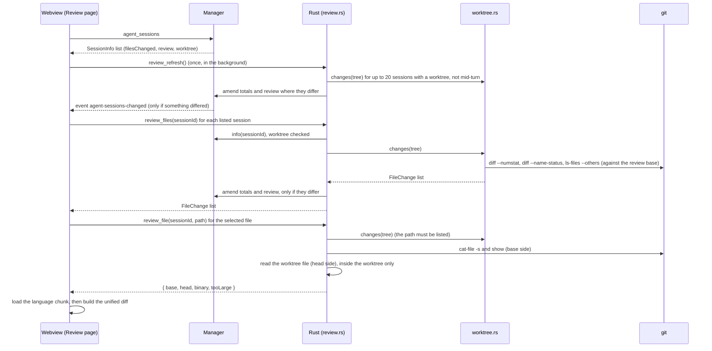
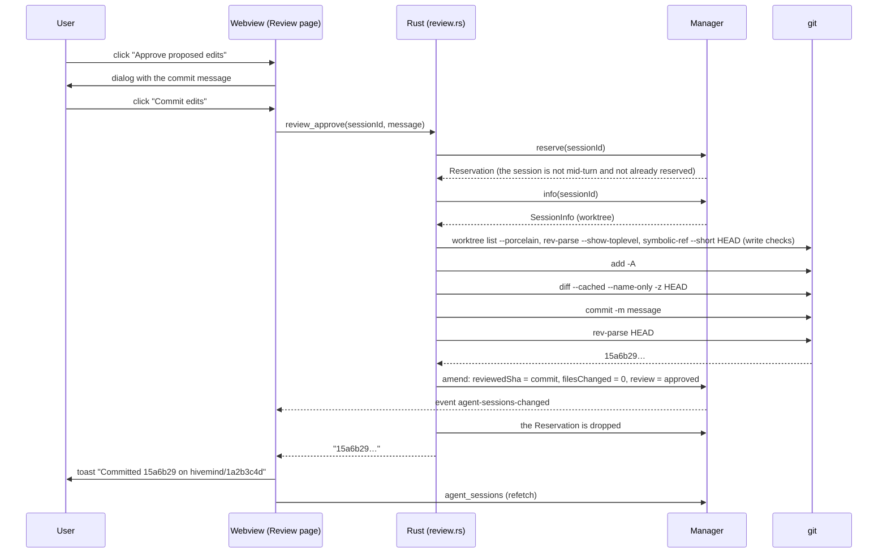
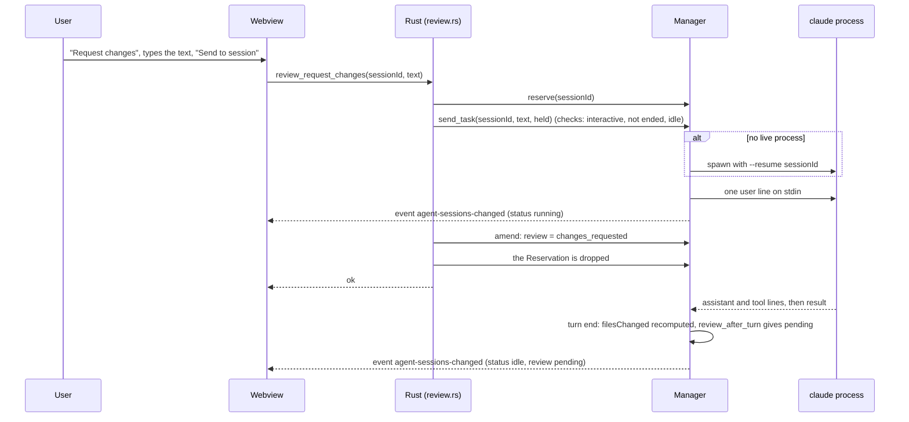
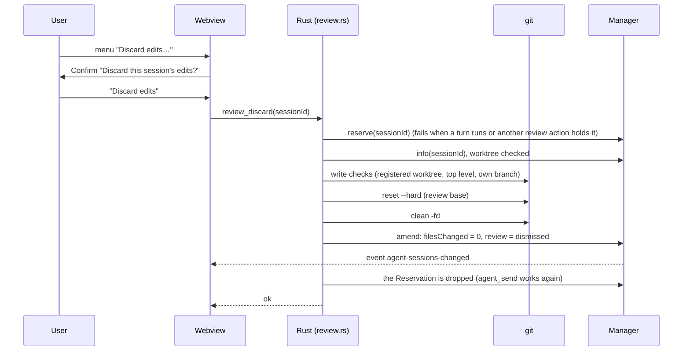
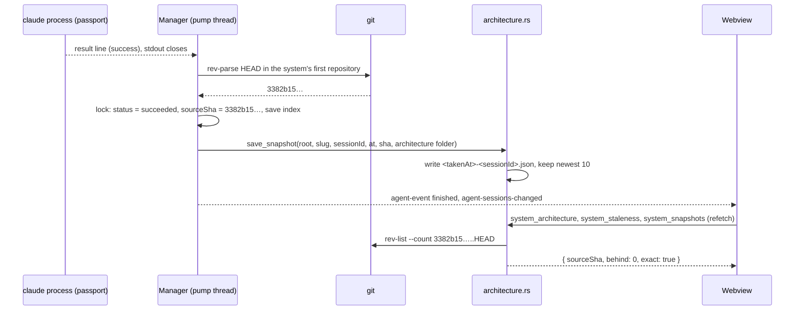

# Phase 4: Review

Read [README.md](README.md) first. Its section 1 (decisions) and section 7 (contracts) are binding; this document goes deeper and does not repeat them. Spike cited here: [spikes/claude-headless.md](spikes/claude-headless.md).

Written 2026-11-10 against branch `feat/mock-ux` at commit `5def8eb`. Phases 2 and 3 were not merged when this was written. What this document says about them comes from README section 7 and from their own documents ([phase-2-interactive-sessions.md](phase-2-interactive-sessions.md), [phase-3-changes.md](phase-3-changes.md)), which are plans, not code. Section 1.4 lists the checks to run before you start; section 1.5 lists the names taken from those plans.

---

## 1. Goal, mock screens, non-goals

### 1.1 What the user gets

Phase 2 lets an agent edit files in a git worktree. Phase 3 ties sessions to changes. Phase 4 lets the user look at what the agent did and decide.

1. A **Review page** (mock 10) that lists every session with proposed edits, shows each changed file as a diff with line numbers and syntax colours, shows what the agent ran to validate its work, and offers four decisions: approve (commit on the session's branch), request changes (send a message to the session), dismiss (hide from the queue), discard (throw the edits away).
2. **Memory items** on the same page: notes due for review, and notes an agent captured that nobody has confirmed.
3. **Architecture items** on the same page: registry updates an agent proposed, and systems whose architecture output is older than the code ("newer candidate").
4. An exact **"Snapshot is N commits behind"** figure, computed by git, on the Architecture page and on Overview.
5. **Baselines** on the architecture canvas (mock 07): a copy of the model is kept each time a passport session succeeds; a select switches between them; **Compare** tints what was added or changed and names what was removed; **View evidence** shows where an element came from.
6. Every existing "review" entry point (chat card, Overview, Changes) leads to the Review page and shows the real state.

### 1.2 Mock screens

The mocks are PNG files in the folder `hivemind-mocks` beside the repository. Ignore the wordmark in them; the product is Hivemind.

| Mock | What Phase 4 takes from it |
| --- | --- |
| `10_Agent_Code_Review.png` | The whole Review page. |
| `03_Agent_Workspace_Chat.png` | The files-proposed card's "Review changes" button and "Waiting for review" label; the rail row "3 files awaiting review". |
| `01_Project_Overview.png` | "Needs your review": "3 proposed file changes" and "Architecture snapshot is 2 commits behind". |
| `05_Changes_List.png`, `06_Change_Detail.png` | The "Waiting for review" chip, "3 files awaiting review", "Review proposed changes". |
| `07_Architecture_Diagram_Viewer.png` | "Current baseline · Nov 6" select, "Compare", the caption "Baseline from source 8d3a91c", the banner "Snapshot is 2 commits behind", "View evidence". |

Mock 10 in words (1487x1058): title "Review", subtitle "Inspect agent changes before they become accepted work.". Pill tabs "All 5", "Code 3", "Memory 1", "Architecture 1". Left column: a bold header "CHG-014 · Claude Code", three file rows with a file icon (`EventHandler.java` selected and filled, `IdempotencyStore.java`, `EventHandlerTest.java`), a divider, then "Memory: replay lesson" and "Architecture: newer candidate". Right column: the file name as a heading; a mono line with a branch icon, "feature/idempotency • Base 8d3a91c", and "+24 −6" in green and red at the right edge; a code box with a line-number gutter, one removed line on a red background with a "−" sign, four added lines on a green background with "+" signs, context lines above and below, Java syntax colours; a rule; "Validation" with a "View test output →" link, a green check row "Agent-reported component tests: 12 passed" and a yellow warning row "Restart recovery has not been verified.". Bottom bar across the page: "**3 files proposed** · Waiting for your review", under it a warning icon and "Reviewing code does not mark the change complete.", then the buttons "Approve proposed edits" (green, filled), "Request changes" (outlined) and "Dismiss" (text).

### 1.3 Non-goals

- No merge, no push, no pull request. Approve commits on the session's own branch and stops there (README section 1, decision 6).
- No editing in the diff, no per-hunk accept or reject, no comments on lines.
- No side-by-side diff. One unified view.
- No structured result schema on chat turns. Validation is derived from what the session already logged.
- Approving does not change a change's stage or status. The warning line says so.
- No change to Living Memory. The Memory items use commands that exist today.
- The mock 07 controls "Diagram: Containers" (a select; Phase 1 built it as the segmented control at the bottom of the canvas), "Export", "Discuss with agent", "Linked decisions", "Related change" and "Attach to agent context" are not part of this phase.
- No worktree is ever deleted by Phase 4. Discard resets a worktree; removing worktrees is Phase 2's business.
- Removed elements are not drawn on the canvas in Compare. They are named in the legend (section 4.9 says why).

### 1.4 Preflight checklist

Run these from the repository root before changing anything. Each must match. If one does not, Phase 2 or 3 is not merged as its document describes: read the real code, adapt the name, and write the difference down for the final report. Stop and tell the user only if a whole piece is missing (no worktrees, no `agent_send`, no changes registry).

| # | Command | Must show |
| --- | --- | --- |
| P1 | `git log --oneline -15` | Commits for Phase 2 (interactive sessions) and Phase 3 (changes). |
| P2 | `git grep -n "mod worktree" src-tauri/src/lib.rs` | `src-tauri/src/worktree.rs` exists and is registered. |
| P3 | `git grep -n "pub struct Worktree\|pub struct FileChange\|pub struct Totals\|pub fn changes\|pub fn totals\|pub fn patch\|pub fn ahead\|pub fn remove" src-tauri/src/worktree.rs` | Phase 2's worktree type, its per-file type with a `binary` flag, its totals type, the listing, and the two functions that decide whether a branch is deleted (`ahead`, `remove`). Read `changes`, `ahead` and `remove` in full. |
| P4 | `git grep -n "files_changed" src-tauri/src/agent` | The place a finished turn stores `files_changed`. This is the hook point of section 4.4. |
| P5 | `git grep -n "fn agent_send\|fn agent_files\|fn agent_end\|fn agent_interrupt\|fn agent_answer" src-tauri/src/lib.rs` and `git grep -n "pub fn send_task\|pub fn send\|pub fn files\|fn record\|pub fn events_of" src-tauri/src/agent/mod.rs` | All five commands; `send_task` (what `agent_send` calls), `Manager::send`, `Manager::files`, `Inner::record`, `events_of`. |
| P6 | `git grep -n '"--resume"' src-tauri/src/agent` | The adapter can resume a session. Read what the send does for a session with no live process and for an ended one (section 4.6, UNVERIFIED-2). |
| P7 | `git grep -n "Idle\|Waiting\|Ended" src-tauri/src/agent/events.rs` | The `Status` variants of README 7.1. |
| P8 | `git grep -n "UserMessage\|TurnFinished\|FilesChanged" src-tauri/src/agent/events.rs` | The `RunEvent` variants of README 7.1. |
| P9 | `git grep -n "worktrees_dir" src-tauri/src/lib.rs` | `AppState.worktrees_dir`, the folder `worktrees` under the app data folder. |
| P10 | `git grep -n "filesChanged\|worktree\|turns\|export interface FileChange" src/lib/agent.ts` and `git grep -n "export function waitingForReview\|export const isEnded" src/features/agents/session.ts` | The TypeScript `SessionInfo` has the Phase 2 fields; the two helpers exist. |
| P11 | `git grep -n "FilesCard\|ChangesModal\|Review changes\|awaiting review" src/features/agents` and `git grep -n "num-add\|num-del\|files-card" src/App.css` | `FilesCard` and `ChangesModal` in `src/features/agents/Chat.tsx`, where `AgentWorkspace.tsx` opens the modal (the card's `onReview` and the rail's "awaiting review" row), and the classes for the green and red counts. |
| P12 | `git grep -n "useChangesEnabled" src/lib/connection.ts`, `git grep -n "export interface Change \|export const changes " src/lib/lm.ts`, `git grep -n "export const changesQuery" src/features/changes/useChanges.ts`, `git grep -n "export const engineName\|export const displayId\|export function sessionLine\|export function changeChip" src/features/changes/changes.ts` | Phase 3's gate, its `Change` type and reader, its changes query (key `["changes"]`), and its helpers for the engine's name, the change number, the session line and the chip. |
| P13 | `git grep -n "Waiting for review\|awaiting review\|Review proposed changes" src/features` | Every place Phases 2 and 3 show the review state. Section 6.20 changes each one. |
| P14 | `git grep -n "review\b\|reviewed_sha" src-tauri/src/agent/mod.rs src-tauri/src/worktree.rs` | Nothing about a `review` field or a `reviewed_sha` yet. If there is one, compare it with section 4.1 before adding a second. |
| P15 | `npm test`, `npx tsc --noEmit`, `cd src-tauri && cargo test && cargo clippy` | All green before you start. |
| P16 | `git --version` | Git 2.30 or newer on PATH (section 5.1 was verified on 2.56). |

### 1.5 Names taken from the Phase 2 and Phase 3 plans

This document uses these names as those plans give them. Where the merged code differs, use the code's name everywhere; do not add an alias.

| Name | Where the plan puts it | Checked by |
| --- | --- | --- |
| `Worktree { repo, path, branch, base_branch, base_sha }` | `src-tauri/src/worktree.rs`; `SessionInfo.worktree: Option<Worktree>` | P3 |
| `FileChange { path, status, added, removed, binary }`, `Totals { files, added, removed }` | `src-tauri/src/worktree.rs`; `SessionInfo.files_changed: Option<Totals>` | P3, P4 |
| `worktree::changes(&Worktree) -> Result<Vec<FileChange>, String>`, `worktree::totals(&[FileChange]) -> Totals`, `worktree::ahead(&Worktree) -> Result<u64, String>` | `src-tauri/src/worktree.rs` | P3 |
| `send_task(manager, bridge, saved, id, text, options: SendOptions)`; `Manager::send`; `Manager::files`; `Inner::record`; `Inner::update` | `src-tauri/src/agent/mod.rs`; `send_task` is what `agent_send` calls | P5 |
| `Adapter::user_line` (today's `first_message`, renamed by Phase 2) | `src-tauri/src/agent/mod.rs`, `src-tauri/src/agent/claude.rs` | P6 |
| `fn git(dir: &Path) -> Command` (private: `git --no-optional-locks -c core.longpaths=true -c core.quotepath=false -C <dir>`) | `src-tauri/src/worktree.rs` | P3 |
| `AppState.worktrees_dir` | `src-tauri/src/lib.rs` | P9 |
| `Status::Idle`, `Status::Waiting`, `Status::Ended` | `src-tauri/src/agent/events.rs` | P7 |
| `FileChange`, `FileTotals`, `Worktree` (TypeScript); `info.project`, `info.turns` | `src/lib/agent.ts` | P10 |
| `waitingForReview(s)`, `isEnded(s)` | `src/features/agents/session.ts` | P10 |
| `FilesCard({ files, latest, onReview })`, `ChangesModal({ info, onClose })`; the classes `num-add`, `num-del`; the item kind `files` and `latestFiles(t)` | `src/features/agents/Chat.tsx`, `src/App.css`, `src/features/agents/events.ts` | P11 |
| `Change` (`id`, `display`, `title`, …), `changes()` | `src/lib/lm.ts` | P12 |
| `changesQuery()` (key `["changes"]`) | `src/features/changes/useChanges.ts` | P12 |
| `engineName(adapter)`, `displayId(id)`, `sessionLine(s)`, `changeChip(...)` | `src/features/changes/changes.ts` | P12 |
| `useChangesEnabled` | `src/lib/connection.ts` | P12 |
| `Markdown({ children })` | `src/ui/Markdown.tsx` (in the tree today) | exists |

---

## 2. Decisions already made

Do not reopen these.

| Date | Decision | Source |
| --- | --- | --- |
| 2026-11-10 | "Approve proposed edits" commits the session's edits on the session's own worktree branch. It never merges and never pushes. | README section 1, decision 6; phase brief |
| 2026-11-10 | The mock's warning stays on screen: "Reviewing code does not mark the change complete." | Phase brief |
| 2026-11-10 | Command names and the `SessionInfo.review` shape are fixed in README section 7.3. | Phase brief |
| 2026-11-10 | Sections are pages. The Review page is one page; diffs do not open as tabs or panes. | README section 1, decision 2 |
| 2026-11-10 | Dark only; the brand is "Hivemind". | README section 1, decisions 3 and 4 |

Choices this document makes where the README leaves room. Each has its reason in one sentence. They are part of the design; change one only if it turns out wrong, and report it.

| # | Choice | Why |
| --- | --- | --- |
| C1 | The review code lives in a new `src-tauri/src/review.rs`, not in `worktree.rs`. | `worktree.rs` makes and removes worktrees; reading diffs, committing and resetting is a different job and about 400 lines. |
| C2 | The listing of a worktree's changes is Phase 2's `worktree::changes`. `review_files` calls it; nothing in Phase 4 lists files a second way. | Two listings would disagree about untracked or binary files and the page would show two different counts. |
| C3 | An approval records its commit as the session's **review base**, in a new field `worktree.reviewedSha`. Edits are compared with the review base from then on. `worktree.baseSha` never changes. | A later turn's files are then only the edits made since the last approval, and a discard can never undo approved work. `baseSha` must stay where the branch started because Phase 2 counts commits ahead of it to decide whether a branch holds work (it deletes a branch that holds none). |
| C4 | Approve commits with the identity git already has (the user's). When git has none, approve fails and says how to set it. | The commit is the user's decision; inventing an author would put a made-up name in the user's history. |
| C5 | Commit hooks run. Signing settings are respected. | The repository's rules apply to Hivemind's commits as to any other; skipping them silently would let through what the user's own commits would not. |
| C6 | A finished turn reopens the review (`pending`) when it answers a "request changes" or when the totals of changed files differ from before. | It needs no extra stored state, and a dismissed session stays dismissed when a turn changes no files. |
| C7 | Discard records `dismissed` with zero files. | README 7.3 has four states and no "discarded"; discarded edits are edits the user declined. |
| C8 | Validation matches a fixed list of command patterns at the start of each shell command segment. | "Starts with" keeps `grep pytest` and `cat test.txt` from counting as test runs. |
| C9 | A command that ran earlier and ran again later is shown once, with its latest outcome. | A test that failed, was fixed and passed should read as passed. |
| C10 | Unconfirmed agent captures are looked up with `list` plus one `read --metadata-only` per recent note, at most 40. | `list` rows carry neither `origin` nor `confirmed` (section 5.4), and Living Memory is not changed in this phase. |
| C11 | Snapshots are JSON files in `<app data>/architecture-snapshots/<slug>/<takenAt>-<sessionId>.json`, the newest 10 per system. | A listing needs only file names; ten baselines is more than a canvas select can usefully show. |
| C12 | When the current output was not made by a Hivemind session, "commits behind" counts commits made after the model file was written; with a `sourceSha` it counts `sourceSha..HEAD`. | Output generated outside Hivemind should still be reported as stale; the count from a commit id is exact and is used whenever there is one. |
| C13 | Relationships are compared by `source_id -> destination_id`, not by `id`. | The suite numbers relationship ids by position (`containers-r3`), so they shift when one is inserted; the canvas already draws one arrow per pair. |
| C14 | The Review route is `{ page: "review"; session?: string; file?: string }`; the selected Memory or Architecture item is component state. | Other pages only ever link to a session or a file. |

---

## 3. The code as it stands

Every path is relative to the repository root. Find each place by its anchor string.

### 3.1 Rust

| Place | What it does today | Why it matters here |
| --- | --- | --- |
| `src-tauri/src/git.rs` (anchor `pub fn run_with_timeout`) | Runs a command with `GIT_TERMINAL_PROMPT=0`, no stdin, piped stdout and stderr, `CREATE_NO_WINDOW` on Windows; kills it after the timeout. Returns stdout as lossy UTF-8. On a non-zero exit the error is the **first** non-empty stderr line only. | Review needs the exit code and the whole stderr (a failing hook, an identity error after CRLF warnings). Section 6.1 splits this function in two. |
| `src-tauri/src/git.rs` (anchor `fn commits_for`) | The only git call today: `git --no-optional-locks -C <repo> log ...`. | The pattern to copy: `--no-optional-locks` and `-C <dir>` first, then the subcommand; arguments are passed one by one, never through a shell. |
| `src-tauri/src/git.rs` (anchor `const TIMEOUT: Duration`) | 10 seconds, private. | Review defines its own timeouts. |
| `src-tauri/src/agent/mod.rs` (anchor `pub struct SessionInfo`) | The listed details of a session, `camelCase` in JSON. | Gains `review` and `source_sha` (section 4.1). |
| `src-tauri/src/agent/mod.rs` (anchor `fn update(&self, id: &str`) | `Inner::update`: changes a session's details under the `sessions` mutex, saves the index, emits `SessionsChanged`. Private; silently ignores an unknown id. | The model for the public `Manager::amend` of section 6.3. |
| `src-tauri/src/agent/mod.rs` (anchor `fn pump(`) | The reader thread. When the process has exited it takes the lock, builds the one `Finished` event and stores status, cost, error and `structured` (anchor `info.structured = structured.clone();`). | Where a succeeded passport session gets its `source_sha` and its snapshot (section 6.4). Phase 2 has reshaped this function; keep the intent. |
| `src-tauri/src/agent/mod.rs` (anchor `pub fn session(&self, id: &str, from_seq: u64)`) | Rebuilds a session's events from its log through `adapter.parse_line`. | `Manager::tool_output` reads the same log the same way. |
| `src-tauri/src/agent/mod.rs` (anchor `pub trait Adapter`) | What a CLI adapter provides. | Gains one provided method, `tool_result` (section 6.5). |
| `src-tauri/src/agent/mod.rs` (anchor `struct Rig`) | The test rig: a fake adapter that prints a file of lines. | Reuse it for the snapshot test. |
| `src-tauri/src/agent/claude.rs` (anchor `const RESULT_SUMMARY: usize = 500;`) | A tool result is clipped to 500 characters before it becomes a `ToolResult` event (anchor `fn result_summary`). | Why "View test output" must read the raw log. |
| `src-tauri/src/agent/claude.rs` (anchor `fn name(&self)`) | Returns `"claude-code"`. | The page shows it as "Claude Code" through Phase 3's `engineName`. |
| `src-tauri/src/agent/store.rs` (anchor `pub fn load_index`) | Returns an empty history if **any** entry fails to parse. | Every new `SessionInfo` field needs `#[serde(default)]` and the old-index test of section 8. |
| `src-tauri/src/agent/store.rs` (anchor `pub fn read_log`) | Every readable `Record` of a session; `Record::Raw { at, raw }` is a line the CLI printed. | The source for the full tool output. |
| `src-tauri/src/agent/store.rs` (anchor `pub fn log_path`) | Accepts only a plain lowercase UUID; the error is `Invalid session id`. | Every new command that takes a session id goes through it first. |
| `src-tauri/src/agent/store.rs` (anchor `pub const KEEP: usize = 50;`) | The index keeps the newest 50 sessions. | Snapshots must not depend on the session still being listed (section 4.8). |
| `src-tauri/src/agent/scope.rs` (anchor `add_dirs: repos.chain([architecture.clone()]).collect()`) | A passport session's folders: the first repository is the working directory and the architecture folder is the **last** entry. | `SessionInfo.workspace` is built in that order, so `workspace[0]` is the repository and `workspace.last()` is the architecture folder. Section 6.4 relies on it. |
| `src-tauri/src/architecture.rs` (anchor `const MODEL: &str`) | `architecture-model.json`. | The file a snapshot copies. |
| `src-tauri/src/architecture.rs` (anchor `pub fn system_entry`) | One system's registry entry from Living Memory (`systems --actor viewer`). | Staleness looks up the system's first repository and folder with it. |
| `src-tauri/src/architecture.rs` (anchor `fn read_json`), (anchor `fn modified_ms`) | Reads a JSON file up to 16 MiB; a file's modification time in milliseconds. | Reused by snapshots and staleness. |
| `src-tauri/src/architecture.rs` (anchor `pub fn read_diagram`) | Serves a file only if the manifest lists it and its canonical path is inside the canonical folder. | The same two checks, in the same order, guard `review_file`. |
| `src-tauri/src/lib.rs` (anchor `struct AppState`) | Bridge, settings path, drafts folder, the agent manager. | Phase 2 adds `worktrees_dir` to it; Phase 4 adds `snapshots_dir`. |
| `src-tauri/src/lib.rs` (anchor `async fn blocking`) | Runs blocking work off the async runtime. | Every new command uses it. |
| `src-tauri/src/lib.rs` (anchor `tauri::generate_handler![`) | The command list. | Eleven new names (section 4.2). |
| `src-tauri/src/lib.rs` (anchor `let sessions_dir`) | `<app data>/agent-sessions`. | The snapshots folder is its sibling. |

The signatures this phase calls or copies:

```rust
// src-tauri/src/git.rs
pub fn run_with_timeout(mut command: Command, timeout: Duration) -> Result<String, String>
pub fn drain<R: Read + Send + 'static>(pipe: Option<R>) -> std::thread::JoinHandle<String>

// src-tauri/src/agent/store.rs
pub fn log_path(dir: &Path, id: &str) -> Result<PathBuf, String>
pub fn read_log(dir: &Path, id: &str) -> Result<Vec<Record>, String>

// src-tauri/src/agent/mod.rs
pub fn sessions(&self) -> Vec<SessionInfo>
fn update(&self, id: &str, change: impl FnOnce(&mut SessionInfo))          // on Inner

// src-tauri/src/architecture.rs
pub fn system_entry(bridge: &Bridge, slug: &str) -> Result<Value, String>
```

### 3.2 Frontend

| Place | What it does today | Why it matters here |
| --- | --- | --- |
| `src/features/review/ReviewPage.tsx` (anchor `export function ReviewPage()`) | At the last commit (`git show HEAD:src/features/review/ReviewPage.tsx`): two sections over existing data, Architecture proposals and Memory (notes due), under three pill tabs. | Replaced by the page of section 7.1. Its two data sources stay. The page may have gained a section by the time you start; section 6.17 says what to do then. |
| `src/features/work/ReviewQueue.tsx` (anchor `function ReviewItem`) | One due note as a card with "Still true", "Snooze 7d/30d/90d", "Archive…". After a write it invalidates three query keys (anchor `for (const key of [["review"], ["list"], ["note", row.ref]])`). | Reused for Memory items; gains a `snooze` prop and one more key. |
| `src/features/systems/useSystem.ts` (anchor `export function useSystemProposals`) | For each system: its sessions, the newest succeeded one, and the registry update it proposed unless dismissed (dismissals are kept in `localStorage`, anchor `const DISMISSED`). | The Architecture items of kind "proposal". Unchanged. |
| `src/features/systems/ArchitecturePage.tsx` (anchor `function SystemView(`) | Lays out the canvas, the rail and the sections for one system. Builds the canvas caption (anchor `const generated =`). | Gains the baseline state, Compare and the staleness banner. |
| `src/features/systems/ArchitecturePage.tsx` (anchor `function Inspector(`) | The rail card for the selected box: kind line, description, decisions that mention it, "Talks to". | Gains the banner and "View evidence". |
| `src/features/systems/ArchitectureCanvas.tsx` (anchor `export function ArchitectureCanvas`) | Draws a level from the model with pan and zoom. Top bar (anchor `<div className="canvas-top">`): caption and the Source switch. Nodes (anchor `laid.nodes.map((n) => (`) and edges (anchor `laid.edges.map((e) => {`) get the class `on` when selected. | Gains two props: extra top-bar controls and a diff to tint by. |
| `src/features/systems/canvas.ts` (anchor `export function canvasGraph`) | Which boxes and arrows a level shows. An arrow's id is `source->destination` (anchor `const key =`). | The diff uses the same key for relationships. |
| `src/features/editor/MergeDialog.tsx` (anchor `new MergeView({`) | The only use of `@codemirror/merge` today: the two-pane `MergeView`. | Shows the package works in this build. The diff pane uses the other export, `unifiedMergeView`. |
| `src/features/editor/MarkdownEditor.tsx` (anchor `const theme = EditorView.theme({`) | The app's CodeMirror theme: transparent background, `var(--fg)` text, `var(--accent-soft)` selection. Not exported, and it carries editor-only padding. Its highlight style (anchor `const style = HighlightStyle.define([`) is for Markdown. | The diff pane defines its own small theme with the same tokens and a highlight style for code. Do not export or change the editor's. |
| `src/features/plans/PlanDialog.tsx` (anchor `export function DiffView`) | Renders a unified diff **text** with `diff-line add/del/hunk/meta` spans. | Not used for file diffs (no line numbers, no syntax colours). The name `DiffView` is taken; the new component is `CodeDiff`. |
| `src/features/agents/AgentWorkspace.tsx` (anchor `function Session(`) | Loads a session's log once (anchor `queryKey: ["agent", "session", id]`, `staleTime: Infinity`) and keeps it current in component state from live events. | The cached log is not kept current, so the Review page reads the log under its own key (section 4.10). Phase 2 put the chat, with the files-proposed card, in `Chat.tsx` beside it. |
| `src/features/agents/events.ts` (anchor `export function apply(`) | The reducer from `SeqEvent`s to a transcript. | Validation is a second, separate reduction over the same events. |
| `src/features/projects/OverviewPage.tsx` (anchor `function SystemContext(`) | Shows the system diagram row and, from commit dates (anchor `const behind =`), the row "Architecture snapshot is N commits behind". | The estimate is replaced; the row moves into "Needs your review" (anchor `<Section title="Needs your review"`). |
| `src/App.css` (anchor `--diff-add: #0a4032;`) | The tokens `--diff-add`, `--diff-del` and `--bg-code` (anchor `--bg-code: #170d24;`); used today by `.diff-line.add` and `.diff-line.del`. | The diff pane's line backgrounds and its box. |
| `src/App.css` (anchor `.status-chip.waiting`) | The yellow chip. | "Waiting for review" everywhere. |
| `src/App.css` (anchor `.banner.warn`) | The yellow-bordered warning box. | The "Snapshot is N commits behind" banner. |
| `src/store.ts` (anchor `export type Route =`) | The routes and the helpers `openProject`, `openSystem`, `openSession`. | The `review` route gains `session` and `file`; a helper `openReview` is added. |
| `src/lib/agent.ts` (anchor `export interface SessionInfo`) | Session types and the `agent_*` invokes. | Gains the review types and invokes. |
| `src/lib/lm.ts` (anchor `export const meta =`) | `read REF --metadata-only`: a note's properties without its body, including `origin` and `confirmed` (anchor `confirmed?: string[]`). | How unconfirmed agent captures are found. |
| `src/lib/lm.ts` (anchor `export const ORIGIN = "hivemind:local";`) | The origin Hivemind's own captures carry. | Captures with this origin are the user's, not an agent's. |
| `src/lib/refresh.ts` (anchor `const KEEP =`) | Query keys whose first element is `connect`, `git`, `diff`, `architecture` or `agent` are not refetched when notes change. | New git-backed and session-backed queries start with `agent` or `architecture` for that reason. |
| `src/main.tsx` (anchor `refetchOnWindowFocus: false`) | Query defaults: no refetch on focus, `retry: 1`, `staleTime: 30_000`. | Review queries set their own `staleTime` and `retry`. |
| `src/App.tsx` (anchor `listen("agent-sessions-changed"`) | Invalidates `["agent", "sessions"]` when the manager says sessions changed. | The only event Phase 4 needs; no new event. |
| `src/ui/Page.tsx` (anchor `export function Tabs`) | Underlined or pill tabs with counts. | The page's pill tabs. |
| `src/ui/Modal.tsx` (anchor `export function Confirm`) | `Modal` and the yes/no `Confirm`. | The approve, request-changes, output and evidence dialogs, and the discard confirmation. |
| `src/ui/Markdown.tsx` (anchor `export function Markdown`) | `Markdown({ children })`: react-markdown with GFM whose links open in the system browser instead of navigating the app window. | The only way this phase renders Markdown text (the note summary of a Memory item). |
| `src/features/history/OperationList.tsx` (anchor `queryKey: ["meta", ref]`) | Already caches `meta(ref)` per note under `["meta", ref]`. | The Memory items share that cache. |

---

## 4. Architecture

### 4.1 Data model

**Rust, in `src-tauri/src/agent/mod.rs`, beside `SessionInfo`.** They live there, not in `review.rs`, because the manager's turn-end code must set them and `agent` must not depend on `review`.

```rust
/// What the user decided about a work session's edits.
#[derive(Serialize, Deserialize, Clone, Copy, Debug, PartialEq)]
#[serde(rename_all = "snake_case")]
pub enum ReviewState {
    Pending,
    Approved,
    ChangesRequested,
    Dismissed,
}

#[derive(Serialize, Deserialize, Clone, Debug, PartialEq)]
#[serde(rename_all = "camelCase")]
pub struct Review {
    pub state: ReviewState,
    /// The commit an approval made (or found); None in every other state.
    pub commit: Option<String>,
    /// When the state last changed, in milliseconds since the epoch.
    pub at: u64,
}
```

`SessionInfo` gains two fields, after the Phase 2 fields:

```rust
    /// The user's decision about the proposed edits. None reads as "pending".
    #[serde(default)]
    pub review: Option<Review>,
    /// For a passport session: the repository's HEAD when it succeeded.
    #[serde(default)]
    pub source_sha: Option<String>,
```

Every literal `SessionInfo { ... }` in the code and the tests needs the two fields (`review: None, source_sha: None`); the compiler lists them.

JSON, as stored in `index.json` and sent to the webview:

```json
{ "review": { "state": "approved", "commit": "15a6b29b6425ad81675cd7d56434dfffc84d734e", "at": 1794322874000 }, "sourceSha": null }
{ "review": { "state": "changes_requested", "commit": null, "at": 1794322990000 }, "sourceSha": null }
{ "review": null, "sourceSha": "3382b1501c612f54d521720304adab0dd4747a87" }
```

**Rust, in `src-tauri/src/worktree.rs` (Phase 2's file).** `Worktree` gains one field and one method (choice C3):

```rust
    /// The commit of the last approval. Edits are compared with it from then on; `base_sha` never changes.
    #[serde(default, skip_serializing_if = "Option::is_none")]
    pub reviewed_sha: Option<String>,
```

```rust
impl Worktree {
    /// The commit the proposed edits are compared with: the last approved commit, else where the branch started.
    pub fn review_base(&self) -> &str {
        self.reviewed_sha.as_deref().unwrap_or(&self.base_sha)
    }
}
```

In JSON the key `reviewedSha` is absent until the first approval, so everything Phase 2 stored and tested keeps its shape:

```json
{ "worktree": { "repo": "C:/demo/repos/paystream", "path": "…\\worktrees\\paystream-5d1c0a3e\\1a2b3c4d", "branch": "hivemind/1a2b3c4d", "baseBranch": "main", "baseSha": "3382b1501c612f54d521720304adab0dd4747a87", "reviewedSha": "15a6b29b6425ad81675cd7d56434dfffc84d734e" } }
```

The per-file type is Phase 2's `worktree::FileChange` (`path`; `status` `"A"`, `"M"` or `"D"`; `added`; `removed`; `binary`). `review_files` returns a list of them. Phase 4 declares no per-file type of its own.

**Rust, in the new `src-tauri/src/review.rs`:**

```rust
/// The two versions of one changed file. README 7.3 fixes `base`, `head` and `binary`; `too_large` is added.
#[derive(Serialize, Debug, PartialEq)]
#[serde(rename_all = "camelCase")]
pub struct FileContents {
    /// The file at the review base; None when it did not exist there, or is binary or too large.
    pub base: Option<String>,
    /// The file in the worktree now; None when it was deleted, or is binary or too large.
    pub head: Option<String>,
    pub binary: bool,
    /// One side is larger than MAX_FILE.
    pub too_large: bool,
}
```

**Rust, in `src-tauri/src/agent/mod.rs`:**

```rust
/// The full text of one tool result, read back from the raw log.
#[derive(Serialize, Debug, PartialEq)]
pub struct ToolOutput {
    pub text: String,
    pub ok: bool,
    /// The text was longer than MAX_OUTPUT characters; its end is kept.
    pub truncated: bool,
}
```

**Rust, in `src-tauri/src/architecture.rs`:**

```rust
#[derive(Serialize, Debug, PartialEq)]
#[serde(rename_all = "camelCase")]
pub struct Staleness {
    /// The commit the current output was generated from, when a Hivemind session generated it.
    pub source_sha: Option<String>,
    /// Commits on the repository's HEAD that the output has not seen; None when it cannot be told.
    pub behind: Option<u64>,
    /// False when `behind` was counted from the model file's date because no `source_sha` applies.
    pub exact: bool,
}

#[derive(Serialize, Debug, PartialEq)]
#[serde(rename_all = "camelCase")]
pub struct SnapshotInfo {
    /// The file's stem: "<takenAt>-<sessionId>".
    pub id: String,
    pub session_id: String,
    pub taken_at: u64,
}

/// One stored copy of architecture-model.json, as written to disk.
#[derive(Serialize, Deserialize, Debug, PartialEq)]
#[serde(rename_all = "camelCase")]
pub struct Snapshot {
    pub session_id: String,
    pub taken_at: u64,
    pub source_sha: Option<String>,
    pub model: Value,
}
```

**TypeScript, in `src/lib/agent.ts`:**

```ts
export type ReviewState = "pending" | "approved" | "changes_requested" | "dismissed";
export interface Review { state: ReviewState; commit: string | null; at: number }
// SessionInfo gains:  review: Review | null;  sourceSha: string | null;
// Worktree gains:     reviewedSha?: string;

export interface FileContents { base: string | null; head: string | null; binary: boolean; tooLarge: boolean }
export interface ToolOutput { text: string; ok: boolean; truncated: boolean }
```

**TypeScript, in `src/lib/architecture.ts`:**

```ts
export interface ArchEvidence { id: string; reference?: string; kind?: string; line?: number; excerpt?: string; confidence?: number }
// ArchElement and ArchRelationship gain:  evidence_ids?: string[];
// ArchModel gains:                        evidence?: ArchEvidence[];

export interface Staleness { sourceSha: string | null; behind: number | null; exact: boolean }
export interface SnapshotInfo { id: string; sessionId: string; takenAt: number }
export interface Snapshot { sessionId: string; takenAt: number; sourceSha: string | null; model: ArchModel }
```

### 4.2 Commands and events

Every command takes names only: a session id, a system slug, a path that must be on a list Rust builds itself. No command takes a folder, a commit id or a command line from the webview. Tauri turns the camelCase argument names below into the snake_case Rust parameters, as it does today for `agent_session`.

| Command | Arguments | Returns | Errors (exact text) |
| --- | --- | --- | --- |
| `review_files` | `sessionId` | `FileChange[]`, sorted by path | the common errors below |
| `review_file` | `sessionId`, `path` | `FileContents` | common; `That file is not one of this session's changes`; `That file is outside the worktree` |
| `review_approve` | `sessionId`, `message` | the commit id (40 hex characters) | common; busy; the write checks; `Write a commit message first.`; `There is nothing to approve: the worktree matches its base commit.`; the identity error; `The commit did not go through:` followed by git's last lines |
| `review_request_changes` | `sessionId`, `text` | nothing | `Write what should change first.`; busy; then the errors of Phase 2's `agent_send`, unchanged: `Invalid session id`; `Unknown session`; `This session does not take messages`; `This session has ended`; `The agent is still working; wait for this turn to finish or stop it`; `This session's worktree no longer exists; end the session`; its start and limit errors |
| `review_dismiss` | `sessionId` | nothing | `Invalid session id`; `Unknown session` |
| `review_discard` | `sessionId` | nothing | common; busy; the write checks |
| `review_refresh` | none | the number of sessions whose stored totals changed | none (a session whose worktree cannot be read is skipped) |
| `review_tool_output` | `sessionId`, `toolUseId` | `ToolOutput` | `Invalid session id`; `Unknown session`; `That tool call has no result in this session's log` |
| `system_staleness` | `slug` | `Staleness` | `Unknown system: <slug>`; Living Memory's own error |
| `system_snapshots` | `slug` | `SnapshotInfo[]`, newest first | `Invalid system slug` |
| `system_snapshot` | `slug`, `id` | `Snapshot` | `Invalid system slug`; `Unknown snapshot` |

Common errors, in the order they are checked:

```text
Invalid session id
Unknown session
This session has no worktree to review
The session's base commit is not a commit id
The session's worktree folder is missing: <path>
The session's worktree is outside Hivemind's worktrees folder
Could not run git: <the operating system's message>
git timed out after <n>s
<git's own "fatal: ..." or "error: ..." line>
```

Busy (from `Manager::reserve`, section 4.11; `review_approve`, `review_discard` and `review_request_changes` all start with it):

```text
This session is busy                                   (a turn is in progress: status running or waiting)
A review action is already running for this session   (another approve, discard or request is still at work)
```

While one of those three commands runs, Phase 2's `agent_send`, `agent_end` and `agent_remove_worktree` answer, for that session:

```text
A review action is running for this session
```

Write checks (before `review_approve` and `review_discard` change anything; section 4.11):

```text
This session's branch name does not match its id: <branch>
The session's folder is not a worktree of <repo>
The session's folder is inside another git checkout: <top-level folder git reported>
The session's worktree is on branch <found>, not on its own branch <branch>
The session's worktree is on a detached commit, not on its own branch <branch>
```

The identity error:

```text
Git has no author identity, so it cannot commit. Set one with: git config --global user.name "Your Name" and git config --global user.email "you@example.com". Then approve again.
```

Examples:

```json
// invoke("review_files", { sessionId: "1a2b3c4d-0000-4000-8000-000000000001" })
[
  { "path": "src/ingest/consumer.py", "status": "M", "added": 24, "removed": 6, "binary": false },
  { "path": "src/ingest/idempotency.py", "status": "A", "added": 12, "removed": 0, "binary": false },
  { "path": "docs/flow.png", "status": "M", "added": 0, "removed": 0, "binary": true }
]

// invoke("review_file", { sessionId: "...", path: "src/ingest/consumer.py" })
{ "base": "def consume(event):\n    return event\n", "head": "def consume(event):\n    key = event.id\n    return event\n", "binary": false, "tooLarge": false }

// invoke("review_approve", { sessionId: "...", message: "Prevent duplicate payment alerts" })
"15a6b29b6425ad81675cd7d56434dfffc84d734e"

// invoke("review_tool_output", { sessionId: "...", toolUseId: "toolu_01JDdQ12vozJ8B3vPpSdHovj" })
{ "text": "============ 12 passed in 0.41s ============", "ok": true, "truncated": false }

// invoke("system_staleness", { slug: "paystream" })
{ "sourceSha": "3382b1501c612f54d521720304adab0dd4747a87", "behind": 2, "exact": true }

// invoke("system_snapshots", { slug: "paystream" })
[ { "id": "1794322874000-1a2b3c4d-0000-4000-8000-000000000001", "sessionId": "1a2b3c4d-0000-4000-8000-000000000001", "takenAt": 1794322874000 } ]
```

**Events.** No new event. Every change to `review`, `sourceSha`, `filesChanged` or `worktree.reviewedSha` goes through `Manager::amend` (or the manager's own update), which saves the index and emits the existing `agent-sessions-changed` event (payload: none). The webview already answers that event by refetching `["agent", "sessions"]`; every review query is keyed by values taken from the refetched `SessionInfo` (section 4.10), so it follows.

### 4.3 Listing a worktree's changes

"Changed" means: different between the **review base** (`worktree.review_base()`: the last approved commit, else `baseSha`) and the files in the worktree **now**. That covers commits the agent made on the branch, staged edits, unstaged edits and untracked files. Ignored files are not changes.

The listing is Phase 2's `worktree::changes(&Worktree)`. It runs three read-only git commands in the worktree, with `--no-optional-locks` so a listing never writes the index:

```text
git --no-optional-locks -C <worktree> diff --numstat -z --no-renames <base> --
git --no-optional-locks -C <worktree> diff --name-status -z --no-renames <base> --
git --no-optional-locks -C <worktree> ls-files --others --exclude-standard -z
```

- `diff <base>` with no second commit compares the commit with the working tree (tracked files, staged or not).
- `--no-renames` reports a rename as one deletion and one addition, so every record has exactly one path.
- `-z` ends every record with a NUL byte and turns off path quoting, so spaces and non-ASCII names come through unchanged.
- `ls-files --others --exclude-standard` lists untracked files that are not ignored, with paths relative to the worktree root.

Phase 4 makes **one change** to it: wherever `changes` and `patch` pass `tree.base_sha` to git as `<base>`, they pass `tree.review_base()` instead (section 6.8). `ahead` and `remove` keep `base_sha`. Because the turn-end totals, the `filesChanged` event, `agent_files` and `review_files` all go through `changes`, they all follow the review base from that one edit.

What `changes` returns, as Phase 2 specifies it and as section 5.1 verified the git output: one `FileChange` per path, sorted by path. Tracked files take their letter from `--name-status` (`A`, `D`; anything else is `M`) and their counts from `--numstat`; a `-` there means `binary`. Untracked files are `A` with `removed = 0`; `added` is the number of `\n` bytes plus one when the file is not empty and does not end in a newline (verified against git: a file `n1\nn2\nn3` is `3 0` once added); a NUL byte in the first 8000 bytes, or a size over Phase 2's limit, makes it `binary`. `worktree::totals` gives `files`, `added`, `removed`.

**Reconciling.** `review_files` compares the totals of what it found with the session's stored `filesChanged`. When they differ and the session is not `running` or `waiting`, it stores the new totals through `Manager::amend`, and in the same update sets `review = review_after_turn(review, old totals, new totals, now)` (section 4.4). This is what makes the counts right, and puts an approved session back in the queue, after someone edits files in the worktree by hand.

**Refreshing every worktree.** `review_files` is only called for sessions the page lists, and an approved or dismissed session is not listed. Edits made in such a worktree outside a turn (by hand, or by a tool the user ran there) would never be noticed. So there is a second entry to the same reconcile, `review_refresh`, that takes no session: for each session, newest first, that has a worktree, is not `running` or `waiting`, and whose worktree folder exists and passes the worktree check, it computes `worktree::changes` and reconciles exactly as above. It stops after `REFRESH_CAP` (20) such sessions. It returns how many sessions changed; a session whose worktree cannot be read is skipped without an error. The Review page and the Overview's "Needs your review" call it once each time they are shown (sections 6.17 and 6.20). A session it reopens arrives through the ordinary `agent-sessions-changed` event, and only then passes the page's filter.

Cost: three read-only git commands per worktree, about a tenth of a second each on a small repository, run one after another on one blocking thread and never on the UI thread; at most 20 worktrees. Sessions without a worktree, and sessions whose folder is gone, cost one metadata lookup. The page does not wait for it: it shows what the stored totals say and updates if the refresh changes them.

**If P3 shows that `worktree::changes` does not exist or does less than this** (no untracked files, no binary flag): write it in `worktree.rs` to this section and section 5.1, with the tests named for that case in section 8, commit 2, and make Phase 2's turn-end code call it. Do not put a listing in `review.rs`.

Opening the page and one file:



### 4.4 The review state machine

`review` is `null` until the first decision or reopening. `null` and `pending` mean the same.

| State | Event | Next state | Side effect |
| --- | --- | --- | --- |
| null, pending, changes_requested, dismissed | `review_approve` succeeds | approved | `git add -A` and `git commit` on the worktree branch; `review.commit` = the new HEAD; `worktree.reviewedSha` = the same commit; `filesChanged` = zero |
| null, pending, dismissed | `review_request_changes` succeeds | changes_requested | the text is sent to the session as a user message; a turn starts |
| changes_requested | `review_request_changes` succeeds | changes_requested | another message; `at` is updated |
| null, pending, changes_requested | `review_dismiss` | dismissed | none; the files stay in the worktree |
| any | `review_discard` succeeds | dismissed | `git reset --hard <review base>` and `git clean -fd` in the worktree; `filesChanged` = zero |
| changes_requested | a turn finishes | pending | none |
| approved, dismissed | a turn finishes with `files > 0` and totals different from before the turn | pending | none |
| approved, dismissed | a turn finishes with the same totals, or with no files | unchanged | none |
| null, pending | a turn finishes | unchanged | none |
| approved | `review_approve` again with nothing new | approved (unchanged) | the command fails with "There is nothing to approve…" |

`commit` is set only by an approval and is cleared by every other transition.

A session is **waiting for review** as README 7.3 says: `filesChanged.files > 0`, no turn is in progress, and `review` is null or `pending`. The predicate exists once: Phase 2's `waitingForReview` in `src/features/agents/session.ts` (files changed, status neither `running` nor `waiting`). Phase 4 adds the `review` part to that function, and every page uses it.

The turn-end rule is one pure function in `src-tauri/src/agent/mod.rs`:

```rust
/// What a finished turn does to the review decision: an answer to "request changes", or a different set of
/// edits, puts the session back in the queue.
pub fn review_after_turn(review: Option<Review>, before: Option<&Totals>, after: Option<&Totals>, now: u64) -> Option<Review>
```

1. `review` is `None`: return `None`.
2. State is `ChangesRequested`: return `Some(Review { state: Pending, commit: None, at: now })`.
3. State is `Approved` or `Dismissed`, `after` has `files > 0`, and `after` differs from `before` (a missing `before` is zero files): return pending as in 2.
4. Otherwise return `review` unchanged.

It is called from three places, each time with the stored totals as `before` and the totals just computed as `after` (a missing value counts as zero files), and its result is stored in the same locked update:

- in the pump, at the end of **every** turn of an interactive session (Phase 2's turn-end step: after `worktree::changes` was computed, before the totals are stored), whether or not the totals changed;
- in `Manager::files` (behind `agent_files`), where Phase 2 stores totals that differ from the stored ones;
- in `review::files` and `review::refresh` (behind `review_files` and `review_refresh`), in the same case (section 4.3, "Reconciling" and "Refreshing every worktree"); the two share one private function.

### 4.5 Approve

`commit_all(tree, message)` in `review.rs` (`tree` is the session's `Worktree`; "the review base" is `tree.review_base()`):

1. `message.trim()` is empty: fail with `Write a commit message first.`
2. `git -C <worktree> add -A` (timeout 120 s). Stages every change and every untracked file that is not ignored, in this worktree's index only.
3. `git --no-optional-locks -C <worktree> diff --cached --name-only -z HEAD`. Empty output means nothing is staged.
4. If something is staged: `git -C <worktree> commit -m <message>` (timeout 120 s). The message is one argument; nothing goes through a shell. No `--no-verify`, no identity override, no signing override (choices C4, C5).
   - On failure, when stderr contains `Author identity unknown` or `empty ident name`: fail with the identity error of section 4.2.
   - On any other failure: fail with `The commit did not go through:` and, on the following lines, the last 20 non-empty lines of stderr followed by stdout. A hook's own output is in there.
5. `git -C <worktree> rev-parse HEAD`, trimmed. It must be 40 hex characters.
6. If HEAD equals the review base: fail with `There is nothing to approve: the worktree matches its base commit.`
7. Return HEAD.

Step 6 without step 4 is the case where the agent committed its own work during the turn: nothing is left to stage, HEAD is ahead of the review base, and the approval records the agent's commit. The user's message is not used then; the toast says which commit was approved.

A failed commit leaves the files staged. That is harmless: the listing compares the review base with the working tree and does not care what is staged.

`approve(agents, worktrees_dir, id, message)` wraps it: reserve the session (`agents.reserve(id)?`, section 4.11; this is the busy check, and the reservation is held until the function returns, on every path), read the session, check the worktree and run the write checks (section 4.11), run `commit_all`, then in one `Manager::amend`: `worktree.reviewed_sha = Some(commit)`, `files_changed = Some(Totals::default())`, `review = Some(Review { state: Approved, commit: Some(commit), at: now })`. `base_sha` is not touched.



### 4.6 Request changes, dismiss, discard

**Request changes.** `request_changes(agents, bridge, saved, id, text)`: `text.trim()` empty fails with `Write what should change first.`; reserve the session (`let held = agents.reserve(id)?`); call Phase 2's `send_task(agents, bridge, saved, id, text, SendOptions::default(), Some(&held))` (the function behind `agent_send`, P5; the last argument is the one Phase 4 adds, section 6.3) with the text exactly as typed; only when that returns `Ok`, `amend` the session to `changes_requested`; then the reservation is dropped. `send_task` does its own checks (the session exists, is interactive, has not ended, is `idle`); `review.rs` adds none. Holding the reservation across the send means no other message, and no second review action, can slip in between the send and the state change. The message appears in the transcript as an ordinary `userMessage` event, because it went through the same path as a message typed in the chat.

Phase 2's plan (its section 4.6) says what the send does: for an `idle` session whose process is alive, the line is written; for an `idle` session with no process, a process is started with `--resume <session id>` and then the line is written; for `ended`, `cancelled` and `failed` sessions it answers `This session has ended`. Phase 4 adds nothing to that. The Review page disables "Request changes" for an ended session (section 7.3).

> **UNVERIFIED-2: the merged `send_task` resumes an `idle` session that has no live process (`--resume`), and refuses ended sessions with `This session has ended`.** This is what the Phase 2 plan says; the code was not there to read.
> First step: read the function found in P5 and P6. Pass: it has a branch for "no live process" that builds the command with `--resume` and then writes the user line. Fail: it returns an error for an idle session without a process.
> If it fails: add the resume branch there, following section 5.2 (same flags, `--resume <id>` instead of `--session-id <id>`, then one user line). That is README 7.1's contract ("`idle` … whether or not its process is still alive") and belongs in the manager, not in `review.rs`. If ended sessions turn out to be resumable after all, nothing breaks: drop the disabled state of the button.



**Dismiss.** `dismiss(agents, id)`: `amend` to `Review { state: Dismissed, commit: None, at: now }`. No git, no reservation, allowed in any status.

**Discard.** `discard(agents, worktrees_dir, id)`: reserve the session (`agents.reserve(id)?`, held until the function returns); read the session; check the worktree and run the write checks (section 4.11); then

```text
git -C <worktree> reset --hard <review base>
git -C <worktree> clean -fd
```

and `amend`: `files_changed = zero`, `review = dismissed`. `reset --hard` moves the session's own branch back to the review base and restores every tracked file; commits the agent made after it are dropped from the branch (git's reflog still has them for a while); an approved commit **is** the review base, so approved work stays. `clean -fd` removes untracked files and folders but not ignored ones. Both act on this worktree only; the user's own checkout of the repository is a different working tree and is not touched (verified, section 5.1).



### 4.7 Validation

Validation is read off the session's own events. Nothing is asked of the agent.

**Which commands count.** A `toolUse` event whose `name` is `Bash` or `PowerShell` is a shell command; its `summary` is the command text (the adapter puts the input's `command` field first, clipped to 300 characters). The command is split into segments on `&&`, `||`, `;`, `|` and newlines. From the start of each segment, leading environment assignments and wrappers are removed (`FOO=1`, `npx`, `bunx`, `pnpm exec`, `sudo`, `time`, `uv run`, `poetry run`, `pipenv run`, `bundle exec`, `cross-env`, `./`, `.\`). A segment is a check when what is left **starts with** one of the patterns in `CHECKS` (the exact list is the code in section 6.13). A command with a test segment is a `test`; otherwise, with a build segment, a `build`; otherwise it is ignored.

**Outcome.** The `toolResult` event with the same id gives it: `passed` when `ok` is true and the result text does not start with `Exit code ` followed by a non-zero digit; `failed` otherwise; `running` while there is no result.

> **UNVERIFIED-3: Claude Code marks a shell command that exits non-zero with `is_error: true` in its `tool_result` block.** The spike logs hold no shell command that ran and failed (only denied ones, which do carry `is_error: true`).
> First step: in the paid check of section 11.4 the agent is asked to run a failing command; then run `review_tool_output` for it, or search the session's `.jsonl` for the `tool_result` line. Pass: the block has `"is_error":true`. Fail: it has no `is_error` and the text begins `Exit code 1`.
> If it fails: nothing to change; the `Exit code` test above already covers it. If neither holds, report that failed commands show as passed and leave the wording "Agent ran … : passed" out (show the command with a neutral icon).

**Which runs are shown.** Runs of the same command text collapse to the latest one (choice C9). At most the last six are shown, oldest first.

**The warning line.** With `filesProposed` true: when the session has no `test` check at all, `The agent ran no tests in this session.`; when the last `test` check started before the last file edit, `No test command ran after the last file edit.`; otherwise none. A file edit is a `toolUse` whose `name` is `Edit`, `Write`, `MultiEdit` or `NotebookEdit`.

**Full output.** The 500-character summary is not enough for a test run. `review_tool_output(sessionId, toolUseId)` reads the session's raw log, newest line first, asks the adapter for the tool result with that id in each raw line, and returns the first hit. The text is the whole `content` of the `tool_result` block (a string, or the text parts joined with newlines), which is what the summary was clipped from. Above `MAX_OUTPUT` (400,000 characters) only the end is kept and `truncated` is true: a test run's totals are at the end.

### 4.8 Source commit, staleness and snapshots

**When a passport session succeeds** (in the manager's end-of-process code, section 6.4):

1. Before taking the sessions lock: `head = git -C <workspace[0]> rev-parse HEAD` (None when the folder is not a repository or git fails).
2. In the locked update that stores the final status: when the status is `Succeeded`, `info.source_sha = head`.
3. After the lock is released and before the `Finished` event is emitted: `architecture::save_snapshot(snapshots_root, slug, session_id, at, head, <workspace.last()>)`.

Doing 2 in the same update as the status means the webview never sees "succeeded" without its `sourceSha`.

**Snapshot files.** Root: `<app data>/architecture-snapshots`, the sibling of `agent-sessions`. One folder per system slug (a slug matches `[a-z0-9][a-z0-9-]{0,39}`, which is safe as a folder name; anything else is refused). One file per successful passport session: `<takenAt>-<sessionId>.json`, holding a `Snapshot` (section 4.1). The model is copied as parsed JSON; a model file that is missing, unreadable or over 16 MiB gives no snapshot and no error. After writing, all but the newest `SNAPSHOT_KEEP` (10) files of that system are deleted. Listing reads only file names. Reading takes an `id` that must equal one of the listed ids, so the webview cannot name any other file.

**Which snapshot is "current".** A snapshot is written after the model file, so `takenAt >= generatedAt` (the model file's modification time) for the snapshot that matches the folder's current content. The webview treats snapshots with `takenAt >= generatedAt` as the current baseline and does not list them separately; snapshots with `takenAt < generatedAt` are older baselines.

**Staleness.** `architecture::staleness(bridge, sessions, slug)`:

1. `entry = system_entry(bridge, slug)?`. `repo` = the first of its `repos`; `folder` = its `architecture`. If either is missing, or the model file has no modification time: return `{ sourceSha: null, behind: null, exact: false }`.
2. `generated_at` = the model file's modification time in milliseconds.
3. Find the newest session with `task = SystemPassport { slug }`, `status = Succeeded`, a `source_sha`, and `ended_at >= generated_at` (the folder has not been rewritten since that session ended).
4. If found: `git --no-optional-locks -C <repo> rev-list --count <sourceSha>..HEAD`. On success return `{ sourceSha, behind: n, exact: true }`. If git fails (the commit is no longer in the repository), fall through.
5. Otherwise: `git --no-optional-locks -C <repo> rev-list --count --since=@<generated_at / 1000> HEAD` and return `{ sourceSha: null, behind: n, exact: false }`; `behind: null` if git fails.



### 4.9 Compare and evidence

`diffModels(base, head)` in `src/features/systems/compare.ts` is pure:

- **Elements** are matched by `id`. In `head` only: added. In `base` only: removed. In both: changed when `name`, `type`, `technology`, `description`, `parent_id` or `external` differ (missing text counts as `""`, missing `external` as `false`).
- **Relationships** are matched by `source_id->destination_id` (choice C13). For each key, the value compared is the sorted list of `description|technology` of every relationship with that key. Key in `head` only: added; in `base` only: removed; value differs: changed.

On the canvas, added and changed boxes and arrows are tinted. Removed ones are **not drawn**: they are not in the shown model, the level's view does not list them, and the layout is computed from the shown model only. Merging two models' views and layouts to draw a ghost box is not something the mock asks for. They are named in the legend instead.

Element ids come from the Architecture Suite. Where it derives an id from a file position (the suite's from-source example has ids like `gcp-resource-infra-main-tf-line-17-…`), moving the declaration makes the element read as one removed and one added. That is a limit of the data, not something to fix here.

**Evidence.** The suite's model has a top-level `evidence` list and `evidence_ids` on elements and relationships (section 5.5). "View evidence" is shown in the inspector when the selected element has at least one `evidence_ids` entry that resolves to an item of `model.evidence`. It opens a dialog listing each item's `reference` (with `:line` when present), `kind`, `excerpt` and `confidence`. The demo model written by `scripts/seed_demo_store.py` (anchor `def write_model(folder):`) has no evidence, so the link is absent in the demo store until section 11.3 adds some.

### 4.10 Where state lives and who writes it

| State | Lives in | Written by | Read by |
| --- | --- | --- | --- |
| `SessionInfo.review` | `<app data>/agent-sessions/index.json` | `review.rs` through `Manager::amend`; the manager's turn-end code through `review_after_turn` | every page, from the `["agent", "sessions"]` query |
| `SessionInfo.worktree.reviewedSha` | the same | `review::approve` only | `worktree::changes` (through `review_base`), `review.rs` |
| `SessionInfo.worktree.baseSha` | the same | Phase 2 at session start; never again | Phase 2's `ahead` and `remove`; `review_base` until the first approval |
| `SessionInfo.filesChanged` | the same | Phase 2 at each turn end; `review::approve`, `review::discard` (zero); `review::files` and `review::refresh` (reconcile) | every page |
| Which session a review action holds | memory: `Session.reserved` in the manager | `Manager::reserve` and `Reservation`'s `Drop` only | `Manager::send`, `end`, `remove_worktree`; Phase 5's terminal start |
| `SessionInfo.sourceSha` | the same | the manager, when a passport session succeeds | `architecture::staleness` |
| The edits themselves | the session's worktree folder and its branch `hivemind/<id8>` | the agent; `git commit`, `git reset`, `git clean` run by `review.rs` | `review.rs` |
| Snapshots | `<app data>/architecture-snapshots/<slug>/*.json` | `architecture::save_snapshot` only | `system_snapshots`, `system_snapshot` |
| Dismissed registry proposals | `localStorage["hivemind.system-proposals-dismissed"]` (today) | `useSystemProposals` | the same |
| Selected session and file | the route (`hivemind.nav`) | the Review page, `openReview` | the Review page |
| Selected Memory or Architecture item, the tab, open dialogs | component state | the Review page | the Review page |

Query keys (the first element decides whether a note change refetches them; see `src/lib/refresh.ts`):

| Key | Function | Options |
| --- | --- | --- |
| `["agent", "sessions"]` | `agentSessions` (exists) | refetched on `agent-sessions-changed` |
| `["agent", "review-files", id, version]` | `reviewFiles(id)` | `staleTime: 0`, `retry: false` |
| `["agent", "review-file", id, path, version]` | `reviewFile(id, path)` | `staleTime: Infinity`, `retry: false` |
| `["agent", "review-events", id, version]` | `agentSession(id, 0)` | `staleTime: Infinity`, `retry: false` |
| `["agent", "tool-output", id, toolUseId]` | `reviewToolOutput(id, toolUseId)` | `staleTime: Infinity`, `retry: false` |
| `["architecture", slug, "staleness", generatedAt]` | `systemStaleness(slug)` | `staleTime: 60_000`, `retry: false` |
| `["architecture", slug, "snapshots", generatedAt]` | `systemSnapshots(slug)` | `staleTime: 60_000`, `retry: false` |
| `["architecture", slug, "snapshot", id]` | `systemSnapshot(slug, id)` | `staleTime: Infinity`, `retry: false` |
| `["meta", ref]` | `meta(ref)` (key exists) | `staleTime: Infinity` |

`version` is `reviewVersion(info)` (section 6.12): a string made of `turns`, the three `filesChanged` totals, `worktree.reviewedSha` and `review.at`. Anything that can change a worktree's listing changes one of them, so the listing refetches without a new event. The architecture keys start with `["architecture", slug]`, which `AgentActions` already invalidates when a passport session ends.

### 4.11 Threading, locking and the worktree check

- Every command runs its work in `blocking(...)` (`src-tauri/src/lib.rs`), so no git call runs on the async runtime.
- **The sessions mutex** (inside the manager) is never held across a git call or a file copy. `review.rs` reads a session with `Manager::info` (lock, clone, unlock), works, then writes with `Manager::amend` (lock, change, save index, unlock, emit).
- **The reservation.** A review action that writes (approve, discard, request changes) reserves its session for its whole duration, so no turn can start, and no worktree can be removed, while git is committing or resetting in it. The manager owns it:

```rust
/// Holds one session for a review action. While it lives, nothing else may start a turn in the session,
/// end it or remove its worktree. Dropping it releases the session.
pub struct Reservation { inner: Arc<Inner>, id: String }

impl Reservation {
    pub fn id(&self) -> &str
}
impl Drop for Reservation { /* clears the session's `reserved` flag under the sessions lock */ }

impl Manager {
    /// Reserve a session for one review action.
    pub fn reserve(&self, id: &str) -> Result<Reservation, String>
}
```

  - The flag is a new field of the manager's private `Session` struct, `reserved: bool` (false when a session is loaded or started). It lives under the sessions mutex, so reserving and every check below are atomic with the status they read. It is memory only; a restart clears it.
  - `reserve`: `store::log_path` (`Invalid session id`); lock; the session must exist (`Unknown session`); status `Running` or `Waiting` gives `This session is busy`; `reserved` already true gives `A review action is already running for this session`; set `reserved = true`; unlock; return the `Reservation`.
  - `Drop`: lock the sessions (take the guard even if the mutex is poisoned; a destructor must not panic), set `reserved = false` if the session is still there, unlock. Because release is a destructor, every return path of `approve`, `discard` and `request_changes`, including every `?`, releases it.
  - **What refuses while a session is reserved**, each with `A review action is running for this session`, checked under the sessions lock at the point where the function first looks at the session: `Manager::send` (unless it is given the reservation itself, see below), `Manager::end` and `Manager::remove_worktree` (both can remove the worktree). Phase 5 adds the same check where it starts or attaches a terminal. `Manager::answer`, `interrupt`, `cancel`, `files` and the pump are not affected: a reserved session has no turn in progress, except the one `request_changes` has just started itself.
  - `Manager::send` and `send_task` gain a last parameter `held: Option<&Reservation>`. `agent_send` passes `None`. `request_changes` passes its own reservation; `send` accepts a reserved session only when `held` is `Some` and `held.id()` is this session's id.
  - There is no other lock in `review.rs`. Two review actions on **different** sessions may run at the same time; they touch different worktrees. `files`, `file`, `refresh`, `dismiss` and `tool_output` take no reservation: they do not change the worktree.
- **The worktree check** (`checked_worktree(info, worktrees_dir)`), used by every command that touches the worktree, reading or writing:
  1. `info.worktree` must be `Some`.
  2. `base_sha`, and `reviewed_sha` when set, must be 40 or 64 hex characters (so neither can ever be read as an option or a path).
  3. `std::fs::canonicalize(worktree.path)` must succeed.
  4. The canonical path must start with the canonical `worktrees_dir`. An `index.json` that was edited or damaged can therefore never make Hivemind commit in, or reset, a folder outside its own worktrees.
- **The write checks** (`checked_for_write(id, tree)`), run by `approve` and `discard` after the worktree check and before the first command that changes anything. Being inside `worktrees_dir` does not prove that git will change the session's own branch: someone may have checked out another branch in that folder, or the record may be damaged. Each step refuses with a message that says what was found (the texts are in section 4.2):
  1. `tree.branch` must equal `hivemind/<first 8 characters of the session id>`. Otherwise: `This session's branch name does not match its id: <branch>`.
  2. The folder must be a registered worktree of the session's repository: `git --no-optional-locks -C <tree.repo> worktree list --porcelain` (through Phase 2's `worktree::list(repo)`, which parses it) must have an entry whose path, canonicalised, equals the canonical worktree path. Otherwise: `The session's folder is not a worktree of <repo>`.
  3. `git --no-optional-locks -C <worktree> rev-parse --show-toplevel`, canonicalised, must equal the canonical worktree path. Otherwise: `The session's folder is inside another git checkout: <what git printed>`.
  4. `git --no-optional-locks -C <worktree> symbolic-ref --short HEAD` must print `tree.branch`. Another name: `The session's worktree is on branch <found>, not on its own branch <branch>`. A failure (git prints `fatal: ref HEAD is not a symbolic ref`): `The session's worktree is on a detached commit, not on its own branch <branch>`.

  The checks and the write are not one atomic step, but nothing Hivemind does can change the branch in between: the session is reserved, so no agent turn runs. A person switching branches by hand in that folder during those milliseconds is not guarded against.
- **The pump thread** runs `rev-parse` before it locks and `save_snapshot` after it unlocks (section 4.8).
- **Timeouts.** Reads: 20 s. `add -A`, `commit`, `reset --hard`, `clean -fd`: 120 s. On a timeout `run_captured` kills the **whole process tree** of the command, not only git, and waits a bounded time for the output (section 6.1). A commit hook that hangs, or that leaves a child holding the pipes, therefore cannot keep an approval, and its reservation, blocked past the timeout plus a few seconds.

### 4.12 Memory items

Two groups, shown together under "Memory":

1. **Due for review**: what the page shows today. `review({ allDomains: true, tags: [project.tag], limit: 100 })` for the picked project (through `useProject(slug).due`), or without the tag when no project is picked.
2. **Captured by an agent, not confirmed**: an **active** note whose `origin` is set, whose `origin` does not start with `hivemind:`, whose `confirmed` is absent or empty, and which is not already in group 1.
   - `origin` is `<harness>:<12 hex>` for a note captured inside an agent session (`claude:…`, `codex:…`); Hivemind's own captures carry `hivemind:local`; a note captured from a plain command line has none (section 5.4).
   - Candidates: `list({ allDomains: true, status: "active", tags: project ? [project.tag] : undefined, limit: 40 })`, which Living Memory returns newest update first; keep those whose `created` is within the last 14 days. For each candidate, `meta(ref)` under the key `["meta", ref]`. That is one `list` call and at most 40 small reads through the long-lived bridge, cached until the note changes.
   - Older unconfirmed notes are not lost: Living Memory's own `review` command lists a note once it is past its review date or has gone 180 days unchanged, which puts it in group 1.

A row of either group is a `ReviewRow` and is rendered by the existing `ReviewQueue`. Group 2 hides the "Snooze" buttons: snoozing sets a review date and does not confirm, so the note would stay in the group.

---

## 5. Verified external contracts

### 5.1 Git

Verified on 2026-11-10 with `git version 2.56.0.windows.4` on Windows 11, in a scratch repository with a linked worktree made by `git worktree add -b hivemind/1a2b3c4d ../wt main`. The machine has `core.autocrlf=true` in the system git config, which is the Git for Windows default. Everything below is standard, documented git; nothing depends on that version.

The worktree held: a modified text file, a deleted file, a file renamed with `git mv`, a modified binary file, a modified file with a non-ASCII name, a staged new file, and two untracked files (one nested, one without a final newline). Output is shown with each NUL byte written as `|` and each tab as `⇥`:

```text
$ git --no-optional-locks -C wt diff --numstat -z --no-renames 3382b15… --
2⇥1⇥a.txt|0⇥2⇥gone.txt|1⇥0⇥naïve-日本.txt|4⇥0⇥new.txt|0⇥4⇥old.txt|-⇥-⇥pic.bin|1⇥0⇥staged.txt|

$ git --no-optional-locks -C wt diff --name-status -z --no-renames 3382b15… --
M|a.txt|D|gone.txt|M|naïve-日本.txt|A|new.txt|D|old.txt|M|pic.bin|A|staged.txt|

$ git --no-optional-locks -C wt ls-files --others --exclude-standard -z
sub/deep/u.txt|untracked.txt|
```

Facts the design relies on, each seen in that run:

| Fact | Seen |
| --- | --- |
| A binary file is `-⇥-⇥path` in `--numstat`. | `pic.bin` above. |
| Untracked files are not in `git diff <commit>`; `ls-files --others --exclude-standard` lists them. | Above. |
| With `-z`, names with spaces and non-ASCII characters are printed raw. | `naïve-日本.txt`; `sp ace.txt` in the staged list. |
| On success git may still print warnings on stderr (`warning: in the working copy of 'a.txt', LF will be replaced by CRLF the next time Git touches it`). | Every diff and add on this machine. Never treat non-empty stderr as failure, and never take the first stderr line as the reason for a failure. |
| `git show <sha>:<path>` prints the blob as stored (LF line ends), whatever the working file has. `git cat-file -s <sha>:<path>` prints its size in bytes. | `a.txt`: 14 bytes at base, CRLF on disk. |
| `git show <sha>:<path>` for a path not in that commit: exit 128, `fatal: path 'staged.txt' exists on disk, but not in '3382b15…'`. | Never call it for a file with status `A`. |
| With `core.autocrlf=true`, a working file with CRLF and one edited line is `1⇥1` in `--numstat`, not "every line". | Yes. |
| `git add -A` then `git diff --cached --name-only -z HEAD` lists what a commit would take; empty output means nothing is staged. | Nine names before the commit, empty after. |
| `git commit -m <msg>` in the linked worktree commits on its branch; the main working tree's HEAD and files do not change. | `[hivemind/1a2b3c4d 15a6b29] Approve: line one`; `git -C repo status --porcelain` empty and `rev-parse HEAD` unchanged. |
| With nothing staged, `git commit` exits 1 and prints `nothing to commit, working tree clean` on **stdout**. | Yes. The design never runs commit with nothing staged. |
| No identity: exit 128; stderr starts with `Author identity unknown` and ends with `fatal: unable to auto-detect email address (got '<user>@<host>.(none)')`. With an empty `user.name`: the same first line, ending `fatal: empty ident name (for <>) not allowed`. | Both. `git config user.name` exits 1 and prints nothing when unset. |
| A failing `pre-commit` hook: exit 1; the hook's stdout and stderr both reach git's stderr and stdout. A hook file written without `chmod` still runs on Windows. | `lint: 2 problems found`, `details on stdout`. |
| After commits on the branch, `git diff --numstat <old base>` still lists everything since the old base; against the new HEAD it is empty. | Yes. This is why the review base moves on approval (C3) and why agent commits still show as changes. |
| `git reset --hard <sha>` prints `HEAD is now at 15a6b29 …` and exits 0; `git clean -fd` prints `Removing junk.txt`, `Removing newdir/` and exits 0. Ignored files stay, unless the reset removed the `.gitignore` change that ignored them. | Yes. |
| `git clean -fd` with a file held open by another program: exit 1, `warning: failed to remove locked.txt: Invalid argument`. | Yes (Windows). |
| `git rev-list --count <a>..HEAD` prints one number. With a commit id the repository does not have: exit 128, `fatal: Invalid revision range 1111…1111..HEAD`. | Yes. |
| `git rev-list --count --since=@<unix seconds> HEAD` counts commits whose committer date is after that instant. | 2 for one second before the first commit; 0 for a time in the future. |
| `git rev-parse HEAD` prints 40 hex characters and a newline. `git rev-parse --show-toplevel` in the linked worktree prints that worktree's own root with forward slashes. | Yes. |
| `git worktree list --porcelain`, run in the repository, prints one block per working tree: `worktree <path with forward slashes>`, `HEAD <sha>`, then `branch refs/heads/<name>` or the single word `detached`. The linked worktree's block names its folder and `refs/heads/hivemind/1a2b3c4d`. | Yes (checked again on 2026-11-10 for the write checks of section 4.11). |
| `git symbolic-ref --short HEAD` in the linked worktree prints `hivemind/1a2b3c4d`; after `git checkout -b other` there it prints `other`; after `git checkout --detach` it exits 128 with `fatal: ref HEAD is not a symbolic ref`. | Yes. |

To check again, in Git Bash, in an empty scratch folder (never in a real repository):

```sh
G="git -c user.name=Tester -c user.email=t@example.invalid -c commit.gpgsign=false"
$G init -q -b main repo && cd repo
printf 'one\ntwo\nthree\n' > a.txt; printf 'x\ny\n' > gone.txt; printf '\000\001bin' > pic.bin
$G add -A && $G commit -q -m base && BASE=$(git rev-parse HEAD)
$G worktree add -q -b hivemind/1a2b3c4d ../wt main && cd ../wt
printf 'one\nTWO\nthree\nfour\n' > a.txt; rm gone.txt; printf '\000\002bin' > pic.bin; printf 'n1\nn2\nn3' > untracked.txt
git --no-optional-locks diff --numstat -z --no-renames $BASE -- | tr '\0' '|'; echo
git --no-optional-locks diff --name-status -z --no-renames $BASE -- | tr '\0' '|'; echo
git --no-optional-locks ls-files --others --exclude-standard -z | tr '\0' '|'; echo
$G add -A && git diff --cached --name-only -z HEAD | tr '\0' '|'; echo
$G commit -m "Approve" && git rev-list --count $BASE..HEAD && git -C ../repo status --porcelain
printf 'junk\n' > junk.txt && git reset --hard $BASE && git clean -fd
```

> **UNVERIFIED-5: a `pre-commit` hook runs, and its output is captured, when git is started the way Hivemind starts it (no console window, stdin closed, stdout and stderr piped).** The hook run above was started from a terminal.
> First step: the Rust test `approve_reports_a_failing_hook` (section 8, commit 3). Pass: the error contains the hook's line. Fail: the commit succeeds (the hook did not run) or the error lacks the hook's text.
> If it fails because the hook did not run: keep the behaviour, change the test to assert only that the commit result is consistent, and report that hooks do not run for approvals on Windows. If only the text is missing: report it; the error then says "The commit did not go through:" with whatever git printed.

### 5.2 Claude Code (from `docs/plans/spikes/claude-headless.md`)

Tool version: Claude Code 2.1.322 on Windows 11, 2026-11-10. To re-verify, follow the spike's last section ("How to re-verify"). Phase 4 starts no process itself; it relies on these facts through `Manager::send`:

- The line that carries a user message on stdin, verbatim from the spike:

```json
{"type":"user","message":{"role":"user","content":[{"type":"text","text":"Reply with exactly: one"}]}}
```

- "The process stays alive and silent after `result` while stdin is open … A second user line starts a second turn in the same `session_id`; the model remembers turn 1."
- "A user line sent mid-turn is QUEUED and FOLDED into the running turn: one `result` answers both. So wait for `result` before sending the next prompt." This is why `review_request_changes` refuses a busy session.
- "Resume later: same flags with `--resume <session-id>` in place of `--session-id <uuid>`."
- "`--session-id` on an existing id: exit 1 before any stdout, stderr `Error: Session ID <id> is already in use.` So a resumed session must use `--resume`."
- "`--resume` on an unknown id: exit 1, stderr `No conversation found with session ID: <id>`".
- "No history is replayed on stdout, with or without `--replay-user-messages`."
- "`--max-budget-usd` counts only the CURRENT process's spend."
- "A non-JSON stdin line KILLS the process". The text must go through the adapter's `user_line` (today's `first_message`; it JSON-encodes the text), never be written raw. `send_task` does that.

The shape of a tool result, as the adapter reads it today in `src-tauri/src/agent/claude.rs` (anchor `fn parse_line`) and as the spike's event inventory lists it ("`user` with tool_result: is_error, tool_use_result, tool_result_meta[].permission_decision"):

```json
{"type":"user","message":{"content":[{"type":"tool_result","tool_use_id":"toolu_01","content":"3 commits"}]}}
{"type":"user","message":{"content":[{"type":"tool_result","tool_use_id":"toolu_03","content":[{"type":"text","text":"first"},{"type":"image"},{"type":"text","text":"second"}],"is_error":false}]}}
```

A tool call the user or the policy denied also has `is_error: true`, with the denial as its text (seen in the spike logs: `Host says no: …`). A denied test command therefore reads as "failed"; its output says why.

### 5.3 CodeMirror

Read from the installed packages in `node_modules` (versions from each `package.json`):

- `@codemirror/merge` 6.12.3 exports `unifiedMergeView(config: UnifiedMergeConfig)`. Fields used: `original: Text | string`, `mergeControls?: boolean` (default true: Accept and Reject buttons on every chunk; pass `false`), `gutter?: boolean` (a thin marker gutter; pass `false`), `highlightChanges?: boolean` (underlines changed text inside a line; pass `false`), `collapseUnchanged?: { margin?: number; minSize?: number }`, `syntaxHighlightDeletions?: boolean` (default true: deleted lines are coloured with the editor's language).
- The DOM it makes: the editor gets the class `cm-merge-b`; each inserted or changed line of the document gets `cm-changedLine`; removed lines are a block widget `div.cm-deletedChunk` holding one `div.cm-deletedLine` per line, placed above the lines that replaced them; a collapsed stretch is `div.cm-collapsedLines` (click to expand).
- The deleted chunk's DOM is built once per chunk and cached. A language added to the editor afterwards does not recolour it. Build the editor after the language has loaded.
- `getChunks(state)` returns `{ chunks, side } | null`; `chunks.length === 0` means the two texts are equal line by line.
- `@codemirror/state` 6.7.6 splits a document string on `/\r\n?|\n/`, and `unifiedMergeView` splits a string `original` on `/\r?\n/`. A file with CRLF on disk and its LF blob therefore compare line by line with no difference from the line ends.
- `@codemirror/language` 6.13.1 has `LanguageDescription.matchFilename(descs, filename): LanguageDescription | null` and `load(): Promise<LanguageSupport>`.
- `@codemirror/view` 6.43.15 has `lineNumbers()`; `EditorView.theme(spec, { dark: true })`.

> **UNVERIFIED-1: the package `@codemirror/language-data` (6.x) exports `languages: LanguageDescription[]`, and each entry's `load()` is a dynamic `import()` of that language's package.** It is not installed in this repository; `@codemirror/lang-markdown`, `lang-javascript`, `lang-html` and `lang-css` are.
> First step: `npm install @codemirror/language-data`, then run `node -e "import('@codemirror/language-data').then(m => console.log(m.languages.length, typeof m.languages[0].load))"`. Pass: it prints a number above 50 and `function`. Then `npm run build` once before and once after adding `src/features/review/language.ts`. Pass: the entry file `dist/assets/index-*.js` grows by less than 20 KB and `dist/assets` gains many small language files.
> If it fails: do not add the package. In `language.ts` map extensions by hand to the three language packages already installed (`js`, `jsx`, `ts`, `tsx`, `mjs`, `cjs`, `json` to `@codemirror/lang-javascript`; `html` to `lang-html`; `css` to `lang-css`; `md` to `lang-markdown`), each behind its own `import()`, and show other files without syntax colours. Report it.

> **UNVERIFIED-4: the theme rules of section 6.15 give the mock's look: green and red line backgrounds that win over the merge package's own faint tints, and a "+" or "−" sign in a column left of the code.** The rules were written from the package's class names and base theme, not rendered.
> First step: screenshot `review-code` in section 11.2. Pass: added lines have the `--diff-add` background and a green "+", removed lines the `--diff-del` background and a red "−", in one column, and the code starts at the same column on every line.
> If the backgrounds are the faint defaults: raise the selector's weight (`"&.cm-merge-b .cm-content .cm-changedLine"`). If the signs are misplaced or missing: remove the two `::before` rules and the extra left padding; colour alone then tells the lines apart. Report the missing sign column.

### 5.4 Living Memory: `origin` and `confirmed`

Read from the Living Memory source checkout at commit `9ac6ea2` (2026-11-10). Nothing was run.

- `origin` is written only when a note is captured with a session: `core/cli.py` (anchor `def _origin(root,session):`) returns `<harness>:<hash>`, where the harness is `claude`, `codex` or `unknown` and the hash is the first 12 hex characters of the SHA-256 of the session id. Hivemind's own captures send `origin: "hivemind:local"`.
- `confirmed` is a list of `YYYY-MM-DD` dates, one per `confirm`, the last eight kept: `core/notes.py` (anchor `CONFIRM_KEEP=8`).
- A `list` row has `ref`, `id`, `domain`, `title`, `type`, `status`, `tags`, `created`, `updated`, `revision`, `path`; with `--with-summary` also `summary`, `files`, `actions`. It has **no** `origin` and **no** `confirmed`. Rows are sorted newest `updated` first.
- A `review` row has `ref`, `title`, `type`, `updated`, `review_by`, `confirmed` (the latest date or null), `revision`, `domain`. No `origin`.
- `read REF --metadata-only` returns every property except the body, including `origin` and `confirmed`.
- A project or system slug matches `[a-z0-9][a-z0-9-]{0,39}`: `core/projects.py` (anchor `SLUG=re.compile`).

### 5.5 Architecture Suite: evidence in the model

Read from the suite's example models (`examples/starter-systems/*/architecture-model.json`, `examples/ride-dispatch/from-source-code/analysis/architecture-model.json`) and its model schema (`architecture-model.schema.json`, property `evidence`: an array of objects with `id` required and `reference`, `excerpt`, `line` (integer, 1 or more), `confidence` (0 to 1) optional). Schema version in the examples: `"2.0"`.

```json
{ "evidence": [
    { "id": "evidence-1", "reference": "dispatch/pyproject.toml", "kind": "static-source", "line": 1, "excerpt": "[project]", "confidence": 0.85 }
  ],
  "elements": [
    { "name": "Customer", "description": "Submits requests", "id": "customer", "type": "person", "evidence_ids": ["evidence-1"] }
  ] }
```

The starter examples carry one item, `{ "id": "evidence-1", "reference": "fictional brief", "kind": "plan" }`, shared by every element. `kind` is in the examples but not in the schema; treat every field except `id` as optional. Relationships carry `evidence_ids` too; Phase 4 shows evidence for elements only.

---

## 6. File-by-file change list

New files are marked **new**. For a changed file, find the anchor and make exactly the change described.

### 6.1 `src-tauri/src/git.rs` (changed)

Split `run_with_timeout` so a caller can have the exit status and both streams. Its behaviour and its tests do not change. (Phase 2 added `project_entry` and `branches` to this file; they are not touched.)

```rust
/// What a finished command printed and how it ended.
pub struct Ran {
    pub status: std::process::ExitStatus,
    pub stdout: String,
    pub stderr: String,
}

/// Run a command to its end, or kill it after `timeout`. An error means it could not start or it timed out.
pub fn run_captured(mut command: Command, timeout: Duration) -> Result<Ran, String>

/// Run a command, returning stdout. Kills it after `timeout`; non-zero exit is an error.
pub fn run_with_timeout(command: Command, timeout: Duration) -> Result<String, String>

/// True for a full commit id: 40 or 64 hex characters.
pub fn is_sha(text: &str) -> bool

/// The commit a repository's HEAD points at.
pub fn head_sha(repo: &Path) -> Result<String, String>

/// `git rev-list --count <selector...>` in `repo`, e.g. `["abc..HEAD"]` or `["--since=@1794322874", "HEAD"]`.
pub fn rev_count(repo: &Path, selector: &[&str]) -> Result<u64, String>
```

- `run_captured` starts from today's body of `run_with_timeout` (anchor `pub fn run_with_timeout`): the same environment, pipes, `CREATE_NO_WINDOW` and polling loop. It returns `Err(format!("{name} timed out after {}s", …))` on a timeout and `Ok(Ran { … })` otherwise. Two things change, because today's body is not safe for a command that starts other programs (a `git commit` runs hooks):
  - **On a timeout it kills the whole process tree.** Today's `child.kill()` ends only the program that was started. A commit hook, or anything the hook started, lives on and keeps the write ends of the stdout and stderr pipes open. Add a private `fn kill_tree(child: &mut Child)`: on Windows run `taskkill /PID <pid> /T /F` (the same command `fn kill` in `src-tauri/src/agent/mod.rs` uses; start it with `Command::new("taskkill")`, the three stdio handles set to null, `CREATE_NO_WINDOW`, and `.status()`, not through `run_captured`), then `child.kill()` and `child.wait()`. On other systems the command is started in its own process group (`std::os::unix::process::CommandExt::process_group(0)`, set in `run_captured` before `spawn`), and `kill_tree` runs `kill -KILL -<pid>` (the minus sign addresses the group), then `child.kill()` and `child.wait()`.
  - **It waits a bounded time for the output.** Today's `out.join()` and `err.join()` return only when every holder of the pipe has closed it. Replace them with a private `fn collect(reader: JoinHandle<String>, grace: Duration) -> String` that polls `reader.is_finished()` every 20 ms for at most `DRAIN_GRACE` (a new constant, 2 seconds): finished gives the joined text; not finished gives an empty string and leaves the thread to end by itself when the pipe closes. This is used on both paths, after a normal exit and after a timeout kill. After a normal exit the readers finish at once unless a surviving child still holds a pipe; in that case the text is lost, which costs nothing here because no caller reads the output of a command that runs hooks (`commit_all` reads the new commit id with `rev-parse` afterwards), and a failing commit's hook has ended by then.
  - The worst case for a command with timeout `t` is therefore `t` plus the time `taskkill` takes plus twice `DRAIN_GRACE`: for an approval, a little over 124 seconds, never unbounded.
- `drain` (anchor `pub fn drain`) keeps its signature; the manager uses it for a session's stderr.
- `run_with_timeout` becomes: call `run_captured`; on success return `stdout`; otherwise the same message as today (the first non-empty stderr line, else `"{name} exited with {status}"`).
- `head_sha`: `git --no-optional-locks -C <repo> rev-parse HEAD` with the existing `TIMEOUT`; trim; if `!is_sha(..)` return `Err("git did not print a commit id")`.
- `rev_count`: `git --no-optional-locks -C <repo> rev-list --count` plus the selector; trim and parse as `u64`; a parse failure is `Err("git did not print a number")`.

### 6.2 `src-tauri/src/review.rs` (**new**)

Module comment: reviewing a work session's edits; the worktree and its base commits come from the session's stored details, never from the webview. It lists nothing itself: the listing is `crate::worktree::changes`.

```rust
use crate::agent::{Manager, Review, ReviewState, SessionInfo};
use crate::worktree::{self, FileChange, Worktree};

pub const MAX_FILE: u64 = 2 * 1024 * 1024;          // bytes, per side of a diff
const SNIFF: usize = 8000;                          // bytes git looks at to call a file binary
const READ: Duration = Duration::from_secs(20);
const WRITE: Duration = Duration::from_secs(120);
pub const REFRESH_CAP: usize = 20;                  // worktrees one review_refresh looks at
const NO_IDENTITY: &str = "Git has no author identity, so it cannot commit. Set one with: git config --global user.name \"Your Name\" and git config --global user.email \"you@example.com\". Then approve again.";

pub struct FileContents { … }     // section 4.1

// ---- git on a worktree (no session knowledge; unit-tested with temp repositories) ----
fn run(dir: &Path, args: &[&str], timeout: Duration) -> Result<String, String>
pub fn file_contents(tree: &Worktree, path: &str) -> Result<FileContents, String>
pub fn commit_all(tree: &Worktree, message: &str) -> Result<String, String>
pub fn reset_to_base(tree: &Worktree) -> Result<(), String>

// ---- the same for a session (what the commands call) ----
fn checked_worktree(info: &SessionInfo, worktrees_dir: &Path) -> Result<Worktree, String>
fn checked_for_write(id: &str, tree: &Worktree) -> Result<(), String>
fn reconcile(agents: &Manager, info: &SessionInfo, list: &[FileChange]) -> bool
pub fn files(agents: &Manager, worktrees_dir: &Path, id: &str) -> Result<Vec<FileChange>, String>
pub fn refresh(agents: &Manager, worktrees_dir: &Path) -> usize
pub fn file(agents: &Manager, worktrees_dir: &Path, id: &str, path: &str) -> Result<FileContents, String>
pub fn approve(agents: &Manager, worktrees_dir: &Path, id: &str, message: &str) -> Result<String, String>
pub fn request_changes(agents: &Manager, bridge: &Bridge, saved: &Settings, id: &str, text: &str) -> Result<(), String>
pub fn dismiss(agents: &Manager, id: &str) -> Result<(), String>
pub fn discard(agents: &Manager, worktrees_dir: &Path, id: &str) -> Result<(), String>
```

Behaviour:

- `run`: takes Phase 2's command builder `worktree::git(dir)` (made `pub(crate)`, section 6.8; it carries `--no-optional-locks -c core.longpaths=true -c core.quotepath=false -C <dir>`), adds `args`, and runs it with `crate::git::run_captured`. On a zero exit it returns stdout. Otherwise the error is: the first stderr line that starts with `fatal:` or `error:`; else the last non-empty stderr line; else `git exited with <status>`.
- `file_contents`:
  1. `entry` = the item of `worktree::changes(tree)?` whose `path` equals `path` exactly; none: `Err("That file is not one of this session's changes")`. This is the "must be listed" rule; it also rejects `..`, absolute paths and anything the webview made up.
  2. `entry.binary`: return `{ base: None, head: None, binary: true, too_large: false }`.
  3. Base, unless `status == "A"`, with `base = tree.review_base()`: `git cat-file -s <base>:<path>` parsed as a number; above `MAX_FILE` the result is `too_large`. Otherwise `git show <base>:<path>`; if the first `SNIFF` bytes hold a NUL character the result is `binary`.
  4. Head, unless `status == "D"`: `full = Path::new(&tree.path).join(path).canonicalize()`; it must start with the canonical worktree path, else `Err("That file is outside the worktree")` (a symbolic link or junction that leaves the worktree). If it is a folder (a submodule): `binary`. `metadata.len() > MAX_FILE`: `too_large`. Read the bytes; a NUL in the first `SNIFF` bytes: `binary`; else `String::from_utf8_lossy`.
  5. When `binary` or `too_large` is set, both `base` and `head` are `None`.
- `commit_all`: section 4.5.
- `reset_to_base`: `git reset --hard <tree.review_base()>` then `git clean -fd`, both with `WRITE`.
- `checked_worktree`: section 4.11; returns the session's `Worktree`.
- `checked_for_write`: the four write checks of section 4.11, in that order, with the messages of section 4.2. Step 2 calls Phase 2's `worktree::list(Path::new(&tree.repo))` and compares canonical paths; steps 3 and 4 use `run` with `READ`. For step 4, any error from `symbolic-ref` is reported as the detached case.
- `reconcile`: when `info.status` is not `Running` or `Waiting` and `worktree::totals(list)` differs from `info.files_changed` (a missing value is zero), `agents.amend` stores the totals and sets `review = review_after_turn(..)` (section 4.4) and the function returns `true`; otherwise it does nothing and returns `false`.
- `files`: `info = agents.info(id)?`; `tree = checked_worktree(..)?`; `list = worktree::changes(&tree)?`; `reconcile(agents, &info, &list)`; return `list`.
- `refresh`: section 4.3, "Refreshing every worktree". Walk `agents.sessions()` (newest first); skip a session with no worktree, or with status `Running` or `Waiting`; skip one for which `checked_worktree` fails (the folder is gone, or the record is bad); for the rest call `worktree::changes` (skip on an error) and `reconcile`; stop after `REFRESH_CAP` sessions that reached `worktree::changes`. Return the number of `true` results.
- `file`: `info`, `checked_worktree`, `file_contents`.
- `approve`, `discard`: sections 4.5 and 4.6. Both begin `let _held = agents.reserve(id)?;` and keep `_held` alive to the end of the function, then `checked_worktree`, then `checked_for_write`. The busy errors come from `reserve`; `review.rs` has no busy text of its own.
- `request_changes`: section 4.6; `let held = agents.reserve(id)?;` then `agent::send_task(agents, bridge, saved, id, text, SendOptions::default(), Some(&held))`.
- `dismiss`: section 4.6. `now` is `agent::now_ms()` (made `pub(crate)`, section 6.3).

### 6.3 `src-tauri/src/agent/mod.rs` (changed): review state and manager access

1. Beside `SessionInfo` (anchor `pub struct SessionInfo`): add `ReviewState`, `Review` and the two fields of section 4.1, and `ToolOutput`. Add `review: None, source_sha: None` to the literal in `Manager::start` and to every other literal the compiler names.
2. Add the pure function `review_after_turn` (section 4.4), beside `finished`. It takes Phase 2's `Totals`.
3. Call it at the two places in this file that section 4.4 names. In the pump's turn-end step (P4; Phase 2's "compute `worktree::changes` … `record` a `TurnFinished`"), inside the locked block and before the totals are stored: `info.review = review_after_turn(info.review.take(), info.files_changed.as_ref(), Some(&totals), at);`. In `Manager::files`, in the branch that stores differing totals: the same line with the current time.
4. Make `now_ms` `pub(crate)`.
5. In `impl Manager`, add (Phase 2's plan has no method that returns one session's details or changes them from outside; if the merged code has one, use it instead):

```rust
    /// One session's details, as listed.
    pub fn info(&self, id: &str) -> Result<SessionInfo, String>

    /// Change a session's details, save the index and tell the UI.
    pub fn amend(&self, id: &str, change: impl FnOnce(&mut SessionInfo)) -> Result<SessionInfo, String>

    /// The full text of one tool result, read back from the raw log.
    pub fn tool_output(&self, id: &str, tool_use_id: &str) -> Result<ToolOutput, String>

    /// Reserve a session for one review action (section 4.11).
    pub fn reserve(&self, id: &str) -> Result<Reservation, String>
```

6. The reservation (section 4.11), as edits to what Phase 2 left in this file:
   - Add `pub struct Reservation` with `id()` and its `Drop`, and two constants: `const RESERVED: &str = "A review action is running for this session";` and the two texts `reserve` returns.
   - Phase 2's private `struct Session { info, live, tape }` gains `reserved: bool`; set it to `false` in the three places a `Session` is built (`Manager::new`, `start`, and wherever Phase 2 inserts one).
   - `Manager::send` (Phase 2's signature `send(&self, id, text, options, launch)`) gains a last parameter `held: Option<&Reservation>`. In its first locked step, where it checks that the session exists, is interactive, has not ended and is `Idle`, add after the existence check: `if session.reserved && held.is_none_or(|h| h.id() != id) { return Err(RESERVED.into()); }`. Its second locked step (after a resume's wait) repeats the same line.
   - `send_task` gains the same last parameter and passes it on. The `agent_send` command in `src-tauri/src/lib.rs` passes `None`.
   - `Manager::end`: in its first lock, after the existence check: `if session.reserved { return Err(RESERVED.into()); }`.
   - `Manager::remove_worktree`: the same line at the same point.
   - Nothing else changes: `answer`, `interrupt`, `cancel`, `files`, `stop_all` and the pump do not look at the flag.

- `info`: `store::log_path(&self.inner.dir, id)?` (gives `Invalid session id`), then the session's `info` cloned, or `Err("Unknown session")`.
- `reserve` and `Reservation`: section 4.11. `Reservation` holds a clone of the manager's `Arc<Inner>` and the id.
- `amend`: the same two checks; then, under the sessions lock, apply `change`, `persist`, unlock, emit `Emit::SessionsChanged`, return the changed details. It is `Inner::update` (anchor `fn update(&self, id: &str`) with an error for an unknown id and a return value; have `Inner::update` stay as it is.
- `tool_output`: `info(id)?` for the two checks; `store::read_log(&self.inner.dir, id)?`; walk the records from the last to the first; for each `Record::Raw { raw, .. }` call `self.inner.adapter.tool_result(&raw, tool_use_id)`; on the first `Some((ok, text))` build the `ToolOutput`: when `text.chars().count() > MAX_OUTPUT` (a constant, `400_000`) keep the last `MAX_OUTPUT` characters and set `truncated`. No hit: `Err("That tool call has no result in this session's log")`. If Phase 5 has given sessions different adapters, use the session's own adapter the way `Manager::session` does.

### 6.4 `src-tauri/src/agent/mod.rs` (changed): source commit and snapshot for a passport session

In the reader thread's end-of-process code (anchor `fn pump(`), for a session whose task is `AgentTask::SystemPassport { slug }`, following section 4.8. After Phase 2 this is the pump's "when stdout ends" step, in its **unattended** branch, which Phase 2 leaves as today's code:

1. Before the block that locks `sessions` to take `live`: read the session's `task` and `workspace` (a short lock, clone, unlock). For a passport task: `let head = crate::git::head_sha(Path::new(&workspace[0])).ok();`.
2. In the locked block, next to the line that stores `structured` (anchor `info.structured = structured.clone();`): `if *status == Status::Succeeded { info.source_sha = head.clone(); }`.
3. After `drop(sessions)` and before `emit(at, event)`: for a succeeded passport session, `let _ = crate::architecture::save_snapshot(&crate::architecture::snapshots_root(&self.dir), slug, id, at, head.as_deref(), Path::new(workspace.last()…));`. A failure to save a snapshot is not a session failure; ignore it.

`workspace[0]` is the system's first repository and `workspace.last()` is its architecture folder: that order comes from `src-tauri/src/agent/scope.rs` (anchor `add_dirs: repos.chain([architecture.clone()]).collect()`) and from `Manager::start`, which builds `workspace` as the working directory followed by `add_dirs`. Say so in a one-line comment at the use.

### 6.5 `src-tauri/src/agent/claude.rs` and the `Adapter` trait (changed)

In `src-tauri/src/agent/mod.rs` (anchor `pub trait Adapter`), after the methods Phase 2 added (`user_line`, `answer_line`, `refusal`, `interrupt_line`, `mode_line`, `mode_of`), add one **provided** method, so the test adapters need no change:

```rust
    /// The whole text and the outcome of the tool result with this id, when the line carries it.
    fn tool_result(&self, _line: &str, _tool_use_id: &str) -> Option<(bool, String)> {
        None
    }
```

In `src-tauri/src/agent/claude.rs`:

- Split `result_summary` (anchor `fn result_summary`) into `fn result_text(content: Option<&Value>) -> String` (the match, without the clip) and `result_summary`, which is `clip(&result_text(content), RESULT_SUMMARY)`.
- Implement `tool_result` for `ClaudeCode`: parse the line; type must be `user`; among `blocks(&value)` find the one with `type == "tool_result"` and `tool_use_id == id`; return `(is_error != Some(true), result_text(block.get("content")))`.
- In the test module's fake adapter in `agent/mod.rs` (it forwards `parse_line` and `outcome` to `ClaudeCode`), forward this one too: `fn tool_result(&self, line: &str, id: &str) -> Option<(bool, String)> { ClaudeCode.tool_result(line, id) }`, so manager tests can read outputs.

### 6.6 `src-tauri/src/agent/store.rs` (changed: tests only)

- In the `session(n, status)` test helper add the two new fields (`None`).
- In `index_round_trips_with_the_contract_field_names` (anchor `fn index_round_trips_with_the_contract_field_names`) add `"review": null, "sourceSha": null` to the expected JSON, after the keys Phase 2 added (`mode` … `system`). The `worktree` object in that test does not change: `reviewedSha` is left out while it is `None`.
- `prune` and `recover` are Phase 2's and are not touched. (Phase 2's `prune` never drops a session that has a worktree, so a session with proposed edits cannot fall out of the history.)
- Add the test `index_written_before_phase_4_still_loads` (section 8, commit 1).

### 6.7 `src-tauri/src/architecture.rs` (changed)

```rust
pub const SNAPSHOT_KEEP: usize = 10;

pub struct Staleness { … }        // section 4.1
pub struct SnapshotInfo { … }
pub struct Snapshot { … }

/// Where snapshots are kept: beside the sessions folder, in the app data folder.
pub fn snapshots_root(sessions_dir: &Path) -> PathBuf

fn snapshot_dir(root: &Path, slug: &str) -> Result<PathBuf, String>

/// Keep a copy of the folder's model for this session; drop all but the newest SNAPSHOT_KEEP of the system.
pub fn save_snapshot(root: &Path, slug: &str, session_id: &str, taken_at: u64, source_sha: Option<&str>, folder: &Path) -> Result<(), String>

/// A system's snapshots, newest first, from the file names alone.
pub fn list_snapshots(root: &Path, slug: &str) -> Result<Vec<SnapshotInfo>, String>

pub fn read_snapshot(root: &Path, slug: &str, id: &str) -> Result<Snapshot, String>

/// How far the repository has moved since the system's architecture output was generated.
pub fn staleness(bridge: &Bridge, sessions: &[crate::agent::SessionInfo], slug: &str) -> Result<Staleness, String>
```

- `snapshots_root`: `sessions_dir.with_file_name("architecture-snapshots")`.
- `snapshot_dir`: the slug must be 1 to 40 characters of `a-z`, `0-9`, `-`, starting with a letter or digit; else `Err("Invalid system slug")`. Returns `root.join(slug)`.
- `save_snapshot`: `model = read_json(&folder.join(MODEL))`; `None`: return `Ok(())`. Create the folder. Serialise a `Snapshot` to `<taken_at>-<session_id>.json` by writing a `.tmp` file and renaming it (as `save_index` does). Then list, and delete every file after the first `SNAPSHOT_KEEP`.
- `list_snapshots`: read the folder (missing folder: empty list). Keep names of the form `<digits>-<uuid>.json` where the uuid passes `uuid::Uuid::try_parse`; build `SnapshotInfo`; sort by `taken_at` descending, then by `id`.
- `read_snapshot`: `id` must equal the `id` of an item of `list_snapshots`, else `Err("Unknown snapshot")`. Read with `read_json` and deserialise; a file that does not parse is `Err("Unknown snapshot")`.
- `staleness`: section 4.8. `sessions` is `Manager::sessions()`, which is already newest first.

### 6.8 `src-tauri/src/worktree.rs` (changed, Phase 2's file)

Four small changes; everything else in the file stays as Phase 2 left it.

1. `Worktree` (anchor `pub struct Worktree`): add the field `reviewed_sha` and the method `review_base` of section 4.1. Add `reviewed_sha: None` where `create` builds its `Worktree` and in every test literal the compiler names.
2. `changes` (anchor `pub fn changes`) and `patch` (anchor `pub fn patch`): wherever they pass `tree.base_sha` to git as the commit to compare with, pass `tree.review_base()`. That is the numstat and name-status commands in `changes` and the one-file diff in `patch`.
3. `ahead` (anchor `pub fn ahead`) and `remove` (anchor `pub fn remove`): **no change**. They keep `base_sha`. `ahead` must go on counting the approval commit, or `remove` would delete the session's branch with the approved work on it.
4. The private `fn git(dir: &Path) -> Command`: make it `pub(crate)` so `review.rs` builds its git commands the same way.

No listing is added anywhere else (choice C2). If P3 found `changes` missing or incomplete, section 4.3's last paragraph applies: complete it here.

### 6.9 `src-tauri/src/lib.rs` (changed)

- `mod review;` with the other `mod` lines.
- `AppState` (anchor `struct AppState`) already has Phase 2's `worktrees_dir`. Add `snapshots_dir: PathBuf` = `architecture::snapshots_root(&sessions_dir)` (anchor `let sessions_dir`).

- Add the commands. They all follow the shape of `agent_session`:

```rust
/// The files a work session changed in its worktree since its review base.
#[tauri::command]
async fn review_files(state: State<'_, AppState>, session_id: String) -> Result<Vec<worktree::FileChange>, String> {
    let (agents, root) = (state.agents.clone(), state.worktrees_dir.clone());
    blocking(move || review::files(&agents, &root, &session_id)).await
}

#[tauri::command]
async fn review_file(state: State<'_, AppState>, session_id: String, path: String) -> Result<review::FileContents, String>
/// Commit the session's edits on its own branch. Never merges, never pushes.
#[tauri::command]
async fn review_approve(state: State<'_, AppState>, session_id: String, message: String) -> Result<String, String>
#[tauri::command]
async fn review_request_changes(state: State<'_, AppState>, session_id: String, text: String) -> Result<(), String>
#[tauri::command]
async fn review_dismiss(state: State<'_, AppState>, session_id: String) -> Result<(), String>
/// Throw the session's edits away: reset its worktree to its review base and remove untracked files.
#[tauri::command]
async fn review_discard(state: State<'_, AppState>, session_id: String) -> Result<(), String>
/// Look at every session's worktree again, so edits made outside a turn are noticed.
#[tauri::command]
async fn review_refresh(state: State<'_, AppState>) -> Result<usize, String>
#[tauri::command]
async fn review_tool_output(state: State<'_, AppState>, session_id: String, tool_use_id: String) -> Result<agent::ToolOutput, String>
#[tauri::command]
async fn system_staleness(state: State<'_, AppState>, slug: String) -> Result<architecture::Staleness, String>
#[tauri::command]
async fn system_snapshots(state: State<'_, AppState>, slug: String) -> Result<Vec<architecture::SnapshotInfo>, String>
#[tauri::command]
async fn system_snapshot(state: State<'_, AppState>, slug: String, id: String) -> Result<architecture::Snapshot, String>
```

`review_request_changes` clones the manager, the bridge and the settings path, as `agent_send` does, and calls `review::request_changes(&agents, &bridge, &settings::load(&path), &session_id, &text)`. `system_staleness` clones the bridge and the manager and calls `architecture::staleness(&bridge, &agents.sessions(), &slug)` inside `blocking`.

- `review_refresh` clones the manager and `worktrees_dir` and returns `Ok(review::refresh(&agents, &root))` from inside `blocking`.
- `agent_send` (Phase 2's command) passes `None` as the new last argument of `agent::send_task` (section 6.3).
- Add the eleven names to the handler list (anchor `tauri::generate_handler![`).

### 6.10 `src/lib/agent.ts` (changed) and `src/features/agents/session.ts` (changed, Phase 2's file)

In `src/lib/agent.ts`: add `Review`, `ReviewState`, `FileContents`, `ToolOutput` (section 4.1); add `review: Review | null; sourceSha: string | null;` to `SessionInfo` and `reviewedSha?: string` to `Worktree`; and add the invokes. `FileChange` is Phase 2's. `agentFiles` and its types stay: `agent_files` is in README 7.1 and Phase 5 lists files with it.

```ts
export const reviewFiles = (sessionId: string) => invoke<FileChange[]>("review_files", { sessionId });
export const reviewFile = (sessionId: string, path: string) => invoke<FileContents>("review_file", { sessionId, path });
export const reviewApprove = (sessionId: string, message: string) => invoke<string>("review_approve", { sessionId, message });
export const reviewRequestChanges = (sessionId: string, text: string) => invoke<void>("review_request_changes", { sessionId, text });
export const reviewDismiss = (sessionId: string) => invoke<void>("review_dismiss", { sessionId });
export const reviewDiscard = (sessionId: string) => invoke<void>("review_discard", { sessionId });
/** Have Rust look at every session's worktree again; resolves to how many sessions changed. */
export const reviewRefresh = () => invoke<number>("review_refresh");
export const reviewToolOutput = (sessionId: string, toolUseId: string) => invoke<ToolOutput>("review_tool_output", { sessionId, toolUseId });

/** The commit a session's proposed edits are compared with. */
export const reviewBase = (w: Worktree) => w.reviewedSha ?? w.baseSha;
```

In `src/features/agents/session.ts`: extend Phase 2's `waitingForReview` (do not add a second function; README 7.3). It becomes:

```ts
/** README 7.3: files changed, no turn in progress, and the user has not decided. */
export function waitingForReview(s: SessionInfo): boolean {
  return (s.filesChanged?.files ?? 0) > 0 && s.status !== "running" && s.status !== "waiting" && (!s.review || s.review.state === "pending");
}
```

Update Phase 2's doc comment on it (it says `review` does not exist yet). Every caller (Phase 2's Overview card and rail row, Phase 3's `changeChip`, `metaLines`, `sessionLine` and the change detail) follows without an edit.

### 6.11 `src/store.ts` (changed)

- In `Route` (anchor `export type Route =`): `| { page: "review"; session?: string; file?: string }`.
- After `openSession` (anchor `export const openSession`):

```ts
/** Show the Review page, on one session's edits (and one file) when given. */
export const openReview = (session?: string, file?: string) => app().go({ page: "review", session, file });
```

The sidebar's `go({ page: "review" })`, the palette entry and the breadcrumb need no change.

### 6.12 `src/features/review/review.ts` (**new**) and `review.test.ts` (**new**)

Pure helpers for the page. No React, no invokes.

```ts
import type { SessionInfo } from "../../lib/agent";
import { waitingForReview } from "../agents/session";       // Phase 2, extended in 6.10
import { displayId, engineName } from "../changes/changes";   // Phase 3

export const fileKey = (sessionId: string, path: string) => `file:${sessionId}:${path}`;
export const baseName = (path: string) => path.split("/").pop() ?? path;

/** The change a session belongs to, if any. */
export const changeOf = (info: SessionInfo): number | undefined
/** "CHG-014 · Claude Code" for a session of a change, else the session's title. */
export function sessionHeading(info: SessionInfo, display?: string): string
/** The sessions the Code section lists: edits not yet approved or dismissed, plus the one the route names. */
export function reviewSessions(all: SessionInfo[], project: string | undefined, routed: string | undefined): SessionInfo[]
/** Changes whenever the worktree's listing can have changed. */
export function reviewVersion(info: SessionInfo): string
/** The chip for a session's review state, or null when there is nothing to say. */
export function reviewLabel(info: SessionInfo): { text: string; tone: "waiting" | "busy" | "active" | "" } | null
/** Files proposed by sessions that wait for review. */
export function proposedFiles(sessions: SessionInfo[]): number
/** The key `delta` rows away from `current` in `keys`, staying inside the list. */
export function step(keys: string[], current: string | null, delta: 1 | -1): string | null
/** Where the page goes after a decision took `done` out of the queue: the next session that waits, else the bare page. */
export function afterDecision(listed: SessionInfo[], done: string): { page: "review"; session?: string }
/** "3 files", "1 file". */
export const filesWord = (n: number) => `${n} file${n === 1 ? "" : "s"}`;
```

- `changeOf`: `info.task.kind === "work" ? info.task.change ?? undefined : undefined`.
- `sessionHeading`: with a change id: `${display ?? displayId(id)} · ${engineName(info.adapter)}`; else `info.title`. (`display` is the registry's `Change.display` when the changes query has loaded.)
- `reviewSessions`: keep `s` when `s.worktree` is set and (`s.id === routed`, or (`(s.filesChanged?.files ?? 0) > 0` and `s.review?.state` is not `"approved"` or `"dismissed"` and (`!project` or `s.project === project`))). Order as given (newest first).
- `reviewVersion`: `[info.turns, info.filesChanged?.files, info.filesChanged?.added, info.filesChanged?.removed, info.worktree?.reviewedSha, info.review?.at].join(":")`.
- `reviewLabel`: status `running` or `waiting`: `null`. `review.state === "changes_requested"`: `{ text: "Changes requested", tone: "busy" }`. `waitingForReview(info)`: `{ text: "Waiting for review", tone: "waiting" }`. `"approved"`: `{ text: "Approved", tone: "active" }`. `"dismissed"`: `{ text: "Dismissed", tone: "" }`. Else `null`.
- `proposedFiles`: the sum of `filesChanged.files` over sessions for which `waitingForReview` holds.
- `step`: index of `current` (not found: `delta > 0 ? -1 : keys.length`), plus `delta`, clamped to `0..keys.length - 1`; `null` for an empty list.
- `afterDecision`: look at `listed` (the page's groups, in their order) starting after the position of `done` and wrapping round, skipping `done` itself; the first session for which `waitingForReview` holds gives `{ page: "review", session: its id }`; none gives `{ page: "review" }`. It exists because `reviewSessions` always keeps the session the route names: unless the route moves, an approved or dismissed session would stay on the page.

### 6.13 `src/features/review/validation.ts` (**new**) and `validation.test.ts` (**new**)

```ts
import type { SeqEvent } from "../../lib/agent";

export type CheckKind = "test" | "build";
export interface Check { id: string; kind: CheckKind; command: string; outcome: "passed" | "failed" | "running"; seq: number }
export interface Validation { checks: Check[]; warning: string | null }

const SHELL = new Set(["Bash", "PowerShell"]);
const EDITS = new Set(["Edit", "Write", "MultiEdit", "NotebookEdit"]);
const SEGMENTS = /&&|\|\||[;|\n]/;
const PREFIX = /^(?:\s*(?:[A-Za-z_][A-Za-z0-9_]*=\S*|npx|bunx|pnpm\s+exec|sudo|time|uv\s+run|poetry\s+run|pipenv\s+run|bundle\s+exec|cross-env|\.\/|\.\\)\s*)*/;

/** What counts as a test run or a build. Each pattern is tried at the start of a command segment. */
export const CHECKS: { kind: CheckKind; pattern: RegExp }[] = [
  { kind: "test", pattern: /^(?:npm|pnpm|yarn|bun)\s+(?:run\s+)?t(?:est)?\b/i },
  { kind: "test", pattern: /^(?:vitest|jest|mocha|ava)\b/i },
  { kind: "test", pattern: /^(?:playwright\s+test|cypress\s+run)\b/i },
  { kind: "test", pattern: /^cargo\s+(?:test|nextest)\b/i },
  { kind: "test", pattern: /^go\s+test\b/i },
  { kind: "test", pattern: /^(?:pytest|py\.test|tox|nox)\b/i },
  { kind: "test", pattern: /^py(?:thon[\d.]*)?\s+-m\s+(?:pytest|unittest)\b/i },
  { kind: "test", pattern: /^(?:mvn|mvnw|gradle|gradlew)(?:\.cmd|\.bat)?\s.*\b(?:test|verify|check)\b/i },
  { kind: "test", pattern: /^dotnet\s+test\b/i },
  { kind: "test", pattern: /^(?:rspec|phpunit|ctest)\b/i },
  { kind: "test", pattern: /^(?:deno|swift|mix|flutter|dart)\s+test\b/i },
  { kind: "test", pattern: /^(?:make|just)\s+(?:test|check)\b/i },
  { kind: "build", pattern: /^(?:npm|pnpm|yarn|bun)\s+(?:run\s+)?(?:build|lint|typecheck|check)\b/i },
  { kind: "build", pattern: /^(?:tsc|eslint|ruff|mypy|flake8|pylint)\b/i },
  { kind: "build", pattern: /^cargo\s+(?:build|check|clippy)\b/i },
  { kind: "build", pattern: /^go\s+(?:build|vet)\b/i },
  { kind: "build", pattern: /^(?:mvn|mvnw|gradle|gradlew)(?:\.cmd|\.bat)?\s.*\b(?:compile|package|install|build|assemble)\b/i },
  { kind: "build", pattern: /^dotnet\s+build\b/i },
  { kind: "build", pattern: /^(?:make|just)(?:\s+(?:all|build))?\s*$/i },
];

/** "test" or "build" when a shell command runs one, else null. A test anywhere in the command wins. */
export function classify(command: string): CheckKind | null
/** The checks a session ran and what is missing, from its events in order. */
export function validation(events: SeqEvent[], filesProposed: boolean): Validation
```

- `classify`: split on `SEGMENTS`; for each segment remove `PREFIX`, trim, and find the first entry of `CHECKS` whose pattern matches; return `"test"` if any segment is a test, else `"build"` if any is a build, else `null`.
- `validation`: walk the events in order. On `toolUse` with a name in `EDITS`: `lastEdit = seq`. On `toolUse` with a name in `SHELL` and `classify(summary)` not null: remove any earlier check with the same `command` and push `{ id, kind, command: summary, outcome: "running", seq }`. On `toolResult` whose `id` is a known check: `outcome = event.ok && !/^Exit code [1-9]/.test(event.summary) ? "passed" : "failed"`. At the end keep the last six. `warning` as in section 4.7.

### 6.14 `src/features/review/memory.ts` (**new**) and `memory.test.ts` (**new**)

```ts
import type { Note, NoteRow, ReviewRow } from "../../lib/lm";

export const RECENT_DAYS = 14;
export const CANDIDATES = 40;
type Meta = Pick<Note, "status" | "origin" | "confirmed">;

/** The notes worth one metadata read each: active, created in the last RECENT_DAYS. */
export function candidates(rows: NoteRow[], now = new Date()): NoteRow[]
/** Captured inside an agent session and never confirmed by anyone. */
export const agentCaptured = (m: Meta) => m.status === "active" && !!m.origin && !m.origin.startsWith("hivemind:") && !m.confirmed?.length;
/** Rows for the Memory list: agent captures nobody has confirmed, without the ones already due. */
export function unconfirmed(rows: NoteRow[], metas: (Meta | undefined)[], due: Set<string>): ReviewRow[]
```

- `candidates`: `rows.filter(r => r.status === "active" && now - new Date(r.created) <= RECENT_DAYS days).slice(0, CANDIDATES)`.
- `unconfirmed`: for each index, keep the row when its meta is loaded, `agentCaptured(meta)` and `!due.has(row.ref)`; map to `{ ref, title, type, updated, revision, domain }`.

### 6.15 `src/features/review/language.ts` (**new**) and `CodeDiff.tsx` (**new**)

`language.ts`:

```ts
import { LanguageDescription, type LanguageSupport } from "@codemirror/language";

/** The CodeMirror language for a file name, or null. The language list and each grammar are their own chunks,
 *  fetched the first time a diff of that kind is opened. */
export async function loadLanguage(path: string): Promise<LanguageSupport | null> {
  try {
    const { languages } = await import("@codemirror/language-data");
    const found = LanguageDescription.matchFilename(languages, path.split("/").pop() ?? path);
    return found ? await found.load() : null;
  } catch {
    return null;
  }
}
```

The `import()` is what keeps the bundle from growing: Vite puts `@codemirror/language-data` and every language behind it into separate files that are requested only when `loadLanguage` runs. Do not import the package statically anywhere.

`CodeDiff.tsx` exports one component:

```tsx
/** One file's changes as a read-only unified diff: line numbers, added and removed lines on the diff colours. */
export function CodeDiff({ path, base, head }: { path: string; base: string; head: string })
```

- State: `language: { path: string; support: LanguageSupport | null } | null` and `same: boolean`.
- Effect 1, on `[path]`: `loadLanguage(path)`, then `setLanguage({ path, support })` unless unmounted.
- Effect 2, on `[path, base, head, language]`: return early while `language?.path !== path` (the editor is built after the language, see section 5.3). Create `new EditorView({ parent: host.current!, state: EditorState.create({ doc: head, extensions }) })`, set `same` to `getChunks(view.state)?.chunks.length === 0`, and destroy the view in the cleanup.
- `extensions`, in this order: `lineNumbers()`, `EditorState.readOnly.of(true)`, `EditorView.editable.of(false)`, `language.support ?? []`, `syntaxHighlighting(code)`, `theme`, `unifiedMergeView({ original: base, mergeControls: false, gutter: false, highlightChanges: false, collapseUnchanged: { margin: 3, minSize: 8 } })`.
- Render: when `same`, `<p className="muted small">No visible changes: only line endings differ.</p>`; then `<div className="review-diff" ref={host} role="group" aria-label={`Changes to ${path}`} />`.

The highlight style and the theme (module constants):

```ts
const code = HighlightStyle.define([
  { tag: [t.keyword, t.modifier], color: "var(--accent)", fontWeight: "600" },
  { tag: [t.string, t.regexp], color: "#f7b267" },
  { tag: [t.comment, t.meta], color: "var(--muted)" },
  { tag: [t.number, t.bool, t.null, t.atom], color: "var(--teal)" },
  { tag: [t.typeName, t.className, t.namespace], color: "#e2bdf7" },
  { tag: [t.function(t.variableName), t.function(t.propertyName), t.propertyName, t.tagName, t.attributeName], color: "#7fb0ff" },
]);

const theme = EditorView.theme({
  "&": { backgroundColor: "var(--bg-code)", color: "var(--fg)", fontSize: ".93rem" },
  "&.cm-focused": { outline: "none" },
  ".cm-scroller": { fontFamily: "var(--font-mono)", lineHeight: "1.6" },
  ".cm-content": { padding: ".5rem 0" },
  ".cm-gutters": { backgroundColor: "var(--bg-code)", color: "var(--muted)", border: "none" },
  ".cm-lineNumbers .cm-gutterElement": { padding: "0 .8rem 0 1rem", minWidth: "3.4rem" },
  ".cm-line": { padding: "0 1rem 0 2.2rem", position: "relative" },
  "&.cm-merge-b .cm-changedLine": { backgroundColor: "var(--diff-add)" },
  "&.cm-merge-b .cm-changedLine::before": { content: '"+"', position: "absolute", left: ".7rem", color: "var(--success)" },
  ".cm-deletedChunk": { backgroundColor: "var(--diff-del)", paddingLeft: "0" },
  ".cm-deletedChunk .cm-deletedLine": { padding: "0 1rem 0 2.2rem", position: "relative" },
  ".cm-deletedChunk .cm-deletedLine::before": { content: '"\\2212"', position: "absolute", left: ".7rem", color: "var(--error)" },
  ".cm-collapsedLines": { background: "var(--bg-alt)", color: "var(--muted)", fontFamily: "var(--font-sans)", fontSize: ".86rem" },
}, { dark: true });
```

The colours go in the CodeMirror theme, not in `src/App.css`, because the merge package's own tints are a base theme and only a theme is sure to come after it. `#f7b267` and `#7fb0ff` are each used once here; they are not tokens. This is UNVERIFIED-4.

### 6.16 `src/features/review/CodeReview.tsx` (**new**)

The right pane and the bottom bar for one session. Exports:

```tsx
/** The selected file of a session: its diff and what the agent ran to check its work. */
export function FilePane({ info, file }: { info: SessionInfo; file: FileChange })
/** What stands in for the diff when a session has no file selected: its state, or that nothing is left to review. */
export function SessionPane({ info }: { info: SessionInfo })
/** "3 files proposed · Waiting for your review", the standing warning, and the decisions. */
export function ReviewBar({ info, files, title, onDecided }: { info: SessionInfo; files: number; title: string; onDecided: () => void })
```

- `FilePane` loads `reviewFile(info.id, file.path)` (key in section 4.10) and renders the header, then one of: `CodeDiff` with `base ?? ""` and `head ?? ""`; the binary, too-large, loading or error text (section 7.2). Below it, `Validation`.
- `Validation` (not exported) loads `agentSession(info.id, 0)` under `["agent", "review-events", info.id, reviewVersion(info)]`, computes `validation(events, (info.filesChanged?.files ?? 0) > 0)` and renders the rows. `OutputDialog` (not exported) loads `reviewToolOutput` for one check.
- `ReviewBar` holds the three dialogs' open state and runs the four mutations with `useMutation`; on success it calls `client.invalidateQueries({ queryKey: ["agent", "sessions"] })` (the event does it too; this makes the UI move at once) and toasts; on error it shows the message (in the dialog for approve and request changes, as a toast for dismiss and discard). `title` is the prefilled commit message. After a successful **approve**, **dismiss** or **discard** it calls `onDecided()`: those three take the session out of the queue, and the page must stop naming it in the route. A successful request for changes does not call it: the session stays on the page, working.

### 6.17 `src/features/review/ReviewPage.tsx` (rewritten)

Replace the component (anchor `export function ReviewPage()`). It keeps today's data for Memory and Architecture and adds Code.

This document describes the page as it is at the last commit. If the page has gained a section by the time you start (anything the description in section 3.2 does not mention), keep it: give it its own tab or rows in the same way Memory and Architecture get theirs, do not delete its data source or its component, and say so in the final report.

Data:

- `sessions = useQuery(sessionsQuery())`; `groups = reviewSessions(sessions.data ?? [], project?.slug, route.session)`.
- Refresh on showing the page: `useEffect(() => { reviewRefresh().catch(() => undefined); }, [])`. `review_refresh` looks at every session's worktree, including approved and dismissed ones the filter above leaves out, and stores what it finds (section 4.3). Nothing is awaited and its result is not used: a session it reopens comes back through `agent-sessions-changed`, the sessions query refetches, and `reviewSessions` then lists it. Without this call an approved session edited by hand afterwards would never return to the page.
- `lists = useQueries` over `groups`, each `reviewFiles(g.id)` under `["agent", "review-files", g.id, reviewVersion(g)]`.
- `changes`: `useQuery({ ...changesQuery(), enabled: useChangesEnabled() && groups.some((g) => changeOf(g) !== undefined) })` (Phase 3's query from `src/features/changes/useChanges.ts`, the same cache entry the Changes page uses); used for `display` and `title`.
- Memory: `due` exactly as today; `recent = useQuery({ queryKey: ["list", "review-candidates", project?.slug ?? "*"], queryFn: () => list({ allDomains: true, status: "active", tags: project ? [project.tag] : undefined, limit: CANDIDATES }), enabled: projectsOn })`; `metas = useQueries` over `candidates(recent.data?.notes ?? [])` with `["meta", ref]` and `staleTime: Infinity`; `captures = unconfirmed(...)`.
- Architecture: `useSystemProposals(scoped, all)` as today; plus, for each system in `scoped` that has a repository and an architecture folder, `systemStaleness(slug)` through `useQueries` (key in section 4.10 with `"review"` in place of `generatedAt`); the "behind" items are those with `behind > 0`.

Selection: `picked: string | null` in state (a key of a Memory or Architecture item). When `picked` is null the selection is `fileKey(route.session, route.file)` if that file is listed, else the first file of the routed session, else the first file of the first group, else the first Memory item, else the first Architecture item. Selecting a file calls `go({ page: "review", session, file }, { replace: true })` and `setPicked(null)`; selecting another item calls `setPicked(key)`.

After a decision: the page passes `onDecided={() => { setPicked(null); go(afterDecision(groups, info.id), { replace: true }); }}` to `ReviewBar`. So after an approve, a dismiss or a discard the route names the next waiting session, or is `{ page: "review" }` when none waits, and the decided session is gone from the list as soon as the sessions query has refetched. (`groups` here is the list from before the decision; `afterDecision` skips the decided session itself.) A session opened on purpose later, from the chat's "Review changes", is still shown whatever its state, because the route names it again.

Tabs filter which sections the left list shows; counts are in section 7.1.

Keyboard: `onKeyDown` on the list container; `ArrowDown` and `ArrowUp` call `step(visibleKeys, selectedKey, ±1)`, select that item, focus its button and `preventDefault()`.

The architecture proposal's "Review…" still opens the existing `PlanDialog` with `systemPlan("update", update)`, unchanged from today.

### 6.18 `src/features/work/ReviewQueue.tsx` (changed)

- `ReviewQueue` and `ReviewItem` take `snooze?: boolean` (default `true`); when false the three "Snooze" buttons are not rendered.
- In `done` (anchor `for (const key of [["review"], ["list"], ["note", row.ref]])`) add `["meta", row.ref]` to the list, so a confirmed capture leaves the Memory list.

### 6.19 Architecture: `src/lib/architecture.ts`, `src/features/systems/useSystem.ts`, `compare.ts` (**new**), `compare.test.ts` (**new**), `ArchitectureCanvas.tsx`, `ArchitecturePage.tsx`

`src/lib/architecture.ts` (anchor `export interface ArchElement`): the types of section 4.1 and

```ts
export const systemStaleness = (slug: string) => invoke<Staleness>("system_staleness", { slug });
export const systemSnapshots = (slug: string) => invoke<SnapshotInfo[]>("system_snapshots", { slug });
export const systemSnapshot = (slug: string, id: string) => invoke<Snapshot>("system_snapshot", { slug, id });
```

`src/features/systems/useSystem.ts`: two hooks with the keys of section 4.10.

```ts
/** How many commits the system's repository is ahead of its architecture output. */
export function useStaleness(slug: string | undefined, generatedAt: number | null | undefined)
/** Earlier baselines of the system's model: the stored snapshots older than the current output, newest first. */
export function useOlderSnapshots(slug: string | undefined, generatedAt: number | null | undefined)
```

`useStaleness` is enabled when `slug` and `generatedAt` are set. `useOlderSnapshots` returns the query with `select: (all) => all.filter((s) => s.takenAt < generatedAt)`.

`src/features/systems/compare.ts`:

```ts
import type { ArchModel, ArchRelationship } from "../../lib/architecture";

export interface ModelDiff {
  added: string[];                                   // element ids only in head
  changed: string[];                                 // element ids in both, with a different name, type, technology, description, parent or external flag
  removed: { id: string; name: string }[];           // elements only in base
  addedEdges: string[];                              // "source->destination" only in head
  changedEdges: string[];
  removedEdges: { key: string; from: string; to: string }[];   // element names, for the legend
}
export const edgeKey = (r: Pick<ArchRelationship, "source_id" | "destination_id">) => `${r.source_id}->${r.destination_id}`;
/** What `head` added, changed and removed relative to `base`. */
export function diffModels(base: ArchModel | null, head: ArchModel | null): ModelDiff
/** How many things differ in all. */
export const changeCount = (d: ModelDiff) => d.added.length + d.changed.length + d.removed.length + d.addedEdges.length + d.changedEdges.length + d.removedEdges.length;
```

Algorithm: section 4.9. `removedEdges` names come from the base model's elements (the id when an element is unknown). Every list is sorted, so the result is stable.

`ArchitectureCanvas.tsx` (anchor `export function ArchitectureCanvas`): two optional props.

```ts
  /** Extra controls for the top bar, between the caption and the Source switch. */
  top?: ReactNode;
  /** What to tint: the result of a comparison, with the date it was compared with. */
  diff?: { result: ModelDiff; label: string } | null;
```

- In the top bar (anchor `<div className="canvas-top">`), after `<span className="fill" />`, render `{top}`.
- When `diff` is set, render the legend (section 7.4) between the top bar and the view.
- Nodes (anchor `laid.nodes.map((n) => (`): add the class `diff-added` when `diff.result.added` includes `n.id`, `diff-changed` when `changed` does.
- Edges (anchor `laid.edges.map((e) => {`): the same with `addedEdges` and `changedEdges` and `e.id` (the canvas edge id is the same `source->destination` key; `compare.test.ts` asserts it).

`ArchitecturePage.tsx`:

- `SystemView` (anchor `function SystemView(`): state `shown: string | null` (a snapshot id; null is the current output) and `comparing: boolean`. `older = useOlderSnapshots(system.slug, arch?.generatedAt)`. `snapshot = useQuery` of `systemSnapshot(system.slug, shown)` when `shown` is set. `shownModel = shown ? snapshot.data?.model ?? null : model`. `entries = [{ id: null, at: arch.generatedAt }, ...older]`; the comparison base is the entry after the shown one; its model is loaded with the same snapshot query. `diff = comparing && baseModel && shownModel ? diffModels(baseModel, shownModel) : null`.
- Pass `model={shownModel}`, `top={…}` (the select and the Compare button, section 7.4) and `diff` to the canvas. The inspector gets `shownModel`. Every other section keeps using the current `model`.
- Caption (anchor `const generated =`): when the current output is shown and `staleness.data?.sourceSha` is set: `Baseline from source <first 7 characters>`; when a snapshot is shown and it has a `sourceSha`: the same from the snapshot; otherwise today's `Generated …` text.
- `Inspector` (anchor `function Inspector(`): one new prop, `behind: number | null` (Phase 2 already gave it `slug` and, as its last child, the link `Attach to agent context`; put the banner and "View evidence" before that link). It finds the element by `node.id` in `model.elements`, resolves its `evidence_ids` against `model.evidence`, and renders the banner and the "View evidence" link (section 7.4). When no box is selected, the banner is rendered at the top of the system's own section instead.

### 6.20 Entry points

- **Chat** (Phase 2's `src/features/agents/AgentWorkspace.tsx` and `src/features/agents/Chat.tsx`):
  - `AgentWorkspace.tsx` holds the state that opens `ChangesModal`, used by the files card's `onReview` and by the rail's Changes row (`{n} file{s} awaiting review`). Replace both handlers with `() => openReview(info.id)` and delete that state and the modal's render.
  - `Chat.tsx`: delete `ChangesModal` and the imports only it used (`agentFiles`, `DiffView`, `Modal` if nothing else there uses them). Phase 2's own note at that component says Phase 4 does this.
  - `FilesCard`: the chip on the latest card is hard-coded to `Waiting for review`. Give the card a prop `chip: { text: string; tone: string } | null` and render `<span className={"status-chip " + chip.tone}>{chip.text}</span>` when it is set; the caller passes `reviewLabel(info)` for the latest card.
  - The rail's Changes row is shown when `waitingForReview(info)` (it says "awaiting review"); for other sessions with files it reads `{n} file{s} changed` and still opens the Review page.
- **Overview** (`src/features/projects/OverviewPage.tsx`): add a component `NeedsReview({ project }: { project?: Project })` and use it in place of both "Needs your review" sections (anchor `<Section title="Needs your review"` in `ProjectOverview`, and the one in `StoreOverview`). Its rows are in section 7.5. `NeedsReview` also calls `reviewRefresh().catch(() => undefined)` in an effect when it is first shown, for the same reason the Review page does (section 6.17): the count of proposed files must include an approved session that was edited afterwards. In `SystemContext` (anchor `function SystemContext(`) delete the `commits` prop, the estimate (anchor `const behind =`) and the row under the section; update its one call site. The "Continue your work" cards of Phases 2 and 3 are not touched; they call `waitingForReview` and follow.
- **Changes** (Phase 3's `src/features/changes/ChangeDetail.tsx`): in the "Linked session" section, the `ArrowLink` `Review proposed changes` calls `openReview(latest.id)` instead of `openSession(latest.id)`. Nothing else in Phase 3's files changes: its chip (`changeChip`), its meta lines and its session line are built on `waitingForReview`.

### 6.21 `src/App.css` (changed)

Add a section `/* ---- Review ---- */` after the Changes section, and the canvas rules at the end of the Architecture canvas section. The rules are in sections 7.1 to 7.4. No new tokens.

### 6.22 `package.json` (changed)

`npm install @codemirror/language-data` (UNVERIFIED-1). Commit `package.json` and `package-lock.json`. Nothing else is added: `@codemirror/merge`, `@codemirror/language`, `@codemirror/view`, `@codemirror/state` and `@lezer/highlight` are dependencies already.

### 6.23 `scripts/seed_review_session.py` (**new**, development only)

Puts one fake work session with proposed edits into the app's data folder so the Review page can be driven without starting an agent, and takes it out again. Section 11.1 uses it. The app must not be running when it runs (the manager loads `index.json` at start and rewrites it later).

```text
python scripts/seed_review_session.py --demo <scratch folder built by seed_demo_store.py> [--data <app data folder>]
python scripts/seed_review_session.py --demo <scratch> --remove
```

- `--data` defaults to `%APPDATA%\dev.hivemind.app` on Windows (the identifier in `src-tauri/tauri.conf.json`), `~/Library/Application Support/dev.hivemind.app` on macOS, `~/.local/share/dev.hivemind.app` elsewhere.
- The session id is fixed: `00000000-0000-4000-8000-0000000000d4`.
- Adding: create the worktree `<data>/worktrees/paystream-00000000/00000000` with `git -C <demo>/repos/paystream worktree add -b hivemind/00000000 <path> main`; in it rewrite `src/ingest/consumer.py` (about 20 added and 6 removed lines), add `src/ingest/idempotency.py`, and delete `src/rules/engine.py`; do not commit. Write `<data>/agent-sessions/00000000-0000-4000-8000-0000000000d4.jsonl` with these records, one JSON object per line, each `{"at": <ms>, "raw": "<line>"}`: a `system`/`init` line; an `assistant` line with a `tool_use` named `Edit` (id `toolu_seed_1`) and its `user` `tool_result`; an `assistant` `tool_use` named `Bash` with `{"command": "python -m pytest -q"}` (id `toolu_seed_2`) and its `tool_result` with 60 lines of text ending `12 passed in 0.41s`; an `assistant` `tool_use` named `Write` (id `toolu_seed_3`) and its result; a `result` line with `"subtype":"success"`; then two records Hivemind itself would have written, each `{"at": <ms>, "event": {…}}`: a `filesChanged` event listing the three files (the shape of Phase 2's section 4.4) and a `turnFinished` event (`ok` true, `outcome` `"completed"`). They give the chat its files card. Append to `<data>/agent-sessions/index.json` (a JSON array; create it as `[]` if missing) one entry with every field Phase 2 stores (its section 4.2 shows a full example, including `context`, `model` and `system`): `task` `{ "kind": "work", "project": "paystream", "repo": "<demo>/repos/paystream" }`, `status` `"idle"`, `mode` `"interactive"`, `policy` `"ask"`, `project` `"paystream"`, `worktree` with the real path, branch, `baseBranch` `"main"` and `baseSha` from `git rev-parse main`, `turns` 1, `filesChanged` with the three totals, `review` null. Print the id.
- Adding also writes one older baseline for the Compare control: `<data>/architecture-snapshots/paystream/<takenAt>-00000000-0000-4000-8000-0000000000d4.json`, a `Snapshot` (section 4.1) with `takenAt` three days ago, `sourceSha` null, and a `model` that is the demo's `<demo>/architecture/paystream/architecture-model.json` with the element `event-store` and the relationship `containers-r5` taken out and the `technology` of `delivery` set to `"Java"`. Compared with the current model that gives one added box, one added arrow and one changed box.
- `--remove`: delete that snapshot file (and the `paystream` snapshot folder if it is then empty), delete that entry from `index.json`, delete the log file, run `git -C <demo>/repos/paystream worktree remove --force <path>` and `git -C <demo>/repos/paystream branch -D hivemind/00000000`, and remove the empty `paystream-00000000` folder. It touches nothing else.
- It refuses to run when `--demo` has no `.hivemind-demo-store` marker file, and it never writes outside `--data` and the demo repository.

---

## 7. Screen specification

Sizes are in `rem` and follow `src/App.css`. Icons are from `lucide-react`, sized in `em`. Every text below is the exact on-screen text.

### 7.1 The Review page: frame, tabs and the left list

Building blocks reused: `PageHeader`, `Tabs` (pill), `Section`, `ArrowLink` from `src/ui/Page.tsx`; `Modal`, `Confirm` from `src/ui/Modal.tsx`; `Menu` from `src/ui/Menu.tsx`; `toast`; the classes `page`, `fill-page`, `status-chip`, `muted`, `small`, `error`, `pad`, `grow`, `fill`, `work-group`, `work-head`, `work-actions`, `badge`, `link-row`, `section-head`, `card-list`, `row-line`, `field`, `swatch`, `banner warn`.

Layout, top to bottom, inside `<div className="page fill-page">` (the page fills the window; its inner columns scroll, not the page):

1. `PageHeader` with title `Review` and subtitle `Inspect agent changes before they become accepted work.` (the same with or without a picked project).
2. `Tabs pill label="Kind"` with four items: `All`, `Code`, `Memory`, `Architecture`, each with a count.
   - Code: the sum of `filesChanged.files` over the listed sessions.
   - Memory: notes due plus unconfirmed captures.
   - Architecture: registry proposals plus systems that are behind.
   - All: the three added up.
3. `<div className="review">`: two columns, `19rem` and the rest.
4. The bottom bar (section 7.3), only when a session is selected.

The left column is `<nav className="review-list" aria-label="Items to review" onKeyDown={…}>`:

- For each listed session (tabs All and Code): `<h2 className="review-group">` with `sessionHeading(info, change?.display)`, for example `CHG-014 · Claude Code`, followed by `<span className="status-chip busy">Changes requested</span>` when `reviewLabel(info)` says so, or `<span className="status-chip running">Working…</span>` when the status is `running` or `waiting`. Then one row per file, at most 300; beyond that a line `and N more files` (`muted small pad`).
  - A file row: `<button className="review-item [on]" aria-current={selected} title={file.path}>` with a `FileText` icon (`1.3em`), `<span className="grow">` holding `baseName(path)`, and, for status `A`, `<span className="muted small">new</span>`; for `D`, `deleted`.
  - While a session's files load: `Loading files…` (`muted small pad`). On an error: the message (`error small pad`). A listed session with no files (the routed one after an approval): one row `<button className="review-item [on]">` with a `CircleCheck` icon and the text `No proposed edits`; its key is `session:<id>`.
- When both a session and another item are shown: `<div className="review-divider" role="separator" />`.
- Memory rows (tabs All and Memory): `<button className="review-item [on]">` with a `Layers` icon and `Memory: <note title>`. Due notes first, then unconfirmed captures.
- Architecture rows (tabs All and Architecture): a `Network` icon and `Architecture: <system name> update` for a registry proposal, `Architecture: newer candidate` for a system that is behind (followed by ` · <system name>` when more than one system is behind).

Keyboard: `ArrowDown` and `ArrowUp` in the list move the selection one row and move focus with it; they stop at the ends. `Enter` and `Space` are the buttons' own. `Tab` leaves the list. When the page opens, the selected row is focused once, so the arrows work at once.

States of the page:

| Situation | What is shown |
| --- | --- |
| Sessions, notes or systems still loading and nothing to list yet | `Loading…` (`muted`) in place of the two columns. |
| The sessions query failed | The message as `<p className="error">` above the columns; Memory and Architecture still show. |
| Nothing in any section | `Nothing is waiting for you.` (`muted`) in place of the two columns. |
| A tab with no items while others have some | In the left column: `No code changes are waiting.`, `No notes are waiting.` or `No architecture updates are waiting.` (`muted pad`); the right column is empty. |
| Living Memory without the `review` command (`useProjectsEnabled()` false) | Under the tabs: `Memory review needs a newer Living Memory (API 2 with the <code>review</code> command).` (`muted`). Code still works: sessions are Hivemind's own data. |
| Living Memory without `systems` | No Architecture rows; no message. |
| The route names a session that is not in the history | Ignore it; select the first item. |

CSS (new, in a section `/* ---- Review ---- */` of `src/App.css`):

```css
.review { display: grid; grid-template-columns: 19rem minmax(0, 1fr); flex: 1; min-height: 0; border-top: 1px solid var(--border); }
.review-list { border-right: 1px solid var(--border-strong); padding: 1.1rem .9rem 1rem 0; overflow: auto; display: flex; flex-direction: column; gap: .15rem; }
.review-group { display: flex; align-items: center; flex-wrap: wrap; gap: .3rem .6rem; margin: 1rem 0 .4rem .6rem; font-size: 1.15rem; font-weight: 700; }
.review-list > .review-group:first-child { margin-top: 0; }
.review-item { width: 100%; justify-content: flex-start; gap: .8rem; text-align: left; border: none; border-radius: .5rem; padding: .6rem .7rem; flex: none; }
.review-item svg { flex: none; }
.review-item.on { background: #432658; }
.review-divider { border-top: 1px solid var(--border-strong); margin: .8rem 0 .5rem .6rem; }
.review-pane { padding: 1.1rem 0 1.2rem 1.4rem; overflow: auto; min-width: 0; display: flex; flex-direction: column; gap: 1rem; }
.review-pane h2 { margin: 0; font-size: 1.55rem; }
@media (max-width: 1100px) { .review { grid-template-columns: 14rem minmax(0, 1fr); } }
```

`#432658` is the fill `.session-item.on` already uses; it is not a token there either.

### 7.2 The right pane

`<div className="review-pane">`. What it holds depends on the selection.

**A file** (`FilePane`):

1. `<h2>` with `baseName(file.path)`; its `title` is the full path.
2. `<div className="review-meta">`: a `GitBranch` icon (`1.1em`), the text `<branch> • Base <first 7 of reviewBase(info.worktree)>` (for example `hivemind/1a2b3c4d • Base 8d3a91c`), `<span className="fill" />`, then `<span className="num-add">+24</span>` and `<span className="num-del">−6</span>` (the minus is U+2212; the two classes are Phase 2's, from the files card). For a binary file the two counts are replaced by `binary` (`muted`).
3. The diff: `CodeDiff`, inside a rounded box. Or instead of it:

| Situation | Text |
| --- | --- |
| Loading the file or the language | `Loading diff…` (`muted`) |
| `binary` | `This is a binary file. Hivemind does not show binary changes.` (`muted`) |
| `tooLarge` | `This file is larger than 2 MB. Open it in your editor to review it:` followed by `<code>` with the worktree path joined with the file path. |
| The command failed | The message (`error`) |
| A deleted file | The diff, with every line removed; above it `This file was deleted.` (`muted small`) |
| A new file | The diff, with every line added. |

4. `<section className="validation">`: a `section-head` with `<h2>Validation</h2>`, a filler, and `<ArrowLink>View test output</ArrowLink>` when there is at least one check (it opens the last `test` check, or the last check when there is no test). Then the rows:
   - a check: `<button className="validation-row passed|failed|running">` with `CircleCheck`, `CircleX` or a spinning `LoaderCircle` (`1.3em`, with `aria-label` `Passed`, `Failed`, `Running`), and the text `Agent ran <code>{command}</code>: passed`, `…: failed` or `…: still running`. A click opens that check's output.
   - the warning, when there is one: `<div className="validation-row warn">` with `TriangleAlert` and the warning text of section 4.7.
   - no checks and no warning: `Nothing to validate.` (`muted`). Loading: `Loading…`. Error: the message (`error small`).

The output dialog: `Modal wide` titled `Test output` (or `Build output` for a build). First `<code>{command}</code>`, then `<pre className="tool-output">{text}</pre>`. When `truncated`: `Only the end of the output is shown.` (`muted small`) above the text. Loading: `Loading…`. Error: the message.

**A session with no file** (`SessionPane`): `<h2>` with the session heading, then one line: for `approved`, `Approved. The edits are commit <first 7> on <branch>.`; otherwise `This session has no proposed edits.` Under it `<ArrowLink onClick={() => openSession(info.id)}>Open session</ArrowLink>`.

**A Memory item**: `<ReviewQueue rows={[row]} snooze={isDue} />` (the existing card: type badge, title that opens the note, dates, `Still true`, `Snooze 7d`, `Snooze 30d`, `Snooze 90d`, `Archive…`), and under it the note's Executive Summary (`noteQuery(ref)`, `sections(body).summary`) rendered with `Markdown` from `src/ui/Markdown.tsx` inside `<div className="markdown">`. Do not import `react-markdown` directly. For an unconfirmed capture, a line above the card: `An agent captured this note. Nobody has confirmed it yet.` (`muted`).

**An Architecture proposal**: today's card, unchanged: `<div className="work-group">` with the `system` badge, the system name (opens the system), `An agent session proposed changes to {fields}.`, and the actions `Review…` (opens `PlanDialog`), `Dismiss`, `Open session`.

**A system that is behind**: `<h2>` with the system name; the line `{name}'s architecture output is {N} commit(s) behind its repository.`; when `exact`, `Generated from <code>{first 7 of sourceSha}</code>.` (`muted`); then `<ArrowLink onClick={() => openSystem(slug)}>Open Architecture</ArrowLink>`. Regenerating is done there with the existing "Generate with agent".

CSS:

```css
.review-meta { display: flex; align-items: center; gap: .6rem; font-family: var(--font-mono); font-size: .93rem; color: #e9def2; }
.review-diff { border: 1px solid var(--border-strong); border-radius: .5rem; overflow: hidden; background: var(--bg-code); }
.review-diff .cm-editor { max-height: 58vh; }
.validation { border-top: 1px solid var(--border-strong); padding-top: 1rem; display: flex; flex-direction: column; gap: .5rem; }
.validation-row { display: flex; align-items: center; justify-content: flex-start; gap: .8rem; border: none; padding: .2rem 0; text-align: left; }
.validation-row svg { flex: none; }
.validation-row.passed svg { color: var(--success); }
.validation-row.failed svg { color: var(--error); }
.validation-row.warn svg { color: var(--warn); }
.validation-row code, .review-pane code { font-family: var(--font-mono); font-size: .9em; }
.tool-output { margin: 0; padding: .8rem; background: var(--bg-code); border: 1px solid var(--border); border-radius: .45rem; font-family: var(--font-mono); font-size: .86rem; overflow: auto; max-height: 60vh; white-space: pre-wrap; overflow-wrap: anywhere; }
```

`num-add` and `num-del` are Phase 2's classes (P11). If the merged code named them differently, use its names; do not add a second pair.

### 7.3 The bottom bar and its dialogs

`<footer className="review-bar">`, below the two columns, for the selected session (the session of the selected file, or the selected session row). Left to right:

1. `<div className="review-bar-text">` with two lines:
   - `<span><strong>{filesWord(n)} proposed</strong> · {state}</span>`, where `n` is the length of the loaded file list (the stored `filesChanged.files` until it loads) and `state` is from the table below;
   - `<span className="review-warning">` with a `TriangleAlert` icon and `Reviewing code does not mark the change complete.` This line is always there.
2. `<button className="primary big">Approve proposed edits</button>`
3. `<button className="outline">Request changes</button>`
4. `<button className="text">Dismiss</button>`
5. A `Menu` (`label="More review actions"`, `up`, `align="right"`, `className="icon-menu"`, button an `Ellipsis` icon) with one item, `Discard edits…` (`className="danger-text"`).

| Session | `state` text | Buttons |
| --- | --- | --- |
| status `running` or `waiting` | `The agent is working` | All disabled, with the title `The session is still working. Wait for the turn to finish, or stop it first.` (A call made anyway returns `This session is busy`.) |
| files > 0, review null or `pending` | `Waiting for your review` | All enabled. |
| files > 0, `changes_requested`, not busy | `Changes requested` | All enabled. |
| files > 0, `dismissed` | `Dismissed` | Approve, Request changes and the menu; no Dismiss. |
| files = 0, `approved` | the first line is `<strong>Approved</strong> · commit <first 7> on <branch>` | None. |
| files = 0, otherwise | the first line is `<strong>No proposed edits</strong>` | None. |
| In addition, an ended session (`isEnded(info)` from Phase 2's `session.ts`) | as above | Request changes disabled with the title `This session has ended. Start a new session to continue.` Approve, Dismiss and Discard work. |

**Approve dialog.** `Modal` titled `Approve proposed edits`, `locked` while the commit runs.

- `<p>This commits {filesWord(n)} on <code>{branch}</code>. It does not merge or push, and it does not mark the change complete.</p>`
- `<label className="field">Commit message<textarea className="review-message" autoFocus … /></label>`, prefilled with the change's title when the session belongs to a change, else the session's title.
- An error from the command as `<p className="error">` (it keeps git's line breaks; `.error` is `white-space: pre-wrap`).
- Actions: `Cancel`, and `<button className="primary">Commit edits</button>` (`Committing…` while it runs; disabled when the message is blank).
- On success: close, toast `Committed <first 7> on <branch>`, then `onDecided()`: the route moves to the next session that waits for review, or to the bare Review page when none does (section 6.17), so the approved session leaves the list.

**Request changes dialog.** `Modal` titled `Request changes`.

- `<p>Your message is sent to the session as its next prompt.</p>`
- `<textarea className="review-message" autoFocus placeholder="What should change?" aria-label="What should change?" />`
- The error, as above. Actions: `Cancel`, `<button className="primary">Send to session</button>` (`Sending…`; disabled when blank).
- On success: close, toast `Sent to the session`. The list then shows `Working…` beside the session until the turn ends.

**Dismiss.** No dialog. Toast: `Dismissed. The edits stay in the session's worktree.` Then `onDecided()`: the route moves to the next session that waits for review, or to the bare Review page; the dismissed session leaves the list. (It can be opened again from its chat with "Review changes".)

**Discard.** `Confirm` with title `Discard this session's edits?`, message `This resets the session's worktree to commit <first 7 of the review base> and deletes the files the agent created. It cannot be undone.`, action `Discard edits`, `danger`. On success: toast `Edits discarded`, then `onDecided()` as for Dismiss. On an error: an error toast with the message.

While one of the three commands runs, its button shows its busy label and the other decision buttons of that session are disabled. A second click that gets through anyway is answered by the reservation: an error toast `A review action is already running for this session`.

CSS:

```css
.review-bar { display: flex; align-items: center; flex-wrap: wrap; gap: .8rem 1.2rem; border-top: 1px solid var(--border-strong); padding-top: 1rem; flex: none; }
.review-bar-text { flex: 1; min-width: 16rem; display: flex; flex-direction: column; gap: .3rem; font-size: 1.1rem; }
.review-warning { display: flex; align-items: center; gap: .6rem; font-size: 1rem; color: #e9def2; }
.review-warning svg { color: var(--warn); flex: none; }
.review-message { width: 100%; min-height: 6rem; font: inherit; color: inherit; background: var(--bg-input); border: 1px solid var(--border-strong); border-radius: .45rem; padding: .5rem; resize: vertical; }
```

Accessibility, in the style the code already uses: the list is a `nav` with an `aria-label`; the selected row has `aria-current`; icons that carry no meaning have `aria-hidden`, those that do (`Passed`, `Failed`) have an `aria-label`; dialogs are `Modal` (it sets `role="dialog"` and `aria-label`); the textarea in the request dialog has an `aria-label`; disabled buttons explain themselves with `title`.

### 7.4 Architecture: baselines, Compare, the banner, evidence

**Top bar of the canvas** (the `top` prop), left to right after the caption:

- `<select aria-label="Baseline">`. Options: `Current baseline · {dayMonth(generatedAt)}` (value `""`), then one per older snapshot, newest first: `Baseline · {date and time}` using `toLocaleString(undefined, { month: "short", day: "numeric", hour: "numeric", minute: "2-digit" })`. It is shown whenever the system has a model, with one option when there is no older snapshot.
- `<button className="text [on]" aria-pressed={comparing}>Compare</button>`. Disabled, with the title `No earlier baseline to compare with.`, when no entry is older than the shown one. Choosing another baseline keeps Compare on if it is still possible.

**Caption.** `Baseline from source <code>8d3a91c</code>` when the shown baseline has a `sourceSha` (section 6.19); otherwise today's `Generated 2026-11-06 · Architecture Suite 1.1.0`. When an older snapshot is shown, the caption ends with ` · not the current output`.

**Legend**, shown while comparing, `<div className="canvas-legend" role="status">`:

- `Compared with {date of the base}:` then, for each count above zero: a dot and `Added {n}`, `Changed {n}`, `Removed {n}` (boxes and arrows counted together).
- After `Removed {n}`, the names: element names and `From → To` for arrows, at most six, then `and {k} more`.
- When nothing differs: `No differences from {date of the base}.`

**Tints.** Added boxes: border `--success`, background `--diff-add`. Changed boxes: border `--warn`, background `--warn-bg`. Added and changed arrows: the same two colours on the stroke. A selected box keeps its selection style.

**The banner.** `<div className="banner warn stale" title={…}>` with a `TriangleAlert` icon and `Snapshot is {N} commits behind` (`Snapshot is 1 commit behind` for one). The title is `Commits on the repository since {first 7 of sourceSha}.` when `exact`, else `Commits made since the output was generated.` It is shown when `behind > 0` and the current baseline is shown: in the inspector when a box is selected (after "Talks to"), otherwise at the top of the system's own section in the rail. No banner when `behind` is null or 0.

**View evidence.** In the inspector, under the banner: `<ArrowLink>View evidence</ArrowLink>`, only when the selected element has evidence (section 4.9). It opens `Modal` titled `Evidence for {name}` with `<ul className="card-list">`; each item: a `row-line` with `<code>{reference}{line ? ":" + line : ""}</code>` (or `No reference` in `muted` when the item has none), a `badge` with `kind` when present, and `{Math.round(confidence * 100)}%` (`muted small`) when present; then `<pre className="tool-output">{excerpt}</pre>` when present.

States: while a snapshot's model loads, the canvas area shows `Loading baseline…` (`muted pad`); if it fails, the message (`error pad`) and the select stays usable. A system with no model has no select and no Compare (today's empty states stay).

CSS: put the four tint rules directly **before** the existing `.canvas-node.on` rule, so a selected box still looks selected; the rest goes at the end of the Architecture canvas section.

```css
.canvas-node.diff-added { border-color: var(--success); border-style: solid; background: var(--diff-add); }
.canvas-node.diff-changed { border-color: var(--warn); border-style: solid; background: var(--warn-bg); }
.canvas-edge.diff-added path { stroke: var(--success); stroke-width: 2; }
.canvas-edge.diff-changed path { stroke: var(--warn); stroke-width: 2; }

.canvas-top select { padding: .3rem .5rem; max-width: 17rem; }
.canvas-legend { display: flex; align-items: center; flex-wrap: wrap; gap: .3rem 1rem; padding: 0 .9rem .5rem; font-size: .86rem; flex: none; }
.swatch.added { background: var(--success); }
.swatch.changed { background: var(--warn); }
.swatch.removed { background: var(--error); }
.banner.stale { flex-direction: row; align-items: center; gap: .7rem; }
.banner.stale svg { flex: none; }
```

`.swatch` exists (a round dot, `.6rem`).

### 7.5 Overview, the chat card, Changes

**Overview, "Needs your review"** (`NeedsReview`). A `Section title="Needs your review"` with up to three `Row`s, in this order, each only when its number is above zero:

1. icon `CodeXml`, `{N} proposed file changes` (`1 proposed file change`), `N = proposedFiles(sessions of this project)` (all sessions when no project is picked); click: `go({ page: "review" })`.
2. icon `Layers`, `Architecture snapshot is {N} commits behind` (`1 commit behind`); only with a picked project that has a system; click: `openSystem(system.slug)`.
3. icon `Clock`, `{N} notes due for review` (`1 note due for review`); click: `go({ page: "review" })`.

Empty: `Nothing is waiting for you.` Loading and error: the section's own, from the notes query, as today.

**Chat card** (Phase 2's `FilesCard` in `src/features/agents/Chat.tsx`): on the latest card the chip is `reviewLabel(info)`: `Waiting for review` (`status-chip waiting`), `Changes requested` (`busy`), `Approved` (`active`), `Dismissed` (plain); nothing while a turn runs. The button `Review changes` goes to the Review page. The rail row `{filesWord(n)} awaiting review` goes there too.

**Changes** (Phase 3's components): the chip `Waiting for review` keeps `status-chip waiting`; the detail's linked session keeps `{filesWord(n)} awaiting review`; the link `Review proposed changes` goes to the Review page.

### 7.6 Where this differs from the mocks, and why

| Mock | Built | Why |
| --- | --- | --- |
| Branch `feature/idempotency` in the diff header | The session's own branch, `hivemind/<first 8 of the id>` | README 7.1: a work session runs on its own branch in a worktree. |
| The removed line has a line number | Removed lines have none; added and context lines do | `unifiedMergeView` draws removed lines as a block between document lines, and the number gutter numbers document lines only. |
| Only a few context lines around the change | Unchanged stretches of 8 or more lines are collapsed into a bar that expands on click | The same effect, and the whole file stays reachable. |
| "Agent-reported component tests: 12 passed", "Restart recovery has not been verified." | "Agent ran `python -m pytest -q`: passed", "No test command ran after the last file edit." | No result schema is forced on chat turns (phase brief); the page says what it can actually see. |
| Three decisions | A fourth, "Discard edits…", in a menu | The brief asks for `review_discard` behind a confirmation; a menu keeps the destructive action off the main row. |
| "Memory: replay lesson" | "Memory: " and the note's title | The mock's text is a sample title. |
| "Diagram: Containers" select above the canvas | Not built; the level control stays at the bottom of the canvas | Phase 1 built it there. |
| Baseline select and Compare above the canvas | In the canvas's own top bar | The canvas owns its controls since Phase 1 (the Source switch is there). |
| Breadcrumb "Projects / PayStream" on the Review page | "PayStream / Review" | The app's breadcrumb rule since Phase 1. |

---

## 8. Commit sequence

Branch from the Phase 3 branch. Twelve commits. After each: `npm test`, `npx tsc --noEmit`, `npm run build`, `cd src-tauri && cargo test && cargo clippy` must pass. Rust tests that need git start with the existing guard (`if !git_available() { return; }`; copy the helper from the tests in `src-tauri/src/git.rs`). Every test repository sets, in its own local config, `user.name`, `user.email`, `commit.gpgsign false` and `core.autocrlf false`, so the numbers are the same on every machine.

**Commit 1. `feat(review): review state, review base and source commit on sessions`**
Sections 6.3 (items 1 to 6 without `tool_output`), 6.6, 6.8, and the types and the `waitingForReview` change in 6.10. The new last argument of `send` and `send_task` is `None` at every existing call.

- `agent/mod.rs`, test `review_json_is_the_contract_shape`: `Review { state: ChangesRequested, commit: None, at: 5 }` serialises to `{"state":"changes_requested","commit":null,"at":5}` and reads back; the four states serialise as `pending`, `approved`, `changes_requested`, `dismissed`.
- `agent/mod.rs`, test `a_turn_reopens_the_review_when_it_should`: with `f(n)` a totals value of `n` files: `None` stays `None`; `ChangesRequested` becomes `Pending` with `commit None` and `at = now`, with any totals; `Approved` with before `f(0)` and after `f(2)` becomes `Pending`; `Approved` with after `f(0)` is unchanged (commit kept); `Dismissed` with before and after both `f(3)` is unchanged; `Dismissed` with before `f(3)` and after `f(4)` becomes `Pending`; `Pending` is unchanged.
- `agent/mod.rs`, test `amend_changes_saves_and_announces`: with the rig, after a session finished: `amend(id, |i| i.review = Some(…))` returns the changed details, `manager.sessions()` shows them, a new `Manager::new` on the same folder shows them, and a `SessionsChanged` was emitted after the call; `amend("../index", …)` is `Err("Invalid session id")`; an unknown UUID is `Err("Unknown session")`.
- `agent/mod.rs`, test `reserve_refuses_a_busy_or_reserved_session`: for a session loaded as `idle`: `reserve` succeeds; a second `reserve` while the first is held is `Err("A review action is already running for this session")`; after the first is dropped, `reserve` succeeds again. For a session that is running (the rig's lingering process): `Err("This session is busy")`. `reserve("../index")` is `Err("Invalid session id")`; an unknown UUID is `Err("Unknown session")`.
- `agent/mod.rs`, test `a_reserved_session_refuses_send_end_and_remove`: an interactive `idle` session loaded from an index, with a launch closure that returns `Err("no launch")`. While a reservation is held: `send(id, "x", SendOptions::default(), launch, None)` is `Err("A review action is running for this session")` and the closure was not called; `end(id)` and `remove_worktree(id)` give the same error; `send(.., Some(&held))` gets past the check (its error is `no launch`). After the reservation is dropped, `send(.., None)` also gets past the check (`no launch`).
- `agent/mod.rs`, test `a_reservation_is_released_when_its_holder_fails`: a function that reserves and then returns `Err` through `?` leaves the session reservable; so does a thread that panics while holding one (run it with `std::thread::spawn` and `join`, then `reserve` again).
- `agent/store.rs`, test `index_written_before_phase_4_still_loads`: write an `index.json` holding one work session with every field Phases 1 to 3 write and **no** `review`, `sourceSha` or `worktree.reviewedSha`; `load_index` returns one session with `review == None`, `source_sha == None` and `worktree.reviewed_sha == None`.
- `worktree.rs`, test `the_review_base_is_the_last_approved_commit`: `review_base()` is `base_sha` when `reviewed_sha` is `None` and the reviewed commit when it is set; with a real worktree in which one commit was made and `reviewed_sha` set to it, `changes(&tree)` is empty while `ahead(&tree)` is still 1.

**Commit 2. `feat(review): read a worktree's changes and both versions of a file`**
Sections 6.1, 6.2 (the read half: `file_contents`, `checked_worktree`, `reconcile`, `files`, `refresh`, `file`), 6.9 (`review_files`, `review_file`, `review_refresh`), the invokes in 6.10.

- `git.rs`, test `captured_run_keeps_status_and_both_streams`: run `git --version`: `status.success()`, stdout starts with `git version`; run `git rev-parse --verify nothing-here` in a temp folder: not success, stderr not empty. The existing `timeout_kills_a_long_process` still passes.
- `git.rs`, test `timeout_kills_a_hook_that_outlives_git`: a temp repository with one commit and a hooks folder whose `pre-commit` is `#!/bin/sh` and `sleep 30` (on Unix also mode `0o755`); run `git -C <repo> -c core.hooksPath=<hooks> commit --allow-empty -m x` through `run_captured` with a timeout of 2 seconds. The result is `Err` containing `timed out`, and the call returns in under 10 seconds. (With today's body it returns only when the `sleep` ends, after 30 seconds, because the hook keeps the pipes open.) Skip the test when git is missing.
- `git.rs`, test `sha_check`: 40 hex is true; 64 hex is true; 39 characters, `"HEAD"`, a 40-character string with a `g`, and `"--all"` are false.
- `review.rs`, test `file_contents_gives_both_sides`: a repository with a base commit and a linked worktree; in the worktree modify a file, delete one, write an untracked file and a binary untracked file. Modified file: `base` and `head` are the two texts; untracked file: `base` is `None`; deleted file: `head` is `None`; binary: `binary` true and both `None`; a path not in the list, `"../x"` and an absolute path are `Err("That file is not one of this session's changes")`.
- `review.rs`, test `file_contents_refuses_large_files`: a changed tracked file of `MAX_FILE + 1` bytes gives `too_large` true and both sides `None`.
- `review.rs`, test `worktree_must_be_inside_the_worktrees_folder`: `checked_worktree` with no worktree, with `base_sha: "HEAD"`, with a missing folder, and with a real folder outside the given root gives the four messages of section 4.2; inside the root it returns the canonical path and the review base.
- `review.rs`, test `listing_a_session_reconciles_its_totals`: a session (made as in commit 3) whose stored totals say 1 file while its worktree has 2: `files` returns 2 entries and the session then has `files_changed.files == 2`; an `approved` session whose worktree gained a file becomes `pending`.
- `review.rs`, test `refresh_finds_edits_in_sessions_the_page_does_not_list`: three sessions in one index: (a) `approved` with zero stored files, whose worktree then gets a new file; (b) `idle` and pending with correct totals; (c) a session whose worktree folder does not exist. `refresh` returns 1; (a) then has `files_changed.files == 1` and `review.state == Pending`; (b) is unchanged; (c) is unchanged and caused no error. A second `refresh` returns 0. With `REFRESH_CAP + 1` sessions that have real worktrees, only `REFRESH_CAP` are looked at (give the oldest one stale totals and assert it keeps them).
- Only if Phase 2's `worktree::changes` is missing or incomplete (section 6.8): also the fallback's tests, `parses_numstat_and_name_status` (the two verbatim strings of section 5.1 give the seven paths with `(2,1)`, `(0,2)`, `(1,0)`, `(4,0)`, `(0,4)`, binary, `(1,0)` and the letters `M D M A D M A`) and `counts_lines_the_way_git_does` (`""`, `"a\n"`, `"n1\nn2\nn3"` give 0, 1, 3; bytes with a NUL give binary).

**Commit 3. `feat(review): approve, request changes, dismiss, discard`**
The rest of 6.2 and of 6.9's review commands. Sessions for these tests are made by writing an `index.json` with one `idle` work session whose worktree is the test's, then `Manager::new` on that folder.

- `review.rs`, test `approve_commits_everything_on_the_branch`: `commit_all` returns a 40-hex id equal to `git rev-parse HEAD` in the worktree; `git log -1 --format=%s` is the message; the branch name is unchanged; the main working tree's HEAD and `git status --porcelain` are unchanged; with `reviewed_sha` set to the returned id, `worktree::changes` is empty.
- `review.rs`, test `approve_needs_a_message_and_something_to_commit`: a blank message is `Err("Write a commit message first.")`; a clean worktree is `Err("There is nothing to approve: the worktree matches its base commit.")`.
- `review.rs`, test `approve_after_the_agent_committed_returns_its_commit`: commit by hand in the worktree, then `commit_all` returns that commit and makes no new one (`git rev-list --count base..HEAD` is 1).
- `review.rs`, test `approve_without_an_identity_says_how_to_set_one`: set the repository's local `user.name` and `user.email` to `""`; `commit_all` is `Err(NO_IDENTITY)`.
- `review.rs`, test `approve_reports_a_failing_hook`: a folder with a `pre-commit` file (`#!/bin/sh`, `echo "hook says no" >&2`, `exit 1`; on Unix also mode `0o755`), local `core.hooksPath` pointing at it; the error starts with `The commit did not go through:` and contains `hook says no`. This is the check of UNVERIFIED-5.
- `review.rs`, test `discard_resets_and_removes_untracked`: after `reset_to_base`, `worktree::changes` is empty, the untracked file and folder are gone, a deleted tracked file is back, and a commit made after the base is no longer HEAD.
- `review.rs`, test `approving_a_session_records_the_commit_as_its_review_base`: `approve(&manager, &root, id, "msg")`: the session then has `review.state == Approved`, `review.commit == Some(sha)`, `worktree.reviewed_sha == Some(sha)`, `worktree.base_sha` **unchanged**, zero files, and `worktree::ahead` is 1; a `SessionsChanged` was emitted; a second `approve` fails with the "nothing to approve" message; after one more edit and a `discard`, HEAD is still `sha` (approved work survives a discard).
- `review.rs`, test `discarding_and_dismissing_a_session`: `dismiss` sets `Dismissed` and leaves the files; `discard` sets `Dismissed`, zero files, and the worktree is clean.
- `review.rs`, test `a_review_action_holds_and_releases_its_session`: `approve` with a blank message is `Err("Write a commit message first.")` and the session can be reserved straight afterwards; the same after an approve that failed in git (the identity test's setup) and after a `discard` that failed its write checks. While a test holds a reservation itself, `approve` and `discard` are `Err("A review action is already running for this session")` and the worktree is untouched (`worktree::changes` gives the same list as before).
- `review.rs`, test `writes_need_the_sessions_own_worktree_and_branch`: with a session whose worktree is real and correct, `checked_for_write` is `Ok`. Then, one at a time: `git checkout -b other` in the worktree gives `The session's worktree is on branch other, not on its own branch hivemind/<id8>`; `git checkout --detach` gives `The session's worktree is on a detached commit, not on its own branch hivemind/<id8>`; a `tree.branch` of `main` gives `This session's branch name does not match its id: main`; a `tree.repo` that points at a second, unrelated repository gives `The session's folder is not a worktree of <that repository>`; a plain folder created inside the worktrees root (not a git folder) with `tree.path` pointing at it gives the same "not a worktree" error. In each failing case `approve` and `discard` return that error and `git status --porcelain` and `git rev-parse HEAD` in the folder are what they were.
- `review.rs`, test `request_changes_needs_text_and_a_session_that_takes_messages`: blank text is `Err("Write what should change first.")`; for an `ended` session the error is Phase 2's `This session has ended`; in both cases the review state is unchanged. (A real send is covered by Phase 2's tests of `send` and by section 11.4.)

**Commit 4. `feat(review): read one tool result in full from the session log`**
Sections 6.5, `tool_output` in 6.3, `review_tool_output` in 6.9.

- `claude.rs`, test `tool_result_gives_the_whole_text`: for a `user` line with two results, `tool_result(line, "toolu_02")` is `Some((false, "No such file"))`; a 700-character result comes back whole (not 500); an unknown id, an `assistant` line and `"not json"` give `None`. `summaries_are_cut_to_their_limits` still passes.
- `agent/mod.rs`, test `tool_output_is_read_from_the_log`: run the rig with the existing lines; `tool_output(id, "toolu_01")` is `ToolOutput { text: "print('hi') # 100% <ok> | done", ok: true, truncated: false }`; an unknown tool id is `Err("That tool call has no result in this session's log")`; a bad session id is `Err("Invalid session id")`. With a result of `MAX_OUTPUT + 10` characters, `text` has `MAX_OUTPUT` characters, ends with the original's end, and `truncated` is true.

**Commit 5. `chore: a development fixture for the Review page`**
Section 6.23. Check by hand: run it against a demo store, look at `index.json` and the worktree, run `--remove`, and confirm `git -C <demo>/repos/paystream worktree list` shows one line and the index no longer has the entry.

**Commit 6. `feat(review): Review page with file diffs`**
Sections 6.11, 6.12, 6.15, 6.17 (Code only; Memory and Architecture keep today's content, as list rows), `FilePane` without Validation and `SessionPane` from 6.16, the CSS of 7.1 and 7.2, 6.22.

- `src/store.test.ts`, test `openReview routes to a session and file`: after `openReview("s1", "a/b.ts")` the route is `{ page: "review", session: "s1", file: "a/b.ts" }` and the previous route is on the Back stack; `openReview()` gives `{ page: "review" }`.
- `src/features/agents/session.test.ts` (Phase 2's file): extend its test `waiting for review needs changes and a quiet session`: with the sessions listed below, true for (a) and for the same session with `review.state` `pending`; false for (b), (c), (d), (e), and for (a) with status `waiting`.
- `review.test.ts`:
  - `heads a session by its change`: a work task with `change: 14` and display `CHG-014` gives `CHG-014 · Claude Code`; without a display, the same from the number; a session without a change gives its title.
  - `lists sessions with undecided edits`: given sessions (a) 3 files, review null; (b) 2 files, approved; (c) 1 file, dismissed; (d) 0 files; (e) 2 files, changes_requested, running; (f) 3 files in another project; (g) no worktree: with project `p` and no routed id the result is `[a, e]`; routed `c` gives `[a, c, e]` in the given order; without a project `f` is included.
  - `reviewVersion changes with the worktree`: differs when `turns`, any total, `reviewedSha` or `review.at` differs; equal for equal details.
  - `reviewLabel names the state`: the five outcomes of section 6.12.
  - `proposedFiles counts waiting sessions only`: 3 for the set above with project `p`.
  - `step moves inside the list`: from `b` in `[a, b, c]`: +1 is `c`, −1 is `a`; from `c` +1 stays `c`; from `null` +1 is `a` and −1 is `c`; an empty list gives `null`.
  - `afterDecision goes to the next waiting session`: with listed sessions `[a (waiting), b (waiting), c (dismissed, the routed one)]`: after `a` it is `{ page: "review", session: b }`; after `b` it wraps to `a`; after `c` it is `a`; with only `[a]` listed, after `a` it is `{ page: "review" }`; a running session and an approved one are never chosen.

**Commit 7. `feat(review): validation from the session's own commands`**
Section 6.13, the Validation block and the output dialog of 6.16, the CSS of 7.2.

- `validation.test.ts`:
  - `classifies test and build commands`: test for `npm test`, `npm run test:unit`, `cd app && pnpm test -- --run`, `FOO=1 npx vitest run`, `cargo test --lib`, `python -m pytest -q`, `py -m unittest`, `./gradlew test`, `mvn -q verify`, `go test ./...`, `dotnet test`, `make test`; build for `npm run build`, `npx tsc --noEmit`, `cargo clippy`, `make`; test for `npm run build && npm test`; null for `grep -r pytest .`, `cat test.txt`, `git status`, `echo npm test`, `ls`.
  - `takes the outcome from the tool result`: a shell `toolUse` followed by `toolResult ok: true` is `passed`; `ok: false` is `failed`; `ok: true` with summary `Exit code 1\n…` is `failed`; no result is `running`.
  - `shows a repeated command once, with its latest outcome`: `npm test` failed, then `npm test` passed, gives one check, `passed`.
  - `keeps the last six`.
  - `warns when tests did not follow the last edit`: Edit, `npm test`, Edit gives `No test command ran after the last file edit.`; Edit, Edit, `npm test` gives no warning; an Edit and no test gives `The agent ran no tests in this session.`; with `filesProposed` false there is never a warning.
  - `ignores tools that are not a shell`: a `Read` whose summary is `npm test` is not a check.

**Commit 8. `feat(review): approve, request changes, dismiss and discard from the page`**
`ReviewBar` and its dialogs (6.16), `onDecided` and the route move after a decision (6.17), the CSS of 7.3. No new unit tests (the logic is in Rust and in `review.ts`, where `afterDecision` is tested); verified in section 11.2.

**Commit 9. `feat(review): memory items: notes due and unconfirmed agent captures`**
Sections 6.14, 6.18, the Memory part of 6.17 and 7.2.

- `memory.test.ts`:
  - `candidates are recent active notes`: with `now` fixed, a note created 3 days ago is kept, one created 20 days ago and an archived one are not; at most 40 are returned.
  - `an agent capture is unconfirmed until someone confirms it`: `agentCaptured` is true for `{ status: "active", origin: "claude:0123456789ab" }` and for `confirmed: []`; false with `confirmed: ["2026-11-09"]`, with `origin: "hivemind:local"`, with no origin, and with `status: "archived"`.
  - `unconfirmed leaves out due notes and unloaded metadata`: three rows, metas `[agent, undefined, agent]`, the third ref in `due`: the result is the first row only, with `ref`, `title`, `type`, `updated`, `revision`, `domain`.

**Commit 10. `feat(architecture): source commit, snapshots and commits behind`**
Sections 6.4, 6.7, the three commands in 6.9, the invokes and hooks of 6.19, `NeedsReview` and `SystemContext` (6.20), the banner (7.4), the Architecture rows of the Review page.

- `architecture.rs`, test `snapshots_are_kept_listed_and_pruned`: `save_snapshot` twelve times with rising times for one slug: `list_snapshots` has `SNAPSHOT_KEEP` items, newest first, the two oldest files are gone; `read_snapshot` of the first id returns the model, the session id and the `source_sha`; an id not in the list, and `"../x"`, are `Err("Unknown snapshot")`; a folder without a model file saves nothing and returns `Ok`.
- `architecture.rs`, test `snapshot_folders_take_only_slugs`: `snapshot_dir` accepts `paystream` and `a-1`; rejects `""`, `"../x"`, `"A"`, `"a/b"`, a 41-character string, with `Invalid system slug`.
- `git.rs`, test `counts_commits_since_a_commit_and_since_a_time`: a repository with three commits: `rev_count(repo, &["<first>..HEAD"])` is 2; with an id it does not have, an error; `rev_count(repo, &["--since=@0", "HEAD"])` is 3; `head_sha` is 40 hex and equals `git rev-parse HEAD`.
- `agent/mod.rs`, test `a_succeeded_passport_records_its_source_and_a_snapshot`: make the rig's folder a git repository with one commit and write `arch/architecture-model.json`; run the printing rig to success: the session's `source_sha` equals the repository's HEAD and `list_snapshots(snapshots_root(sessions dir), "billing")` has one item with the session's id. A failed run (`session_without_the_required_plugin_fails`) leaves `source_sha` `None` and no snapshot.
- Staleness's own steps are thin over `rev_count`; it is checked in section 11.3.

**Commit 11. `feat(architecture): baselines, Compare and View evidence on the canvas`**
`compare.ts`, the canvas props, `SystemView` and `Inspector` (6.19), the CSS of 7.4.

- `compare.test.ts`:
  - `finds added, removed and changed elements`: base `{a, b, c}`, head `{a, b' (other technology), d}`: `added = ["d"]`, `changed = ["b"]`, `removed = [{ id: "c", name: … }]`.
  - `treats a missing field and an empty one alike`: `description: undefined` against `""`, and `external: undefined` against `false`, are not changes.
  - `compares relationships by their ends`: the same pair with ids `r1` and `r7` is unchanged; a pair only in head is in `addedEdges`; only in base is in `removedEdges` with the two element names; the same pair with another description is in `changedEdges`; two relationships on one pair in a different order are unchanged.
  - `edge keys are the canvas's edge ids`: for a small model, every `canvasGraph(model, "containers")!.edges[i].id` is the `edgeKey` of a relationship of the model.
  - `null models compare as empty`: `diffModels(null, model)` lists every element as added; `changeCount(diffModels(model, model))` is 0.

**Commit 12. `feat: review entry points in the chat, Overview and Changes`**
Section 6.20 (chat card and Changes) and 7.5. Remove Phase 2's changes modal. `npm run build` proves nothing is left unused (`noUnusedLocals`).

---

## 9. Edge cases and failure handling

| Situation | What the user sees | What the code does |
| --- | --- | --- |
| The webview sends a path that is not a changed file (`..\..\secrets`, an absolute path) | Error text in the pane: `That file is not one of this session's changes` | `file_contents` looks the path up in the list Rust just built; nothing is opened. |
| A changed "file" is a link that leaves the worktree | `That file is outside the worktree` | Canonical path must start with the canonical worktree. |
| `index.json` was edited so a session's worktree points at the user's own repository | `The session's worktree is outside Hivemind's worktrees folder`; no git command runs | `checked_worktree`, step 4. |
| A base commit in the index is not a commit id | `The session's base commit is not a commit id` | `checked_worktree`, step 2; the value is never passed to git. |
| The worktree folder was deleted by hand, or removed by Phase 2 after the session ended | `The session's worktree folder is missing: <path>`, or the session is simply not listed (Phase 2 clears `worktree` when it removes one) | Nothing is recreated. |
| Git is not installed | `Could not run git: …` in each session group; on Overview the staleness row is absent | Spawn error from `run_captured`. |
| Approve or discard while the agent is working | Buttons are disabled; a direct call returns `This session is busy` | `Manager::reserve`. |
| Two review actions on one session at once (double click, or approve during a discard) | The second fails at once with `A review action is already running for this session`; the dialog is locked while the first runs | The session's reservation; `Modal locked`. Nothing waits. |
| A message is sent from the chat while an approve or a discard is running | The send fails with `A review action is running for this session`; the composer keeps the text (Phase 2 keeps it on an error) | `Manager::send` checks the reservation under the sessions lock, so a turn cannot start while git commits or resets. |
| "End session" or "Remove worktree" while a review action runs | The same error, as a toast | `Manager::end` and `Manager::remove_worktree` check the reservation; both can delete the worktree. |
| A review action fails or panics half way | The error; the session is usable again at once | The reservation is released by `Drop` on every path. |
| The app closes during an approve | See "The app closed after `git commit`…" below; reservations are memory only and are gone after a restart | |
| Someone checked out another branch in the session's worktree | Approve and discard refuse: `The session's worktree is on branch <found>, not on its own branch hivemind/<id8>`. The files are still listed and can be read | Write check 4. Nothing is committed or reset on a branch that is not the session's. |
| The worktree is on a detached commit | `The session's worktree is on a detached commit, not on its own branch hivemind/<id8>` | Write check 4 (`symbolic-ref` fails). |
| The session's folder exists under the worktrees folder but is no longer a worktree of its repository (`git worktree prune` ran after the folder was moved, or the record's `repo` is wrong) | `The session's folder is not a worktree of <repo>` | Write check 2. |
| The session's folder has lost its `.git` file and sits inside some other checkout | `The session's folder is inside another git checkout: <folder>` | Write check 3; without it git would act on the enclosing repository. |
| The record's `branch` is not `hivemind/<id8>` | `This session's branch name does not match its id: <branch>` | Write check 1. |
| Git has no identity | The identity error in the approve dialog, with the two commands to run | Mapped from `Author identity unknown` and `empty ident name`. Nothing is committed; the files stay staged. |
| A commit hook fails | `The commit did not go through:` and the hook's output, in the dialog | Hooks run (C5). Nothing is recorded as approved. |
| Commit signing needs a passphrase prompt | After 120 s: `git timed out after 120s` | The process tree is killed. The user can commit by hand in the worktree; approving then records that commit. |
| A commit hook hangs, or starts something that keeps running | After 120 s and a few seconds more: `git timed out after 120s`; the session is free again | `run_captured` kills the whole process tree (`taskkill /T /F` on Windows, the process group elsewhere) and waits at most 2 s per stream for the output (section 6.1). |
| The agent committed during its turn | The files are still listed (the diff is against the review base). Approve succeeds and the toast names the agent's commit | `commit_all` steps 3 to 7. |
| The agent created thousands of untracked files | "N files proposed" with the real number; the list shows 300 rows and `and N more files` | The page caps rows. Approving would commit them all: the user should request changes or discard. |
| A binary file, or a file over 2 MB | The texts of section 7.2 | No content is sent to the webview. |
| A file not in UTF-8 | The diff, with replacement characters where bytes are invalid | `from_utf8_lossy`. |
| Only line endings changed | Counts like `+40 −40` and `No visible changes: only line endings differ.` | Git counts the lines (without `autocrlf`); CodeMirror compares lines without their endings. |
| A file the agent wrote with CRLF on a machine with `core.autocrlf=true` | A normal diff; git's counts are normal too | Section 5.1. |
| The user edits files in the worktree by hand | The next time the Review page or the Overview is shown, the counts follow; an approved or dismissed session whose totals changed is pending again and back in the list | `review_refresh` looks at every session that has a worktree (at most 20, none mid-turn), not only the listed ones; `review_files` does the same for a listed one. |
| More than 20 sessions have a worktree | The 20 newest are refreshed; an older approved session edited by hand is noticed only when it is opened from its chat ("Review changes") | `REFRESH_CAP`. |
| The app closed after `git commit` but before the index was saved | The session still lists the files (the review base did not move). Approving again records the existing commit | `commit_all` finds nothing staged and HEAD ahead of the review base. |
| The app closed during a turn | Whatever Phase 2 does for the session; its `review` is unchanged | No Phase 4 state is written mid-turn. |
| Discard while a file is open in another program (Windows) | Error toast: `warning: failed to remove <file>: Invalid argument`; the session still lists what is left | `git clean` exits 1; nothing is recorded; the next listing shows the truth. |
| Request changes on an idle session whose process is gone | The message is sent after a short delay; the session shows `Working…` | `send_task` resumes with `--resume` (Phase 2). |
| Request changes on an ended, failed or cancelled session | The button is disabled; a direct call returns Phase 2's `This session has ended` | The state stays as it was. |
| Request changes on a terminal session (Phase 5) | Phase 5's error: `This session runs in the terminal. Resume it there and type your request.` | Phase 5 puts that guard in `Manager::send`; nothing to do here. |
| The resume fails (`No conversation found with session ID`) | The error in the dialog; the state stays as it was | The state is set only after the send returns `Ok`. |
| A session is ended after an approval | Its worktree and branch stay (the branch has a commit ahead of `baseSha`) | Phase 2 removes a worktree only when nothing changed and nothing was committed. This is why `baseSha` must never move (C3). |
| A dismissed session gets a new turn that changes no files | It stays dismissed | `review_after_turn`, rule 3. |
| More than 50 sessions in the history | A session with a worktree is never pruned (Phase 2's `prune`), so proposed edits stay listed | Snapshots do not depend on the session being listed. |
| A test command the user denied | `Agent ran …: failed`; the output dialog shows the denial text | A denied call has `is_error: true` (section 5.2). |
| `npm test \| tail -5` | `passed` even when tests failed | The shell reports the last command's exit; the row says what ran. Known limit. |
| The log has no result for a tool id (turn interrupted) | The check shows `still running`; the output dialog shows `That tool call has no result in this session's log` | |
| A terminal session (Phase 5) has no events | `The agent ran no tests in this session.` when files are proposed | Validation works on events only. |
| A system's output was generated outside Hivemind | The banner and the Overview row still work, counted from the model file's date; the caption stays "Generated …" | `exact: false`. |
| The `sourceSha` is gone from the repository (history rewritten) | The count falls back to the date | `staleness`, step 4. |
| A system with no repository, or no architecture folder | No banner, no row | `behind: null`. |
| A snapshot file is damaged | It is listed; choosing it shows `Unknown snapshot` in the canvas area | `read_snapshot`. |
| A worktree path with spaces or non-ASCII characters | Works | Paths are passed to git as single arguments; `-z` output is read as UTF-8. |

Security rules, restated: the webview names a session, a system, a tool call, a snapshot id, or a path that Rust checks against its own list. The worktree path, the base commits, the repository, the architecture folder and every git argument are built in Rust from `index.json`, the Living Memory registry and constants. Commit messages and review texts are data: one process argument and one JSON-encoded stdin line; neither is ever part of a command line or a shell string.

---

## 10. Known gotchas

1. **Never move `worktree.baseSha`.** Phase 2 counts commits ahead of it to decide whether a session's branch may be deleted with its worktree. An approval sets `worktree.reviewedSha` instead (C3).
2. **`run_with_timeout` reports the first stderr line.** On Windows that line is often a CRLF warning, not the reason. Review uses `run_captured` and picks the `fatal:` or `error:` line (section 6.2).
3. **Git writes warnings to stderr on success.** Never treat non-empty stderr as failure.
4. **`load_index` drops the whole history on one bad entry.** Every new field has `#[serde(default)]`; commit 1 has the test.
5. **Never change git's configuration between two commands of one test.** In the verification run for this document, one `git add` with `autocrlf` off between commands with it on made an untouched file appear changed.
6. **The tool result summary is clipped from the start** (first 500 characters). A test run's totals are at the end. Do not try to read pass counts from summaries; use `review_tool_output`.
7. **The cached session log is not live.** `["agent", "session", id]` is fetched once and the transcript keeps itself current in component state. The Review page uses its own key with `reviewVersion(info)`.
8. **Deleted-chunk colours are built once.** Create the diff editor after the language has loaded, or removed lines stay uncoloured.
9. **`MergeView` and `unifiedMergeView` are different things.** `MergeDialog` uses the two-pane class and the `.merge-host` rules; none of that applies to the diff pane.
10. **Three things are called "diff".** `DiffView` (`PlanDialog.tsx`) renders diff text; Phase 2's `FileDiff` is a file with its patch text; this phase's `CodeDiff` is the CodeMirror pane. Keep the names apart.
11. **A user line sent mid-turn is folded into the running turn** (spike section A). Request changes is refused while the session is busy.
12. **A CLI permission suggestion sent back unchanged can write `<worktree>\.claude\settings.local.json`** (spike section B). If that file shows up as a proposed file, do not hide it; it is a Phase 2 bug to report.
13. **`git rev-parse --show-toplevel` answers for an enclosing repository.** Do not use it to decide whether a folder is a worktree; the check is the worktrees root (section 4.11).
14. **`drive_ui.py`'s `key:` step dispatches on `window`.** The list's arrow keys are handled on the list element; use the `eval:` step shown in section 11.2.
15. **`refreshStore` refetches every query whose first key is not in `KEEP`.** Keep git-backed and session-backed keys under `agent` or `architecture`. `["meta", ref]` is refetched on note changes, which is what the Memory list wants.
16. **Do not run `cargo fmt`.** Files are hand-formatted at about 140 columns (README section 4).
17. **`noUnusedLocals` fails the build.** Removing Phase 2's changes modal leaves imports behind in `Chat.tsx` and `AgentWorkspace.tsx`; remove what your change orphans, nothing else. `agentFiles` and the Rust command `agent_files` stay (README 7.1; Phase 5 uses them).
18. **The adapter's name is `claude-code`.** Show it through Phase 3's `engineName`; do not compare against `"claude"` anywhere.
19. **A check followed by a git write is not safe by itself.** A turn could start between "the session is idle" and `git reset --hard`. Approve, discard and request changes therefore hold a `Reservation` (section 4.11), and `send`, `end` and `remove_worktree` refuse while one is held. Do not replace it with a status check.
20. **Being inside the worktrees folder does not make a folder the session's branch.** Before a commit or a reset, run the write checks: registered worktree of the repository, its own top level, on `hivemind/<id8>`.
21. **Killing git does not kill its hooks.** A hook that outlives git keeps the output pipes open and a plain `join` on the reader threads never returns. `run_captured` kills the process tree and bounds the wait (section 6.1).
22. **A session that is not listed is never looked at by `review_files`.** Approved and dismissed sessions are found again only by `review_refresh`, which the Review page and the Overview call when shown.
23. **The route keeps a session on the Review page.** `reviewSessions` always lists the session the route names; after approve, dismiss and discard the page must move the route (`afterDecision`), or the decided session stays.
24. **`architecture` queries are not refetched by Refresh.** `refreshStore` skips them (`KEEP` in `src/lib/refresh.ts`). To see a changed model during verification, reload the window.

---

## 11. Verification script

Use a throwaway Living Memory store. The session fixture and the snapshot fixture are written into the app's real data folder: there is no setting to move it. Before you start, copy `%APPDATA%\dev.hivemind.app\agent-sessions` to a scratch folder (Phase 2's rule) and restore it if anything goes wrong. The fixture adds one session and one snapshot file, and `--remove` takes exactly those out. Do every step of 11.5 before you finish.

### 11.1 Set up

```powershell
python scripts/seed_demo_store.py --out <scratch>\demo
# the app must not be running for the next line
python scripts/seed_review_session.py --demo <scratch>\demo
# two commits after the architecture model was written, for "2 commits behind"
git -C <scratch>\demo\repos\paystream -c user.name=Demo -c user.email=demo@example.invalid commit --allow-empty -m "Tune retry cap"
git -C <scratch>\demo\repos\paystream -c user.name=Demo -c user.email=demo@example.invalid commit --allow-empty -m "Log dropped events"

$env:HIVEMIND_LM_ROOT = "<scratch>\demo\store"; $env:HIVEMIND_LM_SCRIPT = "<path>\living_memory.py"; $env:HIVEMIND_PYTHON = "<python.exe>"
$env:LIVING_MEMORY_ROOT = "<scratch>\demo\store"     # the same store, for agent CLIs; see below
$env:WEBVIEW2_ADDITIONAL_BROWSER_ARGUMENTS = "--remote-debugging-port=9222"
$env:WEBVIEW2_USER_DATA_FOLDER = "<scratch>\webview-profile"
npm run tauri dev
```

Why `LIVING_MEMORY_ROOT` as well as `HIVEMIND_LM_ROOT` (README section 6): `HIVEMIND_LM_ROOT` only tells the app's own bridge which store to read. An agent CLI that Hivemind starts loads the user's Living Memory hooks, and those hooks choose their store from `LIVING_MEMORY_ROOT`. Without it, a real session started during verification (section 11.4, or a "Request changes" that resumes one) would write its session state into the user's real store. The fixture steps of 11.2 and 11.3 start no CLI, but set the variable anyway so that nothing run from this window can reach the real store.

The demo store has two notes due for review, so Memory is 2. Pick the project PayStream if it is not already picked.

### 11.2 The Review page (compare with `10_Agent_Code_Review.png`)

```powershell
python scripts/drive_ui.py --out <scratch>\shots nav:Review wait:2 shot:review-all text
python scripts/drive_ui.py --out <scratch>\shots "eval:document.querySelectorAll('.review-item')[0].click()" wait:2 shot:review-code
python scripts/drive_ui.py --out <scratch>\shots "eval:document.querySelector('.review-item.on').dispatchEvent(new KeyboardEvent('keydown',{key:'ArrowDown',bubbles:true}))" "eval:document.querySelector('.review-item.on').textContent"
python scripts/drive_ui.py --out <scratch>\shots "click:View test output" wait:1 shot:review-output "sel:.modal-head button"
python scripts/drive_ui.py --out <scratch>\shots click:Memory wait:1 shot:review-memory click:Architecture wait:1 shot:review-architecture click:All
python scripts/drive_ui.py --out <scratch>\shots "click:Request changes" wait:1 shot:review-request click:Cancel
python scripts/drive_ui.py --out <scratch>\shots "click:Approve proposed edits" wait:1 shot:review-approve "click:Commit edits" wait:4 shot:review-approved text "eval:JSON.stringify(JSON.parse(localStorage['hivemind.nav']).state.route)"
```

What each must show:

| Shot | Must show |
| --- | --- |
| `review-all` | Title "Review" and the subtitle. Tabs `All 6`, `Code 3`, `Memory 2`, `Architecture 1`. Left: the session's title as a bold heading (the fixture has no change, so not "CHG-…"), three file rows with the first filled, `new` beside `idempotency.py`, `deleted` beside `engine.py`, a divider, two "Memory: …" rows, "Architecture: newer candidate". Right: the file name, `hivemind/00000000 • Base <7 hex>`, green `+N` and red `−N`. Bottom bar: "**3 files proposed** · Waiting for your review", the warning line, the three buttons and the menu. Layout as in the mock. |
| `review-code` | The diff box for `consumer.py`: line numbers, green lines with "+", red lines with "−", Python colours, a collapsed bar where a long unchanged part is. This is the check of UNVERIFIED-4. Under it "Validation" with "View test output", a green row "Agent ran `python -m pytest -q`: passed" and a yellow row "No test command ran after the last file edit." |
| the `eval` output | The text of the next file row (the selection moved down). |
| `review-output` | A dialog "Test output" with the command and all 60 lines, ending "12 passed in 0.41s". |
| `review-memory`, `review-architecture` | Only that section's rows on the left; the selected item's card on the right ("…architecture output is 2 commits behind its repository."). |
| `review-request` | The dialog "Request changes" with the text box. |
| `review-approve` | The dialog with the session title as the commit message. |
| `review-approved` | A toast "Committed <7 hex> on hivemind/00000000". Tabs `All 3`, `Code 0`. The session is gone from the list and the first Memory item is selected. The last `eval` prints `{"page":"review"}`: the route no longer names the approved session (no other session waits). |

Then check git, in a terminal:

```powershell
$wt = "$env:APPDATA\dev.hivemind.app\worktrees\paystream-00000000\00000000"
git -C $wt log -1 --format="%H %s"                                  # the new commit, with the message
git -C $wt status --porcelain                                       # empty
git -C <scratch>\demo\repos\paystream status --porcelain            # empty: the main checkout is untouched
git -C <scratch>\demo\repos\paystream log -1 --format=%s main       # "Log dropped events": main did not move
```

An approved session that is edited afterwards comes back; then dismiss, the routed entry point and discard:

```powershell
Set-Content "$wt\notes.txt" "scratch"     # a new edit made by hand, outside any turn, in the approved session's worktree
python scripts/drive_ui.py --out <scratch>\shots nav:Overview wait:3 shot:overview-rediscovered
python scripts/drive_ui.py --out <scratch>\shots nav:Review wait:3 shot:review-rediscovered
python scripts/drive_ui.py --out <scratch>\shots click:Dismiss wait:2 shot:review-dismissed "eval:JSON.stringify(JSON.parse(localStorage['hivemind.nav']).state.route)"
python scripts/drive_ui.py --out <scratch>\shots "nav:Agent Workspace" wait:1 "click:Review changes" wait:2 shot:review-routed
python scripts/drive_ui.py --out <scratch>\shots "sel:.review-bar .menu-button" "click:Discard edits" wait:1 shot:review-discard "sel:.modal .danger" wait:3 shot:review-discarded "eval:JSON.stringify(JSON.parse(localStorage['hivemind.nav']).state.route)"
git -C $wt log -1 --format=%s                                       # still the approval commit: a discard keeps approved work
```

| Shot | Must show |
| --- | --- |
| `overview-rediscovered` | "Needs your review" has "1 proposed file change". Nothing opened the session: showing the Overview ran `review_refresh`, which found the new file in the approved session's worktree and made it pending again. |
| `review-rediscovered` | The session is in the list again without having been opened from the chat: one file `notes.txt` marked `new`, "1 file proposed · Waiting for your review", `Base` showing the approval commit's first 7 characters. |
| `review-dismissed` | The toast "Dismissed. The edits stay in the session's worktree."; the session is gone from the list; the `eval` prints `{"page":"review"}`. |
| `review-routed` | Opened from the chat's "Review changes", the dismissed session is shown again: `notes.txt`, the bar says "1 file proposed · Dismissed" with Approve, Request changes and the menu, no Dismiss. |
| `review-discard` | The confirmation, naming the approval commit's first 7 characters. |
| `review-discarded` | The toast "Edits discarded"; the session is gone from the list; the `eval` prints `{"page":"review"}`; `Test-Path "$wt\notes.txt"` is false. |

### 11.3 Overview and Architecture (compare with `01_Project_Overview.png` and `07_Architecture_Diagram_Viewer.png`)

Run this part before the approval of 11.2, or remove and seed the fixture again, so the three files are still proposed.

```powershell
python scripts/drive_ui.py --out <scratch>\shots nav:Overview wait:2 shot:overview
python scripts/drive_ui.py --out <scratch>\shots nav:Architecture wait:2 shot:architecture click:Compare wait:1 shot:architecture-compare
python scripts/drive_ui.py --out <scratch>\shots "eval:document.querySelector('.canvas-node').click()" wait:1 shot:architecture-inspector
```

| Shot | Must show |
| --- | --- |
| `overview` | "Needs your review" with, in order: "3 proposed file changes", "Architecture snapshot is 2 commits behind", "2 notes due for review". No "commits behind" row under System context any more. |
| `architecture` | The canvas top bar with "Current baseline · {today}", "Compare" and "Source". In the rail, the banner "Snapshot is 2 commits behind". |
| `architecture-compare` | "Event store" tinted green, "Delivery" tinted yellow, a green arrow into the event store, and the legend "Compared with {three days ago}: Added 2, Changed 1". |
| `architecture-inspector` | The inspector for the clicked box, with the banner under "Talks to". No "View evidence" (the demo model has none). |

Evidence: add it to the demo model, then **reload the app window**. A reload is needed, not a wait and not the palette's "Refresh": `refreshStore` in `src/lib/refresh.ts` leaves every query whose key starts with `architecture` alone (its `KEEP` list), and the architecture query has a `staleTime` of a minute, which only matters when a component mounts again or something invalidates it; a mounted query never refetches by itself. Reloading the window empties the query cache, so the model is read again from disk.

```powershell
python -c "import json,sys; p=sys.argv[1]; m=json.load(open(p,encoding='utf-8')); m['evidence']=[{'id':'evidence-1','reference':'src/ingest/consumer.py','kind':'static-source','line':1,'excerpt':'def consume(event):','confidence':0.85}]; [e.update(evidence_ids=['evidence-1']) for e in m['elements'] if e['id']=='ingestion']; json.dump(m,open(p,'w',encoding='utf-8'),indent=2)" <scratch>\demo\architecture\paystream\architecture-model.json
python scripts/drive_ui.py --out <scratch>\shots "eval:setTimeout(() => location.reload(), 100)" wait:8
python scripts/drive_ui.py --out <scratch>\shots nav:Architecture wait:3 "eval:[...document.querySelectorAll('.canvas-node')].find(n=>n.textContent.includes('Ingestion')).click()" wait:1 "click:View evidence" wait:1 shot:architecture-evidence
```

The reload is its own `drive_ui.py` run: the page it was talking to goes away, and the next run attaches to the reloaded one. The `setTimeout` lets the `eval` step return before the page unloads. After the reload the app connects to Living Memory again (the "Connecting…" screen for a moment) and comes back on the page it was on.

`architecture-evidence`: a dialog "Evidence for Ingestion" with `src/ingest/consumer.py:1`, the badge `static-source`, `85%` and the excerpt. (Rewriting the model file makes it newer than the two commits, so the banner is gone after this step; that is correct.) If `click:View evidence` prints `no button View evidence`, the reload did not happen: check the first command's output and run it again; do not conclude the feature is broken from a stale cache.

### 11.4 The one paid check (a few cents; ask the user first if your session must not spend)

This covers what the fixture cannot: a real turn, resume, a failing command, and a passport snapshot.

0. Before any real CLI runs, prove it will use the demo store, not the real one. In the window that started the app, `echo $env:LIVING_MEMORY_ROOT` must print the demo store. Note the newest modification time under the user's real Living Memory store: `(Get-ChildItem <real store> -Recurse -File | Sort-Object LastWriteTime -Descending | Select-Object -First 1).LastWriteTime`, and the time of `<scratch>\demo\store\hooks\last-delivery.json` if it exists. After step 1's session has run a turn, the first value must be unchanged and the demo store's `hooks\last-delivery.json` must be new. If the real store changed, stop, end the session, and report it: Phase 2's `LIVING_MEMORY_ROOT` hand-over to the CLI is not working.
1. In the demo project start a work session from the Agent Workspace with the prompt: `Add a file hello.txt containing one line, then run the command: python -c "import sys; sys.exit(1)"`.
2. When it is idle: Review lists `hello.txt`. Open the session's log (`…\agent-sessions\<id>.jsonl`) and find the `tool_result` of the failing command: note whether it has `"is_error":true` (UNVERIFIED-3). Validation shows nothing for it (it is not a test command); that is expected.
3. Close the app and start it again (so the session's process is gone and the session is idle), then on Review send "Request changes" with `Rename the file to greeting.txt.` Pass: the session shows `Working…`, then lists `greeting.txt`, state "Waiting for your review" again (UNVERIFIED-2).
4. Approve. Check `git log` in the worktree and that the main checkout is untouched. End the session from the Agent Workspace: its branch `hivemind/<id8>` still exists in the demo repository (`git branch --list "hivemind/*"`).
5. If the Architecture Suite is set up on this machine: "Generate with agent" for the demo system. Pass: after success the caption reads "Baseline from source <7 hex>", and the banner is absent (0 behind); after a second run the select lists one older baseline.

### 11.5 Clean up and the automated checks

```powershell
# stop the app first
python scripts/seed_review_session.py --demo <scratch>\demo --remove
git -C <scratch>\demo\repos\paystream worktree list        # one line: the main checkout (plus any session of 11.4, which you remove from the app or report)
npm test
npx tsc --noEmit
npm run build
cd src-tauri; cargo test; cargo clippy
```

Report any worktree, branch, session or snapshot left behind by 11.4.

---

## 12. Definition of done, and the final report

### 12.1 Checklist

- [ ] Preflight P1 to P16 passed, or each deviation is written down.
- [ ] The eleven commands of section 4.2 exist, are registered, and take only names from the webview.
- [ ] `SessionInfo` has `review` and `sourceSha`, and `Worktree` has `reviewedSha`, all with serde defaults; an index written before this phase loads (test).
- [ ] One implementation lists a worktree's changes; `agent_files`, the `filesChanged` event and `review_files` agree, including untracked and binary files.
- [ ] Approve commits on the session's branch only; the main checkout and its branch are untouched (test and section 11.2). No code path merges or pushes.
- [ ] After an approval `reviewedSha` is the approval commit, `baseSha` is unchanged, the session has zero files, and a later turn with new edits is `pending` again.
- [ ] Request changes sends the text through Phase 2's send and sets `changes_requested` only on success.
- [ ] Approve, discard and request changes hold a `Reservation` for their whole duration; while one is held `agent_send`, `agent_end` and `agent_remove_worktree` answer `A review action is running for this session`; it is released on every path (tests).
- [ ] Approve and discard run the write checks first and refuse, naming what they found, when the folder is not the session's own worktree on its own branch (tests).
- [ ] A git command that times out has its whole process tree killed and returns within the timeout plus a few seconds, even when a hook is still running (test).
- [ ] An approved session edited afterwards comes back to the Review page and the Overview without being opened from the chat (`review_refresh`; test and section 11.2).
- [ ] After approve, dismiss and discard the route no longer names the decided session (section 11.2).
- [ ] Discard is behind a confirmation, refused while the session works, confined to Hivemind's worktrees folder, and never undoes an approved commit (tests).
- [ ] The Review page matches mock 10 apart from the listed differences; up and down move through the list.
- [ ] The diff pane shows line numbers, diff colours from `--diff-add` and `--diff-del`, and syntax colours; the language data is not in the entry bundle (UNVERIFIED-1 checked).
- [ ] Validation shows test and build commands with their outcome, the warning line, and the full output on demand.
- [ ] Memory shows notes due and unconfirmed agent captures; confirming one removes it.
- [ ] A succeeded passport session records `sourceSha` and a snapshot; "commits behind" comes from git on the Architecture page and on Overview; the date estimate in `OverviewPage.tsx` is gone.
- [ ] The baseline select, Compare with its legend, and View evidence work on the canvas.
- [ ] The chat card, Overview and Changes lead to the Review page and show `reviewLabel`'s state; Phase 2's changes modal is removed.
- [ ] The five UNVERIFIED blocks are each resolved (passed, or the named fallback applied) and reported.
- [ ] `npm test`, `npx tsc --noEmit`, `npm run build`, `cargo test`, `cargo clippy` are green on the last commit; each commit built on its own.
- [ ] The fixture session and snapshot are removed; nothing is left in the app data folder that was not there before.
- [ ] Nothing was pushed and no pull request was opened unless the user asked.

### 12.2 What to tell the user (README section 8)

- What was built, in the terms of section 1.1, and which screenshots of section 11 you compared with which mock.
- What was verified in the running app and what was not. Say plainly whether section 11.4 (the paid check) was run.
- The outcome of each UNVERIFIED block (1 language data, 2 resume on send, 3 `is_error` on a failed command, 4 the diff theme, 5 hooks without a console), and any fallback you took.
- Anything in this document that turned out wrong, and what you did instead. In particular: the names of section 1.5 that differed.
- Where this phase adds to the README's contracts, so the README can be brought in line: `Worktree` has a new field `reviewedSha`, and after an approval `filesChanged` and `review_discard` are measured against it, not against `baseSha` (README 7.1 and 7.3 say `baseSha`); `review_file` returns one more field (`tooLarge`); five commands beyond README 7.3 (`review_refresh`, `review_tool_output`, `system_staleness`, `system_snapshots`, `system_snapshot`); `Manager::reserve` and the refusals of `send`, `end` and `remove_worktree` while a session is reserved (`end` is one more than the shared decision S3 lists, because ending a session can remove its worktree).
- What other phases must honour: a reserved session. Phase 5 must refuse to start or attach a terminal for a session while `Manager::reserve` holds it, with `A review action is running for this session` (shared decision S3).
- What other phases can now use: `Manager::reserve` and `Reservation` in `src-tauri/src/agent/mod.rs`; `openReview(session?, file?)` in `src/store.ts`; `reviewBase(worktree)` in `src/lib/agent.ts`; `reviewLabel` and `filesWord` in `src/features/review/review.ts`; `Worktree::review_base()` in Rust. Phase 5's "Review diff" link is `openReview(sessionId)`. Tell the user that Phase 5's plan computes a terminal session's totals from `base_sha` by a placeholder name; it must use `worktree::changes(&tree)` (which follows the review base) and apply `review_after_turn`, or an approved terminal session will show its approved files again.
- Every side effect outside the repository: the fixture (added and removed), worktrees and branches made by section 11.4, commits made in the demo repository, files under `<app data>/architecture-snapshots`, the new npm package.

### 12.3 What to record in the project's memory

If your session has Living Memory for this project, record these as decisions or gotchas (one note per workstream; update an existing note rather than adding a second):

- Decision: an approval sets `worktree.reviewedSha`; later turns are reviewed against it; `baseSha` never moves because Phase 2 uses it to decide whether a branch holds work. Why: section 2, C3.
- Decision: approve uses the user's git identity, runs hooks and never passes `--no-verify`; with no identity it fails with instructions. Why: C4, C5.
- Decision: validation is derived from shell commands in the session's events by the pattern list in `src/features/review/validation.ts`; no result schema on chat turns.
- Decision: architecture snapshots live in `<app data>/architecture-snapshots/<slug>/`, ten per system; a snapshot at least as new as the model file is the current baseline.
- Gotcha: on Windows git prints CRLF warnings to stderr on success; take the `fatal:` or `error:` line as the reason for a failure, never the first line.
- Gotcha: the diff editor must be created after its language loads, or removed lines are not coloured.
- The outcome of each UNVERIFIED block, once known.
- Where things live: `src-tauri/src/review.rs` (git for review), `src/features/review/` (page and pure helpers), `scripts/seed_review_session.py` (fixture).
