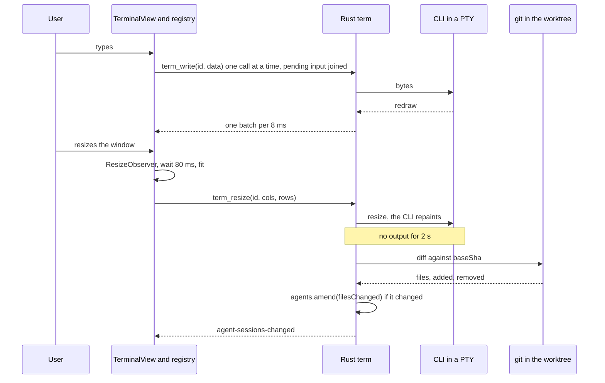
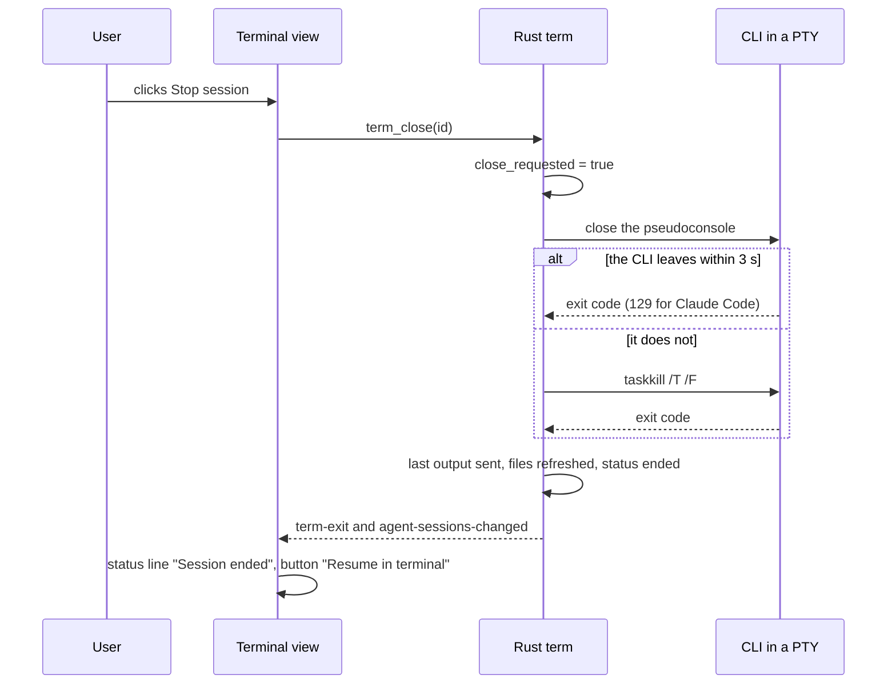
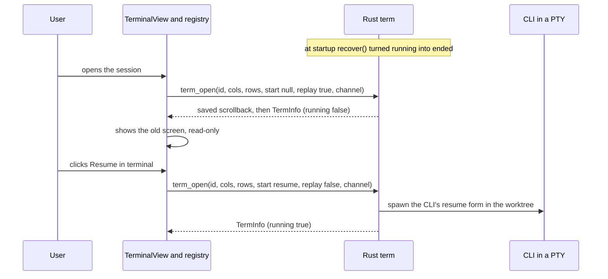
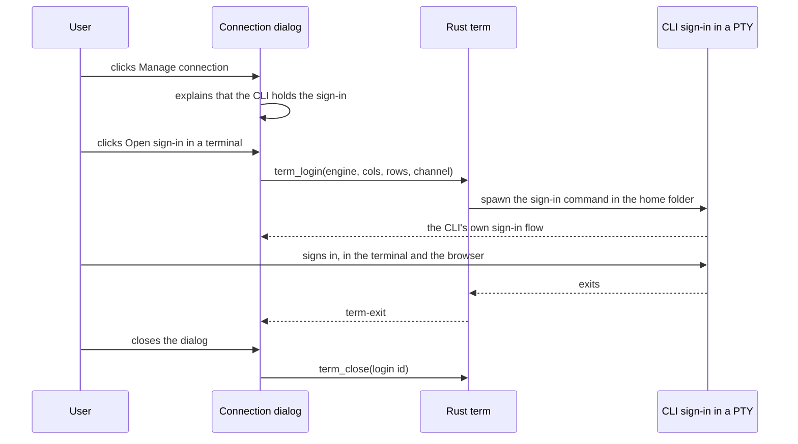

# Phase 5: Codex and the terminal

Handoff document for one implementation session. Read [README.md](README.md) first (its sections 1 and 7 are binding), then this file, then the three spike files it cites: [spikes/pty-terminal.md](spikes/pty-terminal.md), [spikes/codex-interfaces.md](spikes/codex-interfaces.md) and [spikes/claude-headless.md](spikes/claude-headless.md).

Written on 2026-11-10 against branch `feat/mock-ux` at commit `0a322e5`, **before Phases 2, 3 and 4 were implemented**, and then reconciled with the finished Phase 2 and Phase 4 documents ([phase-2-interactive-sessions.md](phase-2-interactive-sessions.md), [phase-4-review.md](phase-4-review.md)). Section 3 describes the code after Phase 1 and lists what Phases 2 and 4 add to it. Every Phase 2 or Phase 4 name used here is the name those documents define (section 1.5). If the merged code differs from them, the code wins: use what is there, and say so in your report.

The phase has three parts. Parts A and B are required. Part C is optional and has its own go/no-go check.

---

## 1. Goal, mock screens, non-goals

### 1.1 What the user gets

**Part A, the terminal.** In Agent Workspace the user can run the real `claude` or `codex` terminal program inside Hivemind, in the same kind of session as a chat session: its own git worktree, the same briefing, the same context rail, the same review of its edits. Several terminals can be open at once, each in its own tab. A terminal that ended (or was cut off by closing the app) can be resumed.

**Part B, Codex as an engine.** The Start-a-session screen gains the Engine control (Claude Code or Codex) and the Interface control (Chat or Terminal). The workspace toolbar gains an engine menu and a Chat | Terminal switch. A "Manage connection" dialog explains sign-in and can open the CLI's own sign-in command in a terminal.

**Part C, Codex in Chat (optional).** A Codex session in the Chat interface, driven through `codex app-server` over stdio, with Hivemind's approval cards.

### 1.2 Mock screens

The mocks are PNG files in the folder `hivemind-mocks` beside the repository (README section 6). Ignore the wordmark drawn in them; the product is Hivemind.

| Mock | What Phase 5 takes from it |
| --- | --- |
| `04_Agent_Workspace_Codex_Terminal.png` | The whole terminal view (described below). |
| `02_Start_Agent_Session.png` | The Engine control ("Claude Code", "Codex", "Use existing local sign-in.", "Manage connection") and the Interface control ("Chat", "Terminal"). |
| `03_Agent_Workspace_Chat.png` | The toolbar's engine menu ("Claude Code") and the Chat | Terminal switch. |

Mock 04 in words, top to bottom:

- Breadcrumb "PayStream / Agent Workspace". Title "Agent Workspace". Subtitle "Run Claude Code or Codex in a local, project-aware harness with memory and context." On the right: the date, and an outlined button "Stop session" with a square icon.
- A toolbar row: a menu button "Codex" with a chevron; a divider; a two-part switch "Chat | Terminal" with Terminal filled; a divider; a shield icon and "Workspace access"; a divider; a branch icon and "feature/idempotency" with a chevron.
- Left, wide: a tab strip with one tab "Codex · ingestion-service" and a close cross, then a "+" button. Under it a bordered dark box holding the terminal. At the bottom of the box a thin line: on the right a green dot and "Session active".
- Right: a rail titled "Workspace". Sub-heading "Source" with two rows (a repository icon and "ingestion-service"; a branch icon and "feature/idempotency"). Sub-heading "Attached context" with rows "Event identity decision" and "Container diagram" (the second with a link "Open diagram →"). Sub-heading "Files changed" with three file rows. A link "Review diff →".
- Inside the terminal the mock draws a yellow line "Next command needs approval:", a command box, and Hivemind buttons "Allow once" and "Deny". **That part is knowingly not built** (section 1.3).

### 1.3 Non-goals

- **No Hivemind approval buttons inside the terminal.** The terminal runs the real CLI; approvals happen in the CLI's own prompts. The "Allow once / Deny" buttons and the "Next command needs approval" block in mock 04 are not built (README section 1, decision 7).
- Hivemind does not answer the CLIs' first-run prompts (folder trust, update, hooks review). The user answers them in the terminal.
- Hivemind does not read, store or pass credentials. It never runs a sign-in on the user's behalf except by opening the CLI's own sign-in command in a terminal the user sees.
- No parsing of terminal output. Hivemind never looks for prompts, state or text in the PTY stream.
- No plain shell tab. A terminal always runs `claude` or `codex` (or their sign-in command).
- No change of interface or engine for an existing session (section 4.9).
- No spending limit in the terminal. Claude Code's `--max-budget-usd` works only with `--print`, and Codex has no budget.
- No Hivemind-side refusal of Living Memory's plan, apply and undo commands in the terminal. Phase 2 refuses them for chat sessions by answering the CLI's permission request itself (`governed_memory_command`). In a terminal Hivemind does not see permission requests: the CLI asks the user. The briefing still tells the agent not to run them.
- No unattended Codex tasks (`codex exec`). The only unattended task is the system passport, which needs a Claude Code plugin.
- No model picker, no reasoning-effort control, no Codex cost or budget.
- No WebGL renderer for the terminal, no terminal search, no split terminals.
- No split panes or tabs anywhere else (README section 1, decision 2). The terminal tab strip is the one decided exception.
- macOS and Linux: the code is written to compile and run there, but nothing in the spikes was run there. Windows is the verified platform.

### 1.4 What earlier phases must have delivered: preflight checklist

Phase 5 builds on Phase 2 ([phase-2-interactive-sessions.md](phase-2-interactive-sessions.md)) and, for one link and two manager methods, on Phase 4 ([phase-4-review.md](phase-4-review.md)). Run these from the repository root before you write any code. Each must pass, except the Phase 3 and Phase 4 rows, which say what to do when they do not.

| # | Check | Command | Pass looks like | If it fails |
| --- | --- | --- | --- | --- |
| P1 | Work task | `git grep -n "Work {" -- src-tauri/src/agent/scope.rs` | The `AgentTask::Work { project, repo, branch, change }` variant | Stop. Phase 2 is not merged. |
| P2 | Session fields | `git grep -n -E "pub (mode\|policy\|project\|worktree\|turns\|files_changed\|context\|model\|system):" -- src-tauri/src/agent/mod.rs` | Nine fields on `SessionInfo` | Stop. |
| P3 | Statuses and mode | `git grep -n -E "Waiting,\|Idle,\|Ended,\|pub enum Mode\|pub enum Decision" -- src-tauri/src/agent/events.rs` | The three new `Status` variants, `Mode`, `Decision` | Stop. |
| P4 | Commands | `git grep -n -E "agent_send\|agent_answer\|agent_interrupt\|agent_end\|agent_files\|agent_set_policy\|agent_remove_worktree\|repo_branches" -- src-tauri/src/lib.rs` | All eight inside `tauri::generate_handler![` | Stop. |
| P5 | Worktree module | `git grep -n -E "pub fn (folder_for\|create\|changes\|totals\|patch\|changed_files\|ahead\|list\|remove)\(" -- src-tauri/src/worktree.rs` | Nine functions; `pub struct Worktree`, `FileChange`, `Totals` in the same file | Stop. |
| P6 | Start path | `git grep -n -A1 "pub fn start_task" -- src-tauri/src/agent/mod.rs` and `git grep -n -A12 "pub struct StartOptions" -- src-tauri/src/agent/mod.rs` | `start_task(manager, bridge, saved, worktrees, task, prompt, options)`; `StartOptions { policy, context, briefing, model, system }` | Stop. |
| P7 | Scope functions | `git grep -n -E "pub enum PolicyMode\|pub fn (work\|for_session\|project_repo\|same_path)\(" -- src-tauri/src/agent/scope.rs` | `PolicyMode` and the four functions | Stop. |
| P8 | Manager internals | `git grep -n -E "fn (free_slot\|record\|spawn\|pump)\(\|pub fn (send\|end\|set_policy\|files\|remove_worktree)\(\|pub fn events_of" -- src-tauri/src/agent/mod.rs` and `git grep -n "worktrees_dir" -- src-tauri/src/lib.rs` | Each name once; `worktrees_dir` on `AppState` | Stop. |
| P9 | Start screen | `git grep -n "Phase 5: Engine and Interface sections go here" -- src/features/agents/StartSession.tsx` | The comment Phase 2 leaves where the two sections go | If the comment is gone, the place is between the Task section and the Workspace section of `form.start-form`. |
| P10 | Session draft | `git grep -n -E "useSessionDraft\|setTask\|setSystem" -- src/features/agents/draft.ts` | The store; `task` is the task text | Stop. |
| P11 | Route and helper | `git grep -n -E 'view\?: "new"\|export const startSession' -- src/store.ts` | Both | Stop. |
| P12 | Shared session helpers | `git grep -n -E "export (const\|function) (isEnded\|repoName\|POLICIES\|permissionLines\|waitingForReview\|sessionBriefing)\b" -- src/features/agents/session.ts` | All six | Stop. |
| P13 | Chat view and toolbar | `git grep -n -E "engine-chip\|agent-toolbar\|branch-label\|toolbar-sep" -- src/features/agents/AgentWorkspace.tsx src/App.css` and `git grep -n "export function" -- src/features/agents/Chat.tsx` | `function Toolbar(` renders `.agent-toolbar` with `.engine-chip`; `Chat.tsx` exports `ApprovalCard`, `FilesCard`, `Composer` | Stop. |
| P14 | Adapter name | `git grep -n '"claude-code"' -- src-tauri/src/agent/claude.rs` | `fn name` returns `"claude-code"` (README 7.1) | Stop and tell the user; section 4.1's `Engine::of` works with any name that is not `"codex"`. |
| P15 | Shared Markdown | `git grep -n "export function Markdown" -- src/ui/Markdown.tsx` | The component whose links open in the system browser | Phase 5's screens render no Markdown. If you add any, use this component, not `react-markdown` directly. |
| P16 | Phase 4 | `git grep -n "review_files" -- src-tauri/src/lib.rs`, `git grep -n "export const openReview" -- src/store.ts`, `git grep -n -E "pub fn (info\|amend)\(\|pub fn review_after_turn" -- src-tauri/src/agent/mod.rs` | The command, `openReview(session?, file?)`, `Manager::info`, `Manager::amend`, `review_after_turn` | Phase 4 is not merged: do not render "Review diff" (section 7.6); add `Manager::info` and `Manager::amend` yourself with Phase 4's exact signatures (section 6.6); leave out the `review_after_turn` call. |
| P17 | Phase 3 | `git grep -n "export const engineName" -- src/features/changes` and `git grep -n "check_change" -- src-tauri/src/agent/mod.rs` | Phase 3's engine label and its check in `start_task` | Phase 3 is not merged: use Phase 4's `engineLabel` (`src/features/review/review.ts`) for a session's engine name, or, with neither, add `ENGINE_LABEL` (section 4.2). |
| P18 | Clean tree, tests green | `git status --short`, `npm test`, `npx tsc --noEmit`, `cd src-tauri && cargo test && cargo clippy` | No output from `git status`; everything passes | Fix or report before starting. |
| P19 | The CLIs | `claude --version`, `codex --version` (PowerShell) | `2.1.322 (Claude Code)` or newer; `codex-cli 0.166.0` or newer | A missing CLI only blocks the manual checks for that engine. |

Branch from the branch that holds the newest merged phase (README section 4, Git), for example `git switch -c feat/phase-5-terminal`.

### 1.5 Names from Phases 2 and 4 that this document uses

These are defined by the Phase 2 and Phase 4 documents. Phase 5 uses them as they are and adds no second version of any of them. If the code differs from a row, the code wins: use what is there and say so in your report.

| Name | Where | What it is |
| --- | --- | --- |
| `Status` (`Running`, `Waiting`, `Idle`, `Succeeded`, `Failed`, `Cancelled`, `Ended`), `Mode` (`Unattended`, `Interactive`), `Decision` (`Allow`, `AllowAlways`, `Deny`, `Withdrawn`), `TurnEnd`, `Outcome` (with `budget`) | `src-tauri/src/agent/events.rs` | Phase 2 |
| `PolicyMode` (`PreApproved`, `Ask`, `AcceptEdits`): what a session stores. `Policy` (the same three, each with `allow`): what a process is started with | `src-tauri/src/agent/scope.rs` | Phase 2 |
| `scope::work(tree, policy, prompt) -> Result<Scope, String>`, `scope::project_repo(entry, repo)`, `scope::for_session(bridge, info)`, `scope::same_path(a, b)` | `src-tauri/src/agent/scope.rs` | Phase 2. `work` gives the title (the first line of the prompt, clipped), `mode: Interactive` and `worktree`. |
| `Worktree { repo, path, branch, base_branch, base_sha }`, `FileChange { path, status, added, removed, binary }`, `Totals { files, added, removed }`, `ChangedFiles` | `src-tauri/src/worktree.rs` | Phase 2 |
| `worktree::create(worktrees, repo, branch, session_id)`, `worktree::changes(&tree) -> Result<Vec<FileChange>, String>`, `worktree::totals(&files) -> Totals`, `worktree::remove(&tree)` | `src-tauri/src/worktree.rs` | Phase 2. `changes` then `totals` is the "worktree diff" this document refers to. |
| `SessionInfo` fields `mode`, `policy: PolicyMode`, `project`, `worktree`, `turns`, `files_changed: Option<Totals>`, `context: Vec<String>`, `model`, `system` | `src-tauri/src/agent/mod.rs` | Phase 2 |
| `StartOptions { policy: Option<PolicyMode>, context, briefing, model, system }` | `src-tauri/src/agent/mod.rs` | Phase 2. `briefing` is the text the webview built with `sessionBriefing`. |
| `agent::Launch { scope, program, budget_usd }` | `src-tauri/src/agent/mod.rs` | Phase 2: what a headless process is started from. It is **not** this document's `term::launch::Cli`. |
| `start_task(manager, bridge, saved, worktrees, task, prompt, options)`, `send_task(...)` | `src-tauri/src/agent/mod.rs` | Phase 2 |
| `Manager::start`, `send`, `answer`, `interrupt`, `end`, `set_policy`, `files`, `remove_worktree`, `cancel`, `stop_all`, `sessions`, `session`; `Inner::record`, `free_slot`, `spawn`, `pump`, `update`, `persist`; `events_of`; `MAX_RUNNING = 3` | `src-tauri/src/agent/mod.rs` | Phase 2 |
| `Manager::info(id) -> Result<SessionInfo, String>` (`Invalid session id`, `Unknown session`), `Manager::amend(id, change) -> Result<SessionInfo, String>`, `review_after_turn(review, before, after, now)` | `src-tauri/src/agent/mod.rs` | Phase 4 |
| `AppState.worktrees_dir` | `src-tauri/src/lib.rs` | Phase 2 |
| The Adapter trait: `name`, `command`, `user_line`, `parse_line`, `outcome`, `answer_line`, `refusal`, `interrupt_line`, `mode_line`, `mode_of` (and Phase 4's provided `tool_result`) | `src-tauri/src/agent/mod.rs` | Phase 2 (Part C changes it) |
| `StartOptions` (TypeScript), `agentStart(task, prompt, options?)`, `agentFiles`, `agentRemoveWorktree`, `agentSetPolicy`, `Policy`, `Worktree`, `FileTotals`, `ChangedFiles` | `src/lib/agent.ts` | Phase 2 |
| `useSessionDraft`: `task` (text), `context`, `change`, `system`, `element`, `setTask`, `addContext`, `removeContext`, `setSystem`, `reset`. Repository, branch, permissions and model are the Start screen's own state. | `src/features/agents/draft.ts` | Phase 2 |
| `isEnded`, `repoName`, `POLICIES`, `permissionLines`, `waitingForReview`, `sessionBriefing` | `src/features/agents/session.ts` | Phase 2 (`waitingForReview` is the one shared function, README 7.3; Phase 4 extends it) |
| `StartSession` (sections are `<section className="start-section">` inside `form.start-form`) | `src/features/agents/StartSession.tsx` | Phase 2 |
| `Toolbar({ info })` rendering `.agent-toolbar`: `.engine-chip`, `.toolbar-sep`, the permissions `<select>`, `.branch-label` | `src/features/agents/AgentWorkspace.tsx` | Phase 2 |
| `ApprovalCard`, `FilesCard`, `Composer` | `src/features/agents/Chat.tsx` | Phase 2 |
| `startSession()`, `openSession(id)`, `openSystem(slug)`, `openReview(session?, file?)` | `src/store.ts` | Phase 2; `openReview` is Phase 4 |
| `engineName(adapter)` | `src/features/changes/changes.ts` (Phase 3; Phase 4 uses the same function) | "Claude Code" or "Codex" for a session's `adapter` |
| `Markdown` | `src/ui/Markdown.tsx` | The one Markdown renderer (links open in the system browser) |

---

## 2. Decisions already made

Made by the user on 2026-11-10. Do not reopen.

1. The terminal is a real embedded terminal: a PTY in Rust (`portable-pty`, ConPTY on Windows) and `@xterm/xterm` in the webview. It runs the actual `claude` and `codex` programs.
2. Approvals in the terminal happen in the CLI's own prompts. Mock 04's "Allow once / Deny" buttons are knowingly not built.
3. Fixed names (README 7.4): Rust module `src-tauri/src/term/`; commands `term_open`, `term_write`, `term_resize`, `term_close`, `term_list`; output over a Tauri `Channel`; frontend `src/features/terminal/`; `SessionInfo.interface`.
4. A terminal is a session: a `SessionInfo` with `interface: "terminal"`, a `work` task and a worktree (README 7.1).
5. Hivemind does not answer first-run prompts for the user.
6. Never handle credentials in the app.
7. Part C is built only if Parts A and B are done and its go/no-go check passes.
8. All of README section 1 (dark only, sections are pages, brand, one phase per branch).

Decisions this document makes where the README left a choice open. Each has its reason in one sentence.

| # | Choice | Reason |
| --- | --- | --- |
| D1 | A session keeps its interface and its engine for life. The Chat | Terminal switch and the engine menu navigate; they never convert a session. | README 7.1 ties one worktree to one session id and README 7.3 reviews one session's diff, so two conversations in one worktree would make "whose edits are these" unanswerable. |
| D2 | A terminal session writes no events to its `.jsonl` log; it keeps a capped raw scrollback file instead. | A PTY stream has no structure to turn into events, and the README's rule "`Finished` is the single last event" cannot hold for a session that can be resumed any number of times. |
| D3 | Scrollback is kept to the last 2 MiB of raw bytes per session. | That repaints the final screen and recent history of both TUIs and bounds disk use at 4 MiB per session at the moment before a trim. |
| D4 | The briefing reaches the CLI as a file plus a short prompt argument that points at it. | A long, multi-line briefing as a command-line argument is fragile on Windows, and a file can be read again after a resume. |
| D5 | Codex is started as the native `codex.exe` when it can be found, else as `node codex.js`; never through `cmd.exe`. | Arguments that pass through `cmd.exe` are re-parsed by it, which is unsafe for a path. |
| D6 | Codex runs with `--no-alt-screen --no-daemon` in the terminal. | The spike verified this form; it keeps xterm's scrollback and plain-drag text selection, and keeps Hivemind away from the shared, self-updating Codex daemon. |
| D7 | Claude Code gets Hivemind's session id (`--session-id`); Codex is resumed with `resume --last` in the session's own worktree. | Codex assigns its own id and a session's worktree folder is used by nothing else, so "the last conversation in this folder" is exact without parsing Codex's files. |
| D8 | After exit a terminal session is `ended` (clean or user-caused) or `failed`; either can go back to `running` through "Resume in terminal". | The brief asks for these statuses, and the conversation lives in the CLI's own store, so it survives the process. |
| D9 | At most 4 terminals run at once (`MAX_TERMINALS`). | Each CLI is a process tree around a 350 MB executable. |
| D10 | xterm instances live in a module-level registry, outside React. | The page component is unmounted on every navigation, and a terminal must keep its screen and keep receiving output while hidden. |
| D11 | Codex Chat (Part C) does not stream text deltas. | README 7.1's event contract has no delta event, and Phase 2's transcript shows whole text blocks. |
| D12 | Phase 2's chat-only commands refuse a terminal session: `agent_send`, `agent_end`, `agent_set_policy`. A terminal session's worktree is removed with Phase 2's `agent_remove_worktree`, from the terminal's rail. | Those commands drive a headless process a terminal session does not have, and `end` would also delete a clean worktree that "Start over" still needs. |
| D13 | The briefing file holds exactly what a chat session's first message holds: the `briefing` the Start screen built with Phase 2's `sessionBriefing`, a `---` line, and the task. | One briefing builder, and the Start screen's preview stays true for a terminal. |
| D14 | Terminal sessions never count against Phase 2's `MAX_RUNNING`. | That limit is about headless processes Hivemind must supervise; terminals have their own limit (D9). |

---

## 3. The code as it stands (after Phase 1)

This table is the code after Phase 1. Section 3.1 lists what Phases 2 and 4 add on top. Find each anchor again before you rely on it.

| Path and anchor | What it does today | Why it matters here |
| --- | --- | --- |
| `src-tauri/Cargo.toml`, anchor `[dependencies]` | `tauri = { version = "2", features = ["tray-icon"] }`, `serde`, `serde_json`, `dirs = "7.0.0"`, `base64 = "0.22"`, `uuid` (v4). `Cargo.lock` has tauri 2.12.5. | Add `portable-pty = "0.9"`. `base64` is already there for the channel fallback. |
| `src-tauri/src/lib.rs`, anchor `struct AppState` | Holds `bridge`, `settings_path`, `drafts_dir`, `agents: agent::Manager`, `watcher`, `shortcut_error`. | Gains `terminals: term::Manager`. |
| `src-tauri/src/lib.rs`, anchor `async fn blocking<T` | `async fn blocking<T: Send + 'static>(work: impl FnOnce() -> Result<T, String> + Send + 'static) -> Result<T, String>` runs work on the blocking pool. | Every `term_*` command that can block uses it. A plain `fn` command runs on the main thread. |
| `src-tauri/src/lib.rs`, anchor `agent::Emit::Event(event) => events.emit("agent-event", event)` | The sink closure that turns manager emits into Tauri events, built in `setup`. | The terminal sink is built the same way, next to it. |
| `src-tauri/src/lib.rs`, anchor `state.agents.stop_all();` | Kills running agent processes on `tauri::RunEvent::Exit`. | Add `state.terminals.stop_all();` beside it. |
| `src-tauri/src/lib.rs`, anchor `tauri::generate_handler![` | The command list. | Add the seven new commands. |
| `src-tauri/src/agent/mod.rs`, anchor `pub trait Adapter` | `name`, `command(&Spec) -> Command`, `first_message(prompt) -> String`, `parse_line(&self, line) -> Vec<RunEvent>`, `outcome(&self, line) -> Option<Outcome>`. Stateless. | Phase 2 widens it to ten methods (section 3.1). Part C moves the per-line methods into a per-session driver (section 4.11). |
| `src-tauri/src/agent/mod.rs`, anchor `pub struct SessionInfo` | `id, adapter, cli_version, task, title, workspace, status, started_at, ended_at, cost_usd, error, structured`; `#[serde(rename_all = "camelCase")]`. | Gains `interface` (and `engine_session` in Part C). |
| `src-tauri/src/agent/mod.rs`, anchor `fn update(&self, id: &str, change: impl FnOnce(&mut SessionInfo))` | Private `Inner::update`: changes a session's details, persists the index, emits `SessionsChanged`. | The terminal module changes a session through Phase 4's `Manager::amend`, which wraps it (section 6.6). |
| `src-tauri/src/agent/mod.rs`, anchor `fn kill(child: &Mutex<Child>)` | `taskkill /PID <pid> /T /F` on Windows through `crate::git::run_with_timeout`, then `child.kill()`. | The same tree kill is used for a PTY child that does not leave. |
| `src-tauri/src/agent/mod.rs`, anchor `pub fn start_task(` | Resolves the scope in Rust and calls `manager.start`. | The terminal branch goes here: create the session, start no process. |
| `src-tauri/src/agent/claude.rs`, anchor `pub fn locate(` | `locate(saved: &Settings, home: &Path, on_path: impl Fn() -> bool) -> Result<String, String>`: the saved `claude_path` if it is a file, else `~/.local/bin/claude(.exe)`, else the bare name `claude` when it runs. Error: `Claude Code was not found. Install it, or set the path to its program in Settings.` | The terminal reuses it through `available(saved)`. The Codex locate follows its shape and its error wording. |
| `src-tauri/src/agent/store.rs`, anchor `pub fn load_index` | Returns an empty history if any entry fails to parse. | Every new `SessionInfo` field needs `#[serde(default)]` and a test with an old index. |
| `src-tauri/src/agent/store.rs`, anchor `pub fn recover(` | At startup, a session still marked `running` becomes `failed` with `CLOSED` and gets a `finished` record. | A terminal session left `running` must become `ended` instead, with no record. |
| `src-tauri/src/agent/store.rs`, anchor `pub fn log_path(` | Accepts only a plain lowercase hyphenated UUID as a session id. | The terminal folder name is the session id; validate it the same way. |
| `src-tauri/src/settings.rs`, anchor `pub claude_path: Option<String>` | Saved settings; every field is an `Option`, so old files load. | Add `codex_path` beside it. |
| `src-tauri/src/git.rs`, anchor `pub fn run_with_timeout(` | Runs a command with `CREATE_NO_WINDOW`, a timeout, and returns stdout. | Used for `taskkill`, `cmd /d /c ver` and the Codex version check. |
| `src-tauri/tauri.conf.json`, anchor `"csp"` | `default-src 'self'; img-src 'self' data: https:; style-src 'self' 'unsafe-inline'; font-src 'self' data:; connect-src ipc: http://ipc.localhost` | Confirmed sufficient for xterm.js and for channel data. **No change.** |
| `src-tauri/capabilities/default.json`, anchor `"permissions"` | `core:default`, `core:window:allow-destroy`, `core:window:allow-hide`, `opener:default`; windows `main` and `capture`. | The app's own commands and channels need no permission entry. **No change.** |
| `package.json`, anchor `"dependencies"` | Has `@fontsource-variable/jetbrains-mono`, `@tauri-apps/api` (2.12.4 installed), `@tauri-apps/plugin-opener`, `zustand`, `@tanstack/react-query`, `lucide-react`. | Add four `@xterm` packages. |
| `src/main.tsx`, anchor `import "@fontsource-variable/jetbrains-mono";` | Bundles the variable font. Its CSS declares the family `'JetBrains Mono Variable'` in six `unicode-range` subsets (Latin, Latin Extended, Cyrillic, Greek, Vietnamese). | The terminal uses the same family. Box-drawing, block and braille characters are **not** in those subsets (section 10, gotcha 17). |
| `src/App.css`, anchor `--font-mono:` | `--font-mono: "JetBrains Mono Variable", ui-monospace, "Cascadia Code", Consolas, monospace;` and `--bg-code: #170d24;` | The terminal's font family and background. |
| `src/App.css`, anchor `.note-tabs {` | `.note-tabs`, `.note-tab-pill`, `.note-tab-pill.on`, `.tab-label`, `.tab-close`: the note tab strip. The filled look of the active pill comes from `.note-tabs.standalone .note-tab-pill.on`. | The terminal tab strip reuses these classes. |
| `src/App.css`, anchor `/* ---- Agent Workspace ---- */` | `.agents` (three-column grid), `.session-list`, `.session-item`, `.chat-thread`, `.agents-rail`, `.rail-actions`. | The terminal view sits in the same page with its own two-column grid. |
| `src/App.css`, anchor `.segmented {` | `.segmented { display: flex; gap: .25rem; }`, `.segmented .on { background: var(--accent-strong); border-color: var(--accent-strong); }` | The Chat | Terminal switch and the Engine and Interface controls. |
| `src/App.tsx`, anchor `function useShortcuts()` | A `keydown` listener on `window` (bubble phase): Alt+Left goes back; Ctrl/Cmd+P palette, +O notes, +N new note, +G graph, +Shift+A activity, +W swallowed. | These must not fire while the terminal has focus (section 4.8). |
| `src/shell/Topbar.tsx`, anchor `(key === "k" && !e.shiftKey)` | A second `window` `keydown` listener: Ctrl/Cmd+K and Ctrl/Cmd+Shift+F focus the search field. | Same. |
| `src/App.tsx`, anchor `function useLiveRefresh(` | Listens for `agent-sessions-changed` and invalidates `["agent", "sessions"]`. | Add `term-exit`. |
| `src/features/agents/AgentWorkspace.tsx`, anchors `function Session(`, `export function AgentWorkspace()` | Session list, transcript, context rail; "Copy resume command" builds `claude --resume ${info.id}`. | Gains the terminal branch, the engine menu and the switch. |
| `src/lib/agent.ts`, anchor `export interface SessionInfo` | Types and `agent_*` invokes. | Gains `Engine`, `Interface`, `EngineInfo`, `agentEngines`. |
| `src/features/settings/SettingsForm.tsx`, anchor `type PathKey =` | The path fields, built by `field(key, label, hint)`. | Gains `codex_path`. |
| `src/lib/lm.ts`, anchor `export interface Settings` | The TypeScript `Settings` type. | Gains `codex_path`. |
| `src/ui/Menu.tsx`, `src/ui/Modal.tsx`, `src/ui/Page.tsx` | `Menu`, `Modal`, `Confirm`, `PageHeader`, `Section`, `Row`, `ArrowLink`. | Used as they are. |
| `scripts/drive_ui.py` | Drives the dev window over the debugging port. Steps: `nav`, `click`, `sel`, `key`, `type`, `eval`, `css`, `text`, `wait`, `size`, `shot`. | Verification (section 11). |

### 3.1 What Phases 2 and 4 add that this phase touches

From the Phase 2 and Phase 4 documents. Check each anchor in the merged code.

| Path and anchor | What it does | Why it matters here |
| --- | --- | --- |
| `src-tauri/src/agent/mod.rs`, anchor `pub fn start_task(` | Step 1: `program = claude::available(saved)?` and a new session id. Work task: checks the prompt and the model, `git::project_entry`, `scope::project_repo`, (Phase 3: `check_change`), `worktree::create(worktrees, &repo, branch, &id)`, `scope::work(tree.clone(), policy, prompt)`, then `manager.start(id, task, Launch { scope, program, budget_usd }, prompt, &options)`. When a work start fails after the worktree was created it calls `worktree::remove(&tree)`. | The terminal branch goes after `scope::work` and replaces only the `manager.start` call. Step 1 must look for the chosen engine's program, not always Claude Code. |
| `src-tauri/src/agent/mod.rs`, anchor `pub fn start(&self, id: String` | Step 1 builds the `SessionInfo` from the scope and the options. Step 4 writes the first message: `"{briefing}\n\n---\n\n{prompt}"` when `options.briefing` is set, else `prompt`. | The terminal branch needs the same record and the same text. Section 6.6 moves both into small functions used by both paths. |
| `src-tauri/src/agent/mod.rs`, anchor `fn free_slot(` | Makes room under `MAX_RUNNING = 3`: counts sessions that are `running` or `waiting`, or `idle` with stdin open. | A terminal session is `running` with no headless process; it must not be counted (D14). |
| `src-tauri/src/agent/mod.rs`, anchors `pub fn send(`, `pub fn end(`, `pub fn set_policy(` | Message, end and permission-mode change of a chat session. `end` records `finished`, sets `ended` and removes a clean worktree. | Each gets a one-line guard for terminal sessions (D12). |
| `src-tauri/src/agent/mod.rs`, anchors `pub fn info(`, `pub fn amend(`, `pub fn review_after_turn(` (Phase 4) | Read one session (`Invalid session id`, `Unknown session`); change one session, save, emit `agent-sessions-changed`; the rule that puts a session back in the review queue when its files change. | The terminal module reads and writes sessions only through `info` and `amend`, and calls `review_after_turn` when it refreshes `files_changed`. |
| `src-tauri/src/agent/store.rs`, anchor `pub fn recover(` | Phase 2: an interactive session left `running` or `waiting` becomes `idle` and gets a `turnFinished` record. | A terminal session must be handled before that rule: it becomes `ended`, with no record. |
| `src-tauri/src/agent/store.rs`, anchor `pub fn prune(` | Phase 2: a session that still has a worktree is never pruned. | A terminal session keeps its worktree until the user removes it, so the terminal rail needs Phase 2's "Remove worktree" action. |
| `src-tauri/src/worktree.rs`, anchors `pub fn changes(`, `pub fn totals(` | The worktree's changed files against `base_sha` (untracked files included), and their totals. | The files-changed refresh. No new diff code. |
| `src-tauri/src/lib.rs`, anchor `worktrees_dir` | `AppState.worktrees_dir`, set in `setup`; `agent_start` passes it to `start_task`. | `terminals_dir` is added beside it and passed the same way. |
| `src/features/agents/StartSession.tsx`, anchor `Phase 5: Engine and Interface sections go here` | The Start screen. Sections are `<section className="start-section">` with an `<h2>`. It loads `agentAvailable()` for a "Claude Code not found" banner and the path line, and has a Model select under "Environment & session options". | The two new sections go at the comment. The banner, the path line and the Model select must follow the chosen engine. |
| `src/features/agents/AgentWorkspace.tsx`, anchor `function Toolbar(` | `.agent-toolbar`, shown only when the current session is interactive: `.engine-chip` (static "Claude Code"), `.toolbar-sep`, the permissions `<select>` (`agentSetPolicy`), `.toolbar-sep`, `.branch-label` (the worktree branch, `title` "from <base branch>"). | The chip becomes the engine menu; the Chat / Terminal pill switch goes directly after it, before the first separator (Phase 2 says so). |
| `src/features/agents/AgentWorkspace.tsx`, the interactive rail's `div.rail-actions` | "End session", "Remove worktree" (behind a `Confirm`), "Copy resume command". | The terminal rail reuses "Remove worktree" (section 6.11). |
| `src/features/agents/session.ts` | `isEnded`, `repoName`, `POLICIES`, `permissionLines`, `waitingForReview`, `sessionBriefing`. | Used as they are. `isEnded` is true for `ended` and `failed`; for a terminal session that means "no program is running", not "over for good". |
| `src/features/agents/draft.ts`, anchor `useSessionDraft` | `task` (text), `context`, `change`, `system`, `element`. In memory only. | Gains `engine` and `interface`, so other pages can preselect them. |
| `src/store.ts`, anchors `export const startSession`, `export const openReview` | `startSession()` goes to `{ page: "agents", view: "new" }`. Phase 4: the route `{ page: "review"; session?: string; file?: string }` and `openReview(session?, file?)`. | "+" and the empty state call `startSession()`. "Review diff" calls `openReview(sessionId)`. |
| `src/App.css`, inside `/* ---- Agent Workspace ---- */` | Phase 2 adds `.agent-toolbar`, `.engine-chip`, `.branch-label`, `.toolbar-sep`, `.start-section`, `.start-row`, `.start-more`, `.nav-dot.waiting`. | Reuse them. Do not define them again. |
| `src/features/settings/SettingsForm.tsx` | Phase 2 renames the label to `Spend cap per agent run (USD)` and rewrites the paragraph under it. | Section 6.11 edits Phase 2's wording, not Phase 1's. |
| `src/ui/Markdown.tsx`, anchor `export function Markdown` | The shared Markdown renderer; links open in the system browser. | Phase 5 renders no Markdown. Any you add must use it. |

---

## 4. Architecture

### 4.1 Data model: Rust

New and changed types, in full. Field order inside existing structs: append at the end.

```rust
// src-tauri/src/agent/mod.rs

/// Which coding-agent CLI a session uses. `SessionInfo.adapter` stores the adapter's name; this is the same fact as a type.
#[derive(Serialize, Deserialize, Clone, Copy, Debug, Default, PartialEq, Eq, Hash)]
#[serde(rename_all = "lowercase")]
pub enum Engine {
    #[default]
    Claude,
    Codex,
}

impl Engine {
    /// The engine of a stored session. Anything that is not Codex is Claude Code, whatever name Phase 1 or 2 stored.
    pub fn of(adapter: &str) -> Engine { if adapter == "codex" { Engine::Codex } else { Engine::Claude } }
    /// What `SessionInfo.adapter` holds for a new session.
    pub fn adapter_name(self) -> &'static str { match self { Engine::Claude => claude::ClaudeCode.name(), Engine::Codex => "codex" } }
    pub fn label(self) -> &'static str { match self { Engine::Claude => "Claude Code", Engine::Codex => "Codex" } }
}

/// How the user talks to a session.
#[derive(Serialize, Deserialize, Clone, Copy, Debug, Default, PartialEq)]
#[serde(rename_all = "lowercase")]
pub enum Interface {
    #[default]
    Chat,
    Terminal,
}

pub struct SessionInfo {
    // ... every field that exists after Phase 2 (and Phase 4's `review` and `source_sha`) ...
    /// README 7.1. Default `chat`, so older indexes load.
    #[serde(default)]
    pub interface: Interface,
    /// Part C only: the engine's own id for the conversation (a Codex thread id). Claude Code uses `id`.
    #[serde(default)]
    pub engine_session: Option<String>,
}
```

Phase 2's `StartOptions` (`policy`, `context`, `briefing`, `model`, `system`) gains two fields, both with serde defaults so Phase 2's and Phase 3's callers keep working:

```rust
#[serde(default)]
pub engine: Engine,        // default: claude
#[serde(default)]
pub interface: Interface,  // default: chat
```

A terminal session's `SessionInfo`, field by field:

| Field | Value for a terminal session |
| --- | --- |
| `id` | A new UUID v4, as for every session. |
| `adapter` | `engine.adapter_name()`. |
| `cli_version` | `None`. |
| `task` | The `work` task. |
| `title` | From `scope::work`: the first non-empty line of the task, clipped to 60 characters. |
| `workspace` | `[worktree path, context folder]`. |
| `status` | `idle` at creation, then section 4.5. |
| `started_at` | Creation time. Never changed. |
| `ended_at` | Set when the program exits; cleared when it is started again. |
| `cost_usd`, `structured` | `None`. |
| `error` | `None`, or `The program exited with code N.` when `failed`. |
| `mode` | `interactive`. |
| `policy` | `PolicyMode::Ask` or `PolicyMode::AcceptEdits`, as chosen on the Start screen. |
| `project`, `worktree`, `context`, `system` | As for a chat work session. |
| `model` | The alias from the options for Claude Code; `None` for Codex. |
| `turns` | `0`. A terminal has no turns Hivemind can count. |
| `files_changed` | Refreshed when output goes quiet and on exit (section 4.6). |
| `review` | Phase 4's, unchanged. |
| `interface` | `terminal`. |

The terminal module's own types:

```rust
// src-tauri/src/term/mod.rs

/// How many terminal programs may run at once.
pub const MAX_TERMINALS: usize = 4;
/// Exit codes that mean the user left, not that something broke: clean exit, SIGHUP, SIGINT, and
/// Windows' STATUS_CONTROL_C_EXIT (what Codex returns after Ctrl+C and what a closed console gives).
pub const QUIET_EXITS: [u32; 4] = [0, 129, 130, 0xC000_013A];

/// What `term_open` should do when the session has no running program.
#[derive(Deserialize, Clone, Copy, Debug, PartialEq)]
#[serde(rename_all = "lowercase")]
pub enum StartMode {
    /// The first-run command line: the briefing prompt, a new conversation.
    Fresh,
    /// The CLI's resume form: continue the session's conversation.
    Resume,
}

#[derive(Serialize, Clone, Debug, PartialEq)]
#[serde(rename_all = "camelCase")]
pub struct TermInfo {
    /// The session id for a session's terminal; `login-claude` or `login-codex` for a sign-in terminal.
    pub id: String,
    pub session_id: Option<String>,
    pub engine: Engine,
    pub running: bool,
    pub exit_code: Option<u32>,
    /// The Windows build number, for xterm's `windowsPty` option; None on other systems.
    pub windows_build: Option<u32>,
}

#[derive(Serialize, Clone, Debug, PartialEq)]
#[serde(rename_all = "camelCase")]
pub struct TermExit {
    pub id: String,
    pub session_id: Option<String>,
    pub code: Option<u32>,
}

/// What the terminal manager tells the UI.
#[derive(Clone, Debug)]
pub enum Emit {
    Exit(TermExit),
}
pub type Sink = Arc<dyn Fn(Emit) + Send + Sync>;

/// Where a terminal's bytes go. Returns false when the receiver is gone (the webview reloaded).
pub type Output = Arc<dyn Fn(Vec<u8>) -> bool + Send + Sync>;
```

```rust
// src-tauri/src/term/launch.rs

/// A program and the arguments that come before the CLI's own (for example `node` and `codex.js`).
/// Named `Cli` because the crate already has `settings::Launch` and Phase 2's `agent::Launch`.
#[derive(Clone, Debug, PartialEq)]
pub struct Cli {
    pub program: String,
    pub args: Vec<String>,
}
```

```rust
// src-tauri/src/lib.rs (Part B)

#[derive(Serialize)]
#[serde(rename_all = "camelCase")]
struct EngineInfo {
    engine: agent::Engine,
    label: &'static str,
    /// The program that would be started; None when it was not found.
    path: Option<String>,
    /// Why it cannot be started, in words the user can act on.
    error: Option<String>,
    /// Whether the Chat interface works with this engine.
    chat: bool,
    chat_reason: Option<String>,
}
```

```rust
// src-tauri/src/settings.rs, in `pub struct Settings`, after `claude_path`
/// The Codex program for terminals and Codex sessions; None looks in the usual places.
pub codex_path: Option<String>,
```

### 4.2 Data model: TypeScript

```ts
// src/lib/agent.ts (additions)
export type Engine = "claude" | "codex";
export type Interface = "chat" | "terminal";

export interface SessionInfo {
  // ... existing and Phase 2-4 fields ...
  interface: Interface;
  engineSession: string | null;   // Part C
}

/** The engine of a session, whatever adapter name older code stored. */
export const engineOf = (s: Pick<SessionInfo, "adapter">): Engine => (s.adapter === "codex" ? "codex" : "claude");
// Only when Phase 3's `engineName` does not exist (preflight P17):
// export const ENGINE_LABEL: Record<Engine, string> = { claude: "Claude Code", codex: "Codex" };

export interface EngineInfo {
  engine: Engine; label: string; path: string | null; error: string | null; chat: boolean; chatReason: string | null;
}
export const agentEngines = () => invoke<EngineInfo[]>("agent_engines");
export const enginesQuery = () => ({ queryKey: ["agent", "engines"], queryFn: agentEngines, staleTime: 60_000 });
```

```ts
// src/lib/term.ts (new)
import { Channel, invoke } from "@tauri-apps/api/core";
import type { Engine } from "./agent";

export type StartMode = "fresh" | "resume";
export interface TermInfo { id: string; sessionId: string | null; engine: Engine; running: boolean; exitCode: number | null; windowsBuild: number | null }
export interface TermExit { id: string; sessionId: string | null; code: number | null }

export const termOpen = (a: { sessionId: string; cols: number; rows: number; start: StartMode | null; replay: boolean; output: Channel<ArrayBuffer> }) =>
  invoke<TermInfo>("term_open", a);
export const termLogin = (a: { engine: Engine; cols: number; rows: number; output: Channel<ArrayBuffer> }) => invoke<TermInfo>("term_login", a);
export const termWrite = (id: string, data: string) => invoke<void>("term_write", { id, data });
export const termResize = (id: string, cols: number, rows: number) => invoke<void>("term_resize", { id, cols, rows });
export const termClose = (id: string) => invoke<void>("term_close", { id });
export const termList = () => invoke<TermInfo[]>("term_list");
export const termsQuery = () => ({ queryKey: ["term", "list"], queryFn: termList });
```

`interface` is a reserved word in TypeScript's strict mode as an identifier, but it is legal as a property name. Write `info.interface`; when destructuring, rename it: `const { interface: face } = info`.

Phase 2's TypeScript `StartOptions` gains `engine?: Engine` and `interface?: Interface`.

For a session's engine name in text, call Phase 3's `engineName(s.adapter)`, which already maps `"claude-code"` to "Claude Code" and `"codex"` to "Codex". `engineOf` is only for code that branches on the engine.

Phase 2's session draft (`src/features/agents/draft.ts`, `useSessionDraft`) gains `engine: Engine` (initial `"claude"`), `interface: Interface` (initial `"chat"`), `setEngine(engine)`, `setInterface(face)`. `reset()` puts both back. They are in the draft, unlike the repository, branch, permissions and model, because other pages preselect them (the "+" button, the engine menu, the terminal empty state).

### 4.3 Commands

All arguments are named in camelCase on the JavaScript side (Tauri converts to snake_case). Errors are `Err(String)`; the exact strings are listed so tests and UI can rely on them.

| Command | Arguments | Returns | Errors |
| --- | --- | --- | --- |
| `term_open` | `sessionId: string`, `cols: number`, `rows: number`, `start: "fresh" \| "resume" \| null`, `replay: boolean`, `output: Channel` | `TermInfo` | `Invalid session id`; `Unknown session`; `This session is not a terminal session`; `This session has no worktree` (it was removed); `The session's worktree folder is missing: {path}`; `Close a terminal first: 4 are already running`; `Could not start {program}: {error}`; the two "was not found" strings below |
| `term_login` | `engine: "claude" \| "codex"`, `cols`, `rows`, `output: Channel` | `TermInfo` (id `login-claude` or `login-codex`) | `Could not start {program}: {error}`; "was not found" |
| `term_write` | `id: string`, `data: string` | nothing | `This terminal is not running` |
| `term_resize` | `id: string`, `cols: number`, `rows: number` | nothing | none (a terminal that is not running is ignored) |
| `term_close` | `id: string` | nothing | none (closing a terminal that is not running does nothing) |
| `term_list` | none | `TermInfo[]`: the terminals with a running program | none |
| `agent_engines` | none | `EngineInfo[]`: Claude Code first, then Codex | none |

"Was not found" strings: `Claude Code was not found. Install it, or set the path to its program in Settings.` (exists today) and `Codex was not found. Install it, or set the path to its program in Settings.` (new).

What `term_open` does, in order:

1. Look the session up with Phase 4's `Manager::info` (it validates the id as a plain UUID). It must have `interface == Terminal` and a `worktree` whose `path` is an existing folder.
2. Clamp `cols` to 20..=500 and `rows` to 5..=300.
3. If `replay` is true, send the session's saved scrollback through `output` as one message (skip when the file is empty or missing).
4. If a program is running for this session: make `output` the terminal's output (replacing the old one), resize the PTY to `cols` x `rows`, return `TermInfo { running: true, .. }`. `start` is ignored.
5. Otherwise, if `start` is null: return `TermInfo { running: false, .. }`. Nothing is started. This is the read-only view of an ended session.
6. Otherwise: enforce `MAX_TERMINALS`, find the program, build the command line for `start` (section 5.4), set the session `running`, spawn it in a PTY of that size in the worktree, return `TermInfo { running: true, .. }`.

Steps 3 and 4 happen under one lock, so no byte is lost or sent twice between the saved history and the live stream (section 4.7).

Example call and reply:

```json
{ "sessionId": "5f0c1c2e-9a41-4c0e-8a55-0d7f3b6e2a11", "cols": 96, "rows": 32, "start": "fresh", "replay": false, "output": "__CHANNEL__:7" }
```

```json
{ "id": "5f0c1c2e-9a41-4c0e-8a55-0d7f3b6e2a11", "sessionId": "5f0c1c2e-9a41-4c0e-8a55-0d7f3b6e2a11", "engine": "codex", "running": true, "exitCode": null, "windowsBuild": 26100 }
```

`agent_engines` example:

```json
[
  { "engine": "claude", "label": "Claude Code", "path": "%USERPROFILE%\\.local\\bin\\claude.exe", "error": null, "chat": true, "chatReason": null },
  { "engine": "codex", "label": "Codex", "path": null, "error": "Codex was not found. Install it, or set the path to its program in Settings.", "chat": false, "chatReason": "Chat with Codex is not available yet. Use Terminal." }
]
```

`agent_start` (Phase 2's command) keeps its signature. Its options now carry `engine` and `interface`. New errors it can return:

| Situation | Error string |
| --- | --- |
| `interface: "terminal"` with a task that is not `work` | `A terminal session needs a project repository.` |
| `engine: "codex"` with a task that is not `work` | `System passports run with Claude Code.` |
| `engine: "codex"`, `interface: "chat"`, before Part C | `Chat with Codex is not available yet. Use Terminal.` |

Phase 2's chat-only commands refuse a terminal session (decision D12), each with a guard at the top of the manager method:

| Command | Error string for a terminal session |
| --- | --- |
| `agent_send`, and Phase 4's `review_request_changes`, which calls `Manager::send` | `This session runs in the terminal. Resume it there and type your request.` |
| `agent_end` | `This session runs in the terminal. Stop it there.` |
| `agent_set_policy` | `A terminal session keeps the permission mode it was started with.` |

`agent_answer`, `agent_interrupt` and `agent_cancel` need no guard: a terminal session has no headless process and no pending request, so Phase 2's own code answers `That request is no longer waiting for an answer` or does nothing. `agent_files` and `agent_remove_worktree` work unchanged; `agent_remove_worktree` refuses while the program runs, because the session is then `running` (`End the session before removing its worktree`).

### 4.4 Events

| Event | Payload | When |
| --- | --- | --- |
| `term-exit` | `TermExit`, for example `{"id":"5f0c1c2e-…","sessionId":"5f0c1c2e-…","code":0}` | Once per program run, after its last output was sent. |
| `agent-sessions-changed` (exists) | none | Whenever a terminal session's status or `filesChanged` changes; it is emitted by the agent manager's `amend`. |

Terminal output does not use events. It goes over the `Channel` passed to `term_open`.

### 4.5 State machine: a terminal session's status

| State | Event | Next state | Side effect |
| --- | --- | --- | --- |
| (none) | `agent_start` with `interface: "terminal"` | `idle` | Worktree created (Phase 2). `briefing.md` written. Index saved. `agent-sessions-changed`. No process. |
| `idle` | `term_open(start: "fresh")` succeeds | `running` | PTY spawned. `ended_at` and `error` cleared. |
| `idle`, `ended`, `failed` | `term_open(start: …)` fails to spawn | unchanged | The error goes back to the caller. Nothing is stored. |
| `running` | Output arrives | `running` | Bytes appended to the scrollback file and sent to the output. |
| `running` | No output for 2 s after some output | `running` | `files_changed` recomputed; saved and announced only if it changed. |
| `running` | `term_close`, or the app exits | (exit follows) | "Close requested" is recorded. The PTY is closed. After 3 s the process tree is killed if still alive. |
| `running` | The program exits, close was requested or the code is in `QUIET_EXITS` | `ended` | `ended_at` set. `files_changed` recomputed. `term-exit`. |
| `running` | The program exits with any other code | `failed` | As above, and `error = "The program exited with code N."` |
| `ended`, `failed` | `term_open(start: "resume" or "fresh")` succeeds | `running` | As the second row. |
| `ended`, `failed`, `idle` | `term_open(start: null)` | unchanged | Only the saved scrollback is sent (if `replay`). |
| `running` (in the index at app start) | `store::recover` | `ended` | `ended_at = now`. No record is written. Phase 2's rule for interactive sessions (back to `idle`, with a `turnFinished` record) must not reach a terminal session. |
| `ended`, `failed` | `agent_remove_worktree` (Phase 2) | unchanged | The worktree is removed; `worktree` and `files_changed` become `None`. The session can no longer be started. |

`waiting`, `succeeded` and `cancelled` are never used by a terminal session. This table extends README 7.1 in one respect: for a terminal session `ended` and `failed` are not final. What that means for code from other phases:

- Phase 2's `isEnded(s)` is true for an `ended` or `failed` terminal session. That is right for everything that uses it (no "Resume session" on Overview, no composer), because those all mean "cannot take a message now".
- Phase 4 refuses Approve, Request changes and Discard while a session is `running` or `waiting`, and shows "The agent is working". A terminal session is `running` for as long as its program runs, even when the CLI sits at its prompt. So the user stops the terminal, then approves. The Review page can be opened and read at any time.
- `waitingForReview(s)` is false while the program runs, for the same reason.
- A terminal session is `idle` only between `agent_start` and its first `term_open`. Phase 2 shows `idle` as "ready"; nothing sends it a message, because `Manager::send` refuses it.

### 4.6 State machine: one PTY

| State | Event | Next | What the code does |
| --- | --- | --- | --- |
| (none) | `Session::open` | open | `openpty(size)`, build the `CommandBuilder`, `spawn_command`, drop the slave, clone the reader, take the writer, start the reader, batcher and waiter threads. |
| open | First read starts with `ESC [ 6 n` (Windows) | open | Write `ESC [ 1 ; 1 R` back, strip those four bytes. |
| open | A read returns bytes | open | Send the chunk to the batcher. |
| open | Batcher has had no chunk for 8 ms, or holds 64 KiB | open | Emit `TermEvent::Data(batch)`. |
| open | Batcher has had no chunk for 2 s and emitted data since the last `Quiet` | open | Emit `TermEvent::Quiet`. |
| open | `write(bytes)` | open | `write_all` on the writer. |
| open | `resize(cols, rows)` | open | `master.resize(PtySize { rows, cols, .. })`. |
| open | `close()` | closing | Drop the master (closes the pseudoconsole). Poll `exited` every 20 ms for up to 3 s. If still alive: `taskkill /PID <pid> /T /F` on Windows, then `killer.kill()` (result ignored). |
| open, closing | `child.wait()` returns (waiter thread) | exited | Set `exited`. Drop the master. Join the reader and the batcher. Emit `TermEvent::Exit(code)`. Always the last event. |
| exited | `write` | exited | Returns an error. |
| exited | `resize`, `close` | exited | Nothing. |

### 4.7 Where state lives, who writes it, threading and locking

| State | Where | Written by |
| --- | --- | --- |
| The session record (status, `filesChanged`, …) | `agent::Manager` in memory and `agent-sessions/index.json` | Only the agent manager, through `Manager::amend` and Phase 2's own paths. The terminal module calls `info` and `amend`. |
| The running PTYs | `term::Manager` in memory: `Mutex<HashMap<String, Arc<Entry>>>` keyed by terminal id | Only `term::Manager`. |
| Scrollback | `<app data>/terminals/<session id>/scrollback.bin` | Only the terminal's data handler, under the entry's `out` lock. |
| The briefing | `<app data>/terminals/<session id>/context/briefing.md` | Written once by the `agent_start` terminal branch. |
| The conversation itself | The CLI's own store (`~/.claude`, `~/.codex`) | The CLI. Hivemind never reads or writes it. |
| The xterm instances | `src/features/terminal/registry.ts`, a module-level `Map` | The registry. |
| Which tab is selected | The route (`{ page: "agents", session }`) | `openSession`. |
| The engine and interface picked on the Start screen | `useSessionDraft` | The Start screen. |

`<app data>` is `app.path().app_data_dir()`, on Windows `%APPDATA%\dev.hivemind.app`. The `terminals` folder is a sibling of `agent-sessions`.

Rust structure:

```rust
// src-tauri/src/term/mod.rs
struct Out {
    /// None when the webview's channel is gone; output is still saved.
    output: Option<Output>,
    /// None for a sign-in terminal.
    scrollback: Option<scrollback::Scrollback>,
}

struct Shared {
    id: String,
    session_id: Option<String>,
    engine: Engine,
    out: Mutex<Out>,
    close_requested: AtomicBool,
    /// A files-changed refresh is already under way.
    refreshing: AtomicBool,
}

struct Entry {
    shared: Arc<Shared>,
    pty: pty::Session,
}

struct Inner {
    dir: PathBuf,                 // <app data>/terminals
    agents: agent::Manager,
    settings_path: PathBuf,
    sink: Sink,
    terms: Mutex<HashMap<String, Arc<Entry>>>,
}

#[derive(Clone)]
pub struct Manager {
    inner: Arc<Inner>,
}
```

Threads, per running terminal (plain `std::thread`, as `agent/mod.rs` does):

- **reader**: blocking `read` into a 16 KiB buffer; answers the cursor query; forwards chunks.
- **batcher**: joins chunks for 8 ms or 64 KiB; emits `Data` and `Quiet`.
- **waiter**: owns the `Child`; `wait()`; closes the pseudoconsole; joins the other two; emits `Exit`.
- A short-lived thread per files-changed refresh (it runs git).

Locking rules:

1. Lock order is `Inner.terms`, then the agent manager's session lock (taken inside `agents.info` and `agents.amend`). Never the reverse. Agent code never calls into `term`.
2. `Entry.shared.out` is held only to append to the scrollback and send one message, or to replay and swap the output. Nothing else is called while it is held.
3. `pty.close()` can block for 3 s. Never call it while holding `Inner.terms`: clone the `Arc<Entry>` out of the map, release the lock, then close.
4. `open` holds `Inner.terms` from the limit check until the new entry is inserted. The exit handler starts by taking the same lock, so an exit of a short-lived program cannot be handled before its entry exists.
5. `open` sets the session `running` before it spawns and puts the old status back if the spawn fails. That order, with rule 4, means an early exit can never be overwritten by a late "running".
6. Phase 2's rule stands: the agent manager's sink is called while its session lock is held and must never call back into a manager. The terminal sink in `lib.rs` only emits a Tauri event.

### 4.8 Keyboard: making the app's shortcuts go to the terminal

The app's global shortcuts are two `keydown` listeners on `window` in the bubble phase (`src/App.tsx` `useShortcuts`, `src/shell/Topbar.tsx`). xterm.js listens on a hidden `<textarea>` inside the terminal's element. So a `keydown` listener on the terminal's host element runs after xterm's and before the window's.

`TerminalView` adds one such listener to the host element:

```ts
host.addEventListener("keydown", (e) => {
  e.stopPropagation();                 // the app's window listeners never see it
  if (swallow(e)) e.preventDefault();  // and WebView2 does not act on it (print, new window, ...)
});
```

This covers Ctrl+P, Ctrl+O, Ctrl+N, Ctrl+G, Ctrl+W, Ctrl+K, Ctrl+Shift+A, Ctrl+Shift+F and Alt+Left without touching `App.tsx` or `Topbar.tsx`. `App.tsx` and `Topbar.tsx` are not changed.

`swallow` and `keyAction` are pure functions in `src/features/terminal/keys.ts`:

```ts
export interface Key { type: string; key: string; ctrlKey: boolean; metaKey: boolean; shiftKey: boolean; altKey: boolean }
export type KeyAction = "copy" | "paste" | "leave" | "newline" | "pass";

/** What the terminal does with a key before xterm sees it. */
export function keyAction(e: Key, hasSelection: boolean): KeyAction {
  if (e.type !== "keydown") return "pass";
  const mod = (e.ctrlKey || e.metaKey) && !e.altKey;
  const key = e.key.toLowerCase();
  if (mod && e.shiftKey && key === "k") return "leave";
  if (mod && key === "c" && (hasSelection || e.shiftKey)) return "copy";
  if (mod && key === "v") return "paste";
  if (e.shiftKey && !e.ctrlKey && !e.metaKey && !e.altKey && e.key === "Enter") return "newline";
  return "pass";
}

/** Whether the browser's own action for this key must be stopped. Never for AltGr (Ctrl+Alt) or for paste. */
export function swallow(e: Key): boolean {
  if (e.altKey && !e.ctrlKey && !e.metaKey) return e.key === "ArrowLeft";
  if (!(e.ctrlKey || e.metaKey) || e.altKey) return false;
  return e.key.length === 1 && e.key.toLowerCase() !== "v";
}
```

`term.attachCustomKeyEventHandler((e) => …)` uses `keyAction`:

| Action | Keys | What happens | Handler returns |
| --- | --- | --- | --- |
| `copy` | Ctrl+C with a selection; Ctrl+Shift+C | `navigator.clipboard.writeText(term.getSelection())`, then `term.clearSelection()` | `false` |
| `paste` | Ctrl+V, Ctrl+Shift+V | Nothing in the handler. xterm does not process the key, the browser fires its native `paste` event on xterm's textarea, and xterm pastes with bracketed paste. | `false` |
| `leave` | Ctrl+Shift+K | Focus moves to the top bar's search field (`document.querySelector<HTMLInputElement>(".top-search input")?.focus()`). | `false` |
| `newline` | Shift+Enter | `write("\x1b\r")` (ESC CR), which both TUIs take as "new line" where they support it | `false` |
| `pass` | Everything else, including Ctrl+C without a selection | xterm sends it to the program | `true` |

Ctrl+Shift+K is the keyboard way out of the terminal. It takes nothing from the program: a terminal cannot tell Ctrl+Shift+K from Ctrl+K anyway.

> UNVERIFIED (U4): keyboard behaviour inside the real WebView2 window (native paste on Ctrl+V after the handler returns `false`; Shift+Enter as ESC CR; copy). The spike marks all keyboard handling "Not verified". First step: section 11, step V6. Pass: pasted text appears in the CLI's input box once, a multi-line paste arrives as one paste, Shift+Enter adds a line in Claude Code. Fail: nothing is pasted, or a prompt asks for clipboard permission. If paste fails: in the `paste` branch call `navigator.clipboard.readText().then((text) => term.paste(text))`. If that prompts: add `tauri-plugin-clipboard-manager` and its `clipboard-manager:allow-read-text` permission (this is the one case where a capability change would be needed; tell the user). If Shift+Enter fails in a CLI: remove the `newline` action; Shift+Enter then behaves as Enter.

### 4.9 Sessions, interfaces and engines: the rules

1. A session has one interface and one engine, set at `agent_start`, never changed.
2. The Chat | Terminal switch (Phase 1's `Tabs` with `pill`, where Phase 2 says to put it) shows the selected session's interface as on. Clicking the other side navigates to the most recently started session of that interface in the current project. If there is none it shows that interface's empty state, whose button opens the Start screen with that interface preselected.
3. The engine menu shows the selected session's engine. Its other entry opens the Start screen with that engine preselected.
4. A new terminal for the same repository is a new session with its own worktree. The "+" button in the tab strip opens the Start screen with Interface "Terminal" and the current tab's engine preselected. The repository and the start branch are picked there: in Phase 2 they are the Start screen's own state, not the draft's.
5. Terminal sessions appear in the chat view's session list with a terminal icon. Clicking one switches the page to the terminal view with that session's tab selected.
6. The tab strip shows the current project's terminal sessions whose status is `idle` or `running`, plus the selected session when it is `ended` or `failed`.

### 4.10 Sequence diagrams

Starting a terminal session:

```mermaid
sequenceDiagram
    participant U as User
    participant S as Start screen
    participant R as Rust agent
    participant W as TerminalView and registry
    participant T as Rust term
    participant C as CLI in a PTY
    U->>S: picks Codex and Terminal, clicks Start session
    S->>R: agent_start(task, prompt, options with engine and interface)
    R->>R: resolve scope, create worktree, write briefing.md, save session as idle
    R-->>S: SessionInfo (status idle, interface terminal)
    S->>W: openSession(id)
    W->>W: create xterm, wait for the font, open, fit
    W->>T: term_open(id, cols, rows, start fresh, replay false, channel)
    T->>R: update(status running)
    T->>C: spawn in the worktree at cols x rows
    T-->>W: TermInfo (running true)
    C-->>T: ESC [ 6 n
    T->>C: ESC [ 1 ; 1 R
    C-->>T: output bytes
    T-->>W: channel message (raw bytes)
    W->>W: term.write(bytes)
```

Input, resize, quiet refresh:



Stopping, and exit:



After an app restart:



Manage connection:



### 4.11 Part C architecture: Codex in Chat

Build this only after section 8's commits 1 to 9 are done and the go/no-go check (section 5.9) passes.

**The trait change.** After Phase 2 the `Adapter` trait has ten methods: `name`, `command`, and eight that are each a function of one line with no memory: `user_line`, `parse_line`, `outcome`, `answer_line`, `refusal`, `interrupt_line`, `mode_line`, `mode_of`. Phase 4 adds an eleventh with a default body, `tool_result`. That shape is enough for Claude Code. `codex app-server` needs three things it cannot give: a handshake before the first prompt; lines written because of a line that was read; and memory between lines (the thread id, the turn id, the item an approval request refers to, the server's request id). So the eight per-line methods move into a per-session `Driver`. `name`, `command` and `tool_result` stay on `Adapter`.

```rust
// src-tauri/src/agent/mod.rs

/// One coding-agent CLI: how to start it. The conversation itself is driven by a `Driver`.
pub trait Adapter: Send + Sync {
    fn name(&self) -> &'static str;
    /// Program, arguments and working directory; the manager sets up the pipes.
    fn command(&self, spec: &Spec) -> Command;
    /// The state of one session's conversation. Everything it needs is in the stored session, so a driver can
    /// also be made to replay a log: the working folder, the permission mode, and the engine's own
    /// conversation id when the session already has one (`SessionInfo.engine_session`).
    fn driver(&self, cwd: &Path, policy: PolicyMode, engine_session: Option<&str>) -> Box<dyn Driver>;
    /// Phase 4's, unchanged: the whole text and the outcome of the tool result with this id.
    fn tool_result(&self, _line: &str, _tool_use_id: &str) -> Option<(bool, String)> {
        None
    }
}

/// What one log record led to.
#[derive(Default)]
pub struct Step {
    /// Lines to write to the process now, in order (without the newline).
    pub write: Vec<String>,
    pub events: Vec<RunEvent>,
    /// The CLI's closing report of a turn, when this line ends a turn.
    pub turn: Option<Outcome>,
    /// The permission mode the CLI says it is in now, when the line reports one.
    pub mode: Option<PolicyMode>,
    /// The engine's own conversation id, the first time it is known.
    pub engine_session: Option<String>,
}

/// One session's conversation with its process.
pub trait Driver: Send {
    /// Lines to write as soon as the process is up, before any message (a handshake). Often none.
    fn open(&mut self) -> Vec<String>;
    /// One stdout line. Unknown and malformed lines give an empty step; never `Finished` or `TurnFinished`.
    fn read(&mut self, line: &str) -> Step;
    /// Hivemind recorded an event of its own (a `Record::Event`), for example an answered approval.
    fn note(&mut self, _event: &RunEvent) {}
    /// The lines that carry one user message. A driver still in its handshake keeps the text and writes it from `read` later.
    fn send(&mut self, text: &str) -> Vec<String>;
    /// The line that answers a permission request. `request` is the stdout line that asked, as printed.
    fn answer(&mut self, request_id: &str, request: &str, decision: Decision) -> Option<String>;
    /// The line that stops the running turn, when there is one to stop.
    fn interrupt(&mut self) -> Option<String>;
    /// The line that changes the permission mode of a running CLI, when the CLI can do that.
    fn set_mode(&mut self, mode: PolicyMode) -> Option<String>;
}
```

**The Claude adapter after the change.** `ClaudeCode::driver` returns a `ClaudeDriver` with no fields. Phase 2's eight functions stay in `claude.rs` as private functions; the driver calls them:

| `Driver` method | Claude Code implementation |
| --- | --- |
| `open` | `vec![]` (spike: "Handshake: NONE required"). |
| `read(line)` | `Step { write: refusal(line).into_iter().collect(), events: parse_line(line), turn: outcome(line), mode: mode_of(line), engine_session: None }` |
| `note` | The default: nothing. |
| `send(text)` | `vec![user_line(text)]` |
| `answer(_, request, decision)` | `answer_line(request, decision)` |
| `interrupt` | `Some(interrupt_line())` |
| `set_mode(mode)` | `Some(mode_line(mode))` |

No behaviour changes for Claude Code. Phase 2's and Phase 4's tests must pass, changed only where they called an adapter method that is now a driver method.

**The manager after the change.** Everything below is a change to Phase 2's code; nothing new is locked.

- `Inner.adapter: Arc<dyn Adapter>` becomes two fields, `claude` and `codex`, and `fn adapter(&self, engine: Engine) -> &Arc<dyn Adapter>`. `Manager::new(dir, claude, codex, sink)`. A session's adapter is `adapter(Engine::of(&info.adapter))`. Phase 4's `tool_output` uses it too (Phase 4 says so).
- `Session` gains `driver: Option<Box<dyn Driver>>` beside `tape`. It is guarded by the sessions lock like `tape`, made by `spawn` for a new process, and, for a session loaded from disk, rebuilt by folding its log at the same moment Phase 2 fills `tape`.
- Phase 2's `events_of(adapter, record, started)` becomes `fn step_of(driver: &mut dyn Driver, record: &Record, started: &mut bool) -> Step`. A `Record::Event` gives its event as is, after `driver.note(&event)`. A `Record::Raw` gives `driver.read(raw)`, minus every `Started` after the first (Phase 2's rule stays here, not in a driver). It is still the one function both the live path and the replay use.
- `Inner::record` returns the `Step`. Its events are numbered and emitted as in Phase 2.
- The pump, per line: where Phase 2 writes `refusal(line)`, write `step.write`; where it calls `outcome(line)`, use `step.turn`; where it calls `mode_of(line)`, use `step.mode`; store `step.engine_session` in `info.engine_session` when it is set. Lines are written after the sessions lock is released, through `Live.stdin`, exactly as Phase 2 writes (its rule: never hold the sessions lock while writing to a CLI).
- `start` and a resuming `send`: after `spawn`, write `driver.open()`; then, where Phase 2 writes `user_line(text)`, write `driver.send(text)`.
- `answer`: `driver.answer(request_id, &request_line, decision)` where Phase 2 calls `answer_line`. The `ApprovalResolved` it records reaches `driver.note` through `record`.
- `interrupt` and `set_policy`: `driver.interrupt()` and `driver.set_mode(mode)`; `None` means there is nothing to write.
- `Manager::session` (replay): make a fresh driver with `adapter.driver(Path::new(&info.workspace[0]), info.policy, None)`, fold the records with `step_of`, keep the events, drop `write`, `turn`, `mode` and `engine_session`.

Why replay still numbers events exactly as the live run did: a driver's events depend only on the records it was fed, in order. Stdout lines reach it through `read`; Hivemind's own events (including every answered approval) reach it through `note`. Nothing a driver emits depends on what was written to stdin.

**The Codex driver's states.**

| State | Line read (or call) | Next | Lines written | Events |
| --- | --- | --- | --- | --- |
| (new) | `open()` | `Handshake` | `initialize` (id 1) | none |
| `Handshake` | `{"id":1,"result":{…}}` | `Starting` | `initialized`, then `thread/start` or `thread/resume` (id 2) | none; if `userAgent` shows a version below 0.166.0 the step's turn is a failed `Outcome` with reason `This Codex version is not supported for Chat. Use Terminal.` |
| `Handshake`, `Starting` | `send(text)` | same | none (text kept) | none |
| `Starting` | `{"id":2,"result":{"thread":{"id":…}}}` | `Ready` | `turn/start` for the kept text, if any | `started { model, cliVersion, plugins: [] }`; `engine_session = thread.id` |
| `Starting` | `{"id":2,"error":…}` | `Failed` | none | turn = failed `Outcome` with the error's message |
| `Ready` | `send(text)` | `Turn` (when `turn/started` arrives) | `turn/start` (next client id) | none (Phase 2 logs `userMessage`) |
| `Turn` | notifications and server requests | `Turn` | A decline, at once, for a command Phase 2's `governed_memory_command` refuses; an error reply for a request Hivemind cannot answer. Other approval answers come from `answer`. | section 5.10 |
| `Turn` | `interrupt()` | `Turn` | `turn/interrupt` with the thread id and turn id | none |
| any other state | `interrupt()` | unchanged | none (`None`) | none |
| any | `set_mode(mode)` | unchanged | none (`None`): changing the approval policy of a running thread was not verified | none |
| any | `note(ApprovalResolved { request_id, .. })` | unchanged | none | The request is no longer open. |
| `Turn` | `turn/completed` | `Ready` | none | `approvalResolved { withdrawn }` for each request still open; turn = `Outcome` |

**What has no Codex equivalent.**

| Thing | Codex | What Hivemind does |
| --- | --- | --- |
| Cost in dollars | None anywhere in the protocol | `cost_usd` stays `None`. The existing `cost()` helper prints nothing for `null`, so cost simply does not appear. The chat rail of a Codex session shows one muted line: "Codex does not report cost. The spend cap does not apply." |
| Budget (`--max-budget-usd`) | No flag | Not passed. The Settings label already reads "Spend cap per agent run (USD), Claude Code chat only" (section 6.11). |
| Imposing the session id | Codex assigns the thread id | Stored in `engine_session`; used for `thread/resume`. |
| "Allow always" | `acceptForSession` exists but was not verified | `canAlways: false` and `alwaysLabel: null` on every Codex approval request. |
| Changing the permission mode of a running session (`agent_set_policy`) | Not verified | `set_mode` returns `None`. In Phase 2's `Toolbar` the permissions `<select>` is `disabled` for a Codex session, with the `title` "Codex keeps the permission mode it was started with." |
| The spending-limit turn end (`TurnEnd::Budget`) | None | `Outcome.budget` is always `false`. |
| Plugins (`--plugin-dir`), `--json-schema`, allow rules | None | Not used; Codex is only offered for `work` tasks. |
| Text deltas | `item/agentMessage/delta` | Ignored (decision D11). The whole text arrives with `item/completed`. |

---

## 5. Verified external contracts

Versions the spikes ran, all on Windows 11 Home 24H2 build 26100, on 2026-11-10:

| Thing | Version |
| --- | --- |
| `portable-pty` | 0.9.0 |
| Claude Code | 2.1.322 (`%USERPROFILE%\.local\bin\claude.exe`, a native executable) |
| Codex CLI | 0.166.0 (npm global `@openai/codex`; 0.167.0 was on offer) |
| Tauri | 2.12.5 (`Cargo.lock`) |
| WebView2 / Edge | 157.0.4341.42 |
| `@xterm/xterm` | 6.0.0 |
| `@xterm/addon-fit` | 0.11.0 |
| `@xterm/addon-unicode11` | 0.9.0 |
| `@xterm/addon-web-links` | 0.12.0 |
| node | v26.13.0 |

To re-verify anything in sections 5.1 to 5.3, use the harness in `spikes/pty-terminal.md` section 10. For 5.5 to 5.10, use the scripts in `spikes/codex-interfaces.md`, "How to re-verify".

### 5.1 ConPTY and `portable-pty` (all measured)

- The first bytes of every session are `ESC [ 6 n`. Until the host answers `ESC [ 1 ; 1 R`, nothing else arrives and typed input is not delivered. With no answer a PowerShell session showed 4 bytes in 11 s.
- Exit is not visible on the reader. After the child exited the reader was still blocked 1.5 s later in every run. `child.wait()` on its own thread saw the exit within milliseconds.
- The reader reaches EOF when the master is dropped, provided the slave was dropped right after the spawn. `drop(master)` returned in 0 ms and the reader ended 0 to 10 ms later.
- Dropping the master is also the graceful stop: `cmd` + `ping` and `cmd -> node -> codex` were gone in 8 to 24 ms (code `0xC000013A`); `claude` shut itself down in about 960 ms (code 129).
- `ChildKiller::kill` returns `Err("The handle is invalid. (os error 6)")` when the kill succeeded. It kills only the direct child. `taskkill /PID <pid> /T /F` takes the tree.
- Final output is not lost when the master is dropped as soon as the child exits: 20 out of 20.
- Output is ConPTY's re-rendering. Text arrives split by cursor moves (`Trust ESC[1C this ESC[1C folder?`). It cannot be searched.
- Output is always UTF-8; input is UTF-8. A read may end in the middle of a character in principle: pass bytes, never decode per chunk.
- A flood is about 11,000 reads a second (median 209 bytes). With 8 ms batching, 7.8 MB became 519 messages (122 a second, 20.7 KB largest).
- Resize: `master.resize(PtySize { rows, cols, .. })`; ConPTY repaints; the TUIs redraw (3 to 8 KB).
- Environment: `CommandBuilder::new` starts from the app's own environment. With `TERM=xterm-256color` and `COLORTERM=truecolor`, Codex used 24-bit colour (21 sequences against 0 without).
- If the host process dies, `conhost`, the shell and its child were all gone within 2 s.
- Read in the `portable-pty` 0.9.0 source (`src/cmdbuilder.rs`, `current_directory`): on Windows, when the given working directory is not a folder, the child is started in `%USERPROFILE%` without any error.
- Read in the same file (`search_path`): on Windows a bare program name is looked up in each PATH folder under its exact name first, and only then with the PATHEXT extensions.

The tested `Session` code is in `spikes/pty-terminal.md` section 4 (`src\bin\session.rs`). Its harness output:

```
1. short-lived program x20: last line delivered 20/20, exit code 0 and Exit after all Data 20/20
2. flood: 7828426 bytes in 519 messages over 4252 ms (122 messages/s, 15083 bytes/message on average, largest 20710); starts with the cursor query false; valid UTF-8 true; exit Some(Some(0))
3. cmd + ping: resize -> Ok(()); under cmd before close: [PING.EXE(18848)]
   close(): kill needed false; Exit event true (Some(Some(3221225786))) 12 ms after close; ping.exe anywhere under cmd now: []; resize after close -> Ok(()); write after close -> false
4. claude: 4893 bytes in 13 messages (1689 bytes before resize); shows its banner true; starts with the cursor query false; close(): kill needed false; Exit true (Some(Some(129))) 965 ms after close
```

### 5.2 Finding and starting the programs on Windows

- `claude` is `%USERPROFILE%\.local\bin\claude.exe`, a native executable. Pass the path directly.
- `codex` from an npm global install is three shims in `%APPDATA%\npm`: `codex.ps1`, `codex.cmd`, and an extensionless `codex` (a POSIX shell script). There is no `codex.exe` on PATH.
- Bare `codex` fails in a PTY, verbatim:

```
CreateProcessW `"%USERPROFILE%\\AppData\\Roaming\\npm\\codex\0"` in cwd `Some("...\\spike-pty\\repo\0")` failed: %1 is not a valid Win32 application. (os error 193)
```

- `codex.cmd` runs `node "%dp0%\node_modules\@openai\codex\bin\codex.js" %*`. `codex.js` sets `CODEX_MANAGED_PACKAGE_ROOT` and `CODEX_MANAGED_BY_NPM=1`, then spawns the native binary:

```
%APPDATA%\npm\node_modules\@openai\codex\node_modules\@openai\codex-win32-x64\vendor\x86_64-pc-windows-msvc\bin\codex.exe
```

- Forms that started Codex in a PTY: `codex.cmd`; `cmd.exe /d /c codex`; `node <npm>\node_modules\@openai\codex\bin\codex.js`; the native `codex.exe`. Every run in the Codex spike used the native `codex.exe` directly, without the two environment variables, and worked.
- Run natively, Codex shows a passive "Update available" box in place of the interactive update prompt.
- Other `codex.exe` copies exist and must not be picked: the Codex desktop app's under `C:\Program Files\WindowsApps\OpenAI.Codex_…`, and the daemon's under `~\.codex\packages\app-server-daemon\current\bin` (self-updating).

### 5.3 First-run prompts and quitting (exact text, as rendered)

Claude Code, in a folder it has not seen:

```
Accessing workspace:
<the folder>

Quick safety check: Is this a project you created or one you trust? (Like your own code, a well-known open source
project, or work from your team). If not, take a moment to review what's in this folder first.

Claude Code'll be able to read, edit, and execute files here.

Security guide

❯ No, exit
  Yes, I trust this folder

Enter to confirm · Esc to cancel
```

The selection starts on "No, exit". Esc exits with code 0 after about 320 ms. Down then Enter accepts; the choice persisted for that folder.

Codex, up to three prompts in a row:

```
Update available · 0.166.0 → 0.167.0
Release notes: https://github.com/openai/codex/releases/latest
› 1. Update now (runs `npm install -g @openai/codex`)
  2. Skip
  3. Skip until next version
enter continue · esc skip
```

(only when started through the npm shim; Hivemind starts the native binary, so the passive box is expected instead)

```
Folder access
<the folder>
Note: You're in a subdirectory of a Git project. Trusting will apply to the repository root:
<the repository root>

Trust this folder? Codex can read, edit, and run files here, subject to your permission settings. Folder settings
can run code automatically, even without a model request. Continue only if you trust these files. Your trust
decision will be saved.

› 1. Trust and continue
  2. Back to Agent Command Center

enter continue · esc back
```

```
Hooks need review
6 hooks are new or changed.
Hooks can run outside the sandbox after you trust them.
› 1. Review hooks
  2. Trust all and continue
  3. Continue without trusting (hooks won't run)
enter confirm · esc skip
```

(only for a user with Codex hooks configured; it came back on every run)

Quitting:

- Claude Code: Ctrl+C clears the input and shows "Press Ctrl-C again to exit"; a second Ctrl+C within about a second exits with code 0.
- Codex: Ctrl+C on an empty input quits (code 0 in one spike, `3221225786` = `0xC000013A` in the other). It prints "Disconnected from this task. Any running work continues. To reconnect, run: codex resume <id>".
- After Esc on the hooks prompt, Codex submitted the initial PROMPT argument automatically and answered it.

Modes the TUIs turn on (what reached the host): both use bracketed paste and focus events. Claude Code uses the alternate screen and mouse reporting. Codex uses both too, **except** with `--no-alt-screen`, where it uses the normal screen and no mouse reporting. xterm.js 6.0.0 has neither win32-input-mode nor the kitty keyboard protocol, so both TUIs run in their plain-keyboard mode.

### 5.4 The command lines Hivemind builds

The working directory is always the session's worktree. `<ctx>` is `<app data>\terminals\<session id>\context`. `briefing.md` holds what a chat session's first message holds (decision D13). `<prompt>` is one line built by Hivemind (no user text, no quote characters):

```
Read the file <ctx>\briefing.md first. It holds your task and the project context for this session.
```

| Engine | Start | Program and arguments |
| --- | --- | --- |
| Claude Code | fresh | `<claude> --add-dir <ctx> --session-id <session id> [--model <alias>] --permission-mode <mode> <prompt>` |
| Claude Code | resume | `<claude> --add-dir <ctx> --resume <session id> [--model <alias>] --permission-mode <mode>` |
| Codex | fresh | `<codex> --no-alt-screen --no-daemon -s <sandbox> -a on-request <prompt>` |
| Codex | resume | `<codex> resume --last --no-alt-screen --no-daemon -s <sandbox> -a on-request` |
| Claude Code | sign-in | `<claude> auth login` (working directory: the home folder) |
| Codex | sign-in | `<codex> login` (working directory: the home folder) |

`--model <alias>` is passed for Claude Code when the session has a `model` (Phase 2's Start screen offers `opus`, `sonnet`, `haiku`, and Rust has already checked the value). Codex gets no model flag: the user's Codex default applies.

How the permission choice on the Start screen maps (the left column is Phase 2's `PolicyMode`, as stored on the session):

| `SessionInfo.policy` | Claude Code `--permission-mode` | Codex `-s` | Codex `-a` | Meaning in the CLI |
| --- | --- | --- | --- | --- |
| `ask` | `manual` | `read-only` | `on-request` | The CLI asks before each edit and each command that changes something. |
| `accept_edits` | `acceptEdits` | `workspace-write` | `on-request` | Edits inside the worktree are applied; the CLI asks for anything beyond. |
| `pre_approved` (not offered for a terminal) | `manual` | `read-only` | `on-request` | Treated as `ask`: the strictest mapping. |

Rules that the order of arguments encodes:

- Claude Code's `--add-dir` takes a list (Phase 1's adapter passes several folders after one `--add-dir`). The prompt must not follow it directly or it would be read as another folder. That is why `--add-dir <ctx>` comes first and the prompt comes last, after `--permission-mode <mode>`, which takes exactly one value.
- Phase 2 gives a chat `work` session no `--add-dir` at all, so that an unasked edit cannot land outside the worktree. The terminal adds one folder, `<ctx>`, which is Hivemind's own and holds only `briefing.md`. Whether `acceptEdits` lets Claude Code write there without asking was not verified (Phase 2 says the same about additional directories); the worst case is an edited copy of the briefing.
- `--add-dir <ctx>` is needed for Claude Code: a read outside the working folders prompts (`"decision_reason":"Path is outside allowed working directories"`), and "reads inside the working folders" do not.
- Codex needs no extra folder to read the briefing: its sandbox restricts writes, and the recorded permission profile of a `workspace-write` turn starts with `{"path":{"type":"special","value":{"kind":"root"}},"access":"read"}`. Do not pass `--add-dir` to Codex: there it means "additional directories that should be writable".
- `codex resume` accepts "the same `-C -s -a -m --no-alt-screen --no-daemon` set". Codex does not remember the sandbox across a resume (verified for `exec resume`), so the flags are passed again.

Environment, for every program started in a PTY: the app's own environment, plus `TERM=xterm-256color` and `COLORTERM=truecolor`. If the app's own environment contains `CLAUDECODE` (Hivemind was started from inside a Claude Code session, as `npm run tauri dev` often is), also remove `NO_COLOR` and every variable whose name starts with `CLAUDE`. A Claude Code session's environment on 2026-11-10 held `CLAUDECODE`, `CLAUDE_CODE_ENTRYPOINT`, `CLAUDE_CODE_SESSION_ID`, `CLAUDE_CODE_EXECPATH` and several more `CLAUDE_*` names. When `CLAUDECODE` is absent nothing is removed, so a user's own `CLAUDE_*` settings keep working.

Verbatim help text these lines rest on:

```
--permission-mode <mode>       Permission mode to use for the session (choices: "acceptEdits", "auto", "bypassPermissions", "manual", "dontAsk", "plan")
--fork-session                 When resuming, create a new session ID instead of reusing the original (use with --resume or --continue)
```

Claude Code facts verified in headless mode (`-p`): `--session-id <uuid>` starts a session with that id; `--resume <session-id>` continues it; `--session-id` on an existing id exits 1 with `Error: Session ID <id> is already in use.`; `--resume` on an unknown id exits 1 with `No conversation found with session ID: <id>`.

Codex, from `codex --help` (0.166.0), verbatim descriptions:

| Flag | Help text |
| --- | --- |
| `[PROMPT]` | Optional user prompt to start the session |
| `--add-dir <DIR>` | Additional directories that should be writable alongside the primary workspace |
| `--no-alt-screen` | Disable alternate screen mode. Runs the TUI in inline mode, preserving terminal scrollback history. |
| `-s, --sandbox <SANDBOX_MODE>` | `read-only`, `workspace-write`, `danger-full-access` |
| `-a, --ask-for-approval <APPROVAL_POLICY>` | `on-request`: The model decides when to ask the user for approval. `never`: Never ask for user approval. Execution failures are immediately returned to the model |
| `--no-daemon` | Run without the shared background server, even if it is already running |

`codex resume [OPTIONS] [SESSION_ID] [PROMPT]`: "Resume a previous interactive session (picker by default; use --last to continue the most recent)"; `--all` "disables cwd filtering and shows CWD column".

Verified end to end in the spike (run `e1-tui`): `codex.exe --no-alt-screen --no-daemon -m gpt-6-luna -c model_reasoning_effort=low -s read-only -a never "Reply with exactly: tui-ok"` in a ConPTY submitted the prompt and answered it. With piped stdio the TUI refuses: `Error: stdin is not a terminal`.

> UNVERIFIED (U2): interactive `claude` (without `-p`) accepts a positional prompt, `--session-id`, `--resume`, `--add-dir`, `--model` and `--permission-mode`. The spikes verified these flags only with `-p`, and the app's existing "Copy resume command" already relies on interactive `claude --resume <id>`. First step: run `claude --help` and read it (it starts nothing). Pass: the usage line shows a `[prompt]` argument; `--session-id` and `--add-dir` are listed and their descriptions do not say "only works with --print". Fail: any of them is missing or print-only. If the prompt argument fails: start without it; the hint line above the terminal then ends with "Ask the agent to read the briefing: <ctx>\briefing.md". If `--session-id` fails: start without it and resume with `<claude> --continue` (the worktree is used by this session only, so "the most recent conversation in this folder" is the right one).

> UNVERIFIED (U3): (a) interactive `codex resume --last`, started in the worktree, continues that worktree's conversation without showing a picker; (b) with `-s read-only -a on-request` the Codex TUI asks before an edit. The spike verified `--last` and its per-folder filter only for `codex exec resume`, and never exercised `on-request` in the TUI. First step: section 11, step V8 (one small Codex turn in a scratch worktree). Pass for (a): after quitting and running the resume line, the earlier exchange is on screen. Pass for (b): asked to create a file, Codex shows its own approval prompt. If (a) fails: use the fresh command line for "Resume in terminal" as well and label the button "Start again in terminal" for Codex sessions. If (b) fails (Codex refuses instead of asking): map `ask` to `-s workspace-write -a on-request` for Codex too, and say so in the Start screen's permission help text.

> UNVERIFIED (U5): the sign-in subcommands `claude auth login` and `codex login`. Neither spike quotes them. First step: `claude auth --help` and `codex login --help` (help only). Pass: each prints usage for a sign-in command. If one fails: start the bare CLI for that engine in the sign-in terminal (a signed-out CLI shows its own sign-in), and for Claude Code add to the dialog text "Type /login in the terminal to sign in."

### 5.5 Side effects of running Codex, and how Hivemind avoids each

| Side effect (from the spike) | Avoidance |
| --- | --- |
| The interactive CLI is by default a client of a shared background daemon (`codex.exe app-server --listen unix:// --managed-daemon` plus an updater). The daemon updates itself independently of the CLI; it survived a clean quit and a pseudoconsole close. | Always pass `--no-daemon` in the terminal. Never run any `codex app-server daemon …` subcommand (`version` most likely started the daemon in the spike), never `codex app-server proxy`, never `--listen unix://`. Part C uses `codex app-server` on stdio, which the spike verified is a standalone process that ends when stdin closes. |
| A tree kill (`taskkill /T`) on the terminal that happened to start the daemon took the daemon down with it. | With `--no-daemon` the terminal does not start it. The graceful close (drop the master) is the normal path; the tree kill is only the fallback after 3 s. |
| A writable sandbox on an explicit folder appended `[projects.'<path>'] trust_level = "trusted"` to `~/.codex/config.toml` (observed with `exec -s workspace-write`). In the TUI the user is asked and "Your trust decision will be saved". | Cannot be avoided on 0.166.0 without giving up the user's own Codex configuration. Hivemind does not answer the trust prompt. Each session's worktree is a new folder, so entries accumulate. Tell the user in the final report, and say it in the connection dialog (section 7.8). |
| Sessions land in the user's Codex history (`~/.codex/sessions/…`), and show in `codex resume --all`. | Intended: it is what makes resume work. `ephemeral` is not used. |
| A run with the shared `CODEX_HOME` loads the user's `AGENTS.md`, plugins, MCP servers, hooks and `notify` program. | Intended: the terminal is the user's own Codex. A private `CODEX_HOME` would need its own sign-in, so it is not used. |
| `--approve-for-me` lets a model approve actions invisibly (it approved a write outside the workspace). | Never passed. |
| Quitting the Codex TUI does not stop a running turn ("Any running work continues"). | With `--no-daemon` there is no daemon for the work to continue in. Not verified; listed in section 9. |

### 5.6 The data path in Tauri 2 (read in the source, not run)

From the `Channel` documentation in tauri 2.12.5 (`src/ipc/channel.rs`), verbatim:

> Any `serde::Serialize` value is sent as JSON. To stream binary data without the JSON overhead, send an `InvokeResponseBody::Raw` through a `Channel<InvokeResponseBody>` (the default type parameter) or a `Response`: the payload is then received in JavaScript as an `ArrayBuffer`. Note that a `Channel<Vec<u8>>` does *not* do this - `Vec<u8>` is `Serialize`, so it is sent as a JSON array of numbers.

Also from that file: `MAX_RAW_DIRECT_EXECUTE_THRESHOLD: usize = 1024` (raw messages under 1,024 bytes are delivered inline, larger ones through an IPC fetch, which needs `connect-src ipc: http://ipc.localhost`, already in the CSP); "the `onmessage` handler always observes messages in the same order `Channel::send` was called"; "Channels are cheap to clone … and can be stored in the app state or moved to another thread".

> UNVERIFIED (U1): a `Channel<InvokeResponseBody>` sending `InvokeResponseBody::Raw(bytes)` arrives in this app's webview as an `ArrayBuffer`, for both the inline path (under 1,024 bytes) and the fetch path. The spike read this in the source and did not run it. **This is the first thing to verify**: section 8, step 0. Pass: the probe returns `["[object ArrayBuffer]",6,"[object ArrayBuffer]",4096]`. Fail: any other type, a rejected promise, or a `securitypolicyviolation`. If it fails: use `Channel<String>` and send `base64::engine::general_purpose::STANDARD.encode(&bytes)` (the `base64` crate is already a dependency); in the page decode with `Uint8Array.from(atob(message), (c) => c.charCodeAt(0))`. Only `lib.rs`'s two channel-wrapping closures and `registry.ts`'s `onmessage` change.

### 5.7 xterm.js facts (verified in headless Edge 157, not in a Tauri window)

- Under Vite: `import "@xterm/xterm/css/xterm.css"` next to `import { Terminal } from "@xterm/xterm"`.
- xterm.js creates `<style>` elements at run time and sets inline styles. That needs `'unsafe-inline'` in `style-src`, which `tauri.conf.json` has. Neither `xterm.mjs` nor the addons use workers, `blob:`, `eval` or `new Function`. **No CSP change.** No capability change: the app's own commands and channels are covered by `core:default`.
- Claude Code's trust prompt and TUI, and Codex's TUI in both screen modes, render correctly with the DOM renderer (logo blocks, box drawing, 24-bit colour, hyperlinks, title).
- xterm.js answered `ESC [ 6 n` itself during replay. That is why the Rust side strips the query after answering it.
- INFERRED in the spike (not exercised): wait for the font before `term.open()`; set `windowsPty: { backend: "conpty", buildNumber }`; with mouse reporting on, selecting text needs Shift+drag; Ctrl+V sends `\x16` unless handled; `term.focus()` when a tab becomes active.

### 5.8 Part C: `codex app-server` over stdio (verified, 0.166.0)

Process: `codex.exe app-server` with no flags. Wire format: one JSON object per line, JSON-RPC shaped **without** a `"jsonrpc"` field. It is labelled `[experimental]` and has **no protocol version field**; the only version signals are `userAgent` in the `initialize` result and `cliVersion` on threads. Closing stdin ended the server with exit code 0 in under 0.2 s.

Handshake and thread start (`-->` is what the host wrote, `<--` what it read):

```
--> {"method":"initialize","id":1,"params":{"clientInfo":{"name":"hivemind_spike","title":"Hivemind spike","version":"0.0.1"}}}
<-- {"id":1,"result":{"userAgent":"hivemind_spike/0.166.0 (Windows 10.0.26100; x86_64) WindowsTerminal (hivemind_spike; 0.0.1)","codexHome":"C:\\Users\\<user>\\.codex","platformFamily":"windows","platformOs":"windows"}}
--> {"method":"initialized"}
--> {"method":"thread/start","id":2,"params":{"cwd":"C:\\…\\spike-codex","model":"gpt-6-luna","approvalPolicy":"untrusted","sandbox":"workspace-write"}}
<-- {"id":2,"result":{"thread":{"id":"01a1c541-d126-7731-9bb7-1f2d114bb6fe", … ,"cliVersion":"0.166.0","originator":"hivemind_spike","source":"vscode", … ,"turns":[]},"model":"gpt-6-luna","modelProvider":"openai", … ,"approvalPolicy":"untrusted","approvalsReviewer":"user","sandbox":{"type":"workspaceWrite","writableRoots":[],"networkAccess":false,"excludeTmpdirEnvVar":false,"excludeSlashTmp":false}, … }}
```

A turn:

```
--> {"method":"turn/start","id":3,"params":{"threadId":"01a1c541-d126-7731-9bb7-1f2d114bb6fe","input":[{"type":"text","text":"…"}],"effort":"low"}}
<-- {"id":3,"result":{"turn":{"id":"01a1c541-d435-77a0-8a48-346995bbc105", … ,"status":"inProgress", … }}}
<-- {"method":"turn/started","params":{"threadId":"01a1c541-…","turn":{"id":"01a1c541-d435-77a0-8a48-346995bbc105", … }},"emittedAtMs":1794310788539}
```

A command approval, answered `accept`:

```
<-- {"method":"item/started","params":{"item":{"type":"commandExecution","id":"exec-5facabe0-f461-4a66-9a57-0d38cd70b30e", … ,"command":"\"C:\\\\Windows\\\\System32\\\\WindowsPowerShell\\\\v1.0\\\\powershell.exe\" -NoProfile -Command 'Set-Content -LiteralPath as-shell.txt -Value hi'","cwd":"C:\\…\\spike-codex", … ,"status":"inProgress","commandActions":[{"type":"unknown","command":"Set-Content -LiteralPath as-shell.txt -Value hi"}],"aggregatedOutput":null,"exitCode":null, … },"threadId":"…","turnId":"…"}}
<-- {"method":"item/commandExecution/requestApproval","id":0,"params":{"kind":"command","threadId":"01a1c541-d126-7731-9bb7-1f2d114bb6fe","turnId":"01a1c541-d435-77a0-8a48-346995bbc105","itemId":"exec-5facabe0-f461-4a66-9a57-0d38cd70b30e", … ,"command":"…","cwd":"C:\\…\\spike-codex","commandActions":[{"type":"unknown","command":"Set-Content -LiteralPath as-shell.txt -Value hi"}],"proposedExecpolicyAmendment":["Set-Content","-LiteralPath","as-shell.txt","-Value","hi"],"availableDecisions":["accept",{"acceptWithExecpolicyAmendment":{"execpolicy_amendment":["Set-Content","-LiteralPath","as-shell.txt","-Value","hi"]}},"cancel"]}}
--> {"id":0,"result":{"decision":"accept"}}
<-- {"method":"serverRequest/resolved","params":{"threadId":"01a1c541-d126-7731-9bb7-1f2d114bb6fe","requestId":0},"emittedAtMs":1794310792556}
<-- {"method":"item/completed","params":{"item":{"type":"commandExecution","id":"exec-5facabe0-f461-4a66-9a57-0d38cd70b30e", … ,"status":"completed", … ,"aggregatedOutput":null,"exitCode":0,"durationMs":371, … },"threadId":"01a1c541-…","turnId":"01a1c541-d435-…"}}
```

A file patch approval. The change is in the `item/started` that comes before the request; the request carries only ids:

```
<-- {"method":"item/started","params":{"item":{"type":"fileChange","id":"exec-4d3cbf65-b048-4fb0-b6d5-b5c7908fcce7","changes":[{"path":"C:\\…\\spike-codex\\as-patch.txt","kind":{"type":"add"},"diff":"hi\n"}],"status":"inProgress", … },"threadId":"01a1c541-…","turnId":"01a1c541-d435-…"}}
<-- {"method":"item/fileChange/requestApproval","id":1,"params":{"threadId":"01a1c541-d126-7731-9bb7-1f2d114bb6fe","turnId":"01a1c541-d435-77a0-8a48-346995bbc105","itemId":"exec-4d3cbf65-b048-4fb0-b6d5-b5c7908fcce7","startedAtMs":1794310796170,"reason":null,"grantRoot":null}}
--> {"id":1,"result":{"decision":"accept"}}
<-- {"method":"item/completed","params":{"item":{"type":"fileChange","id":"exec-4d3cbf65-b048-4fb0-b6d5-b5c7908fcce7","changes":[{"path":"C:\\…\\spike-codex\\as-patch.txt","kind":{"type":"add"},"diff":"hi\n"}],"status":"completed", … }}}
```

Declined (the turn continued and finished `completed`):

```
--> {"id":2,"result":{"decision":"decline"}}
<-- {"method":"item/completed","params":{"item":{"type":"commandExecution","id":"exec-c0b7c30b-752c-4e84-a8c6-05ecfed3ff14", … ,"status":"declined", … ,"aggregatedOutput":null,"exitCode":null, … }}}
```

Text and the end of a turn:

```
<-- {"method":"item/agentMessage/delta","params":{"threadId":"01a1c541-…","turnId":"01a1c541-d435-…","itemId":"msg_078a2a7c0cd52289016af3028d7b8487d1a51adc8e5c5f1f36","delta":"done"},"emittedAtMs":1794310798032}
<-- {"method":"item/completed","params":{"item":{"type":"agentMessage","id":"msg_078a…","text":"done.","phase":"final_answer", … },"threadId":"…","turnId":"…"}}
<-- {"method":"turn/completed","params":{"threadId":"01a1c541-d126-7731-9bb7-1f2d114bb6fe","turn":{"id":"01a1c541-d435-77a0-8a48-346995bbc105", … ,"status":"completed","error":null,"startedAt":1794310788,"completedAt":1794310798,"durationMs":9986}},"emittedAtMs":1794310798197}
```

Interrupt, and a failed turn:

```
--> {"method":"turn/interrupt","id":6,"params":{"threadId":"01a1c541-d126-7731-9bb7-1f2d114bb6fe","turnId":"01a1c542-14a7-7c73-962c-09bddecf26a4"}}
<-- {"id":6,"result":{}}
<-- {"method":"turn/completed","params":{"threadId":"01a1c541-…","turn":{"id":"01a1c542-14a7-7c73-962c-09bddecf26a4", … ,"status":"interrupted","error":null, … ,"durationMs":5398}},"emittedAtMs":1794310810179}
<-- {"method":"error","params":{"error":{"message":"The 'no-such-model-xyz' model is not supported when using Codex with a ChatGPT account.","codexErrorInfo":"modelNotFound","additionalDetails":null,"misalignment":null},"willRetry":false,"threadId":"01a1c547-…","turnId":"01a1c547-3e98-…"},"emittedAtMs":1794311144206}
<-- {"method":"turn/completed","params":{"threadId":"01a1c547-…","turn":{"id":"01a1c547-3e98-7c02-9ca4-8c0f6922de9d", … ,"status":"failed","error":{"message":"The 'no-such-model-xyz' model is not supported when using Codex with a ChatGPT account.","codexErrorInfo":"modelNotFound", … }, … ,"durationMs":1118}},"emittedAtMs":1794311144206}
```

Facts a client must handle:

- Server request ids (`0`, `1`, `2`, …) are the server's own counter, separate from the client's ids. They restart in every process. Item ids (`exec-<uuid>`, `msg_…`) are globally unique.
- `decline` was not in `availableDecisions` but was accepted and behaved as documented.
- No `item/completed` followed for an interrupted command.
- `error` with `willRetry` is not the end of a turn; `turn/completed` is, with `status` `completed`, `interrupted` or `failed`.
- `ephemeral: true` on `thread/start` avoids writing a session file (`"path":null` in run `d3`).
- Not verified: the decisions `cancel`, `acceptForSession`, `acceptWithExecpolicyAmendment`; the requests `item/permissions/requestApproval`, `item/tool/requestUserInput` and MCP elicitation; the `thread/resume` parameters (the call was verified, its JSON is not quoted in the spike).
- `codex app-server generate-json-schema --out DIR` writes the protocol's JSON Schema for the installed version (321 files for 0.166.0). It only writes files into `DIR`.

### 5.9 Part C go/no-go check

Run this by hand before writing any Part C code. It makes no model call and writes nothing to the user's Codex home (the sandbox is read-only, so no trust entry; the thread is ephemeral, so no session file).

1. Make a scratch git repository: `git init <scratch>\codex-check`.
2. Find the native program with the rule in section 6.3 (or `codex_path`).
3. Start `<codex> app-server` with piped stdin and stdout, working directory `<scratch>\codex-check`. A ten-line Python or PowerShell script is enough; or adapt `_spike\appserver_session.py <label> handshake` from the spike folder if it still exists.
4. Write: `{"method":"initialize","id":1,"params":{"clientInfo":{"name":"hivemind","title":"Hivemind","version":"0.1.0"}}}`
5. Read lines until one has `"id":1`. **Must hold:** it has `result.userAgent` starting with `hivemind/` followed by a version `0.166.0` or higher, and `result.codexHome`.
6. Write: `{"method":"initialized"}` and `{"method":"thread/start","id":2,"params":{"cwd":"<scratch>\\codex-check","approvalPolicy":"untrusted","sandbox":"read-only","ephemeral":true}}`
7. Read lines until one has `"id":2`. **Must hold:** `result.thread.id` is a non-empty string, `result.thread.ephemeral` is `true`, `result.approvalPolicy` is `"untrusted"`. Lines with a `method` and no `id` (notifications such as `account/updated`, `thread/started`, `mcpServer/startupStatus/updated`) are skipped.
8. Close stdin. **Must hold:** the process exits with code 0 within 2 s.
9. Run `<codex> app-server generate-json-schema --out <scratch>\codex-schema` and open the schema for `thread/resume`'s parameters. **Must hold:** it takes the thread id (expected as `threadId`). Note the exact field names for section 6.12.

**Go** if every "must hold" holds. **No-go** otherwise: do not build Part C; leave `chat: false` for Codex; tell the user which step failed and the line that came back.

### 5.10 Part C: from app-server lines to `RunEvent`s

`Shell` and `Edit` are the tool names Hivemind shows; they are not Codex names.

| Line (by `method`, and `params.item.type` where given) | `RunEvent` (README 7.1 names) |
| --- | --- |
| `{"id":2,"result":{…}}` (reply to `thread/start` or `thread/resume`) | `started { model: result.model, cliVersion: result.thread.cliVersion, plugins: [] }` |
| `item/started`, `commandExecution` | `toolUse { id: item.id, name: "Shell", summary: clip(item.commandActions[0].command, else item.command) }`. The driver remembers the item by id. |
| `item/completed`, `commandExecution` | `toolResult { id: item.id, ok: status == "completed" && exitCode == 0, summary }` where `summary` is the clipped `aggregatedOutput`, or `Declined` for status `declined`, or `exit code N` |
| `item/started`, `fileChange` | `toolUse { id: item.id, name: "Edit", summary: "<add|update|delete> <path relative to the worktree>", … }` (several changes joined with `, `). The driver remembers the item. |
| `item/completed`, `fileChange` | `toolResult { id: item.id, ok: status == "completed", summary: "" or "Declined" }` |
| `item/commandExecution/requestApproval` (has `id` and `method`) | `approvalRequest { requestId: params.itemId, tool: "Shell", summary: the remembered command, input: { command, cwd }, canAlways: false, alwaysLabel: null }`. The driver maps `itemId` to the server's request `id`. **Exception:** when Phase 2's `scope::governed_memory_command(command)` is true, the event is `denied { tool: "Shell", summary: <Phase 2's GOVERNED text> }` and the driver writes `{"id":<id>,"result":{"decision":"decline"}}` at once; the user is not asked. Make Phase 2's `GOVERNED` constant `pub(crate)` for this. |
| `item/fileChange/requestApproval` | `approvalRequest { requestId: params.itemId, tool: "Edit", summary: the remembered paths, input: { changes: [{ path, kind, diff }] }, canAlways: false, alwaysLabel: null }`. Phase 2's `ApprovalCard` shows an `Edit` request from `input.file_path`, `old_string` and `new_string`; give it a branch for an input that has `changes` instead: per change, `<code>{path}</code>` and `<DiffView text={diff} />`. |
| `item/completed`, `agentMessage` | `text { text: item.text }` when not blank. The driver remembers it as the turn's last text. |
| `turn/completed` | For each request still open: `approvalResolved { requestId, decision: "withdrawn" }`. Then the step's `turn`: `Outcome { ok: status == "completed", reason, cost_usd: None, duration_ms: turn.durationMs, turns: None, result: <last text>, structured: None, denials: <items that ended "declined" this turn>, budget: false }`. `reason` is `turn.error.message` for `failed` and `Codex stopped the turn` for `interrupted`. The manager turns this into Phase 2's `turnFinished` as it does for Claude Code: `outcome` is `stopped` when the user pressed Stop (the manager's `interrupted` flag), else `completed` or `error`. |
| A line with `id` and `method` that is neither approval kind | `denied { tool: <method>, summary: "Hivemind cannot answer this kind of request." }`, and the driver writes `{"id":<id>,"error":{"code":-32601,"message":"Not supported by Hivemind"}}` so the turn does not hang (the error shape is INFERRED from JSON-RPC; see U8). |
| Everything else (`item/agentMessage/delta`, `serverRequest/resolved`, `thread/status/changed`, `thread/tokenUsage/updated`, `account/*`, `mcpServer/*`, `turn/started`, `turn/diff/updated`, `error`, `warning`, replies to the host's own requests, unknown methods, non-JSON) | none |

Approvals map onto Phase 2's `agent_answer(sessionId, requestId, decision)`:

| Phase 2's `Decision` | Line `Driver::answer` returns |
| --- | --- |
| `Allow`, `AllowAlways` | `{"id":<server id>,"result":{"decision":"accept"}}` |
| `Deny` | `{"id":<server id>,"result":{"decision":"decline"}}` |
| `Withdrawn`, or a `request_id` the driver does not know | `None` |

Phase 2's manager keeps the request line in `Live.pending` and passes it to `answer`; the Codex driver ignores that argument and uses its own map from item id to the server's request id.

`thread/start` parameters by `PolicyMode`: `Ask` gives `"approvalPolicy":"untrusted","sandbox":"workspace-write"` (the exact pair the spike used so that both a command and a patch needed approval); `AcceptEdits` gives `"approvalPolicy":"on-request","sandbox":"workspace-write"`. `cwd` is the worktree. `model` is left out, so the user's Codex default applies. `clientInfo.name` is `hivemind`.

> UNVERIFIED (U8): three Part C details. (a) `thread/resume` takes `{"threadId": "<id>"}`. (b) A JSON-RPC error object is an accepted reply to a server request Hivemind cannot answer. (c) `thread/start` with a `cwd` and a writable sandbox writes a trust entry to `~/.codex/config.toml` (INFERRED in the spike from `exec`). First step: (a) is step 9 of the go/no-go check. (b) and (c): section 11, step V10, with a copy of `config.toml` taken before. If (a) differs: use the schema's field names. If (b) fails (the turn hangs): answer with `{"id":<id>,"result":{"decision":"decline"}}`, and if that also hangs, interrupt the turn. If (c) is true: nothing changes in the code; report it to the user as a side effect.

---

## 6. File-by-file change list

### 6.1 `src-tauri/Cargo.toml` (changed)

Under `[dependencies]` add `portable-pty = "0.9"`. Nothing else. (The spike's clean build added 27 crates and needed no C compiler.)

### 6.2 `src-tauri/src/term/pty.rs` (new)

Purpose: one program in a pseudo terminal. This is the spike's tested `Session` (copy it from `spikes/pty-terminal.md` section 4, everything above the line of dashes) with four changes.

```rust
//! One program in a pseudo terminal: batched output, one exit event after the last output.
pub const BATCH: Duration = Duration::from_millis(8);
pub const BATCH_BYTES: usize = 64 * 1024;
pub const CLOSE_GRACE: Duration = Duration::from_secs(3);
/// Output has stopped for this long: a good moment to look at what changed on disk.
pub const QUIET: Duration = Duration::from_secs(2);

pub enum TermEvent {
    Data(Vec<u8>),
    /// No output for `QUIET` after some output. At most once per burst.
    Quiet,
    /// Always the last event, after all output.
    Exit(Option<u32>),
}
pub type Sink = Arc<dyn Fn(TermEvent) + Send + Sync>;

pub struct Spawn<'a> {
    pub program: &'a str,
    pub args: &'a [String],
    pub cwd: &'a Path,
    pub env: &'a [(String, String)],
    pub env_remove: &'a [String],
    pub cols: u16,
    pub rows: u16,
}

impl Session {
    pub fn open(spawn: Spawn, sink: Sink) -> Result<Session, String>;
    pub fn write(&self, data: &[u8]) -> Result<(), String>;
    pub fn resize(&self, cols: u16, rows: u16) -> Result<(), String>;
    /// Close the terminal: ask first (console close), kill the tree if that is not enough.
    pub fn close(&self);
}
```

The four changes to the spike's code:

1. `open` takes a `Spawn`. After `command.env(key, value)` for each pair, call `command.env_remove(name)` for each name in `env_remove`.
2. The batcher emits `Quiet`. Replace its loop with:

```rust
let mut dirty = false;
loop {
    let mut batch = match chunks_rx.recv_timeout(QUIET) {
        Ok(chunk) => chunk,
        Err(mpsc::RecvTimeoutError::Timeout) => {
            if std::mem::take(&mut dirty) {
                batches(TermEvent::Quiet);
            }
            continue;
        }
        Err(mpsc::RecvTimeoutError::Disconnected) => break,
    };
    let deadline = Instant::now() + BATCH;
    while batch.len() < BATCH_BYTES {
        match chunks_rx.recv_timeout(deadline.saturating_duration_since(Instant::now())) {
            Ok(more) => batch.extend_from_slice(&more),
            Err(_) => break,
        }
    }
    dirty = true;
    batches(TermEvent::Data(batch));
}
```

3. `close` returns nothing, uses `crate::git::run_with_timeout` for `taskkill` (it adds `CREATE_NO_WINDOW`), and has a Unix branch. INFERRED, not run: on Unix, after the grace period, `Command::new("kill").args(["-9", &format!("-{pid}")])` signals the child's process group (the child is its session's leader, so the group id is its pid), then `killer.kill()`.
4. Keep everything else exactly: the slave is dropped right after `spawn_command`; the reader answers and strips `ESC [ 6 n` only on Windows and only at the start of the first read; the waiter is the only owner of the child and sends `Exit` last; `kill()`'s result is ignored.

### 6.3 `src-tauri/src/term/launch.rs` (new)

Purpose: which program to start and with which arguments and environment. Pure functions; nothing here starts a process except `codex` and `claude` (the two thin wrappers over the real environment) and `windows_build`.

```rust
pub const NO_CODEX: &str = "Codex was not found. Install it, or set the path to its program in Settings.";

/// The Codex program: the saved path, else the npm install's native binary, else `node` and the npm launcher script.
/// `path_dirs` and `home` are parameters so tests never touch the real machine.
pub fn locate_codex(saved: &Settings, path_dirs: &[PathBuf], home: &Path) -> Result<Cli, String>;
/// `locate_codex` with the real PATH and home folder.
pub fn codex(saved: &Settings) -> Result<Cli, String>;
/// Claude Code for a PTY: `agent::claude::available`, with the bare name spelled `claude.exe` on Windows.
pub fn claude(saved: &Settings) -> Result<Cli, String>;
pub fn program(engine: Engine, saved: &Settings) -> Result<Cli, String>;

/// The one-line prompt that points the CLI at its briefing file.
pub fn pointer_prompt(briefing: &Path) -> String;
/// The CLI's own arguments for a session terminal (section 5.4), without the launch prefix.
pub fn session_args(engine: Engine, mode: StartMode, accept_edits: bool, model: Option<&str>, session_id: &str, context_dir: &Path) -> Vec<String>;
/// The CLI's own arguments for its sign-in command.
pub fn login_args(engine: Engine) -> Vec<String>;
/// Variables to set and names to remove, given the app's own variable names.
pub fn environment(own: &[String]) -> (Vec<(String, String)>, Vec<String>);
/// The build number in the text `cmd /d /c ver` prints, e.g. 26100 from "Microsoft Windows [Version 10.0.26100.9711]".
pub fn parse_build(ver: &str) -> Option<u32>;
/// The Windows build number, read once; None on other systems.
pub fn windows_build() -> Option<u32>;
```

`locate_codex`, step by step:

1. If `saved.codex_path` (trimmed) names an existing file:
   - on Windows, if its extension is `exe` (any case), or on other systems: return `Cli { program: that path, args: [] }`;
   - on Windows, if its file name is `codex.cmd`: use its folder as the only candidate npm folder in step 3;
   - on Windows, if its extension is `js`: return `Cli { program: "node", args: [that path] }`.
2. On systems other than Windows: return the first existing file named `codex` in `path_dirs`, then in `/opt/homebrew/bin`, `/usr/local/bin`, `<home>/.local/bin` (INFERRED: a GUI-launched app on macOS does not get the login shell's PATH). None: `Err(NO_CODEX)`.
3. On Windows, for each folder `d` in `path_dirs` that contains `codex.cmd` (or the one folder from step 1), with `pkg = d\node_modules\@openai\codex`:
   - the first existing `pkg\node_modules\@openai\<name>\vendor\<triple>\bin\codex.exe`, where `<name>` starts with `codex-win32-` (list the two folder levels with `read_dir`; the verified names are `codex-win32-x64` and `x86_64-pc-windows-msvc`): return it with no prefix arguments;
   - else, if `pkg\bin\codex.js` exists: return `Cli { program: "node", args: [that path] }`.
4. On Windows, the first existing `codex.exe` in `path_dirs` (an install that is not from npm).
5. `Err(NO_CODEX)`.

It never returns `codex.cmd`, the extensionless `codex`, or `cmd.exe` (decision D5).

`claude`: `let found = agent::claude::available(saved)?;` then, on Windows, `"claude"` becomes `"claude.exe"` (the PTY's own PATH search tries the exact name first and could find an extensionless npm shim; section 5.1).

`session_args` returns exactly the argument lists of section 5.4's table, with `mode` = `"acceptEdits"` or `"manual"`, `sandbox` = `"workspace-write"` or `"read-only"`, `--model <alias>` for Claude Code when `model` is `Some` (ignored for Codex), and the prompt from `pointer_prompt(&context_dir.join("briefing.md"))`. The caller passes `accept_edits = info.policy == PolicyMode::AcceptEdits` and `model = info.model.as_deref()`. It takes a `bool`, not Phase 2's `Policy`, because a terminal has no allow rules.

`environment(own)`: set = `[("TERM", "xterm-256color"), ("COLORTERM", "truecolor")]`. remove = empty unless `own` contains `CLAUDECODE`; then every name in `own` that starts with `CLAUDE`, plus `NO_COLOR` if present.

`windows_build`: on Windows, a `OnceLock<Option<u32>>` filled by `run_with_timeout(cmd /d /c ver, 5 s)` and `parse_build`. `parse_build` takes the text between `[` and `]`, splits it on anything that is not a digit or a dot, takes the piece with at least three dots, and parses its third number.

### 6.4 `src-tauri/src/term/scrollback.rs` (new)

Purpose: the capped raw history of one terminal.

```rust
/// How much history is kept: the file is cut back to this when it reaches twice this.
pub const KEEP: u64 = 2 * 1024 * 1024;

pub struct Scrollback { path: PathBuf, file: File, len: u64, keep: u64 }

impl Scrollback {
    /// Open (or create) the file for appending. `keep` is `KEEP` outside tests.
    pub fn open(path: PathBuf, keep: u64) -> Result<Scrollback, String>;
    /// Append; errors are ignored (a full disk must not stop the terminal).
    pub fn append(&mut self, bytes: &[u8]);
    /// Everything saved so far; empty when there is no file.
    pub fn read(path: &Path) -> Vec<u8>;
}
```

`append`: `write_all`, add to `len`; when `len >= 2 * keep`, trim. Trim: read the file's last `keep` bytes; if a `\n` (0x0A) occurs in their first 64 KiB, drop everything up to and including it (so the kept part starts at a line start more often than not); write to `scrollback.bin.tmp`; rename over the file; reopen for append; set `len`.

The kept history is a best-effort picture: a cut can land inside an escape sequence, and for an alternate-screen program the cut loses the "enter alternate screen" sequence. After a replay into a live terminal the PTY is resized, which makes the program repaint.

### 6.5 `src-tauri/src/term/mod.rs` (new)

Purpose: the running terminals, and how they tie to sessions. Types in sections 4.1 and 4.7.

```rust
pub mod launch;
pub mod pty;
pub mod scrollback;

impl Manager {
    /// `dir` is `<app data>/terminals`. Removes the folders of sessions that are no longer in the history.
    pub fn new(dir: PathBuf, agents: agent::Manager, settings_path: PathBuf, sink: Sink) -> Manager;
    /// `term_open` (section 4.3).
    pub fn open(&self, session_id: &str, cols: u16, rows: u16, start: Option<StartMode>, replay: bool, output: Output) -> Result<TermInfo, String>;
    /// `term_login`.
    pub fn login(&self, engine: Engine, cols: u16, rows: u16, output: Output) -> Result<TermInfo, String>;
    pub fn write(&self, id: &str, data: &[u8]) -> Result<(), String>;
    pub fn resize(&self, id: &str, cols: u16, rows: u16) -> Result<(), String>;
    pub fn close(&self, id: &str);
    pub fn list(&self) -> Vec<TermInfo>;
    /// Close every terminal, for when the app exits. Runs the closes side by side and waits for them.
    pub fn stop_all(&self);
}

/// The session's folder under `dir`; only a plain UUID names one.
pub fn session_dir(dir: &Path, session_id: &str) -> Result<PathBuf, String>;
/// Write `<dir>/<session id>/context/briefing.md` and return the `context` folder. Called by the `agent_start` terminal branch.
pub fn write_briefing(dir: &Path, session_id: &str, text: &str) -> Result<PathBuf, String>;
```

Private pieces and their behaviour:

- `fn spawn(&self, id: String, session_id: Option<String>, engine: Engine, launch: Cli, cwd: &Path, cols: u16, rows: u16, scrollback: Option<Scrollback>, output: Output) -> Result<TermInfo, String>`: the shared tail of `open` and `login`, and what tests call with a harmless program. Under `Inner.terms`: reject when `terms.len() >= MAX_TERMINALS` with `Close a terminal first: 4 are already running`; build `Shared`; build the PTY sink (below); `pty::Session::open`; on error return `Could not start {program}: {error}`; insert the entry.
- The PTY sink, a closure over `Arc<Shared>` and `Arc<Inner>`:
  - `Data(bytes)`: lock `shared.out`; append to the scrollback if there is one; if there is an output and it returns `false`, set it to `None`.
  - `Quiet`: for a session terminal, if `refreshing` was `false` (swap to `true`), start a thread that calls `inner.refresh_files(session_id)` and then clears the flag.
  - `Exit(code)`: `inner.finish(&shared, code)`.
- `Inner::refresh_files(&self, session_id)`: `agents.info(session_id)`; take its `worktree` (none: return); `let new = worktree::totals(&worktree::changes(&tree)?)` (Phase 2's functions; on an error return and leave the stored value). When `new != info.files_changed.unwrap_or_default()` (the comparison Phase 2's turn end uses): `agents.amend(session_id, |info| { let old = info.files_changed; info.files_changed = Some(new); info.review = review_after_turn(info.review.take(), old.as_ref(), Some(&new), now); })`. The `review_after_turn` line is Phase 4's rule (an approved or dismissed session whose files changed goes back to the review queue); leave it out when Phase 4 is not merged. No `filesChanged` event is recorded: a terminal session has no event log.
- `Inner::finish(&self, shared, code)`: lock `terms`, remove the entry, unlock. For a session terminal: status = `Ended` when `close_requested` or `code` is in `QUIET_EXITS` (a missing code counts as not quiet), else `Failed`; `refresh_files`; `agents.amend(|info| { info.status = status; info.ended_at = Some(now); info.error = failed.then(|| format!("The program exited with code {n}.")) })` (for a missing code: `The program ended without an exit code.`). Then emit `Emit::Exit`.
- `open`: `agents.info(session_id)?` (Phase 4's; it gives `Invalid session id` and `Unknown session`); check the interface (`This session is not a terminal session`), the worktree (`This session has no worktree`) and its folder (`The session's worktree folder is missing: {path}`); clamp the size. Then steps 3 to 6 of section 4.3. For step 6: `launch::program(engine, &settings::load(&settings_path))`, append `launch::session_args(...)` to its `args`, remember the old status, `agents.amend(status = Running, ended_at = None, error = None)`, `spawn(...)`, and on error put the old status back.
- `close(id)`: clone the entry out of the map; set `close_requested`; `entry.pty.close()` (outside the lock). The exit handler does the rest.
- `login`: id `login-<engine>`; if that id is already running, behave like step 4 of `term_open` (attach); else `spawn` with `launch::login_args`, the home folder as the working directory, and no scrollback.

### 6.6 `src-tauri/src/agent/mod.rs` and `agent/store.rs` (changed)

Every anchor here is in Phase 2's code (section 3.1). `agent/scope.rs` is not changed in Parts A and B.

**Types.** In `agent/mod.rs`, beside `pub struct SessionInfo`: add `Engine` and `Interface` (section 4.1) and the `interface` field, and `pub const CODEX_CHAT: bool = false;`. Add `interface: Interface::Chat` to the `SessionInfo` literal in Phase 2's `start` and to every other literal the compiler names (tests). In `StartOptions` (anchor `pub struct StartOptions`) add `engine` and `interface` (section 4.1).

**`Manager::info` and `Manager::amend`.** These are Phase 4's (preflight P16). When they are there, use them and add nothing. When Phase 4 is not merged, add them in `impl Manager` exactly as Phase 4's document specifies, so Phase 4 finds them later:

```rust
/// One session's details.
pub fn info(&self, id: &str) -> Result<SessionInfo, String>;
/// Change a session's details, save the index and tell the UI.
pub fn amend(&self, id: &str, change: impl FnOnce(&mut SessionInfo)) -> Result<SessionInfo, String>;
```

- `info`: `store::log_path(&self.inner.dir, id)?` (gives `Invalid session id`), then the session's `info` cloned, or `Err("Unknown session")`.
- `amend`: the same two checks; then, under the sessions lock, apply `change`, `persist`, unlock, emit `Emit::SessionsChanged`, return the changed details. `Inner::update` stays as it is.

**Two small moves out of `Manager::start`** (anchor `pub fn start(&self, id: String`), so the terminal path does not copy them:

```rust
/// A new session as it is first listed, before it has a process.
fn session_info(id: &str, adapter: &str, task: AgentTask, scope: &Scope, options: &StartOptions) -> SessionInfo;
/// The text of a session's first message: the briefing, a rule, and what the user typed.
pub fn first_text(briefing: Option<&str>, prompt: &str) -> String;
```

- `session_info` is step 1 of Phase 2's `start`, moved as it is: `mode` and `worktree` from the scope, `policy` from `scope.policy.mode()`, `project` from a work task, `context`, `model`, `system` from the options for an interactive session, `workspace` from the scope's folders, `status: Running`, `turns: 0`, and the new `interface: Interface::Chat`. `start` calls it with `inner.adapter.name()`.
- `first_text` is the expression of `start`'s step 4 and `send`'s step 4: `format!("{briefing}\n\n---\n\n{prompt}")` when a briefing is given, else the prompt. `start` and `send` call it.

**`Manager::register`**, new, in `impl Manager`:

```rust
/// Add a session that has no headless process (a terminal session). Saves the index and tells the UI.
pub fn register(&self, info: SessionInfo) -> Result<SessionInfo, String>;
```

Create the sessions folder as `start` does. Lock. Insert `Session { info: info.clone(), live: None, tape: None }`. Persist. Unlock. Emit `SessionsChanged`. It does not call `free_slot`, `spawn` or `record`.

**`start_task`** (anchor `pub fn start_task(`). Its signature gains `terminals: &Path` after `worktrees`: `start_task(manager, bridge, saved, worktrees, terminals, task, prompt, options)`. Update Phase 2's and Phase 3's tests that call it.

1. First line of the function: `check_combination(&task, options.engine, options.interface)?`, a new pure function `fn check_combination(task: &AgentTask, engine: Engine, interface: Interface) -> Result<(), String>` that returns the three errors of section 4.3 (the third one while `CODEX_CHAT` is false).
2. Step 1's `program = claude::available(saved)?` stays for a chat session. For `Interface::Terminal` replace it with `crate::term::launch::program(options.engine, saved)?`, called only so that a missing CLI is reported on the Start screen and not in an empty terminal; its result is not stored.
3. The work branch stays as Phase 2 (and Phase 3) wrote it up to and including `let scope = scope::work(tree.clone(), policy, prompt)?;`. Then, for `Interface::Terminal`, in place of the `manager.start(...)` call:

```rust
let mut info = session_info(&id, options.engine.adapter_name(), task, &scope, &options);
info.status = Status::Idle;
info.interface = Interface::Terminal;
if options.engine == Engine::Codex {
    info.model = None;
}
let context = crate::term::write_briefing(terminals, &id, &first_text(options.briefing.as_deref(), prompt))?;
info.workspace.push(context.display().to_string());
manager.register(info)
```

4. An error from these lines is handled as Phase 2 handles a failed start: `worktree::remove(&tree)`, then return the original error.

No event is recorded for a terminal session (decision D2).

**Guards** (decision D12). Each is the first check after the session has been found, with the strings of section 4.3:

| Anchor | Guard |
| --- | --- |
| `pub fn send(` | `if info.interface == Interface::Terminal { return Err("This session runs in the terminal. Resume it there and type your request.".into()); }` |
| `pub fn end(` | the same test, `"This session runs in the terminal. Stop it there."` |
| `pub fn set_policy(` | the same test, `"A terminal session keeps the permission mode it was started with."` |

**`free_slot`** (anchor `fn free_slot(`). A session whose `interface` is `Terminal` never holds a slot: leave it out when counting, and never pick it as the idle session to close (decision D14).

**`agent/store.rs`, `recover`** (anchor `pub fn recover(`). Before Phase 2's two branches: a session with `interface == Interface::Terminal` and status `Running` becomes `Ended` with `ended_at = Some(now)`, no `error`, and **no** record appended; then `continue`. A terminal session that is `Idle`, `Ended` or `Failed` is left alone. `prune` is not changed: Phase 2 already keeps every session that still has a worktree.

### 6.7 `src-tauri/src/settings.rs` (changed)

Add `codex_path` (section 4.1) after `claude_path`. In the test `capture_shortcut_defaults_and_can_be_turned_off`, extend the last assertion so an old settings file also gives `old.codex_path == None`.

### 6.8 `src-tauri/src/lib.rs` (changed)

- Anchor `mod agent;`: add `mod term;` (keep the list alphabetical).
- Anchor `struct AppState`: add `terminals: term::Manager` and `terminals_dir: PathBuf`, beside Phase 2's `worktrees_dir`.
- Anchor `use tauri::{AppHandle, Emitter, Manager, State};`: add `use tauri::ipc::{Channel, InvokeResponseBody};`.
- New commands, after `agent_session`:

```rust
fn raw(output: Channel<InvokeResponseBody>) -> term::Output {
    Arc::new(move |bytes| output.send(InvokeResponseBody::Raw(bytes)).is_ok())
}

/// Attach to a session's terminal, show its saved history, and start its program when asked.
#[tauri::command]
async fn term_open(
    state: State<'_, AppState>, session_id: String, cols: u16, rows: u16, start: Option<term::StartMode>, replay: bool,
    output: Channel<InvokeResponseBody>,
) -> Result<term::TermInfo, String> {
    let terminals = state.terminals.clone();
    blocking(move || terminals.open(&session_id, cols, rows, start, replay, raw(output))).await
}

#[tauri::command]
async fn term_login(state: State<'_, AppState>, engine: agent::Engine, cols: u16, rows: u16, output: Channel<InvokeResponseBody>) -> Result<term::TermInfo, String>;

#[tauri::command]
async fn term_write(state: State<'_, AppState>, id: String, data: String) -> Result<(), String>;   // blocking(.. write(&id, data.as_bytes()))

#[tauri::command]
async fn term_resize(state: State<'_, AppState>, id: String, cols: u16, rows: u16) -> Result<(), String>;

#[tauri::command]
async fn term_close(state: State<'_, AppState>, id: String) -> Result<(), String>;   // blocking: it can wait 3 s

#[tauri::command]
fn term_list(state: State<'_, AppState>) -> Vec<term::TermInfo> { state.terminals.list() }

/// Which engines can be started, and with which interface.
#[tauri::command]
async fn agent_engines(state: State<'_, AppState>) -> Result<Vec<EngineInfo>, String>;
```

  `agent_engines` loads the settings and, for each engine, calls `term::launch::program`: `Ok(launch)` gives `path: Some(launch.program)` (for the `node` form, the script path from `launch.args[0]`), `Err(e)` gives `error: Some(e)`. `chat` is `true` for Claude Code and `agent::CODEX_CHAT` for Codex, a `pub const CODEX_CHAT: bool = false;` in `agent/mod.rs` that Part C turns to `true`. `chat_reason` for Codex while it is false: `Chat with Codex is not available yet. Use Terminal.`
- Anchor `let agents = agent::Manager::new(`: after it, build the terminal manager:

```rust
let terminals_dir = app.path().app_data_dir()?.join("terminals");
let exits = app.handle().clone();
let terminals = term::Manager::new(
    terminals_dir.clone(),
    agents.clone(),
    settings_path.clone(),
    Arc::new(move |emit| {
        let term::Emit::Exit(exit) = emit;
        let _ = exits.emit("term-exit", exit);
    }),
);
```

- Anchor `tauri::generate_handler![`: add `term_open, term_login, term_write, term_resize, term_close, term_list, agent_engines`.
- Anchor `state.agents.stop_all();`: add `state.terminals.stop_all();` on the next line. Change the comment above to cover both.
- `agent_start` (Phase 2's body): clone `state.terminals_dir` with the other state and pass it to `start_task` after `&worktrees`.

### 6.9 `package.json` (changed)

```sh
npm install --save-exact @xterm/xterm@6.0.0 @xterm/addon-fit@0.11.0 @xterm/addon-unicode11@0.9.0 @xterm/addon-web-links@0.12.0
```

Exact versions, because these are the versions the spike tested. The WebGL addon is not installed.

### 6.10 Frontend: new files

`src/lib/term.ts`: section 4.2.

`src/features/terminal/theme.ts` (pure, tested):

```ts
import type { ITheme } from "@xterm/xterm";
/** The terminal's colours, from the app's CSS tokens. `read` returns a token's value, e.g. read("--bg-code"). */
export function xtermTheme(read: (token: string) => string): ITheme;
/** The terminal's font size in pixels: .86rem, the size the app uses for code, rounded. */
export const fontPx = (rootPx: number) => Math.round(rootPx * 0.86);
```

Token map for `xtermTheme`:

| xterm theme key | Token or value |
| --- | --- |
| `background` | `--bg-code` |
| `foreground` | `--fg` |
| `cursor` | `--accent` |
| `cursorAccent` | `--bg-code` |
| `selectionBackground` | `--bg-active` |
| `black` | `--bg-code` |
| `red`, `brightRed` | `--error` |
| `green`, `brightGreen` | `--success` |
| `yellow` | `--warn` |
| `brightYellow` | `--warn-fg` |
| `blue`, `brightBlue` | `#7fb0ff` (the blue `App.css` already uses for `.type-decision`; there is no blue token) |
| `magenta`, `brightMagenta` | `--accent` |
| `cyan`, `brightCyan` | `--teal` |
| `white` | `--muted` |
| `brightBlack` | `--border-strong` |
| `brightWhite` | `--fg` |

The real reader is `(token) => getComputedStyle(document.documentElement).getPropertyValue(token).trim()`.

`src/features/terminal/keys.ts` (pure, tested): section 4.8.

`src/features/terminal/writer.ts` (pure, tested):

```ts
/** Sends input one call at a time and in order; input typed while a call is in flight is joined into the next call. */
export function makeWriter(send: (data: string) => Promise<unknown>): (data: string) => void;
```

Algorithm: keep `pending = ""` and `busy = false`. `write(data)`: append to `pending`; if not busy, set busy and loop: take `pending`, clear it, `await send(taken).catch(() => {})`, until `pending` is empty; then clear busy. Reason: each `invoke` is handled on its own blocking thread, so two calls in flight can reach the PTY in the wrong order.

`src/features/terminal/tabs.ts` (pure, tested):

```ts
import { engineOf, type SessionInfo } from "../../lib/agent";
import { POLICIES, repoName } from "../agents/session";      // Phase 2
import { engineName } from "../changes/changes";           // Phase 3; preflight P17 names the fallback when it is missing
/** "Codex · ingestion-service": the engine and the repository's folder name. */
export function tabLabel(s: SessionInfo): string;
/** The tab strip: the project's terminal sessions that are idle or running, oldest first, plus `selected` when it is an ended or failed terminal session of that project. */
export function terminalTabs(sessions: SessionInfo[], project: string | null, selected?: string): SessionInfo[];
/** The session to show when the user switches to `face`: the most recently started one in the project, or undefined. */
export function latestOf(sessions: SessionInfo[], project: string | null, face: "chat" | "terminal"): SessionInfo | undefined;
/** The shield label in the toolbar for a terminal session. */
export function accessLabel(s: SessionInfo): string;
/** "● Session active" and its siblings. */
export function statusLine(s: SessionInfo, live: boolean): { tone: "on" | "off" | "failed"; text: string };
```

- `tabLabel`: `${engineName(s.adapter)} · ${repoName(s.task.repo)}` for a work task (Phase 3's `engineName`, Phase 2's `repoName`). The task's `repo` is used, not `worktree.repo`, because the worktree can have been removed.
- `accessLabel`: Codex and `accept_edits`: `Workspace access` (mock 04). Codex and anything else: `Read only, asks first`. Claude Code: the `label` of the matching entry in Phase 2's `POLICIES` ("Accept edits" for `accept_edits`, else "Review edits", as in mock 03).
- `statusLine`: `running` and live: `on`, `Session active`. `idle`, or `running` and not live: `off`, `Starting…`. `ended`: `off`, `Session ended`. `failed`: `failed`, `Session failed` followed by ` · ` and `s.error` when there is one.

`src/features/terminal/registry.ts`: the xterm instances, kept outside React (decision D10).

```ts
export interface Live {
  id: string;
  term: Terminal;
  /** The element xterm draws in. It is moved between hosts; `term.open` is called once. */
  box: HTMLDivElement;
  fit: FitAddon;
  /** Whether a program is attached on the Rust side. */
  running: boolean;
  /** The last `term_open` error, for the view. */
  error: string | null;
  /** Whether the user has pressed a key in this terminal (hides the first-run hint). */
  touched: boolean;
}

/** Subscribe to changes of any terminal's `running`, `error` or `touched` (for `useSyncExternalStore`). */
export function subscribe(listener: () => void): () => void;
export function get(id: string): Live | undefined;
/** Create the terminal for `id` if there is none, then attach to the Rust side. Safe to call twice. */
export function ensure(id: string, opts: { sessionId: string | null; engine: Engine; start: StartMode | null }): Live;
/** Start or resume the program in an existing terminal. */
export function start(id: string, mode: StartMode): Promise<void>;
/** Put the terminal's element into `host`, fit it, focus it. */
export function mount(id: string, host: HTMLElement): void;
/** Refit after the host changed size; skipped while the host is hidden. */
export function refit(id: string): void;
/** Forget a terminal and free it. Does not stop its program. */
export function dispose(id: string): void;
```

`ensure`, step by step (the first call for an id):

1. Create `box` (`document.createElement("div")`, class `term-box-inner`). Create the `Terminal`:

```ts
new Terminal({
  fontFamily: read("--font-mono"), fontSize: fontPx(rootPx()), theme: xtermTheme(read),
  cursorBlink: true, scrollback: 5000, allowProposedApi: true,
  linkHandler: { activate: (_e, uri) => { if (/^https?:/i.test(uri)) openUrl(uri).catch(() => undefined); } },
})
```

2. Load `FitAddon`, `Unicode11Addon` (then `term.unicode.activeVersion = "11"`), and `new WebLinksAddon((_e, uri) => { if (/^https?:/i.test(uri)) openUrl(uri).catch(() => undefined); })`. `openUrl` is from `@tauri-apps/plugin-opener`, as `src/ui/Markdown.tsx` uses it.
3. Store the `Live` in the map with `running: false` and return it. The rest runs asynchronously:
4. `await document.fonts.load(`${fontPx(rootPx())}px "JetBrains Mono Variable"`)` (ignore a rejection), then `term.open(box)`.
5. `term.attachCustomKeyEventHandler` with `keyAction` (section 4.8). `term.onKey(() => { touched = true; notify(); })`.
6. Input: `const write = makeWriter((data) => termWrite(id, data)); term.onData(write);`. `onBinary` is not wired: it carries only the legacy mouse encoding, and both CLIs ask for the SGR encoding.
7. Resize: `term.onResize(({ cols, rows }) => { termResize(id, cols, rows).catch(() => {}); })`.
8. Attach: `await attach(id, opts.start, true)`.

`attach(id, start, replay)`: make `const output = new Channel<ArrayBuffer>(); output.onmessage = (bytes) => live.term.write(new Uint8Array(bytes));`, call `termOpen({ sessionId, cols: term.cols, rows: term.rows, start, replay, output })` (or `termLogin` for a sign-in terminal), set `running` and `error` from the result, and, when the result has `windowsBuild`, set `term.options.windowsPty = { backend: "conpty", buildNumber: windowsBuild }`. On rejection set `error` to the message. Notify.

`start(id, mode)` is `attach(id, mode, false)`: the terminal already shows its history, so no replay.

The registry listens once for `term-exit` (`listen<TermExit>("term-exit", …)`): it sets `running = false` on that terminal and notifies.

`mount(id, host)`: `host.replaceChildren(live.box)`, `refit(id)`, `live.term.focus()`.

`refit(id)`: if `live.box.offsetParent === null` return. Recompute `fontPx(rootPx())`; if it differs from `term.options.fontSize`, set it. `live.fit.fit()`.

`rootPx()` is `parseFloat(getComputedStyle(document.documentElement).fontSize)`.

`src/features/terminal/TerminalView.tsx`:

```tsx
/** One terminal's screen. The xterm instance lives in the registry; this component only gives it a place. */
export function TerminalView({ id, sessionId, engine, start, label }: {
  id: string; sessionId: string | null; engine: Engine; start: StartMode | null; label: string;
}): JSX.Element;
```

An effect on `[id]`: `ensure(id, { sessionId, engine, start })`; `mount(id, host)`; add the `keydown` listener of section 4.8 to `host`; create a `ResizeObserver` on `host` whose callback clears and sets an 80 ms timer that calls `refit(id)`. Cleanup: disconnect the observer, clear the timer, remove the listener. It does **not** dispose the terminal. It renders `<div className="term-host" ref={host} role="group" aria-label={`Terminal: ${label}`} />` and, when the registry entry has an `error`, an overlay paragraph `<p className="error pad">` with the message and a button "Try again" that calls `start(id, "fresh")` for an `idle` session and `start(id, "resume")` otherwise.

`src/features/terminal/TerminalWorkspace.tsx`: the terminal view of the page (section 7.3 to 7.7). Exports:

```tsx
/** Mock 04: the tab strip, the selected terminal, its status line, and the Workspace rail. */
export function TerminalWorkspace({ sessions, selected }: { sessions: SessionInfo[]; selected?: SessionInfo }): JSX.Element;
/** The "Stop session" button for the page header; null unless the session's program is running. */
export function StopSession({ session }: { session?: SessionInfo }): JSX.Element | null;
```

`src/features/terminal/ConnectionDialog.tsx`: section 7.8.

```tsx
export function ConnectionDialog({ engine, onClose }: { engine: EngineInfo; onClose: () => void }): JSX.Element;
```

### 6.11 Frontend: changed files

- `src/lib/agent.ts`: section 4.2. Phase 2's `StartOptions` gains `engine?: Engine; interface?: Interface`.
- `src/lib/lm.ts`, anchor `export interface Settings`: add `codex_path?: string | null`.
- `src/features/settings/SettingsForm.tsx`:
  - anchor `type PathKey =`: add `"codex_path"`;
  - after the `field("claude_path", …)` line add `{field("codex_path", "Codex", "default: the codex installed with npm")}`;
  - Phase 2's label `Spend cap per agent run (USD)` becomes `Spend cap per agent run (USD), Claude Code chat only`;
  - in Phase 2's paragraph under it, the first sentence "Hivemind starts Claude Code for you." becomes "Hivemind starts Claude Code or Codex for you; each uses its own saved sign-in.", and this sentence is added at the end: "The cap does not apply in the terminal or to Codex."
- `src/features/agents/draft.ts`: `engine`, `interface`, `setEngine`, `setInterface`; `reset` (section 4.2).
- `src/features/agents/StartSession.tsx`: section 7.1.
- `src/features/agents/Chat.tsx` and `AgentWorkspace.tsx`: move the interactive rail's "Remove worktree" button, with its `Confirm` and its message, out of the rail into an exported component in `Chat.tsx`, unchanged in markup, text and behaviour:

```tsx
/** "Remove worktree" for a session that is over and still has one. Asks first. */
export function RemoveWorktree({ info }: { info: SessionInfo }): JSX.Element;
```

  The chat rail renders `<RemoveWorktree info={info} />` where the button was; the terminal rail renders the same component (section 7.6).
- `src/features/agents/AgentWorkspace.tsx`: sections 7.2 and 7.3. In short: `Toolbar` gets the engine menu and the pill switch and can be shown without a session; the view is chosen from the selected session's interface; terminal sessions get a terminal icon in the session list; `<StopSession>` goes into the header's `actions`.
- `src/App.tsx`, anchor `listen("agent-sessions-changed"`: add `listen("term-exit", () => client.invalidateQueries({ queryKey: ["term"] })),` to the same array.
- `src/App.css`: section 7.9.

### 6.12 Part C files

- `src-tauri/src/agent/mod.rs`:
  - the `Adapter` and `Driver` traits and `Step` (section 4.11), replacing Phase 2's ten-method trait;
  - `Session.driver`, `step_of` in place of `events_of`, and the pump, `start`, `send`, `answer`, `interrupt`, `set_policy` and `session` changes listed in section 4.11;
  - `Inner.claude` and `Inner.codex`; `Manager::new(dir, claude, codex, sink)`; Phase 4's `tool_output` picks the session's adapter;
  - `engine_session` on `SessionInfo` (`None` in `session_info`);
  - Phase 2's `Launch` and `Spec` each gain `pub program_args: Vec<String>` (empty for Claude Code; `codex.js` for the `node` form), and `spawn` copies it from one to the other;
  - `start_task` for `Engine::Codex` with `Interface::Chat`: `let cli = crate::term::launch::codex(saved)?;`, the Codex adapter's name in `session_info`, `Launch { scope, program: cli.program, program_args: cli.args, budget_usd }`, `model: None`. `send_task` picks the program the same way from `Engine::of(&info.adapter)`;
  - `pub const CODEX_CHAT: bool = true;`.
- `src-tauri/src/agent/claude.rs`: `ClaudeDriver` (section 4.11). `ClaudeCode` keeps `name`, `command` and `tool_result` and gains `driver`. Phase 2's eight per-line functions become private functions of the module, called by the driver. `const GOVERNED` becomes `pub(crate)`.
- `src-tauri/src/agent/codex.rs` (new):

```rust
//! Codex through `codex app-server` on stdio: JSON-RPC lines both ways, one process per session.
pub struct Codex;
impl Adapter for Codex {
    fn name(&self) -> &'static str { "codex" }
    /// `<program> [program_args] app-server` in the worktree. Never `daemon`, `proxy` or `--listen`.
    /// No budget flag, no model flag, no allow rules: none of them exist for Codex.
    fn command(&self, spec: &Spec) -> Command;
    fn driver(&self, cwd: &Path, policy: PolicyMode, engine_session: Option<&str>) -> Box<dyn Driver>;
    /// For an `item/completed` line of a `commandExecution` item with this id:
    /// `(status == "completed" && exitCode == 0, aggregatedOutput or "")`.
    fn tool_result(&self, line: &str, tool_use_id: &str) -> Option<(bool, String)>;
}

pub struct CodexDriver { /* state (section 4.11), cwd, policy, thread id, turn id, next client id, kept prompt,
                            remembered items by id, open requests (item id -> server request id), last text, declined count */ }
impl Driver for CodexDriver { /* sections 4.11 and 5.10 */ }

/// The version in an `initialize` result's `userAgent` ("hivemind/0.166.0 (...)"), as (major, minor, patch).
pub fn agent_version(user_agent: &str) -> Option<(u32, u32, u32)>;
```

- `src-tauri/src/lib.rs`, anchor `let agents = agent::Manager::new(`: pass `Arc::new(agent::codex::Codex)` as the second adapter.
- `src/features/agents/AgentWorkspace.tsx`: in the interactive rail of a Codex session, under Phase 2's "Duration" row, the muted line of section 4.11 about cost. In `Toolbar`, the permissions `<select>` is `disabled` for a Codex session (section 4.11).
- `src/features/agents/Chat.tsx`, `ApprovalCard`: the branch for an `Edit` request whose input has `changes` (section 5.10).
- `src/features/review/validation.ts` (Phase 4's, when merged), anchor `const SHELL = new Set(`: add `"Shell"`, so a test run by Codex counts as validation evidence. Add one case to Phase 4's test `takes the outcome from the tool result` with the name `Shell`.

---

## 7. Screen specification

Sizes are in `rem`, in the style of `src/App.css`. Icons are from `lucide-react`, sized in `em`.

### 7.1 Start a session: Engine and Interface (mock 02)

This is Phase 2's `StartSession` (`src/features/agents/StartSession.tsx`). Phase 2 left the comment `{/* Phase 5: Engine and Interface sections go here */}` in `form.start-form`, between the Task section and the Workspace section. The two new sections replace that comment. Each is a `<section className="start-section">` with an `<h2>`, like Phase 2's sections.

The `PageHeader` subtitle goes back to the mock's sentence: "Choose an engine, scope the workspace, and inspect the context." (Phase 2 dropped the first clause and says Phase 5 restores it.)

**Engine.**

- `<h2>Engine</h2>`.
- A row of two equal buttons in `<div className="segmented wide" role="radiogroup" aria-label="Engine">`: "Claude Code" and "Codex". Each is `<button type="button" role="radio" aria-checked={…} className={on ? "on" : ""}>`. The selected one shows a `Check` icon (`size="1.1em"`) before its text. Bound to `draft.engine` (`setEngine`).
- Under it one line (`.control-help`): on the left "Use existing local sign-in." (`muted small`); on the right an `ArrowLink` "Manage connection" that opens `ConnectionDialog` for the selected engine.
- A button whose engine has an `error` in `agent_engines` is `disabled`, with the error as its `title`.
- While `agent_engines` is loading both buttons are enabled; a start with a missing CLI is refused by Rust with the same message.
- If `agent_engines` fails: `<p className="error small">` with the message; both buttons stay enabled.

**Interface.**

- `<h2>Interface</h2>`.
- The same kind of row, `aria-label="Interface"`: "Chat" and "Terminal". Bound to `draft.interface` (`setInterface`).
- "Chat" is `disabled` when the selected engine has `chat: false`; its `title` and a `<p className="muted small">` under the row give `chatReason` ("Chat with Codex is not available yet. Use Terminal.").
- When the user picks an engine whose `chat` is false while "Chat" is selected, the draft's interface becomes `terminal` in the same click.
- When "Terminal" is selected, one more `<p className="muted small">` under the row: "The terminal runs the real command-line program. It asks for approvals itself, inside the terminal."

**What else on Phase 2's screen now follows the two choices.**

| Phase 2's element | Change |
| --- | --- |
| The "Claude Code not found" banner (`<div className="banner warn">` from `agentAvailable()`), which disables Start | Use `useQuery(enginesQuery())` instead of `agentAvailable()` on this screen. The banner shows the selected engine's `error`; Start is disabled while the selected engine has one. |
| "Environment & session options": the Model select | Shown for Claude Code only. For Codex: `<p className="muted small">Codex uses the model set in your Codex configuration.</p>`, and no `model` is sent. |
| The same block: `Spending limit: $5.00 per run. Change it in Settings.` | Shown for Claude Code with Chat. Otherwise: `<p className="muted small">No spending limit applies in the terminal or with Codex.</p>` |
| The same block: `Claude Code: <code>{path}</code>` | `{label}: <code>{path}</code>` from the selected engine's `EngineInfo`. |
| "Tools, MCP & hooks" (four lines of static text about what Hivemind enforces) | Unchanged for Claude Code with Chat. For Terminal, with either engine, the list is instead: `The program asks for approvals itself, in the terminal.`; `Hivemind does not see or answer those prompts, and cannot refuse Living Memory plan, apply and undo commands there. The briefing tells the agent not to run them.`; `Loaded from your own {label} setup: settings, hooks, plugins and MCP servers.` For Codex with Chat (Part C): `Asks you first: shell commands and file edits, by Codex's rules for the chosen permission.`; `Never: Living Memory plan, apply and undo commands.`; `Loaded from your Codex setup: its configuration, AGENTS.md, plugins and MCP servers.` |
| Task, Repo, Start branch, Permissions and their helper lines, the briefing preview, the footer | Unchanged. The briefing and the task are the same for every engine and interface. |

**Starting.** Phase 2's call gains two option fields, and sends the model only for Claude Code:

```ts
const info = await agentStart(
  { kind: "work", project: project.slug, repo, branch },
  draft.task.trim(),
  { policy, context: draft.context, briefing, model: draft.engine === "claude" ? model || undefined : undefined, system: system?.slug,
    engine: draft.engine, interface: draft.interface },
);
```

The rest is Phase 2's: `reset()` (which now also resets the engine and the interface), invalidate `["agent", "sessions"]`, `openSession(info.id)`. The page then shows the terminal view, because the session's interface is `terminal`.

Keyboard: both groups are ordinary buttons in tab order; Space and Enter select. No arrow-key roving (the code has none elsewhere). Phase 2's Ctrl+Enter in the task still starts.

### 7.2 Agent Workspace: header and toolbar (mocks 03 and 04)

**Header** (`PageHeader`): title "Agent Workspace". Phase 2 shows no subtitle. When the terminal view is shown, the subtitle is "Run Claude Code or Codex in a local, project-aware harness with memory and context." (mock 04). `actions`: `<StopSession session={selected} />`.

**Stop session**: `<button className="outline" onClick={…}><Square size="1em" aria-hidden />Stop session</button>`. Shown only when the selected session is a terminal session whose program is running. It calls `termClose(session.id)` and shows a toast on error. No confirmation: the conversation can be resumed, and the button says what it does. While the close is in flight the button is `disabled`.

**Toolbar.** This is Phase 2's `Toolbar` in `AgentWorkspace.tsx` (`.agent-toolbar`). Phase 2 renders it only for an interactive session, as `Toolbar({ info })`. It becomes `Toolbar({ info, face })` with `info` optional, and is rendered when the current session is interactive **or** when the terminal view is shown without a session (its empty state), so the switch is always reachable from there. Left to right:

1. **Engine menu**, in place of Phase 2's static `.engine-chip`: `Menu` from `src/ui/Menu.tsx`, `label="Engine"`, `className="engine-menu"`. Button content: Phase 2's `Sparkle` icon, the engine's name (`engineName(info.adapter)`; with no session, the draft's engine), a `ChevronDown`. Menu items:
   - a `menu-label` "This session";
   - the current engine with a `Check` icon; clicking it only closes the menu;
   - a `menu-sep`;
   - "New session with Codex" (or "… with Claude Code"): `setEngine(other)` on the draft, then `startSession()`. `disabled` with the engine's `error` as `title` when that engine was not found.
   - a `menu-note`: "A session keeps the engine it was started with."
   With no session the menu has only the two "New session with …" items.
2. **Interface switch**, directly after the engine menu and before the first separator (where Phase 2 says it goes): `<Tabs pill label="Interface" items={[{ id: "chat", label: "Chat" }, { id: "terminal", label: "Terminal" }]} value={face} onChange={switchTo} />`, with `Tabs` from `src/ui/Page.tsx`. `switchTo(next)`: `const s = latestOf(sessions, project, next)`; if there is one, `openSession(s.id)`; else go to `{ page: "agents" }` with no session and remember `next` in `AgentWorkspace`'s state so the right empty state shows.
3. Phase 2's `.toolbar-sep`.
4. Permissions. For a chat session: Phase 2's `<select>`, unchanged. For a terminal session, in its place: `<span className="toolbar-fact" title={…}><Shield size="1.2em" aria-hidden />{accessLabel(info)}</span>`; the `title` gives the exact flags, for example "Codex was started with -s workspace-write -a on-request". It is not a select because `agent_set_policy` refuses a terminal session. With no session: nothing, and no separator.
5. Phase 2's `.toolbar-sep` and `.branch-label`, unchanged: the worktree branch (`hivemind/0f9e8d7c`, `title` "from <base branch>"), or `worktree removed`.

### 7.3 Agent Workspace: which view

In `AgentWorkspace`, after the sessions have loaded:

| Condition | View |
| --- | --- |
| The route has `view: "new"` | Phase 2's Start screen. |
| A session is selected and its interface is `terminal` | `TerminalWorkspace` with that session. |
| A session is selected and its interface is `chat` | Phase 2's chat view. |
| No session selected, the user asked for Terminal with the switch | `TerminalWorkspace` with no selection (its empty state). |
| Otherwise | Phase 2's chat view and its own empty state. |

In the chat view's session list, a terminal session's row uses `SquareTerminal` in place of `MessageSquare`. The teal `nav-dot` for a running session works as it is. A terminal session for which `waitingForReview(s)` holds (the one shared function, in Phase 2's `src/features/agents/session.ts`; Phase 4 extends it) shows `<span className="status-chip waiting">Waiting for review</span>` under its title in the list, and in the terminal status line.

### 7.4 Terminal view: layout (mock 04)

```
.term-view                      grid: minmax(0, 1fr)  minmax(15rem, 21rem); fills the page under the toolbar
├─ .term-main                   column
│  ├─ .note-tabs.standalone.term-tabs   the tab strip
│  ├─ .term-hint                the first-run hint (when shown)
│  └─ .term-box                 the bordered box
│     ├─ TerminalView (.term-host)      fills the box
│     └─ .term-status           one line at the bottom
└─ aside.split-rail.agents-rail.term-rail      "Workspace"
```

The page keeps the classes `page fill-page`, so the terminal view fills the window height and nothing scrolls except inside the terminal and the rail. Below 1100px window width the rail is hidden, as `.agents-rail` already is.

### 7.5 Terminal view: tab strip, hint, terminal, status line

**Tab strip.** `<div className="note-tabs standalone term-tabs" role="tablist" aria-label="Terminals">`. One pill per session from `terminalTabs(sessions, project, selected?.id)`:

```tsx
<div role="tab" aria-selected={active} className={`note-tab-pill ${active ? "on" : ""}`} title={`${s.title} · ${s.worktree?.branch ?? "worktree removed"}`}
  onClick={() => openSession(s.id)} onAuxClick={(e) => { if (e.button === 1) close(s); }}>
  <span className="tab-label">{tabLabel(s)}</span>
  <button className="tab-close" aria-label="Close terminal" onClick={(e) => { e.stopPropagation(); close(s); }}><X size="1em" aria-hidden /></button>
</div>
```

After the pills: `<button className="icon-button" title="New terminal session" aria-label="New terminal session"><Plus size="1.2em" aria-hidden /></button>`. It calls `setInterface("terminal")` and `setEngine(<the selected tab's engine, else the draft's>)` on the draft, then Phase 2's `startSession()`. The repository and the start branch are chosen on the Start screen.

`close(s)`:

- Program running: `Confirm` with title "Close this terminal?", message "The program in it will be stopped. You can resume the conversation later from the session list.", action "Close terminal", `danger`. On yes: `termClose(s.id)`; when the selected tab was this one, select the next tab or none.
- Not running: `dispose(s.id)` in the registry, then select the next tab or none. The session stays in the history and in the chat view's session list.

**Hint.** One line above the box, `<p className="term-hint" role="note">`, shown while the selected session's program is running, the session's `ended_at` has never been set (its first run), and the registry's `touched` is false. Text by engine:

- Claude Code: "Claude Code may ask whether you trust this folder. Every session works in its own new folder, so it can ask each time. Answer in the terminal; Hivemind does not answer for you."
- Codex: "Codex may ask about an update, folder trust or hooks before it starts. Answer in the terminal; Hivemind does not answer for you."

It disappears on the user's first key press in that terminal. There is no close button and nothing is stored.

**Terminal.** `<TerminalView id={s.id} sessionId={s.id} engine={engineOf(s)} start={s.status === "idle" ? "fresh" : null} label={tabLabel(s)} key={s.id} />` inside `.term-box`. A session that is `idle` is started on first view. A session that is `ended` or `failed` shows its saved screen and is not started.

**Status line.** `<div className="term-status" role="status">`:

- Left: when the program is not running, the session is `ended` or `failed`, and it still has a worktree: `<button className="primary" onClick={() => start(s.id, "resume")}>Resume in terminal</button>` and `<button className="text underline" title="Start the program again with the briefing, as a new conversation" onClick={() => start(s.id, "fresh")}>Start over</button>`. Both are `disabled` while a start is in flight. When `waitingForReview(s)`: the `status-chip waiting` chip "Waiting for review".
- A `.fill` spacer.
- Right: `<span className={`term-dot ${tone}`} aria-hidden />` and the text from `statusLine(s, live)`, where `live` is "this id is in `term_list`" (`useQuery(termsQuery())`).

The mock's "> ▮" at the left of this line is part of its drawn terminal and is not built: the real prompt is inside the terminal.

**States of the view.**

| State | What is shown |
| --- | --- |
| Sessions loading | `<p className="muted">Loading…</p>` (the page's existing loading line). |
| No terminal session in this project, none selected | `.empty-state`: "No terminals yet. A terminal runs Claude Code or Codex in its own copy of a repository." and `<button className="primary">New terminal session</button>` (same action as "+"). |
| Selected session `idle` | The terminal, status "Starting…", then "Session active". |
| `term_open` failed | Inside the box: the error and "Try again" (section 6.10). Status line: "Starting…" for `idle`, else the session's line. |
| Running | The terminal; "● Session active"; the header shows "Stop session". |
| Ended | The saved screen; "Session ended"; "Resume in terminal" and "Start over". |
| Failed | The same, with "Session failed · The program exited with code 1." in the error colour. |
| Ended or failed, worktree removed | The saved screen; the status text; no "Resume in terminal" and no "Start over". The rail says "The worktree was removed." |
| Four terminals already running | The start fails with "Close a terminal first: 4 are already running", shown as in the `term_open` failed row. |
| Engine not found | Shown on the Start screen (section 7.1). For "Resume in terminal" on an old session: the same in-box error, with the "was not found" text. |
| No project picked ("All memory") | `terminalTabs` gets `project = null` and returns the terminal sessions of every project. |

**Focus.** Selecting a tab, a finished `term_open`, and clicking the terminal all focus it (`mount` and xterm do this). While a `Modal` or `Menu` is open the terminal does not take focus back. `.term-box:focus-within` shows the accent border.

**Selecting text.** In Claude Code (mouse reporting on) hold Shift while dragging; in Codex drag normally. The terminal's `title` attribute is not used for this; the Claude Code hint is one sentence in the connection dialog (section 7.8) and in the final report.

### 7.6 Terminal view: the Workspace rail (mock 04)

`<aside className="split-rail agents-rail term-rail">`. With no session selected the rail is not rendered. `s` is the selected session.

1. `<Section title="Workspace">` holding:
   - `<h3 className="rail-sub">Source</h3>`
   - `<Row icon={<Database size="1.3em" aria-hidden />} title={s.task.repo}>{repoName(s.task.repo)}</Row>` (Phase 2's `repoName`).
   - With a worktree: `<Row icon={<GitBranch size="1.3em" aria-hidden />} title={`Working on ${worktree.branch}, created from ${worktree.baseBranch}. Folder: ${worktree.path}`}>{worktree.baseBranch}</Row>`. Without: `<p className="muted small">The worktree was removed.</p>`
2. `<Section title="Attached context" empty={s.context.length || s.system ? undefined : "No notes attached."}>`:
   - one `<Row icon={<FileText size="1.3em" aria-hidden />} onClick={() => useWorkspace.getState().openNote(ref)}>{title}</Row>` per ref in Phase 2's `s.context`. Titles come from `useQueries` over `noteQuery(ref)` (`src/features/viewer/NoteView.tsx`), the lookup Phase 2's Start screen uses; while a title loads, show the ref's first 8 characters.
   - when Phase 2's `s.system` is set: `<Row icon={<Network size="1.3em" aria-hidden />} meta={<ArrowLink onClick={() => openSystem(s.system!)}>Open diagram</ArrowLink>}>Architecture view</Row>`.
3. `<Section title="Files changed" loading={files.isLoading} error={files.error} empty={none ? "No files changed yet." : undefined}>`, shown with a worktree. The list comes from Phase 4's `reviewFiles(s.id)` under Phase 4's own query key `["agent", "review-files", s.id, reviewVersion(s)]` (`reviewVersion` is in Phase 4's `src/features/review/review.ts`), so the Review page and this rail share one cached listing and it refetches whenever Rust stores new totals. When Phase 4 is not merged: Phase 2's `agentFiles(s.id)` (use its `files`), under `["agent", "files", s.id, s.filesChanged?.files, s.filesChanged?.added, s.filesChanged?.removed]`. Up to 8 rows: `<Row icon={<CodeXml size="1.3em" aria-hidden />} title={`${path}  +${added} −${removed}`}>{file name}</Row>`; then `<p className="muted small">and N more</p>`.
4. `<ArrowLink onClick={() => openReview(s.id)}>Review diff</ArrowLink>` (Phase 4's `openReview` from `src/store.ts`), shown when `(s.filesChanged?.files ?? 0) > 0`. While the program runs, add under it `<p className="muted small">Stop the session to approve the edits.</p>`: Phase 4 keeps Approve, Request changes and Discard disabled for a `running` session. **If Phase 4 is not merged** (preflight P16) the link and that line are not rendered at all, and the Files changed list is the whole feature: a link that leads nowhere is worse than none.
5. `<div className="rail-actions">`, for a session that is `ended` or `failed` and still has a worktree: `<RemoveWorktree info={s} />`, the component moved out of Phase 2's chat rail (section 6.11). It calls Phase 2's `agentRemoveWorktree`. This is the only way a terminal session's worktree goes away: Phase 2 removes a clean worktree in `agent_end`, which a terminal session does not use.

### 7.7 Accessibility basics

- Tab strip: `role="tablist"` with `aria-label`; pills `role="tab"` with `aria-selected`; the close button has `aria-label="Close terminal"`.
- Terminal host: `role="group"` with `aria-label="Terminal: <tab label>"`.
- Status line: `role="status"`. The dot is `aria-hidden`; the text carries the state.
- Hint: `role="note"`.
- Engine and Interface controls: `role="radiogroup"` and `role="radio"` with `aria-checked`. The toolbar switch: `role="tablist"` and `role="tab"`.
- Disabled controls always have a `title` that says why, and the reason is also visible as text near the control.
- Keyboard way out of the terminal: Ctrl+Shift+K (section 4.8). The connection dialog says so.

### 7.8 Manage connection dialog

`Modal` with title "Claude Code connection" or "Codex connection".

Body, top to bottom:

1. `<p>` "Hivemind does not store or handle your sign-in. It starts {label} on this computer, and {label} uses the sign-in it has saved itself."
2. `<p className="muted small">`: found: "Program: {path}". Not found: the `error` in `<p className="error small">`.
3. For Codex only, `<p className="muted small">`: "Codex keeps its own list of trusted folders and its own session history. Sessions started here appear there too."
4. `<p className="muted small">` "In a terminal: Ctrl+Shift+K leaves the terminal. In Claude Code, hold Shift to select text with the mouse."
5. Before the terminal is opened: `<div className="actions">` with `<button onClick={onClose}>Close</button>` and `<button className="primary" disabled={!engine.path}>Open sign-in in a terminal</button>`.
6. After clicking it: a `.term-box.login` (height 22rem) with `<TerminalView id={`login-${engine.engine}`} sessionId={null} engine={engine.engine} start={null} label={`${engine.label} sign-in`} />`. Under it: when the program has exited, `<p className="muted small">The sign-in command has finished.</p>`; and a `Close` button.

Closing the dialog (button, Escape, backdrop) calls `termClose("login-…")` and `dispose("login-…")`. A sign-in terminal has no session, no scrollback file and no tab. The sign-in terminal is attached through `termLogin`; the registry's `ensure` picks `termLogin` when `sessionId` is null.

### 7.9 `src/App.css` additions

Add after the `/* ---- Agent Workspace ---- */` block, under a new comment `/* ---- Terminal ---- */`. `@xterm/xterm/css/xterm.css` is imported in `registry.ts`, not here.

```css
/* ---- Terminal ---- */
.toolbar-fact { display: inline-flex; align-items: center; gap: .6rem; height: 2.4rem; white-space: nowrap; }
/* the same box as Phase 2's .engine-chip, which it replaces */
.engine-menu .menu-button { gap: .6rem; height: 2.4rem; padding: 0 1rem; font-weight: 600; min-width: 11rem; justify-content: flex-start; }
.engine-menu .menu-button > svg:last-child { margin-left: auto; }
.segmented.wide button { padding: .55rem 1rem; }
.control-help { display: flex; align-items: center; justify-content: space-between; gap: 1rem; margin-top: .45rem; }
.control-help .arrow-link { align-self: center; font-size: 1rem; }
.rail-sub { margin: 0; font-size: 1.15rem; font-weight: 700; }

.term-view { display: grid; grid-template-columns: minmax(0, 1fr) minmax(15rem, 21rem); flex: 1; min-height: 0; border-top: 1px solid var(--border); }
.term-main { display: flex; flex-direction: column; gap: .5rem; min-width: 0; min-height: 0; padding: .9rem 1.4rem 0 0; }
.term-tabs { padding: 0; border-bottom: none; }
.term-hint { margin: 0; padding: .4rem .8rem; border-left: 4px solid var(--warn-fg); background: var(--bg-alt); border-radius: .3rem; font-size: .93rem; }
.term-box { position: relative; flex: 1; min-height: 12rem; display: flex; flex-direction: column; border: 1px solid var(--border-strong); border-radius: .6rem; background: var(--bg-code); overflow: hidden; }
.term-box:focus-within { border-color: var(--accent); }
.term-box.login { flex: none; height: 22rem; }
.term-host { flex: 1; min-height: 0; padding: .7rem .2rem .3rem .9rem; }
.term-box-inner, .term-host .xterm { height: 100%; }
.term-box > .error { position: absolute; inset: 0; margin: 0; background: var(--bg-code); display: flex; flex-direction: column; align-items: flex-start; gap: .6rem; }
.term-status { display: flex; align-items: center; gap: .8rem; flex: none; min-height: 2.6rem; padding: .3rem .9rem; border-top: 1px solid var(--border); font-size: .93rem; }
.term-dot { width: .55rem; height: .55rem; border-radius: 50%; background: var(--muted); flex: none; }
.term-dot.on { background: var(--teal); }
.term-dot.failed { background: var(--error); }
.term-status .failed-text { color: var(--error); }
.term-rail { padding: .9rem 0 1rem 1.4rem; overflow: auto; }
@media (max-width: 1100px) { .term-view { grid-template-columns: minmax(0, 1fr); } .term-main { padding-right: 0; } }
```

The active terminal tab gets its filled look from the existing rule `.note-tabs.standalone .note-tab-pill.on`. No new colour token is added. `.agent-toolbar` and `.toolbar-sep` are Phase 2's and are not defined again. Remove Phase 2's `.engine-chip` rule if nothing uses the class any more (`git grep -n "engine-chip" -- src`); keep `.branch-label`.

Deviations from the mock, on purpose:

| Mock 04 | Built | Why |
| --- | --- | --- |
| "Allow once / Deny" and the approval block in the terminal | Not built | Decision 2. |
| The tab is drawn joined to the box like a folder tab | The note tab strip's pills | The brief asks to reuse `.note-tabs` and `.note-tab-pill`. |
| Terminal text about 1.1rem | .86rem | At 1.1rem the box holds about 65 columns in the mock's window; both TUIs are laid out for 80 or more. |
| A "> ▮" prompt in the status line | Not built | The real prompt is the CLI's, inside the terminal. |
| "Workspace access" for every session | The label depends on the engine and the permission choice | It must say what the CLI was really started with. |
| The toolbar's branch control shows the start branch with a chevron | Phase 2's `.branch-label`: the session's own branch `hivemind/<id8>`, no chevron | A session's branch cannot change (Phase 2's decision); the start branch is in the rail's "Source". |

---

## 8. Commit sequence

Each commit builds and passes `npm test`, `npx tsc --noEmit`, `npm run build`, `cargo test` and `cargo clippy` (run the two `cargo` commands in `src-tauri`). Do not run `cargo fmt`. Rust tests never start `claude` or `codex`; they use `cmd.exe`, `ping`, `sh` and `sleep`, as `agent/mod.rs`'s tests do.

### Step 0 (not committed): prove the raw channel

Do this first. It decides U1.

1. Add a temporary command to `lib.rs` and register it:

```rust
#[tauri::command]
fn term_probe(output: tauri::ipc::Channel<tauri::ipc::InvokeResponseBody>) -> Result<(), String> {
    output.send(tauri::ipc::InvokeResponseBody::Raw(vec![0x1b, b'[', b'm', 0xe2, 0x9c, 0x93])).map_err(|e| e.to_string())?;
    output.send(tauri::ipc::InvokeResponseBody::Raw(vec![b'x'; 4096])).map_err(|e| e.to_string())
}
```

2. Add temporarily at the end of `src/main.tsx`:

```ts
import { Channel, invoke } from "@tauri-apps/api/core";
(window as unknown as Record<string, unknown>).probe = async () => {
  const got: unknown[] = [];
  const output = new Channel<ArrayBuffer>((m) => { got.push(Object.prototype.toString.call(m), (m as ArrayBuffer).byteLength); });
  await invoke("term_probe", { output });
  await new Promise((r) => setTimeout(r, 500));
  return JSON.stringify(got);
};
```

3. Start the app as in README section 6, then:

```sh
python scripts/drive_ui.py --out <scratch>\shots "eval:window.probe().then(r => window.__probe = r)" wait:2 "eval:window.__probe" errors
```

4. Pass: the second `eval` prints `["[object ArrayBuffer]",6,"[object ArrayBuffer]",4096]`. Fail: anything else. On a fail, switch to the base64 fallback of U1 everywhere this document says `InvokeResponseBody::Raw`, and tell the user.
5. Remove both temporary pieces (`git checkout -- src-tauri/src/lib.rs src/main.tsx`).

### Commit 1: `feat(term): a program in a pseudo terminal`

Contains: `Cargo.toml` (`portable-pty`), `src-tauri/src/term/pty.rs`, a `mod.rs` with only `pub mod pty;`, `mod term;` in `lib.rs` (with `#[allow(dead_code)]` on the module until commit 5 uses it; remove the attribute then).

Tests, in `term/pty.rs` (a helper `collect()` returns a sink and the shared list of events, as the spike's harness does; `shell(line)` gives `cmd.exe /d /c <line>` on Windows and `sh -c <line>` elsewhere):

| Test | Assertions |
| --- | --- |
| `a_short_program_delivers_its_last_line_then_exits` | Run `echo LAST-LINE-MARKER`. Within 10 s an `Exit` arrives. The joined `Data` bytes contain `LAST-LINE-MARKER`. `Exit` is the last event and there is exactly one. Its code is `Some(0)`. The bytes do not start with `\x1b[6n`. |
| `quiet_follows_a_burst_once` | Run `echo hi` followed by a 4 s wait (`ping -n 5 127.0.0.1 >nul` or `sleep 4`). The events contain exactly one `Quiet`, after the first `Data` and before `Exit`. |
| `close_stops_a_running_program` | Run `ping -n 60 127.0.0.1` (or `sleep 60`). `close()` returns within 6 s. `Exit` arrives within 10 s. Afterwards `write(b"x")` is an error and `resize(90, 30)` is `Ok`. |
| `resize_is_accepted_while_running` | Same program; `resize(100, 40)` is `Ok`; then `close()`. |
| `environment_is_set_and_removed` | With the test process's own variable `HIVEMIND_TERM_TEST=1` set by the test, run `echo %TERM%-%HIVEMIND_TERM_TEST%` (or `echo $TERM-$HIVEMIND_TERM_TEST`) with `env = [("TERM", "xterm-256color")]` and `env_remove = ["HIVEMIND_TERM_TEST"]`. The output contains `xterm-256color-` and does not contain `xterm-256color-1`. |

### Commit 2: `feat(term): capped scrollback file`

Contains: `term/scrollback.rs`.

| Test | Assertions |
| --- | --- |
| `appends_and_reads_back` | Open in a temp folder with `keep = 1024`; append `b"one\n"` then `b"two\n"`; `Scrollback::read` gives `b"one\ntwo\n"`. Reading a path that does not exist gives an empty vector. Opening again and appending continues the same file. |
| `trims_to_the_newest_bytes_at_a_line_start` | `keep = 1024`. Append 100 lines of 30 bytes, each `format!("line-{n:04}-{}\n", "x".repeat(19))`. The file is never longer than 2048 bytes plus one line. After the last append, `read` ends with the last line, starts with `line-`, and is at most 2048 bytes. |
| `survives_bytes_without_newlines` | `keep = 1024`; append 5,000 bytes of `0xFF`; `read` is at most 2048 bytes and not empty. |

### Commit 3: `feat(term): find the programs and build their command lines`

Contains: `term/launch.rs`, `settings.rs` (`codex_path`), `src/lib/lm.ts` (`codex_path`), `SettingsForm.tsx` (the field and the text changes of section 6.11).

| Test (file) | Assertions |
| --- | --- |
| `codex_is_found_in_order` (`launch.rs`, Windows only: `#[cfg(windows)]`) | In a temp folder build `npm\codex.cmd`, `npm\codex` (extensionless), `npm\node_modules\@openai\codex\bin\codex.js`, and `npm\node_modules\@openai\codex\node_modules\@openai\codex-win32-x64\vendor\x86_64-pc-windows-msvc\bin\codex.exe`. With `path_dirs = [npm]` and default settings: the native exe, no prefix arguments. Delete the exe: `program == "node"`, `args == [the codex.js path]`. Delete `codex.js`: `Err` equal to `NO_CODEX`. With a saved `codex_path` to another `x.exe` file: that file, whatever PATH holds. A saved path that does not exist falls through to PATH. The result is never `codex.cmd`, the extensionless file, or anything containing `cmd`. |
| `codex_on_other_systems_is_the_file_on_path` (`#[cfg(not(windows))]`) | A temp folder with a file `codex` in `path_dirs` is returned; none gives `NO_CODEX`. |
| `session_command_lines` | With `ctx = Path::new("C:/data/terminals/ID/context")`, `id = "00000000-0000-4000-8000-000000000001"` and no model: Claude fresh, `accept_edits = false` is exactly `["--add-dir", ctx, "--session-id", id, "--permission-mode", "manual", <prompt>]`; Claude resume, `accept_edits = true` is `["--add-dir", ctx, "--resume", id, "--permission-mode", "acceptEdits"]`; Codex fresh, false is `["--no-alt-screen", "--no-daemon", "-s", "read-only", "-a", "on-request", <prompt>]`; Codex resume, true is `["resume", "--last", "--no-alt-screen", "--no-daemon", "-s", "workspace-write", "-a", "on-request"]`. With `model = Some("opus")`: Claude fresh is `["--add-dir", ctx, "--session-id", id, "--model", "opus", "--permission-mode", "manual", <prompt>]`, and both Codex lists are unchanged. |
| `the_prompt_is_one_line_without_quotes` | `pointer_prompt` contains the briefing path, contains no `"` and no line break, and starts with `Read the file `. In the Claude fresh list the prompt is the last item and the item before it is not a folder (it is `manual` or `acceptEdits`). |
| `login_command_lines` | Claude: `["auth", "login"]`. Codex: `["login"]`. |
| `environment_adds_colour_and_strips_a_nested_session` | `environment(&["PATH", "CLAUDE_CONFIG_DIR"])` sets `TERM` and `COLORTERM` and removes nothing. `environment(&["PATH", "CLAUDECODE", "CLAUDE_CODE_ENTRYPOINT", "CLAUDE_CONFIG_DIR", "NO_COLOR"])` removes those four and not `PATH`. |
| `build_number_is_read_from_ver` | `parse_build("\r\nMicrosoft Windows [Version 10.0.26100.9711]\r\n") == Some(26100)`; `parse_build("Microsoft Windows [version 10.0.19045.5131]") == Some(19045)`; `parse_build("nothing") == None`. |
| `capture_shortcut_defaults_and_can_be_turned_off` (`settings.rs`, extended) | An old settings file gives `codex_path == None`. |

### Commit 4: `feat(agent): terminal sessions in the session history`

Contains: everything in section 6.6: in `agent/mod.rs`, `Engine`, `Interface`, `CODEX_CHAT`, the `interface` field, the two `StartOptions` fields, `info` and `amend` (only when Phase 4 has not added them), `session_info`, `first_text`, `register`, `check_combination`, the `start_task` branch and its `terminals` parameter (so `lib.rs` gains `terminals_dir` here), the three guards, the `free_slot` rule; in `agent/store.rs`, `recover`. Also `src/lib/agent.ts` types and `draft.ts`. The `start_task` branch calls `term::write_briefing` and `term::launch::program`, so this commit also adds `write_briefing` and `session_dir` to `term/mod.rs`.

| Test (file) | Assertions |
| --- | --- |
| `an_index_from_before_interfaces_still_loads` (`store.rs`) | Write an `index.json` whose one entry has every field Phase 2 (and 4, if merged) writes but no `interface`. `load_index` returns one session with `interface == Interface::Chat`. |
| `interface_and_engine_serialise_in_lowercase` (`mod.rs`) | `serde_json::to_value(Interface::Terminal) == json!("terminal")`; `Engine::Codex` is `"codex"`; `Engine::of("codex") == Codex`; `Engine::of("claude-code") == Claude`; `Engine::of("claude") == Claude`. |
| `recovery_ends_a_terminal_session_left_running` (`store.rs`) | Save an index with a terminal session `Running`, a terminal session `Idle` and an interactive chat session `Running`. After `recover(dir, 9_000)`: the first is `Ended`, `ended_at == Some(9_000)`, `error == None`, and its log has no records. The second is unchanged. The chat session is `Idle` and its log ends with a `TurnFinished` record, exactly as Phase 2's own recovery test asserts. |
| `a_terminal_session_is_registered_without_a_process` (`mod.rs`) | With the test rig: `register(info)` for a terminal `SessionInfo` returns it; `sessions()` contains it with `status == Idle`; a `SessionsChanged` was emitted; its log has no records. `amend(id, …)` changes it and persists (a new `Manager::new` on the same folder sees the change). |
| `terminal_sessions_do_not_hold_a_slot` (`mod.rs`) | Register `MAX_RUNNING` terminal sessions and `amend` each to `status: Running`. A headless `start` with the lingering fake still succeeds, and none of the terminal sessions was changed by `free_slot`. |
| `the_first_text_is_the_briefing_a_rule_and_the_task` (`mod.rs`) | `first_text(Some("B"), "T") == "B\n\n---\n\nT"`; `first_text(None, "T") == "T"`. Phase 2's test of the first stdin line still passes. |
| `start_refuses_unsupported_combinations` (`mod.rs`) | `check_combination`: a passport task with `Terminal` gives `A terminal session needs a project repository.`; a passport task with Codex gives `System passports run with Claude Code.`; a work task with Codex and Chat gives `Chat with Codex is not available yet. Use Terminal.` while `CODEX_CHAT` is false; a work task with Codex and Terminal, and a passport task with the defaults, are `Ok`. |
| `chat_only_commands_refuse_a_terminal_session` (`mod.rs`) | On a registered terminal session: `send` returns `This session runs in the terminal. Resume it there and type your request.`; `end` returns `This session runs in the terminal. Stop it there.`; `set_policy` returns `A terminal session keeps the permission mode it was started with.` The session is unchanged after each, and its log has no records. `cancel` and `interrupt` are `Ok`. |
| `only_plain_uuids_name_a_terminal_folder` (`term/mod.rs`) | `session_dir(dir, id)` is `dir/<id>` for a plain UUID and an error for `""`, `"../x"`, `"login-claude"`, an upper-case UUID. `write_briefing` creates `dir/<id>/context/briefing.md` with the text and returns the `context` folder. |
| `keeps the engine and the interface` (beside Phase 2's draft tests, or a new `src/features/agents/draft.test.ts`) | `setEngine("codex")` and `setInterface("terminal")` are read back; `reset()` gives `"claude"` and `"chat"` and still clears Phase 2's fields. |

### Commit 5: `feat(term): terminal manager and commands`

Contains: the rest of `term/mod.rs`; `lib.rs` (state, commands except `agent_engines`, sink, `stop_all`, handler list).

Test rig: a temp folder; an `agent::Manager` on `temp/sessions` with the fake adapter; a `term::Manager` on `temp/terminals`; a terminal session added with `register`, whose `worktree` is a Phase 2 `Worktree { repo, path, branch, base_branch, base_sha }` over a temp git repository with one commit (`path` and `repo` are that folder, `base_sha` its `HEAD`). Skip the files-changed assertions when `git` is not installed, as `git.rs`'s tests do. Tests call the private `spawn` with a harmless `Cli`.

| Test | Assertions |
| --- | --- |
| `a_terminal_runs_and_ends_its_session` | `spawn` with `echo hello`. The returned `TermInfo` has `running == true`. Within 10 s: one `Emit::Exit` with `code == Some(0)`; the session is `Ended` with `ended_at` set and no error; `list()` is empty; the output closure received bytes containing `hello`; `scrollback.bin` contains `hello`. |
| `a_bad_exit_fails_the_session` | `spawn` with `exit 3`. The session ends `Failed` with `error == Some("The program exited with code 3.")`. |
| `files_changed_follows_the_worktree` | `spawn` a program that appends a line to a tracked file and then waits 4 s. Within 4 s of the write (the quiet refresh) the session's `files_changed` is `Some(Totals { files: 1, added: 1, removed: 0 })` and a `SessionsChanged` was emitted. With Phase 4 merged: a session whose `review` was `Approved` before the write has `review.state == Pending` after it. |
| `closing_is_not_a_failure` | `spawn` a 60 s program; `close(id)`; the session ends `Ended` whatever the exit code; `close(id)` again does nothing; `write` returns `This terminal is not running`. |
| `open_refuses_what_it_must` | `open` with `"../x"`: `Invalid session id`. With an unknown UUID: `Unknown session`. With a chat session's id: `This session is not a terminal session`. With `worktree: None`: `This session has no worktree`. With the worktree folder deleted: starts with `The session's worktree folder is missing: `. |
| `open_without_start_only_replays` | After `a_terminal_runs…`, `open(id, 80, 24, None, true, output)`: the output received exactly the saved bytes, the `TermInfo` has `running == false`, no process was started (`list()` is empty), the session's status is unchanged. With `replay == false` the output received nothing. |
| `attaching_swaps_the_output_and_loses_nothing` | `spawn` a program that prints a line every 200 ms for 3 s. After 1 s call `open(id, 80, 24, None, true, second_output)`. Joined, what the second output received equals the final content of `scrollback.bin`. The first output received nothing after the swap. |
| `a_dead_output_does_not_stop_the_terminal` | `spawn` with an output closure that returns `false`; the program still runs to its exit and the scrollback holds its output. |
| `the_limit_is_enforced` | With `MAX_TERMINALS` long-running terminals, one more `spawn` returns `Close a terminal first: 4 are already running`; after `close` of one and its exit, a new `spawn` succeeds. `stop_all()` ends them all within 10 s. |
| `stale_folders_are_removed_at_start` | A folder `terminals/<uuid not in the history>` is gone after `Manager::new`; the folder of a session in the history stays. |

Checks before moving on: start the app; `term_list` from the page returns `[]`:

```sh
python scripts/drive_ui.py --out <scratch>\shots "eval:window.__TAURI_INTERNALS__.invoke('term_list').then(r => window.__t = JSON.stringify(r))" wait:1 "eval:window.__t"
```

### Commit 6: `feat(terminal): xterm packages and the pure parts`

Contains: `package.json` and the lock file; `src/lib/term.ts`; `theme.ts`, `keys.ts`, `writer.ts`, `tabs.ts` and their tests.

| Test (file) | Assertions |
| --- | --- |
| `maps the app's tokens to an xterm theme` (`theme.test.ts`) | With a reader that returns `"<" + token + ">"`: `background === "<--bg-code>"`, `foreground === "<--fg>"`, `cursor === "<--accent>"`, `green === "<--success>"`, `blue === "#7fb0ff"`. `fontPx(18) === 15`, `fontPx(14) === 12`. |
| `routes the terminal's own keys` (`keys.test.ts`) | `keyAction`: Ctrl+C with a selection is `copy`, without is `pass`; Ctrl+Shift+C is `copy`; Ctrl+V and Ctrl+Shift+V are `paste`; Ctrl+Shift+K is `leave`; Ctrl+K is `pass`; Shift+Enter is `newline`; Enter, Ctrl+Enter and Alt+Shift+Enter are `pass`; any `keyup` is `pass`. |
| `swallows the app's shortcuts but not AltGr or paste` (`keys.test.ts`) | `swallow` is true for Ctrl+P, Ctrl+O, Ctrl+N, Ctrl+G, Ctrl+W, Ctrl+K, Ctrl+Shift+A, Ctrl+Shift+F, Cmd+P and Alt+ArrowLeft. It is false for Ctrl+V, Ctrl+Alt+Q (AltGr), a plain `a`, `Enter`, `F5`, Alt+ArrowRight. |
| `sends input in order, one call at a time` (`writer.test.ts`) | With a `send` that records its argument and resolves when the test releases it: write `"a"`, `"b"`, `"c"` before the first call resolves. Exactly one call is in flight with `"a"`. After release, one more call with `"bc"`. A `send` that rejects does not stop later writes. |
| `labels and lists the terminal tabs` (`tabs.test.ts`) | `tabLabel` of a session with `adapter: "codex"` and `task.repo = "C:\\src\\ingestion-service"` is `"Codex · ingestion-service"`; with `adapter: "claude-code"` and `/src/app/` it is `"Claude Code · app"`; it does not read `worktree`, so a session whose worktree was removed has the same label. `terminalTabs` returns idle and running terminal sessions of the project oldest first, leaves out chat sessions, other projects and ended ones, and includes an ended one when it is `selected`. With `project = null` it returns all projects'. `latestOf(…, "terminal")` is the newest terminal session of the project. `accessLabel` gives the four strings of section 6.10. `statusLine` gives the five cases of section 6.10. |

### Commit 7: `feat(terminal): the terminal view in Agent Workspace`

Contains: `registry.ts`, `TerminalView.tsx`, `TerminalWorkspace.tsx`, the view choice and session-list icon in `AgentWorkspace.tsx`, `StopSession` in the header, `RemoveWorktree` moved into `Chat.tsx` (section 6.11), `App.tsx` (`term-exit`), `App.css`.

No new unit tests (vitest has no DOM). Checks before moving on: section 11, steps V1 to V6, with the stand-in program. A terminal session can be created at this point only through `agentStart` options, so until commit 8 start it from the page's console:

```sh
python scripts/drive_ui.py --out <scratch>\shots "eval:window.__TAURI_INTERNALS__.invoke('agent_start',{task:{kind:'work',project:'paystream',repo:'<scratch>/demo/repos/paystream'},prompt:'Say hello',options:{policy:'ask',context:[],engine:'claude',interface:'terminal'}}).then(r => window.__s = r.id, e => window.__s = 'ERR ' + e)" wait:2 "eval:window.__s"
```

(`options` is Phase 2's `StartOptions` plus the two new fields. No `briefing` is sent here, so `briefing.md` holds only the task.)

### Commit 8: `feat(agents): engine and interface on the Start screen`

Contains: `agent_engines` in `lib.rs`; `agentEngines` and `enginesQuery`; everything in section 7.1 (`StartSession.tsx`: the Engine and Interface sections, the subtitle, and the banner, model, limit, path and "Tools, MCP & hooks" lines that follow the choice); `ConnectionDialog.tsx`; `term_login` (the Rust side exists since commit 5; this commit uses it).

| Test (file) | Assertions |
| --- | --- |
| `engines_report_what_was_found` (`lib.rs` or `term/launch.rs`, as a pure helper `engine_info(engine, found: Result<Cli, String>) -> EngineInfo`) | `Ok(Cli { program: "C:/x/claude.exe", args: [] })` for Claude gives `path == Some("C:/x/claude.exe")`, `error == None`, `chat == true`. `Ok(Cli { program: "node", args: ["C:/n/codex.js"] })` for Codex gives `path == Some("C:/n/codex.js")`, `chat == CODEX_CHAT`, and a `chat_reason` exactly when `chat` is false. `Err(NO_CODEX)` gives `path == None`, `error == Some(NO_CODEX)`. |

Checks: section 11, step V7.

### Commit 9: `feat(agents): engine menu and Chat | Terminal switch`

Contains: the changes to Phase 2's `Toolbar` in `AgentWorkspace.tsx` (section 7.2: the engine menu in place of `.engine-chip`, the `Tabs pill` switch, the static permission label for a terminal session, the toolbar without a session), the terminal empty state, the "+" button's draft filling.

Checks: section 11, steps V8 and V9. Parts A and B are complete here. Run the whole of section 11 except V10.

### Part C (optional): commits 10 to 13

Run the go/no-go check (section 5.9) first. On "no-go", stop after commit 9.

**Commit 10: `refactor(agent): a per-session driver behind the adapter`.** The trait split of section 4.11 with `ClaudeDriver`; `Session.driver`; `step_of` in place of `events_of`; the pump, `start`, `send`, `answer`, `interrupt`, `set_policy` and `session` go through the driver. No behaviour change. Tests: every Phase 2 and Phase 4 agent test passes, changed only where it called `user_line`, `parse_line`, `outcome`, `answer_line`, `refusal`, `interrupt_line`, `mode_line` or `mode_of` on an adapter (make a driver with `driver(cwd, PolicyMode::Ask, None)` and call `send`, `read`, `answer`, `interrupt` or `set_mode`). The test module's fake adapter returns `ClaudeCode.driver(...)`. Phase 2's replay test (`session_runs_to_success_and_replays_exactly` and its interactive counterpart) must pass unchanged: that is the proof that `step_of` numbers events as `events_of` did.

**Commit 11: `feat(agent): Codex app-server driver`.** `agent/codex.rs`; `program_args` on Phase 2's `Launch` and `Spec`; `engine_session`. Tests, in `codex.rs`, feed the verbatim lines of section 5.8 (put them in `const`s, with `…` parts filled in from `spikes/codex-interfaces.md`). `d` is `Codex.driver(cwd, PolicyMode::Ask, None)` unless a row says otherwise:

| Test | Assertions |
| --- | --- |
| `handshake_then_thread_then_the_kept_prompt` | `open()` is one line that parses as `{"method":"initialize","id":1,…}` with `clientInfo.name == "hivemind"`. `send("hi")` before the handshake ends returns no lines. `read(INIT_RESULT)` writes `{"method":"initialized"}` and a `thread/start` with `cwd` = the spec's cwd, `approvalPolicy` and `sandbox` per policy, and no `model`. `read(THREAD_RESULT)` gives a `Started` event with `model == "gpt-6-luna"` and `cli_version == "0.166.0"`, `engine_session == Some("01a1c541-d126-7731-9bb7-1f2d114bb6fe")`, and writes a `turn/start` whose `input[0].text == "hi"` and `threadId` is that id. |
| `resume_uses_the_thread_id` | `Codex.driver(cwd, PolicyMode::Ask, Some("T"))`: after `INIT_RESULT` the second written line is a `thread/resume` naming `T` (field names from the go/no-go check, step 9). |
| `a_command_approval_round_trip` | `read(ITEM_STARTED_COMMAND)` gives `ToolUse { id: "exec-5facabe0-…", name: "Shell", summary: "Set-Content -LiteralPath as-shell.txt -Value hi" }`. `read(REQUEST_COMMAND)` gives `ApprovalRequest` with `request_id == "exec-5facabe0-…"`, `tool == "Shell"`, `can_always == false`, `always_label == None`, and writes nothing. `answer("exec-5facabe0-…", REQUEST_COMMAND, Decision::Allow)` is exactly `Some({"id":0,"result":{"decision":"accept"}})`; `Decision::AllowAlways` gives the same line; `Decision::Deny` on a second request (server id 2) gives `{"id":2,"result":{"decision":"decline"}}`; `Decision::Withdrawn` and an unknown request id give `None`. `read(ITEM_COMPLETED_COMMAND)` gives `ToolResult { ok: true, .. }`; the declined one gives `ToolResult { ok: false, summary: "Declined" }`. |
| `a_governed_memory_command_is_declined_without_asking` | A command request whose command is `python living_memory.py apply --plan p.json` gives a `Denied` event with Phase 2's `GOVERNED` text, no `ApprovalRequest`, and one written line `{"id":<its id>,"result":{"decision":"decline"}}`. |
| `tool_results_can_be_read_back` | `Codex.tool_result(ITEM_COMPLETED_COMMAND, "exec-5facabe0-…")` is `Some((true, _))`; with another id, and for a non-command line, `None`. |
| `a_patch_approval_shows_the_change` | After `ITEM_STARTED_PATCH`, `REQUEST_PATCH` gives an `ApprovalRequest` with `tool == "Edit"`, a summary containing `as-patch.txt`, and `input.changes[0].diff == "hi\n"`. |
| `text_arrives_whole_and_deltas_are_ignored` | `read(DELTA)` gives no events. `read(ITEM_COMPLETED_MESSAGE)` gives `Text { text: "done." }`. |
| `turn_completed_closes_the_turn` | `read(TURN_COMPLETED)` gives `turn == Some(Outcome { ok: true, cost_usd: None, duration_ms: Some(9986), result: Some("done."), .. })`. The interrupted line gives `ok == false`. The failed line gives the reason containing `not supported when using Codex`. With one approval request still open, the step's events start with `ApprovalResolved { decision: "withdrawn", .. }`. |
| `unknown_requests_are_answered_and_noise_is_ignored` | A line `{"method":"item/tool/requestUserInput","id":5,"params":{}}` gives a `Denied` event and one written line with `"id":5` and an `error`. `thread/status/changed`, `thread/tokenUsage/updated`, `account/rateLimits/updated`, `serverRequest/resolved`, `not json`, `""` give an empty step. |
| `an_old_codex_is_refused` | An `initialize` result whose `userAgent` is `hivemind/0.150.0 (…)` gives a failed `Outcome` with the "not supported for Chat" reason and writes nothing. `agent_version("hivemind_spike/0.166.0 (Windows 10.0.26100; x86_64) …") == Some((0, 166, 0))`. |
| `replay_rebuilds_open_requests` | Feed a fresh driver the same lines with `read` and, where the live run answered, `note(&RunEvent::ApprovalResolved { .. })`; never call `answer`. The events equal the live run's, and a request that was answered is not reported as `withdrawn` at `turn/completed`. |

**Commit 12: `feat(agent): start Codex chat sessions`.** `Manager::new(dir, claude, codex, sink)` and the adapter lookup; `start_task` and `send_task` for Codex and Chat; `CODEX_CHAT = true`. Test with Phase 2's "printing" rig: the Codex adapter and the stdout lines of one whole turn; assert the emitted events, and that `SessionInfo.adapter == "codex"`, `engine_session` is set, `cost_usd == None`, and the turn ends in Phase 2's `TurnFinished` with `outcome: Completed`.

**Commit 13: `feat(agents): Codex in Chat on the Start screen`.** The frontend items of section 6.12: the cost line in the chat rail, the disabled permissions select for a Codex session, the `changes` branch of `ApprovalCard`, and `"Shell"` in Phase 4's `SHELL` set with its test case. The Start screen enables "Chat" for Codex by itself, because `chat` is now true. Checks: section 11, step V10.

---

## 9. Edge cases and failure handling

| Situation | What the user sees | What the code does |
| --- | --- | --- |
| The webview sends a session id that is not a UUID, or another session's id | An error toast or in-box error | Phase 4's `Manager::info` rejects an id that is not a plain UUID (`session_dir` checks again before any folder is touched); the session must exist and be a terminal session. The webview never supplies a path, a program or an argument: the program comes from the settings and `locate`, the arguments from `session_args`, the folder from the session's stored worktree, the permission mode from the session's stored policy. |
| The worktree folder was deleted | "The session's worktree folder is missing: …" in the terminal box | `open` checks `is_dir()` first. Without the check ConPTY would silently start the CLI in `%USERPROFILE%` with the session's permissions. |
| The CLI is not installed | The engine is disabled on the Start screen with the "was not found" text; "Resume in terminal" shows the same text in the box | `launch::program` fails before anything is spawned. The session's status is unchanged. |
| The user declines the trust prompt (Claude Code: "No, exit") | "Session ended", with "Resume in terminal" and "Start over" | Exit code 0 is quiet. No conversation exists yet, so "Resume in terminal" makes Claude Code print `No conversation found with session ID: …` and exit 1 ("Session failed"). "Start over" is the way forward; the CLI's own message is on screen. |
| "Start over" on a session whose conversation exists (Claude Code) | The CLI prints `Error: Session ID … is already in use.`; "Session failed" | Nothing special. "Resume in terminal" is the right button and still works. |
| The program exits by itself with a non-zero code | "Session failed · The program exited with code N." | `finish` sets `failed` and the error text. |
| The user quits the CLI with Ctrl+C (Codex returns `0xC000013A`) | "Session ended" | The code is in `QUIET_EXITS`. |
| The user closes a tab whose program is running | A confirmation, then the tab closes | `term_close`: drop the master; tree kill after 3 s. Status `ended`. |
| The app is closed with terminals running (really closed, not hidden to the tray) | Next start: each shows "Session ended" with its last screen and "Resume in terminal" | `stop_all` closes them side by side. Whatever did not get recorded is fixed by `recover` at the next start. |
| The window is hidden to the tray | Nothing | The terminals keep running and keep saving their output. |
| The webview reloads (development) | The terminal comes back with its recent history, then repaints | The registry is empty after a reload. `ensure` calls `term_open(start: null, replay: true)`: Rust sends the saved history, swaps the channel and resizes the PTY, which makes ConPTY and the TUI repaint. The old channel's `send` fails and is dropped. |
| Output floods (a build log) | The terminal scrolls fast and stays responsive | 8 ms batches: about 120 messages a second at most. There is no backpressure; a multi-megabyte flood queues in Rust memory (INFERRED in the spike; no cap is added). |
| The scrollback file is cut inside an escape sequence | A few odd characters at the very top of a reopened ended session | Accepted (section 6.4). A live session repaints after the resize. |
| The disk is full | The terminal keeps working; history is not saved | `Scrollback::append` ignores write errors. |
| Two quick key presses | They arrive in order | `makeWriter` sends one call at a time. |
| The user presses Ctrl+P, Ctrl+K, Alt+Left in the terminal | The program gets the key; no palette, no search focus, no Back | The host's `keydown` listener stops propagation (section 4.8). |
| AltGr characters (`@`, `{` on many keyboards) | They are typed | `swallow` is false when Ctrl and Alt are both down. |
| Four terminals are running and the user starts a fifth | "Close a terminal first: 4 are already running" | `spawn` checks the limit under the map lock. The session stays `idle`; "Try again" works after a close. |
| An `idle` terminal session whose first start never happened (the app crashed in between) | Opening it starts it | `idle` means "never started"; the view passes `start: "fresh"`. |
| `agent_send` or Phase 4's "Request changes" on a terminal session | The error "This session runs in the terminal. Resume it there and type your request." | The guard at the top of `Manager::send`. Hivemind never types into the CLI for the user. |
| Phase 4's Approve, Request changes or Discard while the terminal's program is running | The Review page shows the files and "The agent is working"; the three buttons are disabled with Phase 4's title "The session is still working. Wait for the turn to finish, or stop it first." | Nothing new: the session's status is `running`, and Phase 4 refuses a `running` session. The user stops the terminal (it can be resumed), then approves. The rail says so under "Review diff". |
| Files change in an approved terminal session after it was resumed | It is back in the review queue: "Waiting for review" once the program has stopped | `refresh_files` calls Phase 4's `review_after_turn` in the same `amend` that stores the new totals. |
| The agent in a terminal tries a Living Memory plan, apply or undo command | The CLI's own permission prompt, like for any other command | Phase 2's refusal lives in Hivemind's answer to a headless permission request; a terminal has none. The briefing tells the agent not to run them; the Start screen says Hivemind cannot refuse them there (section 7.1). |
| `agent_end` or `agent_set_policy` reaches a terminal session (a stale button, another phase's code) | The guard's error as a toast | Section 6.6. Without the `end` guard Phase 2 would record `finished`, set `ended` under a live program, and remove a clean worktree. |
| "Remove worktree" in the terminal rail | Phase 2's confirmation; then the rail says "The worktree was removed." and the resume buttons are gone | Phase 2's `agent_remove_worktree`. It is only offered when the session is `ended` or `failed`; Phase 2 refuses it for any other status. `term_open(start: …)` then answers `This session has no worktree`. |
| Three chat sessions are working and the user starts a terminal, or four terminals run and the user starts a chat | Both start | Terminal sessions never hold one of Phase 2's `MAX_RUNNING` slots (section 6.6); chat sessions do not count towards `MAX_TERMINALS`. |
| A session is pruned from the history (more than 50) | Its terminal folder disappears at the next start | Phase 2 never prunes a session that still has a worktree, so this only happens after "Remove worktree". `term::Manager::new` removes folders whose id is not in the history. |
| The scrollback holds something sensitive that was on screen | It is in the app data folder until the session is pruned | Said in the final report. Input is never logged separately; only what the program printed is saved. |
| Two Hivemind windows | Not possible | The app has one main window; the capture window never shows terminals. |
| React StrictMode runs effects twice in development | One terminal, one `term_open` | `ensure` returns the existing entry on the second call. |
| The `Channel` is dropped by Rust (terminal exited) | Nothing | Tauri unregisters the callback; the registry keeps the xterm instance so the last screen stays visible. |
| Windows: the located Claude Code is the bare name `claude` | It starts | `launch::claude` spells it `claude.exe`, so the PTY's PATH search cannot pick an extensionless npm shim (os error 193). |
| Windows: Codex is installed only through a `.cmd` shim of another package manager | "Codex was not found…" | The user sets `codex_path` to the native `codex.exe` or to `codex.js`. Hivemind never goes through `cmd.exe`. |
| Hivemind was started from a Claude Code terminal (development) | The nested CLI behaves normally | `environment` removes `CLAUDE*` and `NO_COLOR` only when `CLAUDECODE` is present. |
| Codex prints "To reconnect, run: codex resume <id>" and the user runs that in another terminal | Works; it is their own Codex | Nothing. Hivemind's "Resume in terminal" uses `--last` in the worktree and finds the same conversation. |
| Part C: Codex asks for something Hivemind cannot answer (`item/tool/requestUserInput`, MCP elicitation) | A "Not allowed" banner in the transcript | The driver answers with an error and emits `denied` (section 5.10). |
| Part C: the app-server dies | Phase 2's handling of a dead process | Nothing new: the pump sees stdout close. |
| Part C: a newer Codex changed a message shape | The session fails with a clear reason, or shows less | Unknown lines are ignored; a missing thread id in the `thread/start` reply fails the session with "Codex did not start a conversation. Use Terminal, or update Hivemind." |

---

## 10. Known gotchas

From the spikes, the README and the reading done for this document. Each with its fix.

1. **Nothing appears and input is ignored until the host answers `ESC [ 6 n`.** `portable-pty` opens ConPTY with `PSEUDOCONSOLE_INHERIT_CURSOR` and that cannot be turned off. Fix: answer and strip in the reader (kept from the spike's code). Answering in Rust means a terminal does not depend on the view being mounted; stripping stops xterm.js answering a second time.
2. **The reader blocks forever after the child exits.** Fix: `child.wait()` on its own thread, then drop the master; drop the slave right after the spawn.
3. **`kill()` reports failure when it succeeded** (the check in `portable-pty` 0.9.0 is inverted). Fix: ignore its result.
4. **Killing the child leaves its children.** Fix: close the pseudoconsole first; `taskkill /PID <pid> /T /F` after 3 s.
5. **`codex` by bare name fails with os error 193.** Fix: `locate_codex`.
6. **The stream cannot be parsed for text.** Fix: never try. No prompt detection, no "is it idle" detection, no reading of the resume id from the screen.
7. **A flood is about 11,000 tiny reads a second.** Fix: 8 ms batches.
8. **Bytes, not strings.** Fix: `Uint8Array` into `term.write`; xterm decodes UTF-8 across writes.
9. **Codex keeps a background daemon.** Fix: `--no-daemon`; never `daemon`, `proxy` or `--listen unix://`.
10. **Both TUIs can turn mouse reporting on.** In Claude Code a plain drag goes to the program; selecting text needs Shift+drag. Codex with `--no-alt-screen` has no mouse reporting. Fix: tell the user (connection dialog).
11. **Shift+Enter cannot be told from Enter** with xterm.js 6.0.0. Fix: the `newline` action sends ESC CR (U4).
12. **Startup prompts differ per user and per run.** Fix: nothing to automate; the hint line.
13. **Resize repaints everything.** Fix: the 80 ms debounce before `fit`.
14. **The session outlives the webview's channel.** Fix: a failed send drops the output and keeps the PTY; `term_open` attaches again.
15. **Commands that can block must not be plain `fn` commands.** Fix: `async fn` with `blocking(...)` for `term_open`, `term_login`, `term_write`, `term_resize`, `term_close`.
16. **Claude Code's `--add-dir` swallows a following positional argument.** It takes a list. Fix: the prompt comes last, after an option that takes exactly one value (section 5.4).
17. **The bundled JetBrains Mono has no box-drawing glyphs.** Its subsets cover Latin, Cyrillic, Greek and Vietnamese ranges only. Box drawing, blocks, braille and symbols such as `❯` come from the next font in `--font-mono` (`Cascadia Code` or `Consolas` on Windows). The DOM renderer places every cell itself, so the grid stays aligned. Fix: none needed; do not shorten `--font-mono`. Check it in V3.
18. **xterm measures the cell when it opens.** Fix: `await document.fonts.load(...)` before `term.open()` (INFERRED in the spike; V3 checks the columns line up).
19. **ConPTY starts the child in `%USERPROFILE%` when the working directory is missing.** Fix: check `is_dir()` first.
20. **`portable-pty` looks up a bare program name by its exact name before trying extensions.** Fix: absolute paths, or `claude.exe`.
21. **Two `invoke` calls in flight can be handled in either order.** Fix: `makeWriter`.
22. **A new `SessionInfo` field without a serde default empties the whole history.** `load_index` returns nothing if one entry fails to parse. Fix: `#[serde(default)]` on `interface`, `engine_session`, `context`, and the old-index test.
23. **`interface` is a reserved word as a TypeScript identifier.** Fix: `info.interface` is fine; rename when destructuring.
24. **`--session-id` on an existing Claude Code id exits 1; `--resume` on an unknown id exits 1.** Fix: two explicit buttons ("Resume in terminal", "Start over") instead of guessing.
25. **Codex does not remember the sandbox across a resume.** Fix: pass `-s` and `-a` on the resume line too.
26. **Every worktree is a new folder to the CLIs.** Both can ask about trust in every new session. Fix: the hint says so. Do not pre-answer (decision 5).
27. **`windowsPty` matters for the normal screen.** Without it xterm.js reflows wrapped lines on resize while ConPTY repaints them too. Fix: set it from `TermInfo.windowsBuild` (INFERRED in the spike; check a resize in V5 with Codex).
28. **Agent sessions, settings and terminal folders live in the app's real data folder even in a development run** (README section 6). Fix: back up before verifying, restore after (section 11).
29. **Dev port 1420 is fixed.** Only one development instance can run.
30. **Part C: server request ids restart at 0 in every process.** Fix: Hivemind's `requestId` is the item id (`exec-<uuid>`), which is unique for good.
31. **Part C: the proposed change is not in the approval request.** It is in the `item/started` just before it. Fix: the driver remembers items by id.
32. **Part C: `error` notifications are also retry notices.** Fix: only `turn/completed` ends a turn.
33. **Part C: history read back through `thread/read` differs from the live stream** (it left out a declined command). Fix: Hivemind replays its own log and never reads Codex's history.
34. **Phase 2's `recover` would turn a terminal session left `running` into `idle` and append a `turnFinished` record.** An `idle` terminal session is started with the briefing prompt when it is opened. Fix: the terminal check comes first in `recover` (section 6.6).
35. **Phase 2's `free_slot` counts sessions by status.** A terminal session is `running` for hours with no headless process. Fix: it never holds a slot.
36. **Phase 2's `end` removes a clean worktree.** A terminal that was closed before the agent changed anything still needs its worktree for "Start over". Fix: the `end` guard; the worktree goes only through "Remove worktree".
37. **Phase 4 treats `running` as "a turn is in progress".** For a terminal it means "the program is open". Fix: none in code; the rail tells the user to stop the session before approving.
38. **The crate has two structs named `Launch` after Phase 2** (`settings::Launch`, `agent::Launch`). Fix: the terminal's is `term::launch::Cli`.
39. **Phase 2's Start screen assumes Claude Code** in its banner, its Model select, its spending-limit line and its "Tools, MCP & hooks" text. Fix: section 7.1's table.
40. **Phase 2's toolbar is rendered only for an interactive session.** The terminal empty state has no session. Fix: `Toolbar`'s `info` becomes optional (section 7.2).

---

## 11. Verification script

### Setup

```powershell
python scripts/seed_demo_store.py --out <scratch>\demo        # prints HIVEMIND_LM_ROOT, HIVEMIND_LM_SCRIPT, HIVEMIND_PYTHON
```

The demo project is "PayStream" (slug `paystream`); its repository is `<scratch>\demo\repos\paystream`, a real git repository with commits.

Back up the app's own state, because a development run uses the real folders:

```powershell
Copy-Item "$env:APPDATA\dev.hivemind.app\settings.json" <scratch>\settings.backup.json -ErrorAction SilentlyContinue
Copy-Item "$env:APPDATA\dev.hivemind.app\agent-sessions" <scratch>\agent-sessions.backup -Recurse -ErrorAction SilentlyContinue
```

A stand-in program, so that most checks cost nothing and need no sign-in. Save as `<scratch>\fake-cli.cmd`:

```bat
@echo off
echo FAKE CLI in %CD%
echo ARGS: %*
cmd /d /k
```

Start the app:

```powershell
$env:HIVEMIND_LM_ROOT = "<scratch>\demo\store"; $env:HIVEMIND_LM_SCRIPT = "<path>\living_memory.py"; $env:HIVEMIND_PYTHON = "<python.exe>"
$env:WEBVIEW2_ADDITIONAL_BROWSER_ARGUMENTS = "--remote-debugging-port=9222"
$env:WEBVIEW2_USER_DATA_FOLDER = "<scratch>\webview-profile"
npm run tauri dev
```

In the app's Settings set "Claude Code" to `<scratch>\fake-cli.cmd` and save. (`claude::locate` accepts any saved path that is a file.)

Two helpers used below. `SID` reads the selected session's id from the saved route; `SCREEN` reads the terminal's text (the DOM renderer keeps it in `.xterm-rows`):

```
SID    = JSON.parse(localStorage.getItem('hivemind.nav')).state.route.session
SCREEN = document.querySelector('.term-host .xterm-rows').innerText
```

### Steps

**V1. Start a terminal session with the stand-in.**

```sh
python scripts/drive_ui.py --out <scratch>\shots "nav:Agent Workspace" "click:New session" "type:.start-task=Say hello from the terminal" "click:Terminal" "click:Start session" wait:4 shot:v1-terminal "eval:document.querySelector('.term-host .xterm-rows').innerText" errors
```

Must show: the terminal view, one tab "Claude Code · paystream", the hint line, "Session active", the "Stop session" button. The `eval` output contains `FAKE CLI in`, a path that ends with the first 8 characters of the session id (the worktree), `--session-id`, `--permission-mode manual` and `Read the file`. `errors` prints nothing. Compare `v1-terminal.png` with mock 04: header, toolbar order (engine, switch, shield label, branch), tab strip above a bordered dark box, status line bottom right, "Workspace" rail with "Source", "Attached context", "Files changed".

**V2. The briefing file.** In PowerShell: `Get-Content "$env:APPDATA\dev.hivemind.app\terminals\<session id>\context\briefing.md"`. Must contain the task text and the project briefing.

**V3. Rendering.** Send text that needs the fallback font and colours:

```sh
python scripts/drive_ui.py --out <scratch>\shots "eval:window.__TAURI_INTERNALS__.invoke('term_write',{id:JSON.parse(localStorage.getItem('hivemind.nav')).state.route.session,data:'chcp 65001 >nul & echo ┌──┐ café ✓ & echo │  │ & echo └──┘\\r'})" wait:2 shot:v3-render "css:.term-host .xterm-rows"
```

Must show: a closed box (corners and sides line up), `café ✓` intact, mono text in JetBrains Mono, the background `#170d24`.

**V4. Input, files changed, quiet refresh.**

```sh
python scripts/drive_ui.py --out <scratch>\shots "eval:window.__TAURI_INTERNALS__.invoke('term_write',{id:JSON.parse(localStorage.getItem('hivemind.nav')).state.route.session,data:'echo changed>> README.md\\r'})" wait:5 shot:v4-files text
```

Must show: within about 3 s of the command, the rail's "Files changed" lists `README.md` and "Review diff" appears (if Phase 4 is merged). `click:Review diff` then opens Phase 4's Review page for this session (`openReview`) with the one-line change. While the terminal runs, its bottom bar reads "The agent is working" and Approve is disabled; that is expected. Go back with `key:Alt+ArrowLeft` (focus is not in the terminal now, so Back works).

**V5. Resize.** `size:1100x760 wait:1 shot:v5-small size:1487x1058 wait:1 shot:v5-large`. Must show: no clipped last row or column; at 1100 wide the rail is hidden and the terminal fills the width. Then `eval:` a `term_write` of `mode con\\r` and check the reported columns changed between the two sizes.

**V6. Keyboard (by hand, in the window; this decides U4).** Click in the terminal. Check each: typing appears; Ctrl+P does **not** open the palette and Ctrl+K does **not** focus the search; Alt+Left does not navigate; select text with the mouse and press Ctrl+C, then paste it elsewhere (copied); copy a two-line text elsewhere and press Ctrl+V in the terminal (pasted once, as typed text at the `cmd` prompt); Ctrl+Shift+K moves focus to the search field; from there Ctrl+P opens the palette again. AltGr characters type, if the keyboard has them.

**V7. Stop, ended state, restart, resume.**

```sh
python scripts/drive_ui.py --out <scratch>\shots "click:Stop session" wait:2 shot:v7-ended text
```

Must show: "Session ended", "Resume in terminal", "Start over"; no "Stop session" button; the last screen still visible; "Waiting for review" in the status line (the README.md change from V4); "Remove worktree" in the rail. With Phase 4 merged, the Review page's Approve is now enabled for this session (do not approve yet; V7 resumes it). Close the app completely (tray menu "Quit Hivemind"), start it again, open Agent Workspace and the session: the saved screen is repainted and the status is "Session ended". `click:Resume in terminal`, `wait:3`, read `SCREEN`: it contains `FAKE CLI` again and `--resume <session id>`. Check no stray processes: `Get-CimInstance Win32_Process | Where-Object { $_.CommandLine -like '*fake-cli*' }` lists exactly one tree while running and none after "Stop session".

**V8. Start screen and Codex (Part B; decides U3).** Restore the real Claude Code path in Settings (clear the field). Open "New session". Must show (compare with mock 02): "Engine" with "Claude Code" selected and a check mark, "Codex", "Use existing local sign-in.", "Manage connection →"; "Interface" with "Chat" and "Terminal". Click "Codex": "Chat" becomes disabled with "Chat with Codex is not available yet. Use Terminal." and "Terminal" is selected. Start a session with the task `Create a file named codex-check.txt containing the word ok.`, permission "Review edits". In the terminal: answer Codex's own prompts yourself (trust; hooks if any). Codex reads the briefing and, **before writing the file, shows its own approval prompt** (U3 b). Approve it there. "Files changed" lists `codex-check.txt` after the output goes quiet. Quit Codex with Ctrl+C: "Session ended" (not "failed"). Click "Resume in terminal": **the earlier exchange is on screen** (U3 a). This uses a little of the Codex plan's quota and no money. Take `shot:v8-codex` while it runs and compare with mock 04.

**V9. Claude Code for real, at no cost.** Start a terminal session with Claude Code and any task. The trust prompt of section 5.3 appears with "No, exit" selected. Press Esc. Must show: "Session ended". Then "Start over", choose "Yes, I trust this folder": Claude Code reads the briefing and starts on the task (this costs a few cents; press Ctrl+C twice to stop it early if you only need the check). Check Phase 2's toolbar with its two new controls, the engine menu and the Chat | Terminal pill switch: "Chat" goes to the latest chat session or Phase 2's empty state; "Terminal" comes back to this tab; the engine menu's other entry opens the Start screen with that engine selected. Open "Manage connection", click "Open sign-in in a terminal": the CLI's own sign-in command runs in the dialog (already signed in: it says so or offers to switch; do not complete a new sign-in); closing the dialog ends it (`term_list` returns no `login-…` entry).

**V10. Part C only.** Copy `~\.codex\config.toml` to the scratch folder first. Start a session with Codex and Chat, permission "Review edits", task `Run git status, then create a file named chat-check.txt containing ok. Reply done.` Must show: the transcript with a "Shell" tool row and an approval card (Phase 2's) for the command or the patch; "Allow once" lets it proceed; a second run with "Deny" shows the tool row as failed with "Declined" and the turn still finishes; the final text; no cost anywhere; the rail's line about cost. Send a follow-up message: same thread (the reply refers to the first). Use "Stop" during a turn: the turn ends as interrupted, the session takes another message. Afterwards: `Get-CimInstance Win32_Process -Filter "Name='codex.exe'"` shows no `app-server --listen` process started by Hivemind; compare `config.toml` with the copy and report any new `[projects.…]` entry (U8 c).

### Automated

```sh
npm test
npx tsc --noEmit
npm run build
cd src-tauri && cargo test && cargo clippy
```

### Clean up

Stop every test session. Remove each test session's worktree with "Remove worktree" in its rail (this also checks that button); confirm with `git -C <scratch>\demo\repos\paystream worktree list` that none is left under the app data folder, and delete leftover `hivemind/…` branches. Delete the test sessions' folders under `%APPDATA%\dev.hivemind.app\terminals`. Restore `settings.json` and `agent-sessions` from the backups. The Codex and Claude Code conversations made in V8 to V10 stay in those CLIs' own histories; list them for the user.

---

## 12. Definition of done, and the final report

### Checklist: Parts A and B

- [ ] Step 0 passed, or the base64 fallback is in place and reported.
- [ ] `claude --help`, `codex resume` and the sign-in commands were checked (U2, U3, U5) and the document's fallbacks applied where one failed.
- [ ] A terminal session can be started for Claude Code and for Codex from the Start screen, in its own worktree, with the briefing file in place.
- [ ] Typing, paste, copy, resize and the app's shortcuts behave as section 4.8 says, in the real window.
- [ ] The tab strip, hint, status line and "Workspace" rail match section 7 and mock 04 (apart from the listed deviations).
- [ ] "Files changed" updates after the output goes quiet and on exit; "Review diff" opens Phase 4's page, or is absent when Phase 4 is not merged.
- [ ] "Stop session", closing a tab, quitting the CLI, and closing the app all end in "Session ended"; a non-zero exit ends in "Session failed".
- [ ] After an app restart the session shows its saved screen and can be resumed.
- [ ] No orphan processes after any of the above (checked with `Get-CimInstance Win32_Process`).
- [ ] A running terminal does not use one of Phase 2's `MAX_RUNNING` slots, and Phase 2's chat sessions, their toolbar and their Start screen behave as before for Claude Code with Chat.
- [ ] `agent_send`, `agent_end` and `agent_set_policy` refuse a terminal session; "Remove worktree" works from the terminal rail.
- [ ] The Engine and Interface controls, the engine menu, the Chat | Terminal switch and the connection dialog work; unavailable combinations are disabled with a reason.
- [ ] An index written before this phase still loads (test).
- [ ] `tauri.conf.json` and `capabilities/default.json` are unchanged (or the one clipboard fallback is reported).
- [ ] `npm test`, `npx tsc --noEmit`, `npm run build`, `cargo test`, `cargo clippy` are clean. `cargo fmt` was not run.
- [ ] Test sessions, worktrees and terminal folders were removed; settings restored.

### Checklist: Part C (only if built)

- [ ] The go/no-go check passed; its output is kept in the report.
- [ ] Every existing agent test passes after the driver refactor.
- [ ] A Codex chat session runs a turn, shows approvals through Phase 2's cards, accepts and declines, interrupts, takes a follow-up, and survives an app restart through `thread/resume`.
- [ ] No daemon subcommand, `proxy` or `--listen` appears anywhere in the code (`git grep -n -E "daemon|proxy|--listen" -- src-tauri/src` shows only comments that forbid them).

### What to tell the user at the end (README section 8)

- What was built (Parts A and B; Part C or the reason it was not built), what was verified in the running app, and what was not (macOS and Linux; anything in an UNVERIFIED block you could not check).
- Each UNVERIFIED block (U1, U2, U3, U4, U5 and, for Part C, U8): the result, and which fallback you applied. Say also what you saw for the things this document marks INFERRED and checks in section 11: the font and cell alignment (V3), `windowsPty` on resize (V5).
- Anything in this document that turned out wrong, and what you did instead. In particular: any name in section 1.5 that the merged Phase 2 or Phase 4 code spells differently, and whether `Manager::info` and `Manager::amend` came from Phase 4 or were added here.
- Side effects outside the repository:
  - worktrees and `hivemind/…` branches left in any repository;
  - conversations added to the user's Claude Code and Codex histories during verification;
  - any new `[projects.'…'] trust_level = "trusted"` entry in `~/.codex/config.toml`, and any folder the user trusted in Claude Code;
  - whether a Codex daemon is running that was not running before (`Get-CimInstance Win32_Process -Filter "Name='codex.exe'" | Select-Object CommandLine`); if so, that `codex app-server daemon stop` stops it, and that you did not run it;
  - the scrollback files under the app data folder, and that they hold what was on screen.
- Known limits to state plainly: approvals in the terminal are the CLI's own; Hivemind cannot see or count them, and cannot refuse Living Memory plan, apply and undo commands there as it does in Chat; no spending limit applies in the terminal; a terminal session must be stopped before its edits can be approved on the Review page; a terminal session has no transcript in Hivemind, only its last screen; "Request changes" does not work for a terminal session; both CLIs may ask about folder trust in every new session.

### What to record in the project's memory system

If your session has Living Memory, capture (one note per item, only what a later session would otherwise rediscover):

- A `decision` note: a session keeps its interface and engine; the switch navigates (D1), with the reason.
- A `knowledge` note: the terminal data path as built (raw channel or base64), the three threads, the lock order, and where scrollback and briefing files live.
- A `bug` or `knowledge` note for each trap you hit that section 10 does not list.
- A `research` note with the outcome of U2, U3 and U5 (the exact help lines), with the CLI versions.
- For Part C: the Codex version the driver was verified with, and the go/no-go output.
- Update the repository's codebase map note with `src-tauri/src/term/` and `src/features/terminal/`.

Do not record progress, test counts, commit hashes or scratch paths.
